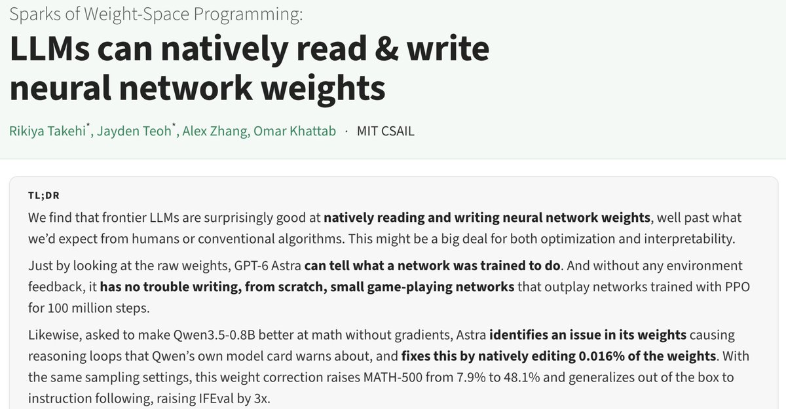
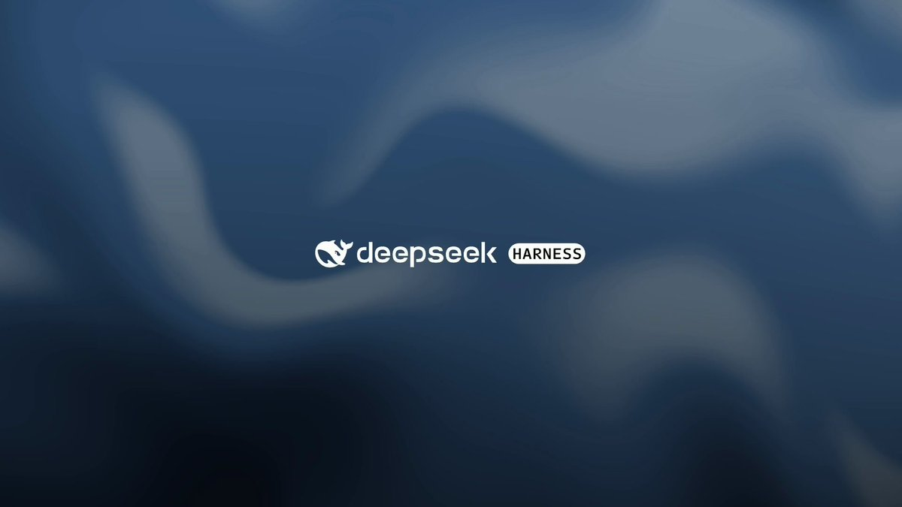
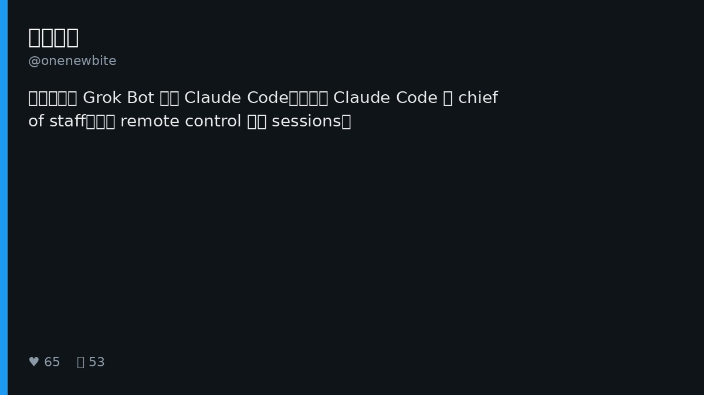
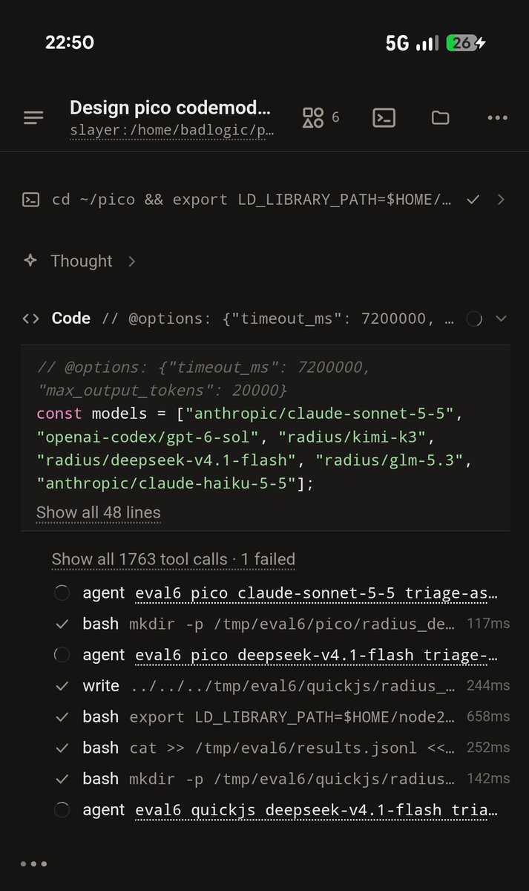
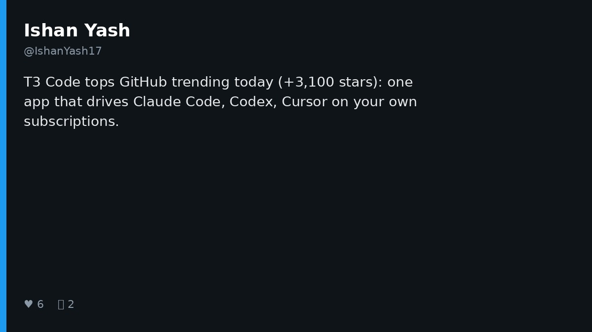
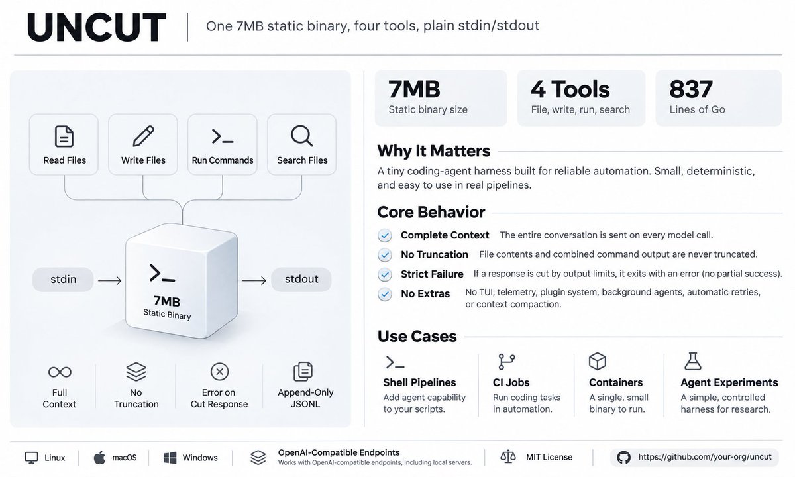
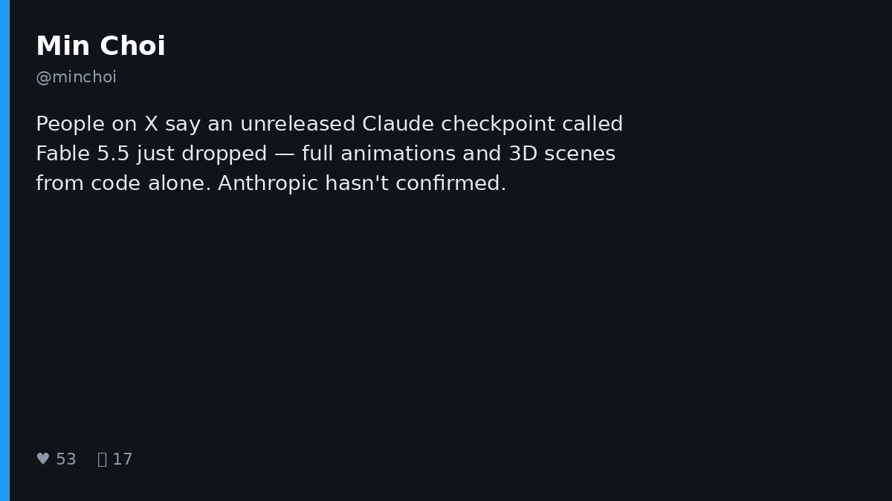
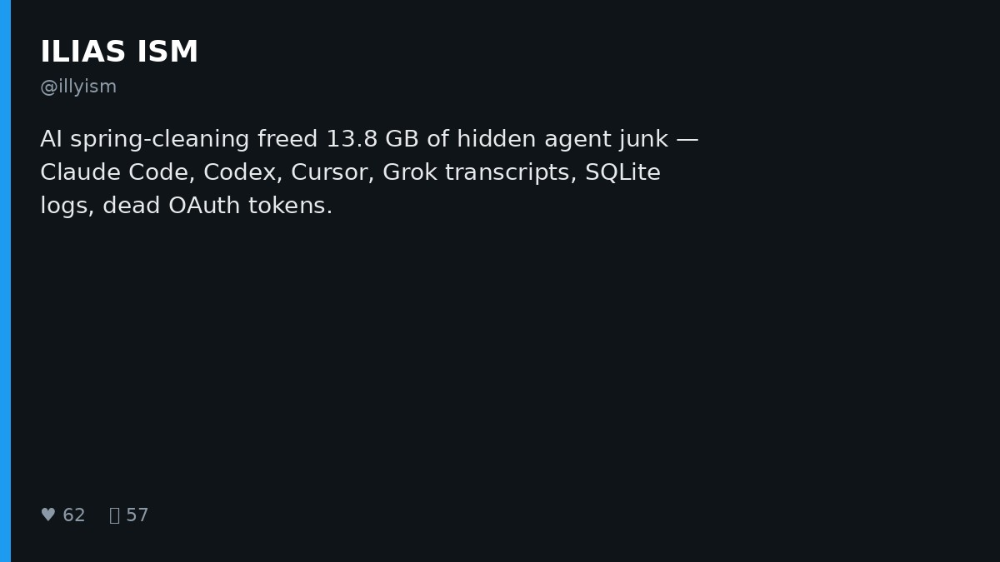

# AI Twitter/X Hots Digest · 2026-11-03 (Tuesday)

## Today's highlights

1. **Models editing models dominate the timeline**: MIT CSAIL-linked discussion pushes **Weight-Space Programming** — GPT-6 Astra reading/writing small-model weights; Neel Nanda and others frame it as scaled-up classic mech-interp, not spooky magic.  
2. **Harnesses keep productizing and going minimal**: DeepSeek Harness ships Creator Mode for user-written plugins; UNCUT hits 500+ stars in a day on "no silent cuts"; Chinese timelines debate Claude Code self-orchestration vs Grok Bot outsourcing.  
3. **Everyday agent friction**: Antigravity's monthly Mission Report, T3 Code / Magpie recirculating, an unconfirmed Fable 5.5 rumor, and a 13.8GB agent disk cleanup.

---

## 1. Weight-Space Programming: Astra edits Qwen weights directly

**Key points**: @rikiyatakehi posts with MIT CSAIL collaborators that **GPT-6 Astra** edited **Qwen3.5-0.8B** weights to improve math: only ~**0.016%** of parameters, no gradient training, fixing reasoning loops, with math up to ~**6×** and instruction following ~**3×**. They call it **Weight-Space Programming** — frontier LLMs natively reading/writing neural net weights. @kimmonismus relays MATH-500 7.9%→48.1%; @NeelNanda5 argues Astra looks surprisingly good at old-school mechanistic interpretability rather than anything spooky, and stays cautious on unlimited scaling.

**Why it matters**: Highest-engagement model-research thread of the day (likes/bookmarks in the tens of thousands). Treat the model as a weight editor — and pair the hype with the blog plus skeptical reads before treating the demo as a training replacement.

- rikiyatakehi: Weight-Space Programming: https://x.com/rikiyatakehi/status/2117313742891327994  
- kimmonismus: relay + quote: https://x.com/kimmonismus/status/2117343192245064004  
- NeelNanda5: mech-interp take: https://x.com/NeelNanda5/status/2117375052618539485

---

## 2. DeepSeek Harness: Creator Mode — turn ideas into plugins

**Key points**: @DeepSeekHarness ships **Creator Mode** — "Your Harness. You Define It." — turning ideas into reusable plugins, from a design workspace and sandbox game to a **3D LLM visualizer**. The video post is extremely high engagement (~17k likes, ~9k bookmarks), extending yesterday's dsh-superagent prototype heat and expanding the harness story from "run tasks" to "user-defined capability surface."

**Why it matters**: Open harness teams are racing for the extensible plugin layer. If Creator Mode really lowers the bar, community remixes accelerate — and the comparison to Claude Code Skills / MCP gets sharper.

- DeepSeekHarness: Creator Mode: https://x.com/DeepSeekHarness/status/2117256196227019194

---

## 3. Claude Code self-orchestration vs Grok Bot: onenewbite's challenge

**Key points**: @onenewbite asks why so many people drive **Claude Code** via **Grok Bot** instead of letting Claude Code orchestrate Claude Code. He says he remote-controls a master session (chief of staff) from phone Claude Code, spinning child sessions in parallel, with multi-account login on mobile. Follow-ups note Claude Code Desktop's native multi-session plus a custom coordination skill, and argue harness plugins are basically customized AI–user interfaces.

**Why it matters**: High-signal Chinese-timeline friction on whether an outer orchestration layer is worth it — Grok Bot's cloud-computer coworker story versus Claude Code's native session tree. The right answer depends on whether you need cross-app agency or full-context local orchestration.

- onenewbite: why not Claude Code controlling Claude Code: https://x.com/onenewbite/status/2117260790109491623  
- onenewbite: native multi-session / skill follow-up: https://x.com/onenewbite/status/2117274206324900231  
- onenewbite: harness plugin direction: https://x.com/onenewbite/status/2117367564787405260

---

## 4. Antigravity: November Mission Report

**Key points**: @antigravity posts this month's **Mission Report** (video) covering product updates and content highlights. Community follow-ups mention changelog themes like Marketplace, built-in browser, and freer attachments, plus case strings (Blender scenes, multilingual calibration, Fortran→Rust). Separate comments "scraping" training rumors from the video are second-hand — keep them distinct from the official report.

**Why it matters**: Google's coding agent keeps mindshare with a monthly narrative; shipped case studies matter more than a one-line changelog for whether it finishes real engineering work.

- antigravity: Mission Report: https://x.com/antigravity/status/2117376966059786330  
- GKev1n: comment-thread summary: https://x.com/GKev1n/status/2117382573773279738

---

## 5. pi: a spare agent builds pico + an eval harness

**Key points**: @badlogicgames keeps showing **pi durable / codemode**: a spare agent writes a tiny language (**pico**, QuickJS/JS vs Armin's djs/TS) and an **eval harness** — tasks different models should complete. Self-described "exceptionally cursed," but the point is clear: harness authors using agents to produce evaluation assets.

**Why it matters**: Not a product launch — a veteran harness practitioner closing the "agent builds agent infra" loop. Read alongside DeepSeek / UNCUT the same day: evals and minimal interfaces are becoming shared ground.

- badlogicgames: spare agent + eval: https://x.com/badlogicgames/status/2117374961061114202  
- badlogicgames: eval harness script: https://x.com/badlogicgames/status/2117375763980697893

---

## 6. T3 Code: GitHub trending surge (not same-day open source)

**Key points**: Multiple posts say **T3 Code** topped GitHub trending (one cites ~+3,100 stars in a day): one desktop/web/phone app driving local **Claude Code / Codex / Cursor** on your own subscriptions. The repo dates to ~**2026-02** with tens of thousands of stars already — today's heat is a **trending recirculation**, not a fresh open-source drop.

**Why it matters**: Demand remains strong for a multi-surface shell that drives local agents on existing subs. Digests should separate new explosions from old-project comebacks and avoid echoing "just open-sourced" framing.

- IshanYash17: trending summary: https://x.com/IshanYash17/status/2117208468654326035

---

## 7. UNCUT: a "lossless" minimal harness clears 500★ in a day

**Key points**: GitHub **Balanov/uncut** (**created_at ~2026-11-01**, MIT) gets dense X write-ups: ~**837 lines of Go**, single ~**7MB** static binary; no TUI/plugins/background agents/auto-retry/context compression; only four tools (read/write/replace/run_command); **No Silent Cuts** — truncation fails loudly instead of silent summarization. @viest_w and @fishjar compare Claude Code / Codex compression, sandboxes, and extension surfaces, framing UNCUT as a control group, not a replacement.

**Why it matters**: In a week of thicker plugin stacks, UNCUT stress-tests transport honesty. Good for CI/containers and people who want to read a whole harness; also a reminder that no compression means long jobs hit context walls.

- viest_w: UNCUT deep dive: https://x.com/viest_w/status/2117271780687778204  
- fishjar: over-encapsulation syndrome: https://x.com/fishjar/status/2117266274950717482

---

## 8. Magpie: local model gateway keeps getting recommended (repo not new)

**Key points**: @0xGky and others keep recommending **yetone/magpie** (MIT; repo ~**2026-09**, not newly open-sourced today): menu-bar one-click model swaps for **Claude Code / Codex / Gemini CLI / OpenCode / Cursor CLI**; a local Gateway for protocol translation so Codex can hit DeepSeek and Claude Code can hit Kimi, plus multi-account quota rotation. Chinese posts stress fewer config edits.

**Why it matters**: Model routing / subscription reuse is still a pain point. Note the repo has existed for months — today's posts are recirculation. Check subscription terms and default credential-reading behavior before installing.

- 0xGky: Magpie as model steward: https://x.com/0xGky/status/2117317818261676409  
- meow2149: daily tool write-up: https://x.com/meow2149/status/2117274566695543129

---

## 9. Fable 5.5: unconfirmed Claude checkpoint rumor

**Key points**: @minchoi roundups a circulating unreleased Claude checkpoint nicknamed **"Fable 5.5"**: full animations and 3D scenes from code alone (no separate image/video model), with same-prompt contrasts vs Opus 5.5, Gemini, and Astra (giraffe gait, open-world RPG, Spider-Verse-style short). The thread notes **Anthropic has not confirmed**.

**Why it matters**: If the visual coding claims hold, demo standards jump overnight — but this is still a second-hand demo chain. Watch-list material, not a ship note.

- minchoi: Fable 5.5 rumor thread: https://x.com/minchoi/status/2117363234957373506

---

## 10. Agent disk spring-cleaning: 13.8GB of hidden junk

**Key points**: @illyism posts an "AI spring-cleaning" on a Mac that freed ~**13.8GB** — tens of thousands of old Grok CLI sessions, thousands of Cursor transcripts, Codex SQLite history, dead Keychain tokens, and editor caches. Includes a pasteable audit + 30-day auto-prune prompt for Cursor / Claude Code.

**Why it matters**: Local agent state is becoming disk and privacy debt. If products keep transcripts forever by default, the ops cost flips from delightful to janitorial — practical reminder for multi-agent users.

- illyism: 13.8GB agent junk: https://x.com/illyism/status/2117103631564689691

---
