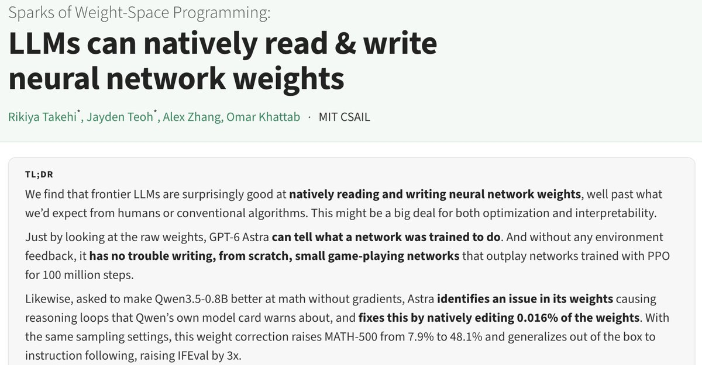
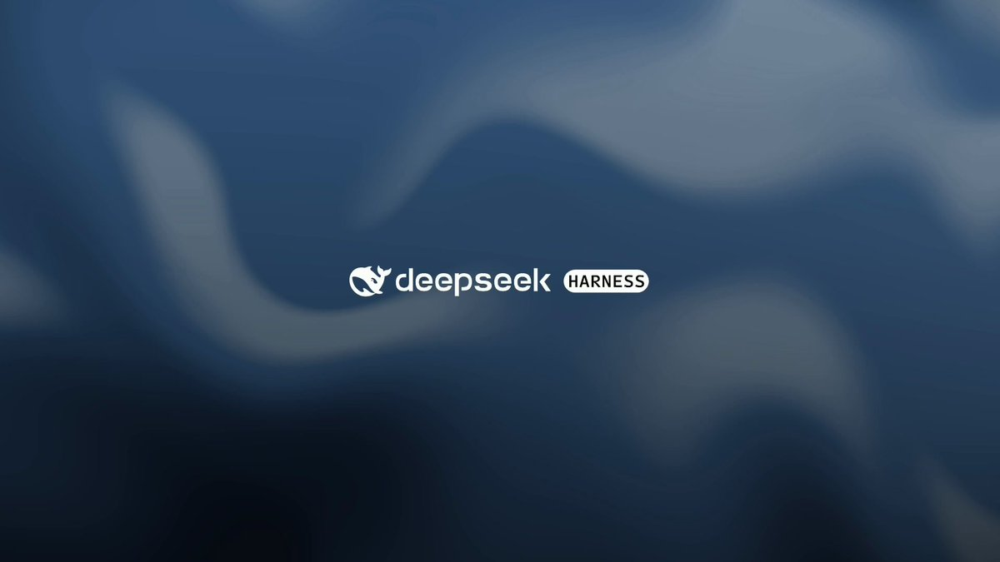
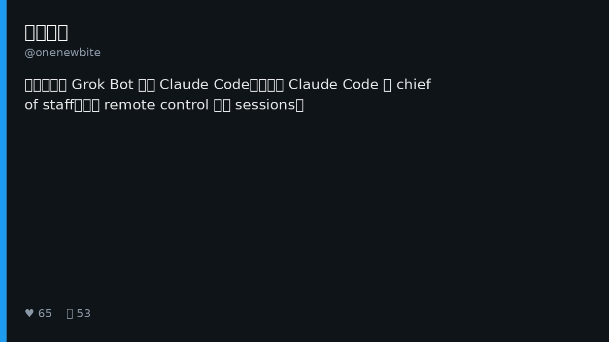
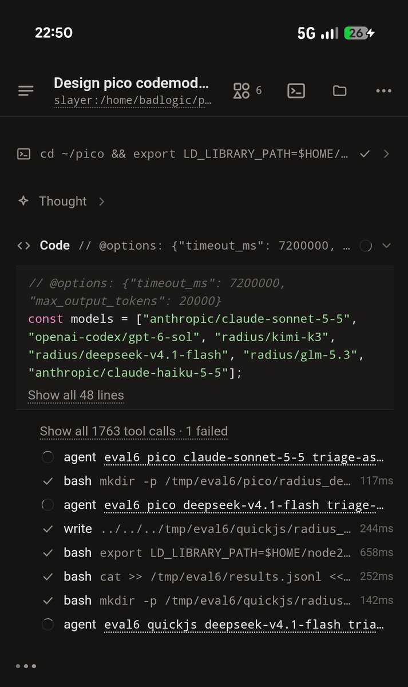
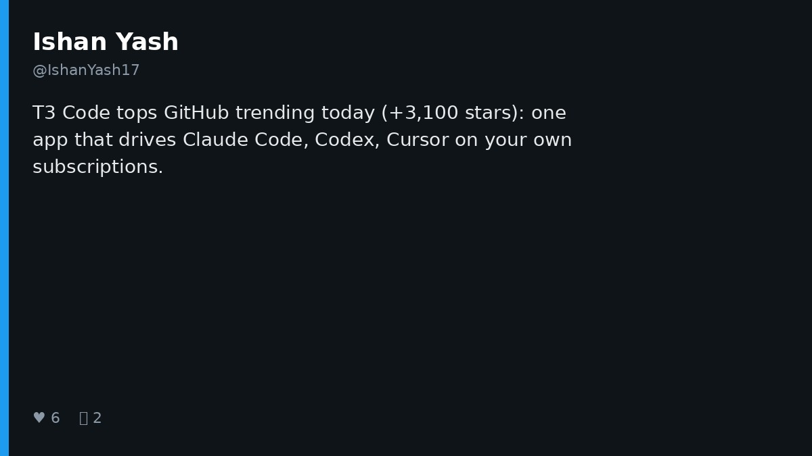
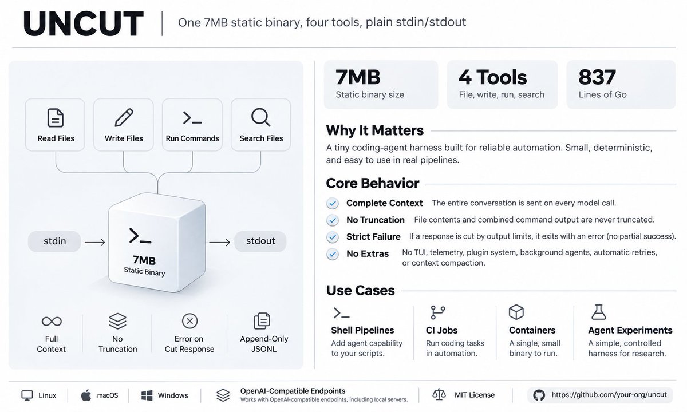
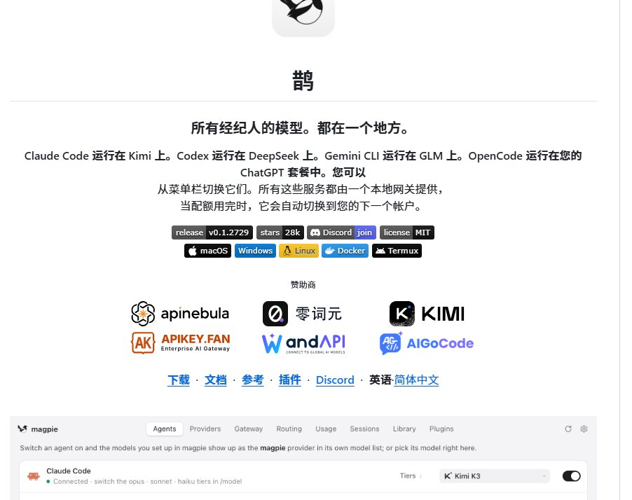
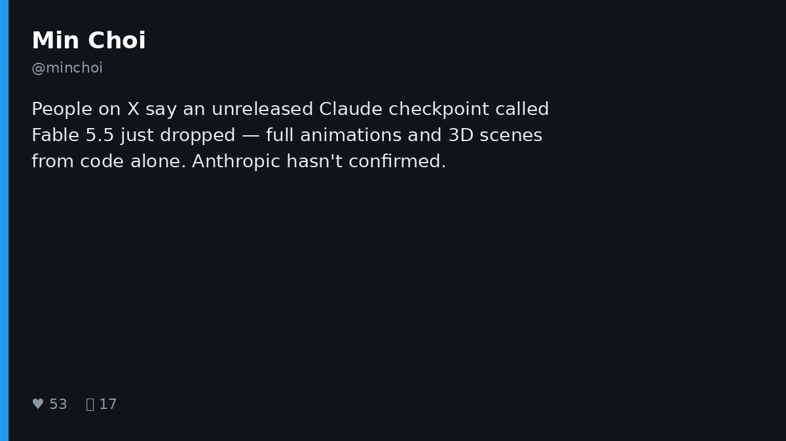
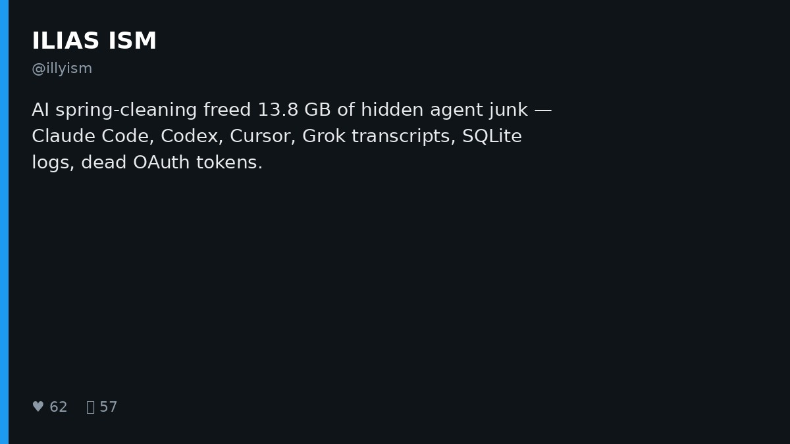

# AI Twitter/X 热点 Digest · 2026-11-03（周二）

## 今日要点

1. **模型改模型冲上热榜**：MIT CSAIL 相关讨论把「Weight-Space Programming」推爆——GPT-6 Astra 直接读写小模型权重；Neel Nanda 等提醒这更像老派 mech-interp 的放大，而非超自然能力。  
2. **Harness 继续产品化与极简对打**：DeepSeek Harness 推 Creator Mode 让用户自写插件；同日 UNCUT 以「零静默截断」极简 harness 一天破五百星；Chinese 圈继续争论 Claude Code 自编排 vs Grok Bot 外包。  
3. **Agent 日常摩擦**：Antigravity 月度 Mission Report、T3 Code / Magpie 再上榜、Fable 5.5 未证实传闻，以及 13.8GB agent 磁盘垃圾大扫除。

---

## 1. Weight-Space Programming：Astra 直接改 Qwen 权重

**要点**：@rikiyatakehi 发帖称与 MIT CSAIL 同事让 **GPT-6 Astra** 编辑 **Qwen3.5-0.8B** 权重以提升数学：只改约 **0.016%** 参数、无梯度训练，修复推理循环，数学最高约 **6×**、指令跟随约 **3×**，并命名为 **Weight-Space Programming**（前沿 LLM 可原生读写神经网络权重）。@kimmonismus 转述 MATH-500 从 7.9%→48.1%；@NeelNanda5 评论更偏向「Astra 擅长做老派 mechanistic interpretability」，对「可无限缩放」持保留。

**为何值得看**：这是过去一天互动量级最高的模型研究帖（赞/藏破万），把「模型当权重编辑器」推到主流时间线；读帖时宜对照作者博客与审慎评论，避免把 demo 直接当成可复现训练替代方案。

- rikiyatakehi：Weight-Space Programming：https://x.com/rikiyatakehi/status/2117313742891327994  
- kimmonismus：转述与引用：https://x.com/kimmonismus/status/2117343192245064004  
- NeelNanda5：mech-interp 视角：https://x.com/NeelNanda5/status/2117375052618539485

---

## 2. DeepSeek Harness：Creator Mode——把想法写成插件

**要点**：@DeepSeekHarness 发布 **Creator Mode**：「Your Harness. You Define It.」——把想法落成可复用插件，示例从设计工作区、沙盒游戏到 **3D LLM visualizer**。视频帖互动极高（点赞约一万七、收藏约九千），延续前一日 dsh-superagent 原型热度，把 harness 叙事从「跑任务」扩到「用户自定义能力面」。

**为何值得看**：开源 harness 团队在抢「可扩展插件层」心智；若 Creator Mode 真能降低插件门槛，社区二次包装会加速，也更容易与 Claude Code Skills / MCP 生态对标。

- DeepSeekHarness：Creator Mode：https://x.com/DeepSeekHarness/status/2117256196227019194

---

## 3. Claude Code 自编排 vs Grok Bot：onenewbite 的质疑

**要点**：@onenewbite 发帖质疑：很多人用 **Grok Bot** 控制 **Claude Code** 干活，为何不直接用 Claude Code 控制 Claude Code？他自称手机 remote control 一个 master session（chief of staff）并行开子 sessions，且手机端支持多账户。跟帖里补充 Claude Code Desktop 原生多 session + 自写协作 skill；另有帖称 harness 插件本质是「定制化 AI 与用户界面」。

**为何值得看**：这是中文圈对「外挂编排层值不值得」的高质量摩擦——一边是 Grok Bot 的云电脑/全权同事叙事，一边是 Claude Code 原生会话树；选择取决于你要的是跨应用代理还是满上下文的本地编排。

- onenewbite：为何不直接用 Claude Code 控制 Claude Code：https://x.com/onenewbite/status/2117260790109491623  
- onenewbite：原生多 session / skill 跟帖：https://x.com/onenewbite/status/2117274206324900231  
- onenewbite：harness 插件方向：https://x.com/onenewbite/status/2117367564787405260

---

## 4. Antigravity：十一月 Mission Report

**要点**：@antigravity 发布本月 **Mission Report**（视频），汇总产品更新与内容亮点。社区跟帖提到 Changelog 方向含 Marketplace、内置浏览器、附件放开，以及案例串（Blender 场景、多语言校准、Fortran→Rust 等）；另有评论从视频里「扒」模型训练传闻，属二手解读，需与官方报告分开看。

**为何值得看**：Google 系 coding agent 用月报维持心智，案例比单点 changelog 更能说明「在真实工程里能不能交活」。

- antigravity：Mission Report：https://x.com/antigravity/status/2117376966059786330  
- GKev1n：评论区摘要：https://x.com/GKev1n/status/2117382573773279738

---

## 5. pi：备用 agent 写出 pico 语言 + eval harness

**要点**：@badlogicgames 继续晒 **pi durable / codemode**：让「闲置」agent 写出一门极小语言（pico，QuickJS/JS 与 Armin 的 djs/TS 对照），并顺手搭 **eval harness**——多任务、多模型应能完成的评测集。自评「exceptionally cursed」，但方向清晰：harness 作者用 agent 生产评测资产。

**为何值得看**：这不是产品发布，而是资深 harness 实践者展示「agent 写 agent 基建」闭环；与 DeepSeek / UNCUT 同日对照，可见评测与极简接口正在变成公共议题。

- badlogicgames：spare agent + eval：https://x.com/badlogicgames/status/2117374961061114202  
- badlogicgames：eval harness 脚本：https://x.com/badlogicgames/status/2117375763980697893

---

## 6. T3 Code：GitHub 趋势再冲高（非同日新开源）

**要点**：多帖称 **T3 Code** 登上 GitHub trending（有帖写单日约 +3100 stars），卖点是一个桌面/Web/手机应用，驱动本机已有的 **Claude Code / Codex / Cursor** 等，走你自己的订阅。仓库本身约 **2026-02** 创建、星数已达四万量级——今日热度是**趋势回流**，不是「刚开源」。

**为何值得看**：说明「多端壳 + 自带订阅驱动本地 agent」仍是强需求；写 digest 时要区分新项目爆发与老项目回潮，避免跟风「刚开源」话术。

- IshanYash17：trending 摘要：https://x.com/IshanYash17/status/2117208468654326035

---

## 7. UNCUT：一天破五百星的「无损」极简 harness

**要点**：GitHub **Balanov/uncut**（**created_at 约 2026-11-01**，MIT）在 X 上被密集解读：约 **837 行 Go**、单文件约 **7MB** 静态二进制；无 TUI/插件/后台 agent/自动重试/上下文压缩；仅 4 工具（read/write/replace/run_command）；主张 **No Silent Cuts**——截断就失败，不偷偷摘要。@viest_w、@fishjar 等长文对比 Claude Code / Codex 的压缩、沙箱与扩展面，强调它是对照组而非替代品。

**为何值得看**：在插件越堆越厚的一周，UNCUT 用「砍掉一切」验证传输层诚实度；适合 CI/容器与想通读 harness 源码的人，也提醒：不压缩 = 长任务迟早撞上下文墙。

- viest_w：UNCUT 长文解读：https://x.com/viest_w/status/2117271780687778204  
- fishjar：过度封装综合征：https://x.com/fishjar/status/2117266274950717482

---

## 8. Magpie：本地模型网关继续被安利（仓库非新）

**要点**：@0xGky 等继续安利 **yetone/magpie**（MIT，仓库约 **2026-09** 创建，非今日新开源）：菜单栏一键给 **Claude Code / Codex / Gemini CLI / OpenCode / Cursor CLI** 换模型；本地 Gateway 做协议转换，可让 Codex 跑 DeepSeek、Claude Code 跑 Kimi，并做多账号额度轮换。中文圈多帖强调「少改 config」。

**为何值得看**：模型路由/订阅复用仍是刚需；注意仓库已存在数月，今日是讨论回流。使用前自行核对订阅条款与凭据默认读取行为。

- 0xGky：Magpie 模型总管：https://x.com/0xGky/status/2117317818261676409  
- meow2149：开发者工具介绍：https://x.com/meow2149/status/2117274566695543129

---

## 9. Fable 5.5：未证实的 Claude 检查点传闻

**要点**：@minchoi 汇总 X 上流传的未发布 Claude 检查点 **「Fable 5.5」** 演示：纯代码生成完整动画与 3D 场景（无单独图像/视频模型），并与 Opus 5.5、Gemini、Astra 等同题对比（长颈鹿 gait、开放世界 RPG、Spider-Verse 风动画等）。帖中明确 **Anthropic 尚未确认**。

**为何值得看**：视觉 coding 能力若属实会立刻改变 demo 标准，但目前仍是二手 demo 链——适合当「关注清单」，不宜写成正式发版。

- minchoi：Fable 5.5 传闻串：https://x.com/minchoi/status/2117363234957373506

---

## 10. Agent 磁盘大扫除：一次清出 13.8GB 隐藏垃圾

**要点**：@illyism 晒 Mac 上「AI spring-cleaning」：一次清出约 **13.8GB**——含上万个旧 Grok CLI session、数千 Cursor transcripts、Codex SQLite 历史、失效 Keychain token 与编辑器缓存等。附上可粘贴给 Cursor / Claude Code 的审计+30 天自动清理提示词。

**为何值得看**：coding agent 的本地状态正在变成磁盘与隐私负债；产品若默认永久留 transcript，运维成本会从「爽」变成「扫垃圾」。实用向，也是对多 agent 并行用户的提醒。

- illyism：13.8GB agent junk：https://x.com/illyism/status/2117103631564689691

---
