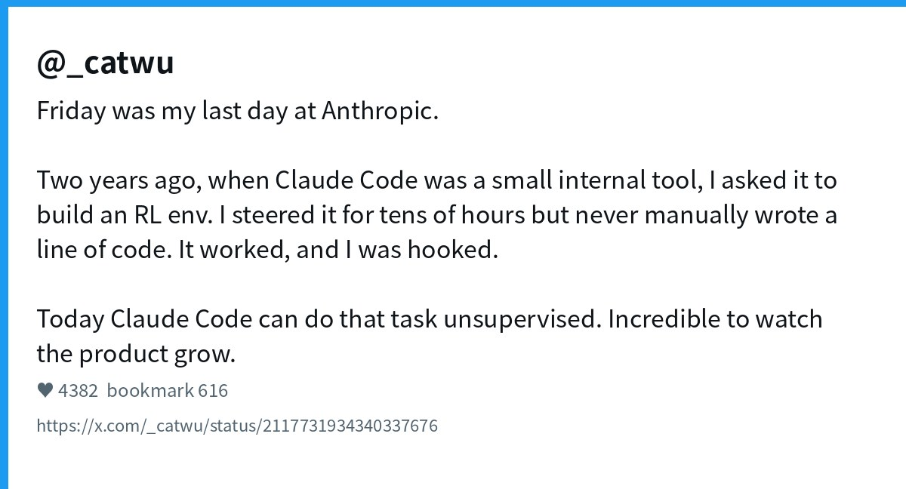
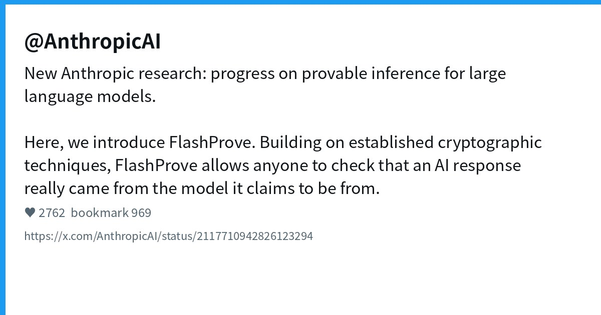
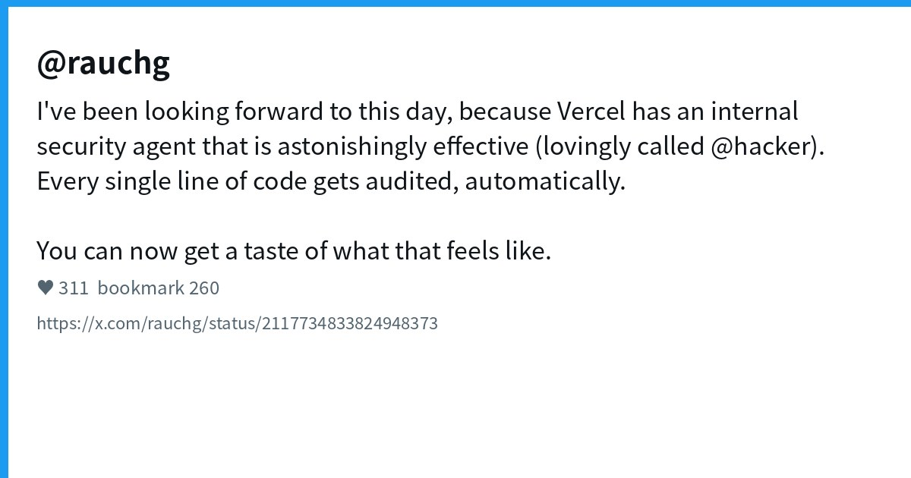
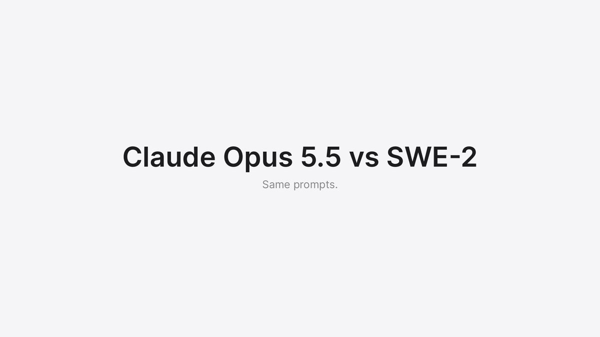
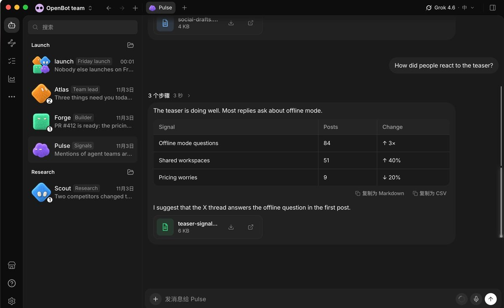
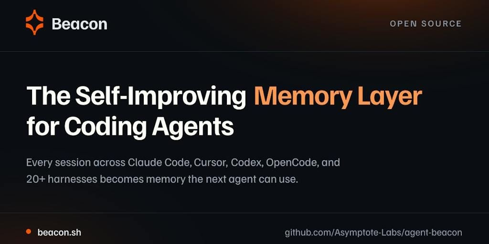
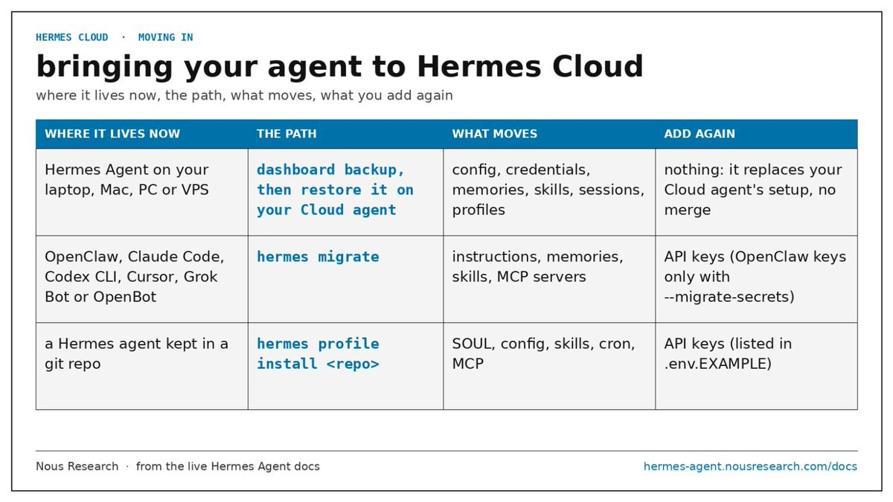
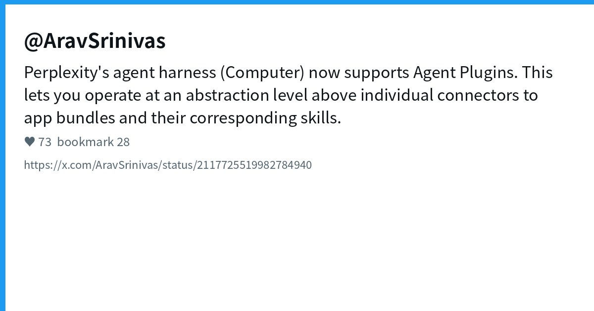
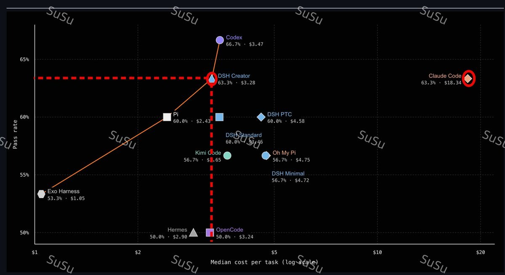

# AI Twitter/X Hots Digest · 2026-11-04 (Wednesday)

## Today's highlights

1. **Claude Code org shock**: Product lead Cat Wu says she has left Anthropic; her join story — steering Claude Code to build an RL env without writing a line by hand — is itself a product demo.  
2. **Provable inference meets agent surfaces**: Anthropic ships FlashProve; Grok Bot pushes phone calls and shopping the same day; Vercel teases its internal security agent @hacker; Devin makes SWE-2 free for a limited window.  
3. **Open harness stack keeps specializing**: openbot, Beacon, Hermes Cloud, Perplexity Agent Plugins, and DeepSeek Harness Creator cost benchmarks show up together — control planes, memory, hosted runtimes, and eval numbers all competing.

---

## 1. Cat Wu leaves Anthropic: Claude Code's product lead signs off

**Key points**: @_catwu posts that Friday was her last day at Anthropic. Two years ago, when Claude Code was a small internal tool, she asked it to build an RL env — she steered for tens of hours and **never manually wrote a line of code**, got hooked, and joined. Today the same task can run unsupervised. Chinese-timeline posts from @dotey and others fill in: she led **Claude Code / Cowork**, previously Scale AI and Dagster, then Index Ventures, joining ~2024-08; last summer she and Boris Cherny briefly left for Cursor and returned within two weeks. No reason or next stop disclosed.

**Why it matters**: A defining product owner exiting a breakout coding agent is news by itself; the "the product recruited me" origin story also explains early Claude Code better than any changelog.

- _catwu: farewell: https://x.com/_catwu/status/2117731934340337676  
- dotey: Chinese background recap: https://x.com/dotey/status/2117739064455463086

---

## 2. Anthropic FlashProve: provenance proofs for model replies

**Key points**: @AnthropicAI announces **FlashProve** — research toward **provable inference**. Built on established cryptography, it lets developers verify whether a given response came from a given AI model. Coverage frames it as a way for anyone to check model attribution of an AI reply. Engagement is very high (~2.7k likes, ~1k bookmarks).

**Why it matters**: Once agents place orders, make calls, and touch production code, "did this actually come from that model?" becomes a compliance and supply-chain question. FlashProve pulls the conversation from leaderboards toward auditability.

- AnthropicAI: FlashProve: https://x.com/AnthropicAI/status/2117710942826123294

---

## 3. Grok Bot: phone calls and shopping heat up the same day

**Key points**: @elonmusk tells people to try asking Grok @Bot to make calls; the official @bot account ships a new shopping experience — find deals, compare items, track orders. @petergyang posts a real call where Bot negotiates with Comcast (including the quotable "I don't actually have eyes on the sky") and lands a cheaper, faster plan; @poteto summarizes the lifestyle pitch as shop / save / ship with @bot.

**Why it matters**: Grok Bot's story is expanding from "cloud coworker that codes" into **voice calls and purchase decisions**. For coding-agent users, whether one subscription covers "call support + edit the repo" changes workflow choice.

- elonmusk: ask Bot to call: https://x.com/elonmusk/status/2117722703738310713  
- bot: shopping experience: https://x.com/bot/status/2117736249444507834  
- petergyang: Comcast negotiation: https://x.com/petergyang/status/2117671678650294437  
- poteto: shop / save / ship: https://x.com/poteto/status/2117745465332846698

---

## 4. Vercel: internal security agent @hacker gets an outward face

**Key points**: @rauchg says Vercel has an "astonishingly effective" internal security agent nicknamed **@hacker** that **audits every line of code automatically**, and that users can now enable similar power on their repos. The same day he plugs `npm i -g ai-cli` — giving any agent video/voice/image/text generation plus `ai decide`, all behind AI Gateway cost and ZDR controls.

**Why it matters**: Platform vendors selling "security agent on every line" signal that the bottleneck after agents write code is **trust and review**. ai-cli fills in a multimodal tool surface for those agents.

- rauchg: @hacker security agent: https://x.com/rauchg/status/2117734833824948373  
- rauchg: ai-cli: https://x.com/rauchg/status/2117719672951095772

---

## 5. Devin: SWE-2 free for all subscriptions through Nov 30

**Key points**: @dabit3 announces **SWE-2** is free in Devin (CLI and Desktop) for all subscriptions until **2026-11-30**, with a demo video. A clear time-boxed promo to put Cognition's stronger coding tier in more hands.

**Why it matters**: Limited free access to a stronger coding tier usually produces a burst of real-repo feedback — useful if you are benchmarking Devin against Claude Code / Codex on your own workloads.

- dabit3: SWE-2 limited free: https://x.com/dabit3/status/2117712332134682680

---

## 6. openbot: open-source "Grok Bot alternative" desktop shell (repo not new)

**Key points**: @Pluvio9yte and others boost **nightly-labs/openbot** — a local-first desktop app that turns on-machine **Codex / Claude Code / Gemini / Grok** coding agents into a persistent, collaborating team while reusing existing subscription logins. GitHub shows **created_at ~2026-08-12** (already thousands of stars) — today's Chinese-timeline heat is **recirculation**, not a same-day open-source drop. Security notes still flag broad host access in a development preview.

**Why it matters**: The demand is clear — keep your subscriptions, add a local collaboration shell. Digests should date the repo so "just launched" framing does not slip through.

- Pluvio9yte: openbot write-up: https://x.com/Pluvio9yte/status/2117661532654051787

---

## 7. Beacon: cross-harness self-improving memory (PH recirculation)

**Key points**: Posts push open-source **Asymptote-Labs/agent-beacon** (beacon.sh): share corrections across **Claude Code / Codex / Cursor / OpenCode** and 20+ harnesses as reusable memory. Repo **created_at ~2026-05-12**, ~3k stars; today's chatter includes Product Hunt-day amplification — **heat recirculation**, not a new repository. @liangzhu_AI frames the pain as "you fix it in Claude Code, Codex makes the same mistake in another window."

**Why it matters**: Once multi-agent / multi-harness is normal, shared memory beats yet another MCP. Still verify local-first claims and default credential/file access.

- liangzhu_AI: Beacon memory layer: https://x.com/liangzhu_AI/status/2117441633671061536  
- binbin_eth: open-source roundup including Beacon: https://x.com/binbin_eth/status/2117450511666287010

---

## 8. Hermes: Cloud hosting plus v0.22.6 stable

**Key points**: @witcheer walks through **Hermes Cloud** — a hosted Hermes Agent on a dedicated instance (own workspace/dashboard), included with new plans; `hermes migrate` aims at Grok Bot / OpenBot setups. @iamlukethedev announces **Hermes v0.22.6** stable: ~**776** merged PRs since 0.22.5 across CLI, Microsoft Store, Docker, and Cloud. NousResearch/hermes-agent itself is a long-running, very high-star project (not created today).

**Why it matters**: Open agents are closing the self-host ↔ one-click cloud gap; migrate messaging aimed at Grok Bot / OpenBot users shows the control-plane fight is now about switching costs.

- witcheer: Hermes Cloud guide: https://x.com/witcheer/status/2117708643407634813  
- iamlukethedev: v0.22.6 stable: https://x.com/iamlukethedev/status/2117567920544854166

---

## 9. Perplexity Computer: Agent Plugins as an open package format

**Key points**: @AravSrinivas says Perplexity's agent harness **Computer** now supports **Agent Plugins** — packaging app connectors and skills above individual tools. @stromdotcom adds iOS/Mac support and describes Agent Plugins as a vendor-neutral open format bundling Agent Skills and MCP servers; browse a catalog or import from GitHub / zip.

**Why it matters**: After MCP / Skills, another portable "plugin pack" layer is competing for mindshare. If packs truly move across agents, harness lock-in loosens.

- AravSrinivas: Computer × Agent Plugins: https://x.com/AravSrinivas/status/2117725519982784940  
- stromdotcom: iOS/Mac support: https://x.com/stromdotcom/status/2117741820352582091

---

## 10. DeepSeek Harness Creator: community benchmarks claim Claude Code parity at ~1/6 cost

**Key points**: @NFT_Chen and others circulate coding-agent benchmark numbers for **DeepSeek Harness Creator**: ~**63.3%** pass rate, matching Claude Code, at ~**$3.28** per task (claimed ~1/6 of Claude Code); vs Codex, about 3.4pp lower pass rate (Codex ~66.7%) but cheaper. This is a **new eval-angle** on yesterday's Creator Mode launch — treat figures as community retellings and chase the original eval write-up before quoting them as official scores.

**Why it matters**: If an open harness truly holds pass-rate parity with an order-of-magnitude cost edge, default team tooling shifts fast — what you need next is a reproducible script, not screenshot wars.

- NFT_Chen: Creator benchmark comparison: https://x.com/NFT_Chen/status/2117603507343696004

---
