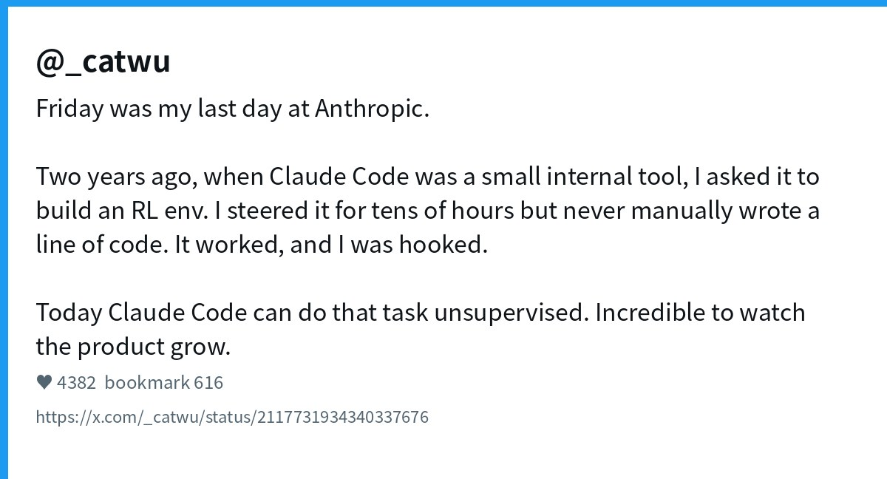
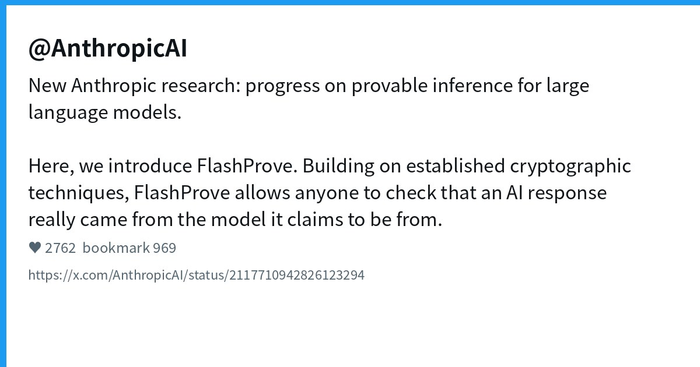
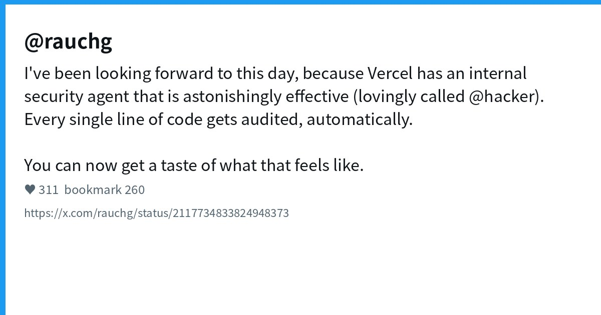
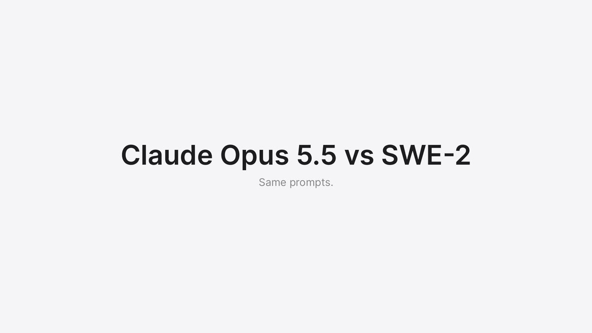
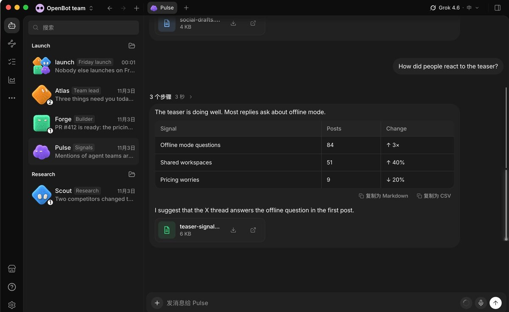
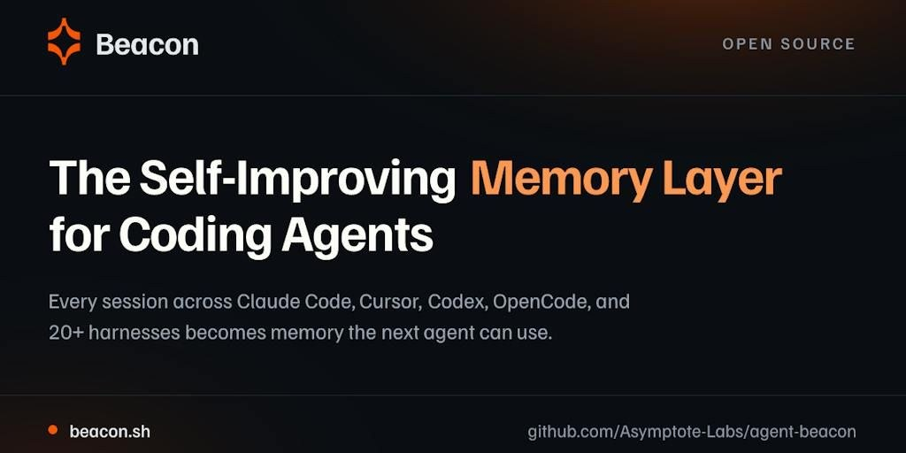
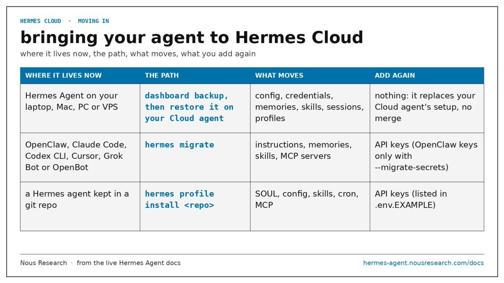
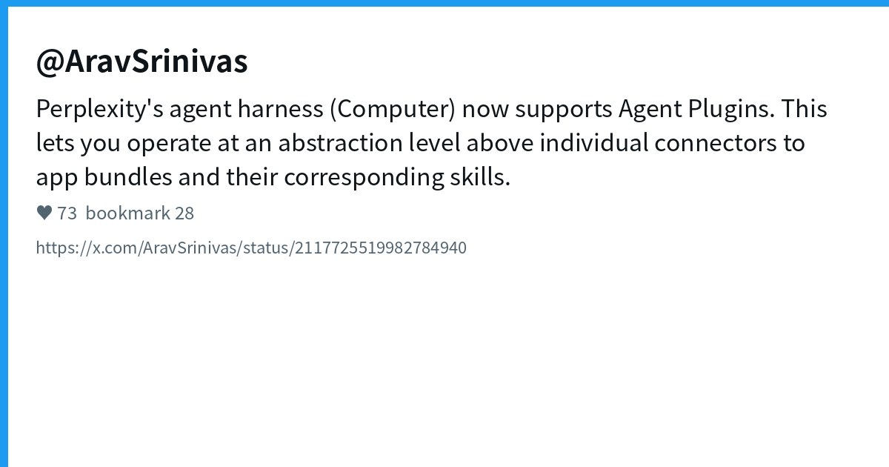
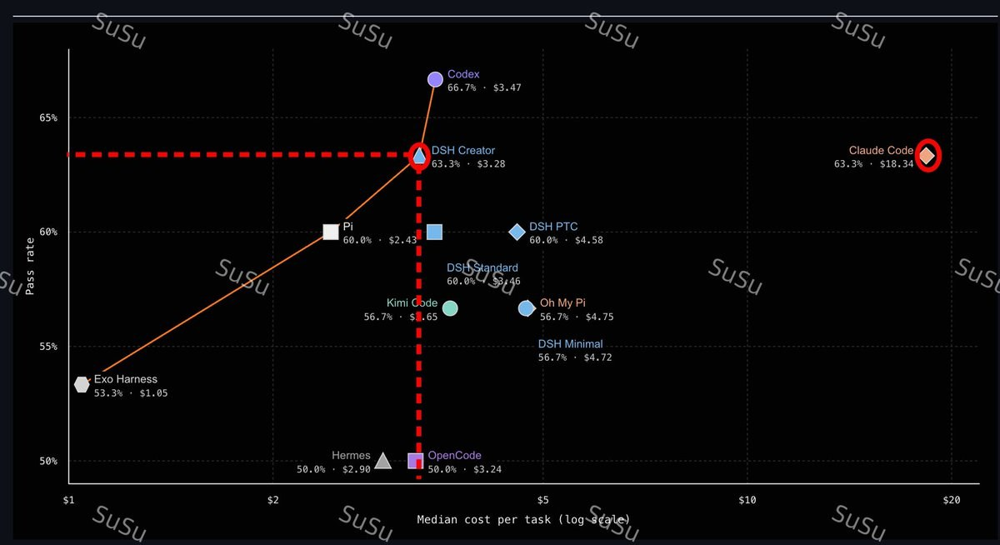

# AI Twitter/X 热点 Digest · 2026-11-04（周三）

## 今日要点

1. **Claude Code 人事地震**：产品负责人 Cat Wu 宣布已离开 Anthropic；她与 Boris 并称「Batman and Robin」，入职故事本身就是早期 Claude Code 能搭 RL 环境、无人手写代码。  
2. **可验证推理与 Agent 产品面同时加速**：Anthropic 发 FlashProve；Grok Bot 同日推电话通话与购物；Vercel 公开内部安全 agent @hacker；Devin 限时免费用 SWE-2。  
3. **开源 harness 生态继续分层**：openbot / Beacon / Hermes Cloud / Perplexity Agent Plugins 与 DeepSeek Harness Creator 成本基准同屏出现——控制面、记忆层、云托管与评测数字一起卷。

---

## 1. Cat Wu 离开 Anthropic：Claude Code 产品负责人告别

**要点**：@_catwu 发帖称周五是她在 Anthropic 的最后一天。两年前 Claude Code 还只是内部小工具时，她让它搭建 RL 环境——自己只做了几十小时引导、**一行代码没手写**，跑通后入伙；如今同一任务已可无人值守完成。中文圈 @dotey 等补背景：她是 **Claude Code / Cowork** 产品负责人，早年 Scale AI、Dagster，后经 Index Ventures，2024-08 加入；去年夏天曾与 Boris Cherny 短暂跳槽 Cursor 又双双回归。离职原因与下一步未公布。

**为何值得看**：现象级 coding agent 的产品灵魂人物离场，本身就是信号；「用产品说服自己入职」的叙事，也比任何 changelog 更能说明 Claude Code 早期到底强在哪。

- _catwu：离职告别：https://x.com/_catwu/status/2117731934340337676  
- dotey：中文背景综述：https://x.com/dotey/status/2117739064455463086

---

## 2. Anthropic FlashProve：给模型回复做「出处证明」

**要点**：@AnthropicAI 发布研究向产品 **FlashProve**：基于既有密码学技术，让开发者验证「这段回复是否真的来自声称的那个模型」。官方强调这是向 **provable inference** 推进的一步；TechCrunch 等转述其定位是让任何人检查 AI 响应的模型归属。帖子互动极高（赞约两千七、藏近千）。

**为何值得看**：Agent 开始代下单、代打电话、代改生产代码之后，「这条输出到底是不是那个模型」会变成合规与供应链问题；FlashProve 把讨论从能力榜拉到可审计性。

- AnthropicAI：FlashProve：https://x.com/AnthropicAI/status/2117710942826123294

---

## 3. Grok Bot：电话通话 + 购物体验同日加热

**要点**：@elonmusk 喊话「试试让 Grok @Bot 打电话」；官方账号 @bot 同期上线新购物体验——找最优价、比商品、追踪订单。@petergyang 放出真实通话视频：Bot 代打 Comcast，自称「看不见天上的天气」，却用竞品报价谈到降价加提速；@poteto 用「shop / save / ship with @bot」概括生活方式叙事。

**为何值得看**：Grok Bot 叙事正从「云电脑同事写代码」扩到 **语音通话与消费决策**；对 coding agent 用户来说，同一订阅是否覆盖「打客服 + 改仓库」会直接影响工作流选型。

- elonmusk：让 Bot 打电话：https://x.com/elonmusk/status/2117722703738310713  
- bot：购物体验：https://x.com/bot/status/2117736249444507834  
- petergyang：Comcast 议价实录：https://x.com/petergyang/status/2117671678650294437  
- poteto：shop / save / ship：https://x.com/poteto/status/2117745465332846698

---

## 4. Vercel：内部安全 agent @hacker 对外开放味道

**要点**：@rauchg 称 Vercel 内部有一个「惊人有效」的安全 agent，昵称 **@hacker**——**每一行代码自动审计**；并表示现在可以把同等能力开到用户仓库上。同日他还安利 `npm i -g ai-cli`：给任意 agent 接上视频/语音/图像/文本生成，以及 `ai decide` 的决策模型，统一走 AI Gateway 的成本与 ZDR 控制。

**为何值得看**：平台厂把「安全 agent 默认扫过每一行」当成可外售能力，说明 agent 写代码的瓶颈正在从生成转向 **信任与审计**；ai-cli 则补上多模态工具面。

- rauchg：@hacker 安全 agent：https://x.com/rauchg/status/2117734833824948373  
- rauchg：ai-cli：https://x.com/rauchg/status/2117719672951095772

---

## 5. Devin：SWE-2 对所有订阅限时免费至 11 月 30 日

**要点**：@dabit3 宣布 **SWE-2** 即日起在 Devin（CLI 与 Desktop）对所有订阅用户 **免费到 2026-11-30**。附视频演示。这是 Cognition 系 agent 在「模型档位 / 评测型号」上的促销与曝光组合拳，时间窗口明确。

**为何值得看**：限时放开更强 coding 档，通常会带来一波真实工作负载反馈；适合正在对比 Devin / Claude Code / Codex 的人趁窗口压测自己的仓库。

- dabit3：SWE-2 限时免费：https://x.com/dabit3/status/2117712332134682680

---

## 6. openbot：开源「Grok Bot 平替」桌面协作层（仓库非新）

**要点**：@Pluvio9yte 等热传 **nightly-labs/openbot**：本地优先桌面 App，把本机 **Codex / Claude Code / Gemini / Grok** 等编程 agent 编成长期在线、可互相协作的团队，并复用已有订阅登录。GitHub 显示仓库 **created_at 约 2026-08-12**（星数已达五千量级）——今日是中文圈高强度安利，**不是「刚开源」**。安全讨论提醒：本地优先意味着对宿主权限较大，仍属开发预览。

**为何值得看**：需求清楚——「不要换订阅，只要一个本地协作壳」；写 digest 时务必标清仓库年龄，避免跟风「一天破星」话术。

- Pluvio9yte：openbot 安利：https://x.com/Pluvio9yte/status/2117661532654051787

---

## 7. Beacon：跨 harness 的自改进记忆层（PH 热度回流）

**要点**：多帖安利开源 **Asymptote-Labs/agent-beacon**（站点 beacon.sh）：在 **Claude Code / Codex / Cursor / OpenCode** 等 20+ harness 之间共享「你纠正过的错」，按规则沉淀成可复用记忆。仓库 **created_at 约 2026-05-12**，星数约三千；今日讨论夹杂 Product Hunt 日榜相关传播，属**热度回流**而非新仓。@liangzhu_AI 用「换窗口又犯同样错」点题。

**为何值得看**：多 agent / 多 harness 并行后，记忆比再堆一个 MCP 更痛；注意核对本地优先承诺与默认读取范围。

- liangzhu_AI：Beacon 记忆层：https://x.com/liangzhu_AI/status/2117441633671061536  
- binbin_eth：开源速览含 Beacon：https://x.com/binbin_eth/status/2117450511666287010

---

## 8. Hermes：Cloud 托管 + v0.22.6 稳定版

**要点**：@witcheer 详解 **Hermes Cloud**：专属实例上的托管 Hermes Agent（独立 workspace / dashboard），付费计划默认附带；支持 `hermes migrate` 从 Grok Bot / OpenBot 迁配置。@iamlukethedev 宣布 **Hermes v0.22.6** 稳定：自 0.22.5 起合并约 **776** 个 PR，覆盖 CLI、Microsoft Store、Docker 与 Cloud。NousResearch/hermes-agent 本身已是超高星项目（非今日新建）。

**为何值得看**：开源 agent 正在补齐「自托管 ↔ 一键云」迁移路径；migrate 话术直接瞄准 Grok Bot / OpenBot 用户，说明控制面竞争进入抢存量阶段。

- witcheer：Hermes Cloud 指南：https://x.com/witcheer/status/2117708643407634813  
- iamlukethedev：v0.22.6 稳定：https://x.com/iamlukethedev/status/2117567920544854166

---

## 9. Perplexity Computer：Agent Plugins 开放标准

**要点**：@AravSrinivas 宣布 Perplexity 的 agent harness **Computer** 支持 **Agent Plugins**：在单个 connector 之上，把应用连接与 skills 打成可复用插件包。@stromdotcom 补充 iOS / Mac 亦支持，并称 Agent Plugins 是厂商中立开放格式（统一 Agent Skills 与 MCP server 打包）；可浏览目录或从 GitHub / zip 导入。

**为何值得看**：继 MCP / Skills 之后，又一层「可移植插件包」标准在抢心智；若真能跨 agent 复用，harness 锁定会松一截。

- AravSrinivas：Computer × Agent Plugins：https://x.com/AravSrinivas/status/2117725519982784940  
- stromdotcom：iOS/Mac 支持：https://x.com/stromdotcom/status/2117741820352582091

---

## 10. DeepSeek Harness Creator：社区基准称打平 Claude Code、成本约 1/6

**要点**：@NFT_Chen 等转述代码 Agent 基准：**DeepSeek Harness Creator** 通过率约 **63.3%**，与 Claude Code 持平，单任务成本约 **$3.28**（称约为 Claude Code 的 1/6）；对比 Codex 通过率约差 3.4%（Codex ~66.7%）但更便宜。这是对昨日 Creator Mode 发布的**评测向新角度**——数字来自社区转述，读帖时宜回溯原始评测说明，不宜直接写成官方成绩单。

**为何值得看**：开源 harness 若在「通过率持平 + 成本数量级优势」上站得住，会立刻改变团队的默认选型；需要的是可复现脚本，而不是截图战争。

- NFT_Chen：Creator 基准对比：https://x.com/NFT_Chen/status/2117603507343696004

---
