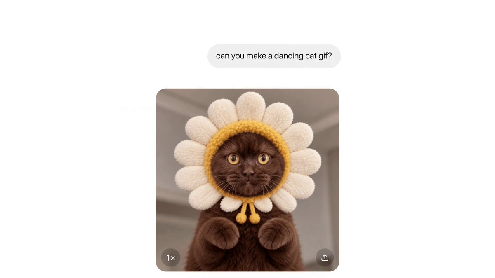
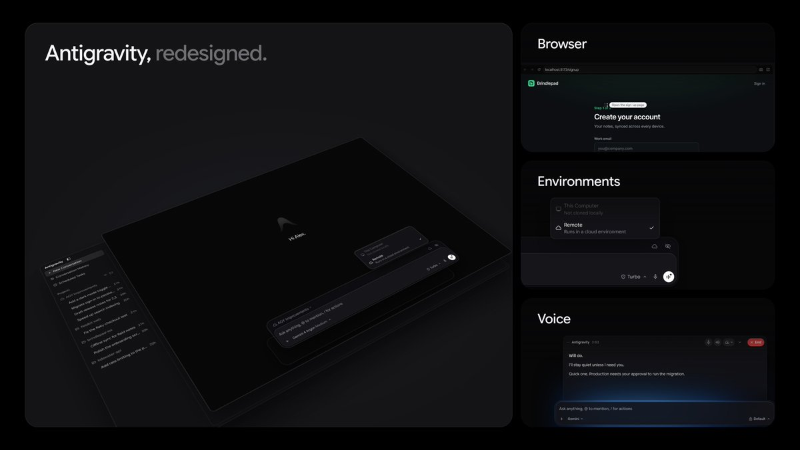
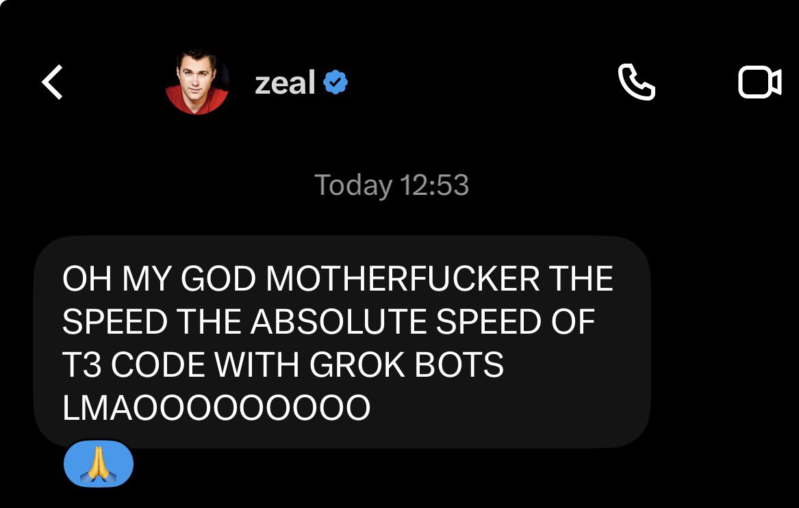
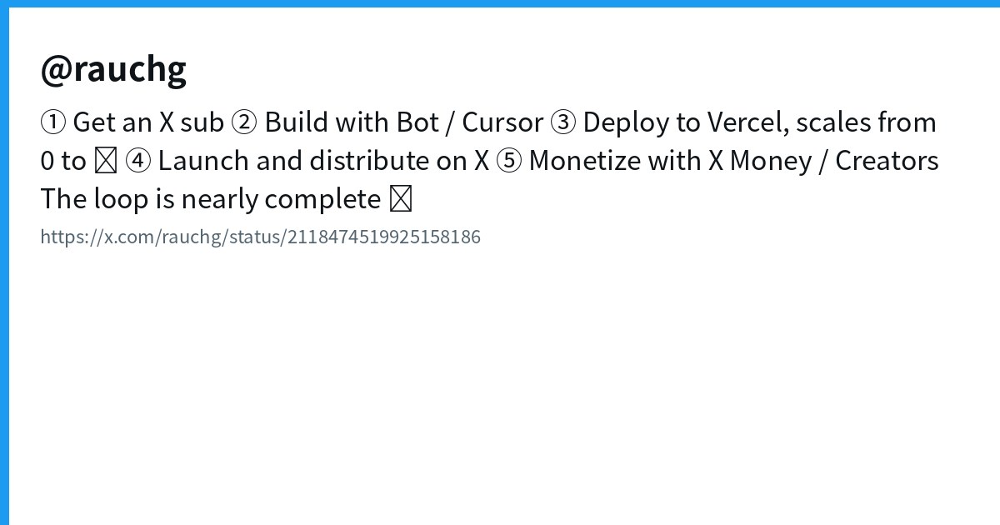
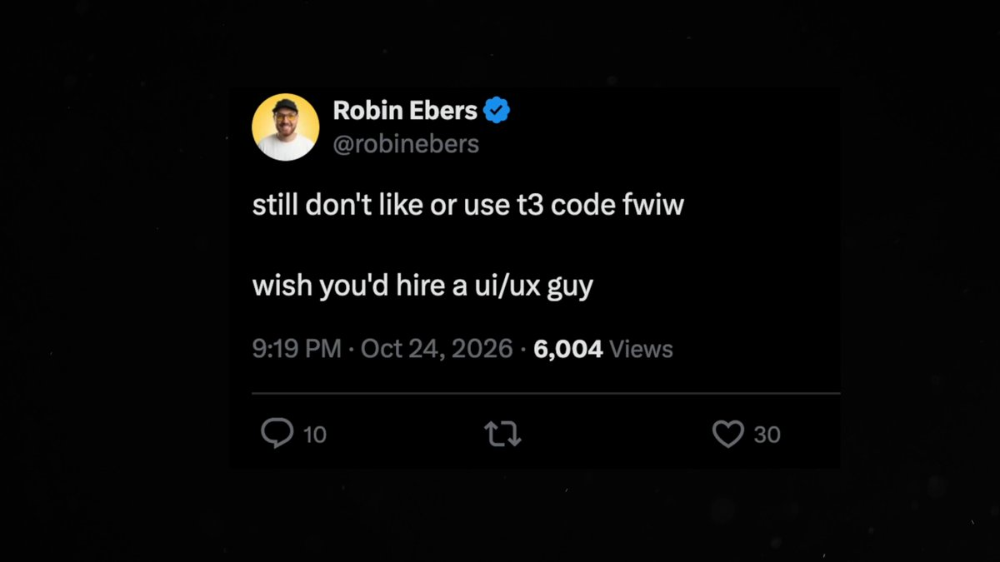
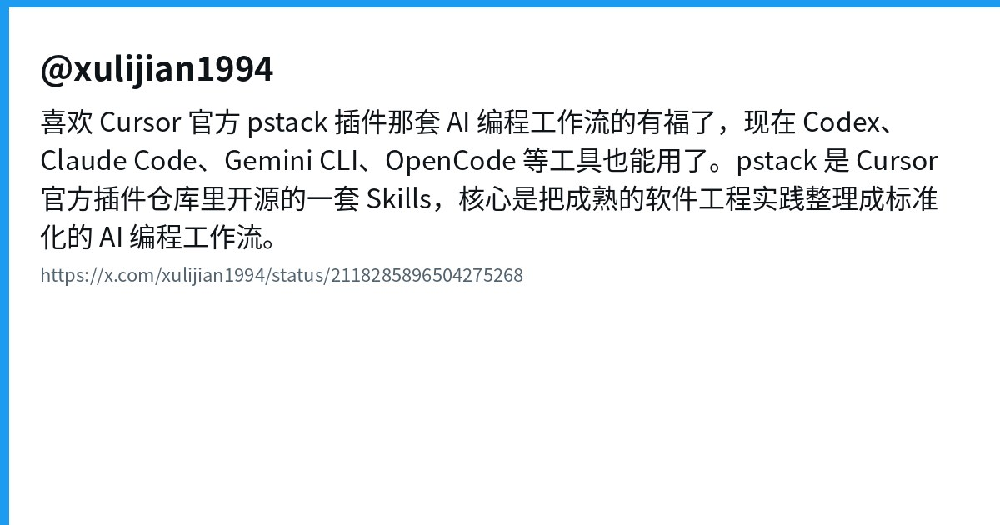
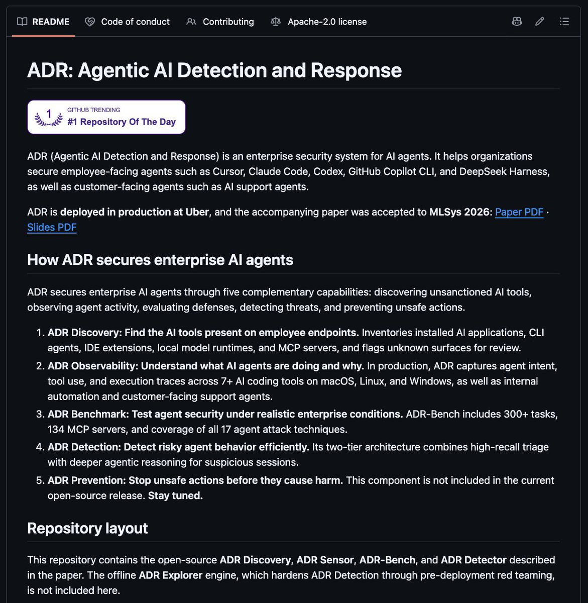
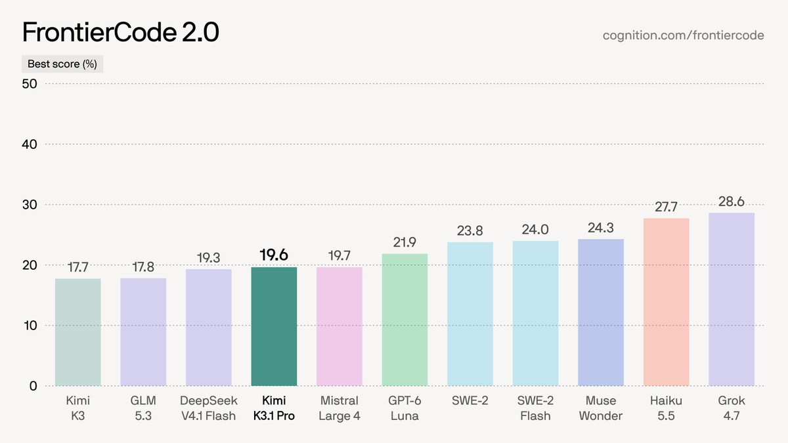
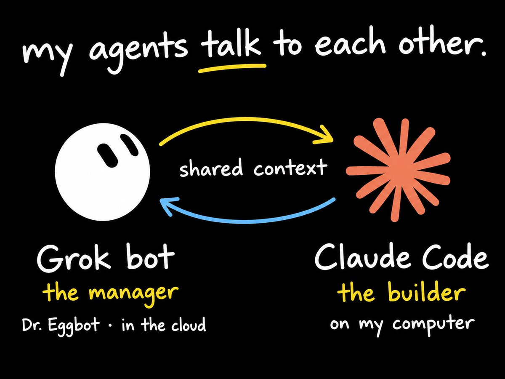

# AI Twitter/X Hots Digest · 2026-11-06 (Friday)

## Today's highlights

1. **Multi-agent orchestration gets acquired**: Conductor founder Charlie Holtz announces a join with Meta MSL — the product is literally about running Claude Code / Codex / Cursor / OpenCode in parallel.  
2. **Images share the coding pipe**: OpenAI Images 2.6 lands in ChatGPT **and Codex**, with Flare/Sunburst in the API; the same day, OpenAI folks cite 4B+ images generated per week.  
3. **Control planes keep specializing**: Antigravity redesigns, T3 Code × Grok Bot goes viral, Vercel narrates Bot/Cursor → deploy → X Money; pstack Skills and Uber ADR push engineering playbooks and enterprise observability into the open layer.

---

## 1. Meta acquires Conductor: multi-agent orchestration enters MSL

**Key points**: @charlieholtz posts that **Conductor is joining Meta**, and the team will build the "next interface" with @natfriedman and @alexandr_wang at **MSL (Meta Superintelligence Labs)** — ending with a choo-choo. Conductor orchestrates multiple coding agents (Claude Code / Codex / Cursor / OpenCode, etc.). Techmeme / Axios-facing summaries say cloud service winds down around **Nov 20**, with a new Meta-era product teased for early next year; deal terms undisclosed.

**Why it matters**: Big Tech is buying the shell that lets one human run a fleet of agents — competition is sliding from model tiers toward **multi-agent throughput and interface**.

- charlieholtz: Conductor joins Meta: https://x.com/charlieholtz/status/2118045232218743264  
- Techmeme: Axios-linked summary: https://x.com/Techmeme/status/2118053513859346809

---

## 2. OpenAI Images 2.6: native GIFs + Flare/Sunburst, shipping inside Codex

**Key points**: @OpenAI introduces **ChatGPT Images 2.6** — prompt or photo to **GIF**, with speed and per-frame edits, plus reusable reference images. API gets **GPT-Image-2.6 Flare** (as fast as ~6s) and **Sunburst** (higher quality / edit consistency), claiming ~50% faster generation. Official follow-up: available in **ChatGPT and Codex across all tiers** (web, desktop, mobile). @thsottiaux adds the scale stat: **>4B images/week** across ChatGPT + API (up from >3B eight weeks ago), i.e. 500M+/day.

**Why it matters**: Putting image gen directly on **Codex** means diagrams, motion demos, and product shots live inside the coding-agent path; the 4B/week figure turns images into infrastructure, not a side toy.

- OpenAI: Images 2.6 launch: https://x.com/OpenAI/status/2118124944928432327  
- OpenAI: ChatGPT + Codex availability: https://x.com/OpenAI/status/2118124966055223755  
- thsottiaux: 4B images/week: https://x.com/thsottiaux/status/2118469621011677521

---

## 3. Antigravity: official UI redesign, more updates "in a couple hours"

**Key points**: @antigravity posts a new look-and-feel and asks for feedback; @_mohansolo says the app was redesigned to feel sleeker, with **more coming in a couple of hours**. This is an explicit client-surface iteration for Google's coding-agent stack (community briefs also mentioned Voice Mode / Remote Agents — treat those as secondary to the official redesign posts).

**Why it matters**: As model gaps narrow, **shell feel** drives daily use; showing a redesign on the public timeline signals Antigravity is competing as a productized IDE, not only a model wrapper.

- antigravity: new interface: https://x.com/antigravity/status/2118477081130512577  
- _mohansolo: redesign + teaser: https://x.com/_mohansolo/status/2118478787566588009

---

## 4. T3 Code × Grok Bot goes mainstream; Antigravity recognizes t3-code

**Key points**: @theo says the **T3 Code × Grok Bot** combo is "breaking a lot of brains," with a screenshot of multi-agent control in one shell. The sharper engineering signal is @PatrickToulme: he landed **t3-code** as a recognized client in Antigravity's **ACP server**, so upcoming T3 releases will attribute traffic correctly (vs older workarounds that impersonated Zed). A PR to @t3dotcodes is mentioned.

**Why it matters**: A unified control plane only works if peers **formally recognize** the client — ACP allowlisting is closer to platformization than another promo thread.

- theo: T3 Code × Grok Bot: https://x.com/theo/status/2118472567128563862  
- PatrickToulme: Antigravity recognizes t3-code: https://x.com/PatrickToulme/status/2118100376637321436

---

## 5. Vercel / rauchg: Bot + Cursor → deploy → X Money as one loop

**Key points**: @rauchg sketches a five-step loop: X subscription → build with **Bot / Cursor** → deploy on **Vercel** → distribute on X → monetize with **X Money / Creators**, saying the loop is nearly complete. Same day: **SpaceXSI 🤝 Vercel** — Grok and Cursor can build, deploy, and scale. Social distribution, coding agents, and edge deploy are sold as one growth story.

**Why it matters**: This is less a feature drop than a bid to own the **default path from idea to payout**; indie builders may start picking tools by how few breaks they put in that ring.

- rauchg: Bot/Cursor → Vercel → X Money: https://x.com/rauchg/status/2118474519925158186  
- rauchg: SpaceXSI × Vercel: https://x.com/rauchg/status/2118464177211940997

---

## 6. theo: agents get good at UI if you burn enough tokens

**Key points**: @theo posts a video: you can make agents good at UI if you burn enough tokens — and asks whether it helped other devs. Engagement is very high (500+ likes, 300+ bookmarks). The claim is about **workflow and budget**, not a new model: UI quality can be stacked via longer try–screenshot–fix loops.

**Why it matters**: It contradicts one-shot perfection marketing and surfaces the real cost of handing frontend to agents — useful signal when comparing Claude Code / Cursor / Codex.

- theo: agents good at UI: https://x.com/theo/status/2118465321032106235

---

## 7. pstack: Cursor's official Skills workflows expand to Codex / Claude Code / OpenCode

**Key points**: @xulijian1994 says fans of Cursor's official **pstack** Skills workflows can now use them with **Codex, Claude Code, Gemini CLI, OpenCode**, and more. pstack packages mature software-engineering practice into a standardized AI coding workflow so agents do more than emit code. Same-day community adaptations (e.g. new Codex-oriented pstack ports) read as **playbook portability across hosts**, not another completion model.

**Why it matters**: Once Skills/methodologies travel, moats move from "one IDE plugin" to **reusable engineering scripts** — which is why people running many CLIs still feel process-bound.

- xulijian1994: pstack cross-tool: https://x.com/xulijian1994/status/2118285896504275268

---

## 8. Uber ADR: detection & response for enterprise AI agents (repo not new)

**Key points**: @thisguyknowsai amplifies Uber's open-source **ADR (Agentic AI Detection and Response)** — inventory which AI tools sit on employee laptops, reconstruct what an agent did, and test defenses beyond toy attacks. GitHub **uber/ADR** shows **created_at ~2026-04-19** and 2k+ stars — today's wave is explanatory recirculation, **not a fresh open-source drop**.

**Why it matters**: While individuals polish harness UX, enterprises treat "which agents ran, and what did they do?" as a security product; observability will show up on procurement checklists for coding agents.

- thisguyknowsai: Uber ADR explainer: https://x.com/thisguyknowsai/status/2118281908698374374

---

## 9. Devin adds Kimi K3.1 Pro; FrontierCode 2.0 scores tick up

**Key points**: @devindevelopers announces **Kimi K3.1 Pro** in **Devin Desktop and Devin CLI**. On **FrontierCode 2.0**, max effort scores **19.6** (above Kimi K3's best 17.7); high effort lands at 17.3 (just under K3's 17.7). Same agent shell, stronger open-weight tier.

**Why it matters**: Devin keeps routing third-party frontier weights through its runtime — buyers compare **shell + routing + eval protocol**, not only one closed-model subscription.

- devindevelopers: Kimi K3.1 Pro on Devin: https://x.com/devindevelopers/status/2118470573474861410

---

## 10. Grok Bot quotas bite: community default is Bot plans, Claude Code builds, Codex reviews

**Key points**: Threads cluster around Grok Bot cost/limits. @notbradyy recounts cycling through seven agents in six months and settling on **Claude Code talking to Grok Bot**; @kylon_ai and others push a split: **Grok Bot plans → Claude Code builds → Codex reviews**, each burning its own subscription. Japanese posts (e.g. @tetumemo) describe driving local Codex / Claude Code from Grok Bot for diagrams and short video. Quota pressure is forcing **role-specialized multi-engine setups**, not a single product launch.

**Why it matters**: When the "one do-everything Bot" hits a cost wall, the market grows an orchestration layer — the same demand behind Conductor's Meta deal and T3's unified shell.

- notbradyy: Claude Code × Grok Bot: https://x.com/notbradyy/status/2118062621152698507  
- kylon_ai: three-role workspace: https://x.com/kylon_ai/status/2118010410120994903

---
