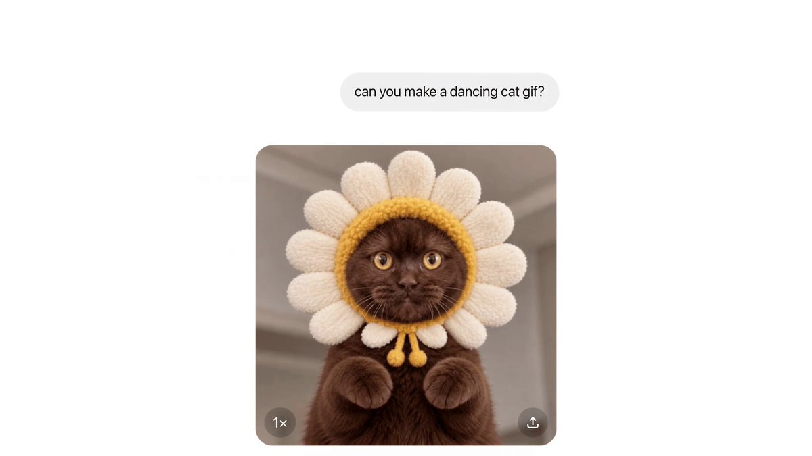
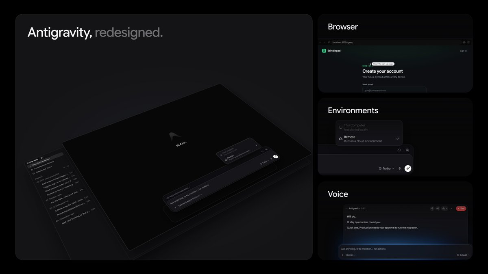
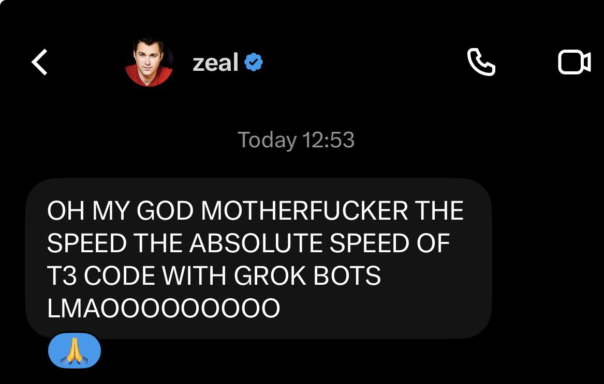
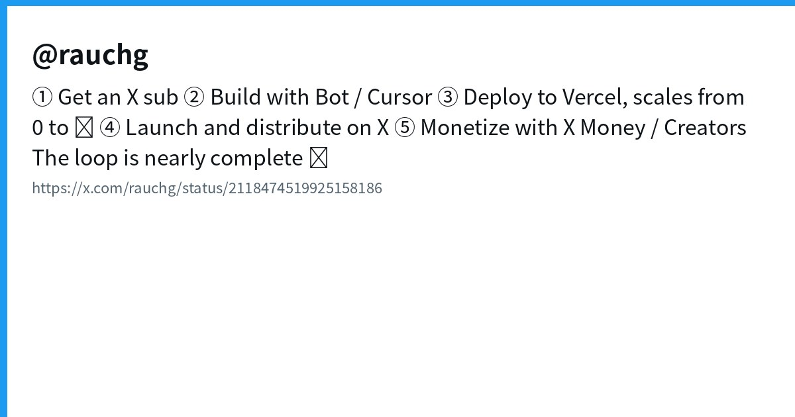
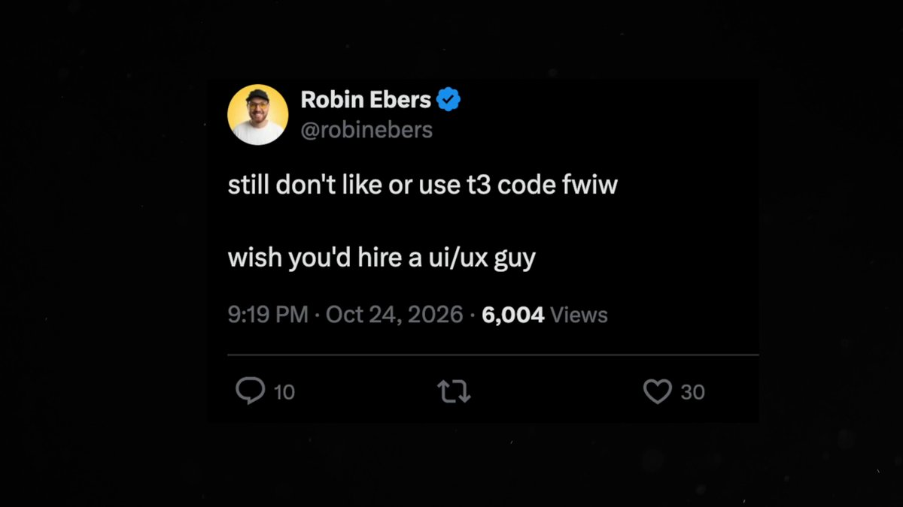
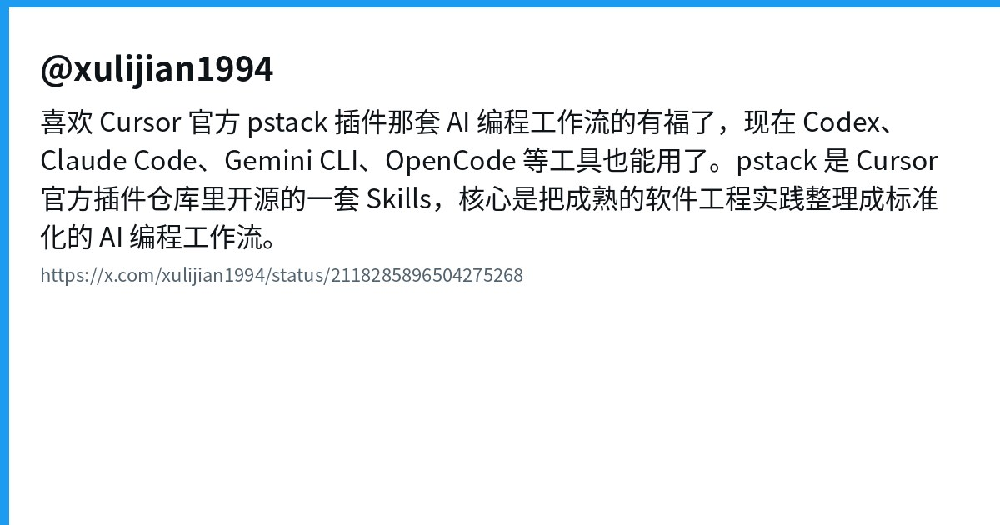
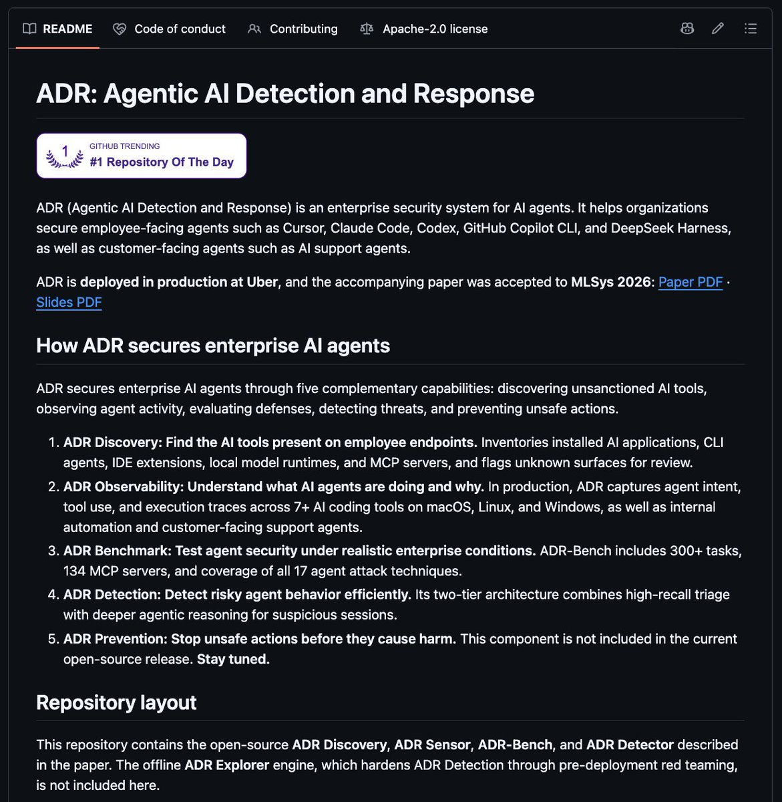
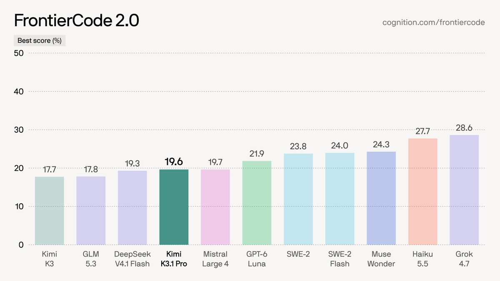
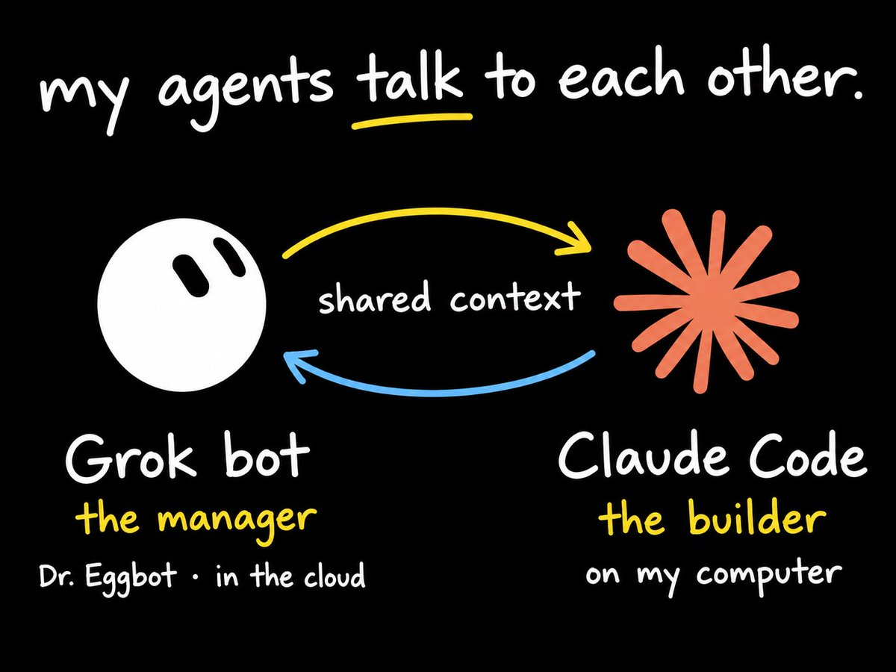

# AI Twitter/X 热点 Digest · 2026-11-06（周五）

## 今日要点

1. **多 agent 编排被大厂收编**：Conductor 创始人 Charlie Holtz 官宣加入 Meta MSL；产品定位就是并行管理 Claude Code / Codex / Cursor / OpenCode。  
2. **图像与 coding 共用同一条管道**：OpenAI Images 2.6 进 ChatGPT **与 Codex**，Flare/Sunburst 进 API；同日官方晒出每周超 40 亿张图像的吞吐数字。  
3. **控制面继续分层**：Antigravity 换皮、T3 Code × Grok Bot 出圈、Vercel 把 Bot/Cursor→部署→X Money 串成闭环；pstack Skills 与 Uber ADR 则分别把「工程流程」和「企业侧观测」往开源层推。

---

## 1. Meta 收购 Conductor：多 agent 编排进超级智能实验室

**要点**：@charlieholtz 发长帖宣布 **Conductor 加入 Meta**，团队将与 @natfriedman、@alexandr_wang 在 **MSL（Meta Superintelligence Labs）** 一起做「下一代界面」；感谢早期投资人并喊出 choo choo。Conductor 定位是并行管理多个 coding agent（Claude Code / Codex / Cursor / OpenCode 等）。Techmeme / 中文圈转述：Axios 报道收购，**云服务约 11 月 20 日关停**，创始人暗示明年年初会有新产品——交易条款未公开。

**为何值得看**：大厂买的不是又一个补全插件，而是「一个人同时带一队 agent」的编排壳；说明竞争正从模型档位移到 **多 agent 吞吐与界面**。

- charlieholtz：Conductor 加入 Meta：https://x.com/charlieholtz/status/2118045232218743264  
- Techmeme：Axios 报道摘要：https://x.com/Techmeme/status/2118053513859346809

---

## 2. OpenAI Images 2.6：原生 GIF + Flare/Sunburst，已进 Codex

**要点**：@OpenAI 发布 **ChatGPT Images 2.6**：提示词或照片一键出 **GIF**、可调速度与逐帧编辑，并支持参考图复用；API 侧推出 **GPT-Image-2.6 Flare**（可低至约 6 秒）与 **Sunburst**（更高质量与编辑一致性），宣称生成约快 50%。官方明确：**ChatGPT 与 Codex 全档位**（web/桌面/移动）可用。@thsottiaux 补充吞吐：**ChatGPT + API 每周生成超 40 亿张图像**（约八周前还是 30 亿+），折合约每天 5 亿+。

**为何值得看**：图像能力直接挂进 **Codex**，意味着 coding agent 工作流里的示意图、动效 demo、产品图不再是旁路工具；「每周 40 亿」也把图像从玩具指标拉成基础设施数字。

- OpenAI：Images 2.6 发布：https://x.com/OpenAI/status/2118124944928432327  
- OpenAI：ChatGPT + Codex 全档可用：https://x.com/OpenAI/status/2118124966055223755  
- thsottiaux：每周 40 亿张：https://x.com/thsottiaux/status/2118469621011677521

---

## 3. Antigravity：官方换新界面，更多更新预告「几小时后」

**要点**：@antigravity 放出新 UI 截图，请用户反馈观感；@_mohansolo 同步称应用已重做得更简洁顺手，并预告 **几小时内还有更多更新**。这是 Google 系 coding agent 客户端在视觉与交互层的一次显式迭代（此前社区也有 v2.29 Voice Mode / Remote Agents 等传闻向汇总，宜以官方帖为准）。

**为何值得看**：当模型差距缩小时，**壳的手感**会直接决定日活；Antigravity 选在公开时间线秀 redesign，说明它把「看起来像成熟 IDE」当成产品战役。

- antigravity：新界面：https://x.com/antigravity/status/2118477081130512577  
- _mohansolo：重设计与后续预告：https://x.com/_mohansolo/status/2118478787566588009

---

## 4. T3 Code × Grok Bot：组合出圈，Antigravity 认 t3-code 客户端

**要点**：@theo 称 **T3 Code × Grok Bot** 组合「弄坏了很多人的脑子」，配图展示统一壳里调度多 agent。更硬的工程信号来自 @PatrickToulme：他已在 Antigravity 的 **ACP server** 内部把 **t3-code** 登记为正式客户端；待 T3 发新版后，流量会正确归因到 T3 Code（此前社区流传需伪装成 Zed 才能吃到部分模型）。并已向 @t3dotcodes 提 PR。

**为何值得看**：统一控制面要「真能接上各家 agent」，关键不只是 UI，而是 **被对端正式识别**；ACP 白名单这一步，比再发一条安利帖更接近平台化。

- theo：T3 Code × Grok Bot：https://x.com/theo/status/2118472567128563862  
- PatrickToulme：Antigravity 认 t3-code：https://x.com/PatrickToulme/status/2118100376637321436

---

## 5. Vercel / rauchg：Bot + Cursor → 部署 → X Money 的闭环叙事

**要点**：@rauchg 画出五步闭环：开 X 订阅 → 用 **Bot / Cursor** 构建 → 部署到 **Vercel** → 在 X 分发 → 用 **X Money / Creators** 变现，并称「环快闭合了」。同日另帖 **SpaceXSI 🤝 Vercel**：Grok 与 Cursor 现可直接构建、部署与扩缩。把社交分发、coding agent 与边缘部署绑成同一条增长故事。

**为何值得看**：这不是单个功能发布，而是平台厂在抢 **「从想法到收款」的默认路径**；对独立开发者，选型标准会从「谁补全更准」变成「谁少打断这条环」。

- rauchg：Bot/Cursor → Vercel → X Money：https://x.com/rauchg/status/2118474519925158186  
- rauchg：SpaceXSI × Vercel：https://x.com/rauchg/status/2118464177211940997

---

## 6. theo：把 agent 练到会做 UI，靠的是烧足够多 token

**要点**：@theo 发视频称「只要烧够 token，就能让 agent 擅长 UI」，并问是否帮到开发者；互动很高（赞五百+、藏三百+）。叙事不是新模型，而是 **工作流与预算**：UI 质量可以被「更长的尝试—截图—改」循环堆出来。

**为何值得看**：和「一次生成即完美」的营销相反，它把前端交给 agent 的真实成本摊开——对评估 Claude Code / Cursor / Codex 的人，这是可复用的操作手册信号。

- theo：agents good at UI：https://x.com/theo/status/2118465321032106235

---

## 7. pstack：Cursor 官方 Skills 工作流扩到 Codex / Claude Code / OpenCode

**要点**：@xulijian1994 称喜欢 Cursor 官方插件仓里的 **pstack** Skills 工作流的人有福了——现在 **Codex、Claude Code、Gemini CLI、OpenCode** 等也能用。pstack 核心是把成熟软件工程实践（规范、评审、验证）编成标准化 AI 编程流程，让 agent 不只会写代码。社区同日出现面向 Codex 等的适配仓（例如新建的 pstack-codex 类仓库），属 **工作流跨宿主移植**，不是又一个补全模型。

**为何值得看**：Skills / 方法论层一旦可移植，护城河就从「某个 IDE 插件」移到 **可复用的工程剧本**；这也解释了为何大家同时开多个 CLI 仍觉得「流程才是瓶颈」。

- xulijian1994：pstack 跨工具：https://x.com/xulijian1994/status/2118285896504275268

---

## 8. Uber ADR：企业给自己的 AI agent 做检测与响应（仓库非新）

**要点**：@thisguyknowsai 热传 Uber 开源的 **ADR（Agentic AI Detection and Response）**：用来盘点员工笔记本上跑了哪些 AI 工具、还原 agent 做了什么、并用非玩具攻击做防御演练。GitHub 上 **uber/ADR** 显示 **created_at 约 2026-04-19**、星数两千+——今日是解读向传播，**不是「刚开源」**。

**为何值得看**：个人开发者还在拼 harness 手感时，大厂已把「agent 在不在、干了啥」当成安全产品；企业采购 coding agent 时，观测与响应会成为标配问题单。

- thisguyknowsai：Uber ADR 解读：https://x.com/thisguyknowsai/status/2118281908698374374

---

## 9. Devin：接入 Kimi K3.1 Pro，FrontierCode 2.0 分数上探

**要点**：@devindevelopers 宣布 **Kimi K3.1 Pro** 已在 **Devin Desktop 与 Devin CLI** 可用。官方给出 **FrontierCode 2.0**：max effort 得分 **19.6**（高于 Kimi K3 最佳 17.7）；high effort 为 17.3（略低于 K3 的 17.7）。属于「同一 agent 壳换更强开源权重档」的产品更新。

**为何值得看**：Devin 继续把第三方前沿权重接进自己的运行时，用户比的是 **壳 + 路由 + 评测口径**，而不只是某一家闭源模型订阅。

- devindevelopers：Kimi K3.1 Pro on Devin：https://x.com/devindevelopers/status/2118470573474861410

---

## 10. Grok Bot 配额紧了？社区主流解法：Bot 规划，Claude Code 构建，Codex 评审

**要点**：多帖围绕「Grok Bot 太贵/限额紧」展开。@notbradyy 复盘半年换了七个 agent，最终钉在 **Claude Code 与 Grok Bot 互相对话**；@kylon_ai 等给出分工模板：**Grok Bot 做规划 → Claude Code 实现 → Codex 做评审**，各用各的订阅额度，避免单点烧光。日文圈 @tetumemo 也描述从 Grok Bot 指挥本机 Codex / Claude Code 出图与短视频。这是配额压力倒逼出的 **多引擎分角色**，而非单一产品发布。

**为何值得看**：当「一个全能 Bot」遇到成本墙，市场自动长出编排层；这与 Conductor 被 Meta 收编、T3 统一壳是同一需求的不同供给。

- notbradyy：Claude Code × Grok Bot：https://x.com/notbradyy/status/2118062621152698507  
- kylon_ai：三分法工作区：https://x.com/kylon_ai/status/2118010410120994903

---
