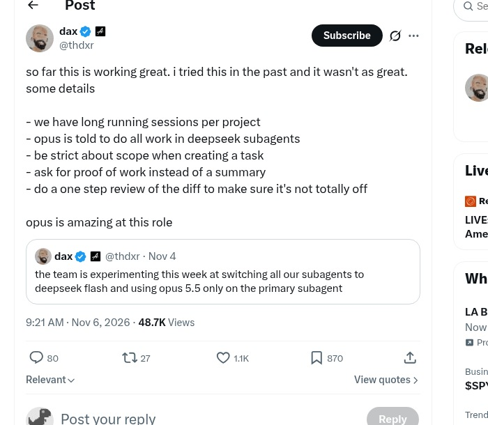
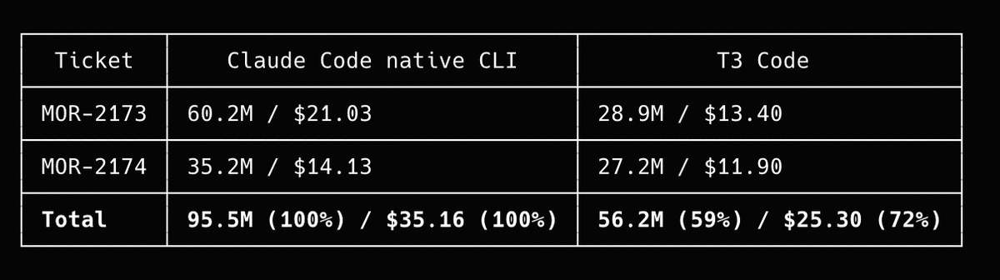
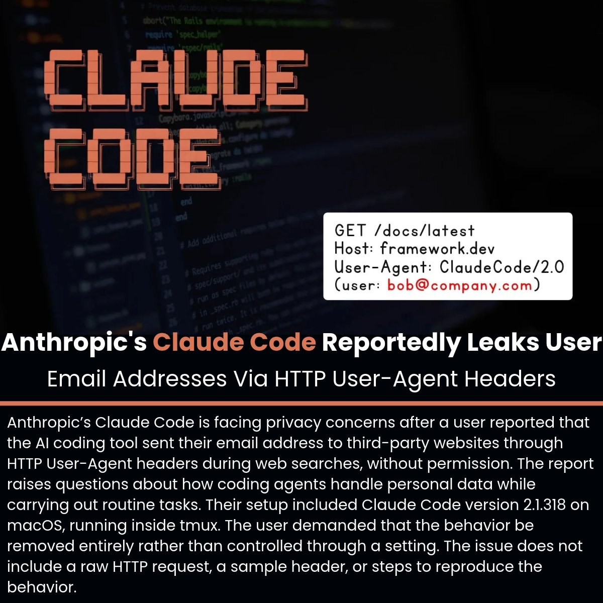
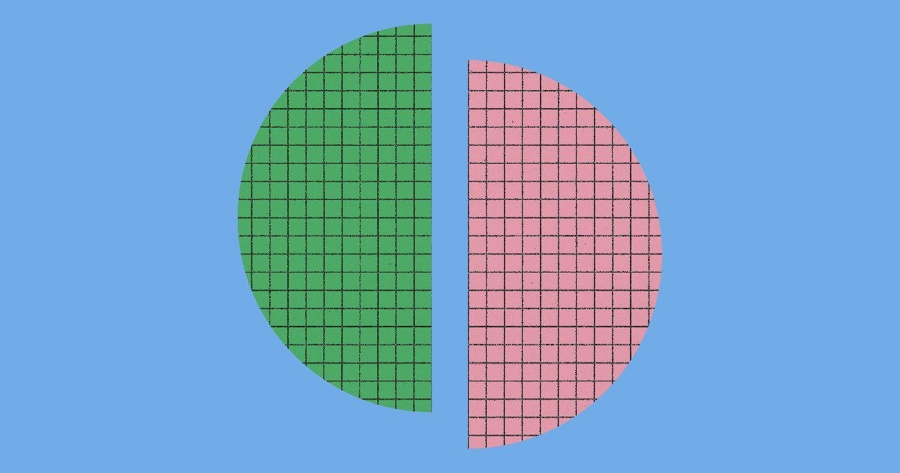
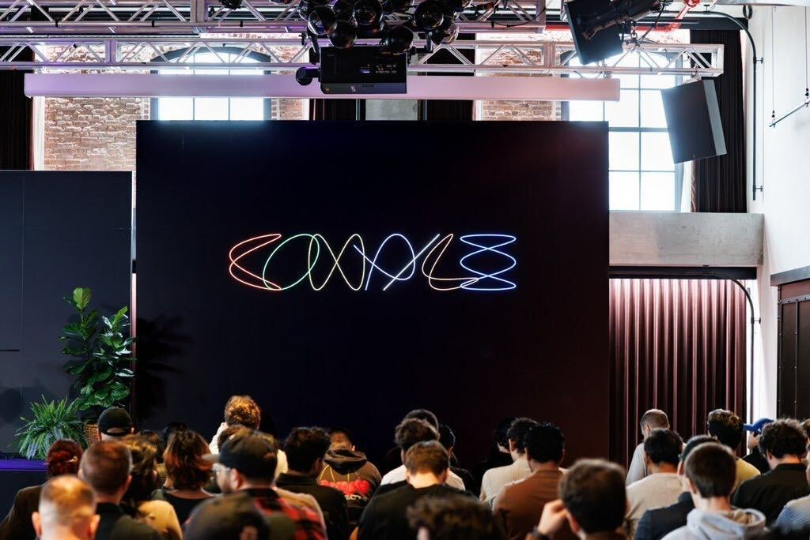
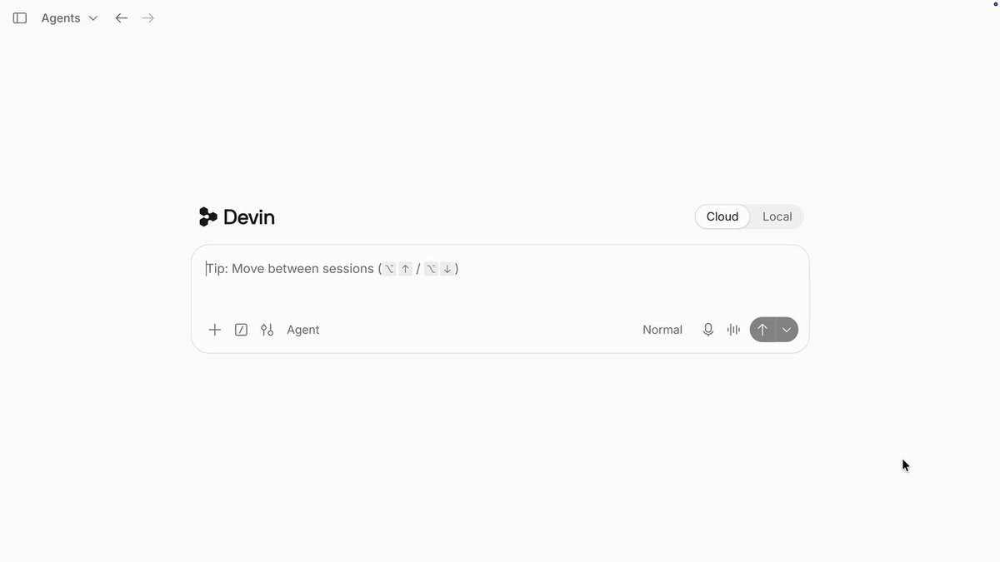
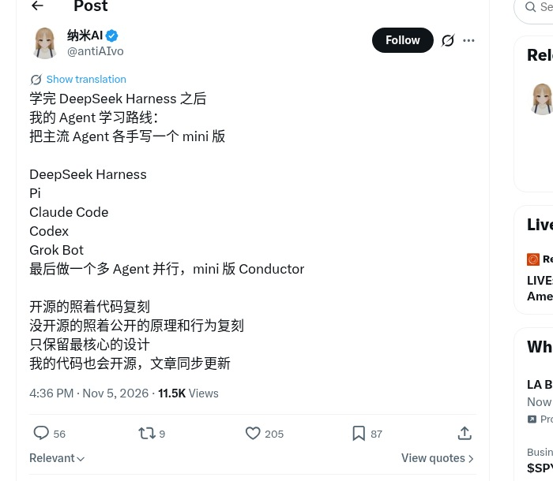
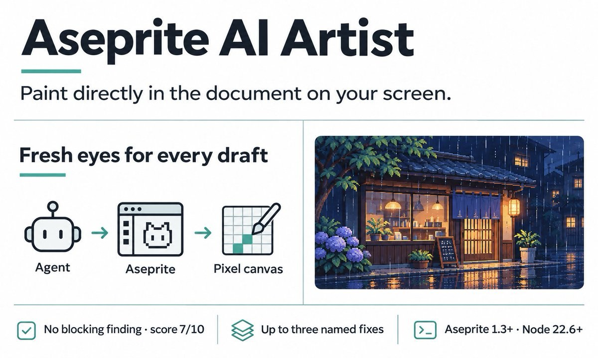
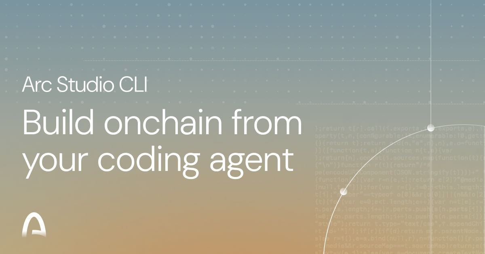
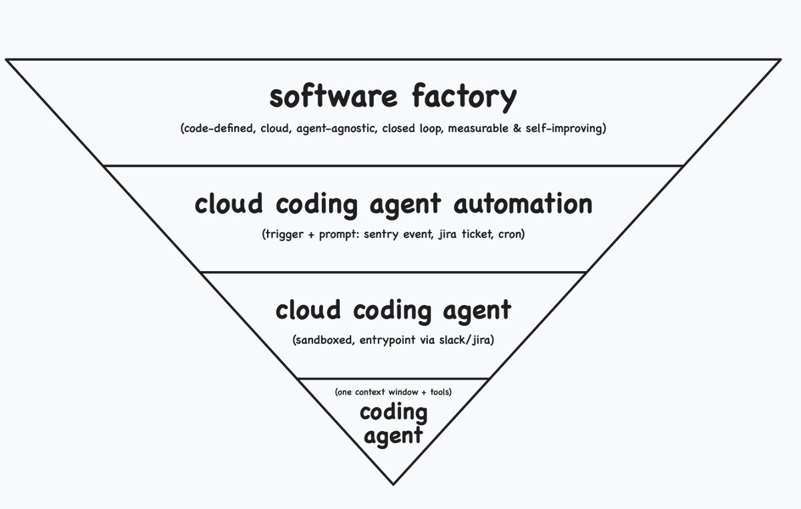

# AI Twitter/X Hots Digest · 2026-11-07 (Saturday)

## Today's highlights

1. **Expensive model as manager, cheap model as worker** keeps getting written as a playbook: OpenCode has Opus delegate to DeepSeek subagents, with Docker for a remote control plane.  
2. **Privacy and memory heat up together**: Claude Code is accused of stuffing the login email into outbound `User-Agent`; Anthropic explains agent memory via “dreaming.”  
3. **Control planes keep expanding**: T3 Code sells phone-driven multi-experiment runs; Devin lists 20 capabilities including third-party ACP agents; Aseprite and Arc plug coding agents into pixel art and onchain work.

---

## 1. OpenCode: Opus delegates to DeepSeek subagents; server runs in Docker

**Key points**: @thdxr shares a working long-session setup — one long-running session per project, with **Opus told to do all work in DeepSeek subagents**: keep task scope strict, ask for proof of work instead of a summary, then do a one-step diff review. His line: “opus is amazing at this role.” Same day: run **`opencode server` in Docker** (`serve --hostname 0.0.0.0 --port 4096`) and connect from the TUI / desktop.

**Why it matters**: Turns “frontier model plans, open/cheap models grind” into a **copyable OpenCode workflow**, with a containerized remote control plane.

- thdxr: Opus → DeepSeek subagents: https://x.com/thdxr/status/2118755687274532893  
- thdxr: Docker opencode server: https://x.com/thdxr/status/2118763115953213831

---

## 2. T3 Code: parking-lot phone dispatch, and a rebuttal to “wastes tokens”

**Key points**: @theo quotes @texoport__ — walking a parking lot, **yapping into T3 Code on a phone**, while agents ran ~40 GCP experiments for ~5 hours — and says “This is why we built T3 Code.” Later he pushes back on “T3 wastes tokens”; the quoted post claims ~**40%** average usage savings. Chinese threads also describe migrating off Grok Bot / Cursor quota anxiety onto a T3 stack.

**Why it matters**: Frames T3 as **phone-remote multi-agent** product narrative, and answers cost criticism head-on (distinct from yesterday’s T3×Grok Bot angle).

- theo: This is why we built T3 Code: https://x.com/theo/status/2118668096965861448  
- texoport__: parking-lot phone dispatch: https://x.com/texoport__/status/2118516088912941131  
- theo: token-waste rebuttal: https://x.com/theo/status/2118831869567647810  
- aarondelasy: ~40% usage savings: https://x.com/aarondelasy/status/2118831501722972295

---

## 3. Claude Code: login email in the HTTP User-Agent (privacy incident)

**Key points**: Multiple threads point at the same issue: during web search / outbound requests, Claude Code put the **login email** into the HTTP **`User-Agent`**, visible to third-party sites. Security media and builders amplified it; practical advice is to upgrade and watch Anthropic’s fix language around removing the email from model context. Treat details as issue / official-response scoped — not a “whole vault leaked” story.

**Why it matters**: When coding agents egress on their own, **identity living in context** becomes a supply-chain privacy surface — sharper than another feature drop.

- The_Cyber_News: User-Agent email leak: https://x.com/The_Cyber_News/status/2118716305243312209  
- CR1337: discussion + screenshots: https://x.com/CR1337/status/2118538550904021001  
- Austen: builder digest including this: https://x.com/Austen/status/2118680123654189164

---

## 4. Anthropic: Claude Memory and “dreaming” engineering post

**Key points**: @AnthropicAI explains how memory lets Claude learn from experience, and how **“dreaming”** helps organize what it learned, correct mistakes, and find things faster next time. @omarsar0 follows up that memory remains one of the biggest levers in a harness — keep it simple and mix in episodic memory.

**Why it matters**: Officials move agent memory from slogan to engineering narrative, matching the community’s “don’t forget across sessions” anxiety.

- AnthropicAI: The components of agent memory: https://x.com/AnthropicAI/status/2118814753154064501  
- omarsar0: memory leverage in harnesses: https://x.com/omarsar0/status/2118838318180037041

---

## 5. johnbai at Compile NYC: Grok Bot from personal assistant to team tool

**Key points**: @johnbai wraps Compile NYC with *Building Something Worth Using* — a look back at early **Grok Bot** design iterations, and a look forward to evolving the personal assistant into something **entire teams** can use; multiple stage photos. Chinese digests flagged it as the day’s strongest on-site signal.

**Why it matters**: Live event + product lead saying “personal → team” is more citable than second-hand roundups (not a rerun of yesterday’s T3×Grok Bot combo posts).

- johnbai: Compile NYC wrap: https://x.com/johnbai/status/2118750928035569738

---

## 6. Devin / Devin Desktop: official “20 things you might not know”

**Key points**: @devindevelopers posts a long feature tour: Local Hands (cloud driving your machine), Element Picker, mobile VMs, Session Branching, Memory, Skills, Sandbox, Local/Cloud Handoff, plus **running Claude Code / Codex and 40+ ACP agents inside the desktop**, and an Agent Command Center.

**Why it matters**: Officially reframes Devin Desktop from “one cloud agent” into a **local + cloud + third-party ACP console**.

- devindevelopers: 20 things / Local Hands: https://x.com/devindevelopers/status/2118851585707053162  
- devindevelopers: Third-party ACP agents: https://x.com/devindevelopers/status/2118851625255416110  
- devindevelopers: Agent Command Center: https://x.com/devindevelopers/status/2118851618456174879

---

## 7. Hand-roll mini harnesses: DeepSeek / Pi / Claude Code / Codex / Grok Bot → mini Conductor

**Key points**: @antiAIvo sketches a learning path — hand-write mini versions of **DeepSeek Harness, Pi, Claude Code, Codex, and Grok Bot**, then a multi-agent **mini Conductor**; clone open-source from code, closed products from public principles, and open-source the results. Chinese replies echo that cloning the orchestration layer beats stacking more subscriptions. Meta’s Conductor acquisition is yesterday’s backdrop; this is a learn-by-building response.

**Why it matters**: Flips “subscription stacking” into a **harness curriculum**, treating orchestration as an engineering object you can study.

- antiAIvo: agent learning path: https://x.com/antiAIvo/status/2118502776393355437

---

## 8. Aseprite AI Artist: MCP lets coding agents paint inside Aseprite

**Key points**: @dextune introduces **Aseprite AI Artist** — an MCP server + extension so Claude Code / OpenCode / Codex / Gemini CLI / Cursor / VS Code / Windsurf can paint **pixel-by-pixel** in an already-open Aseprite window, with a critic agent scoring drafts; knowledge base includes rules, pixel templates, and many palettes. GitHub `with-pebbly/aseprite-ai-artist` has **created_at ~2026-09-08** (hundreds of stars) — today’s posts are product promotion, **not a past-24h open-source debut**.

**Why it matters**: Classic MCP landing: agents leave the editor and enter a specialized creative tool; bookmark/like ratio is high.

- dextune: Aseprite AI Artist: https://x.com/dextune/status/2118516217032098248

---

## 9. Arc Studio CLI: hand off onchain work from your coding agent

**Key points**: @arc launches the **Arc Studio CLI** so Claude Code / Codex / Cursor can hand off onchain work — inspect the sandbox, review results, and pull code back into the project.

**Why it matters**: Crypto/onchain workflows attach to existing coding agents instead of inventing another IDE.

- arc: Arc Studio CLI: https://x.com/arc/status/2118543528536183176

---

## 10. Zach Lloyd: coding-agent glossary + diagram

**Key points**: @zachlloydtweets posts a glossary separating coding agent, cloud coding agent, automation, and software factory, then a follow-up “in diagram form” to align vocabulary.

**Why it matters**: When agent / harness / control-plane language is muddled, one diagram becomes a conceptual anchor for the digest.

- zachlloydtweets: glossary: https://x.com/zachlloydtweets/status/2118725953966715217  
- zachlloydtweets: diagram: https://x.com/zachlloydtweets/status/2118814452791578843

---
