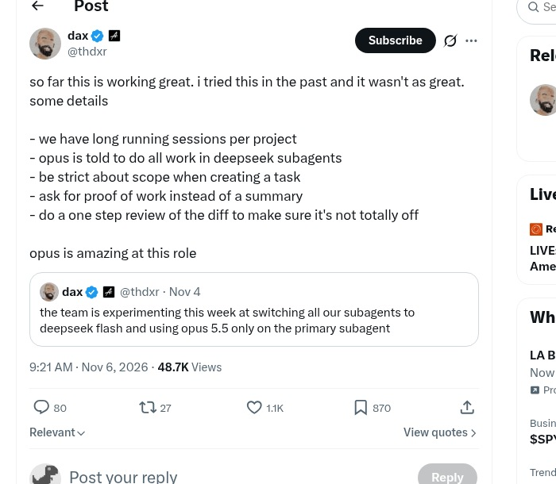
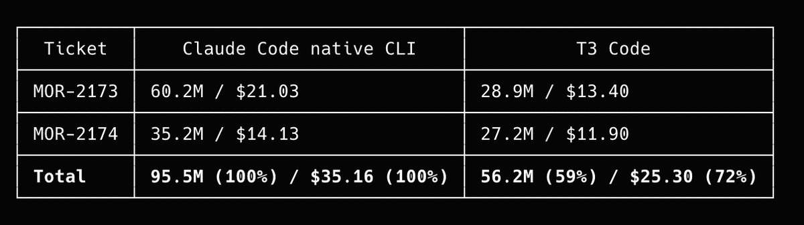
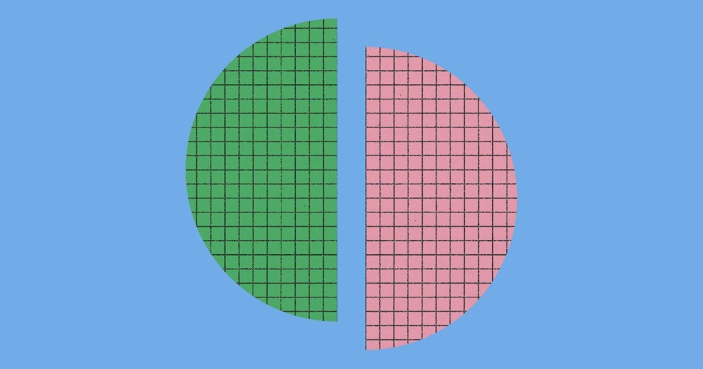
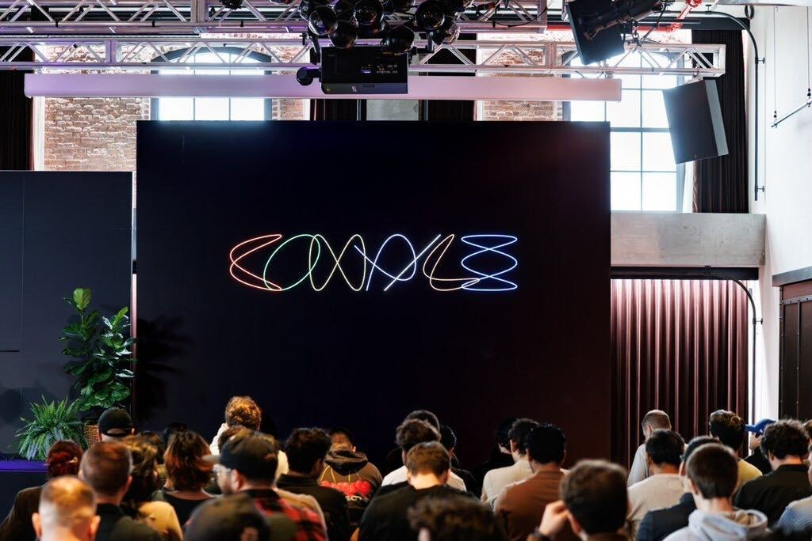
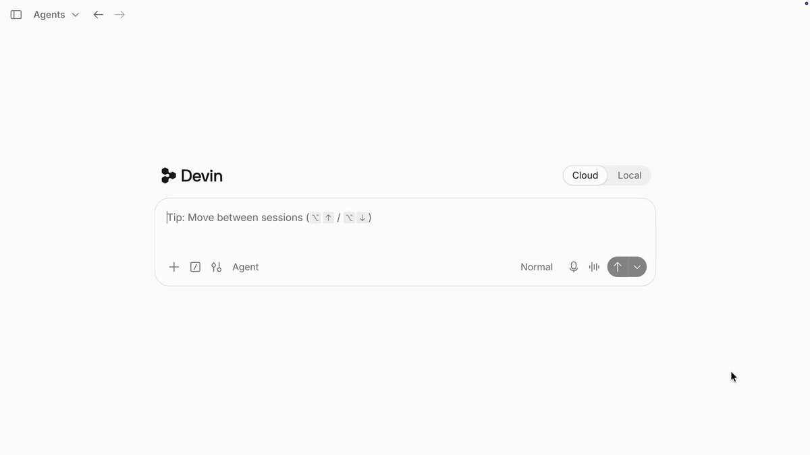
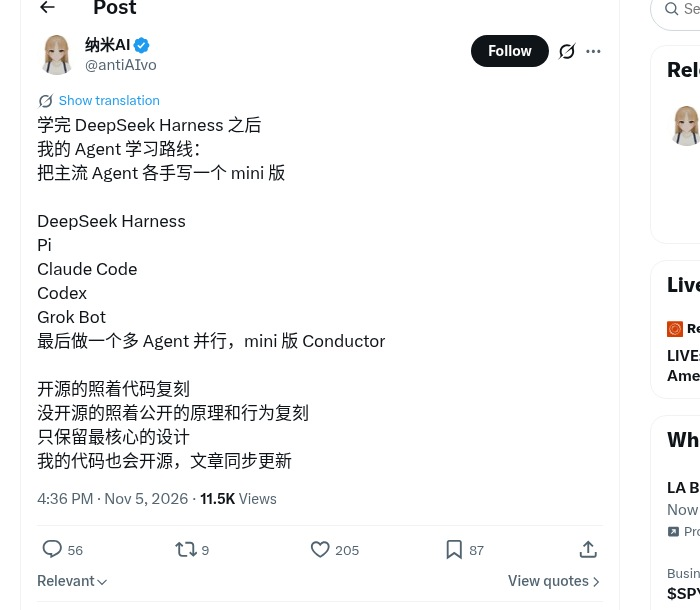
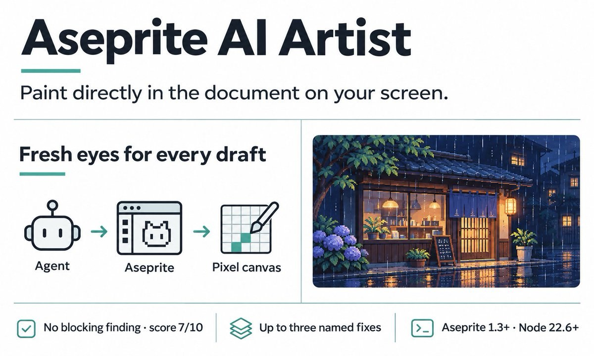
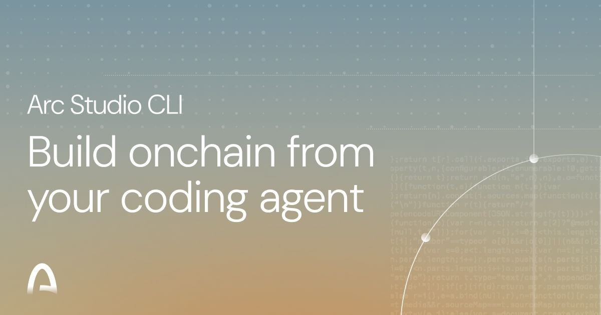
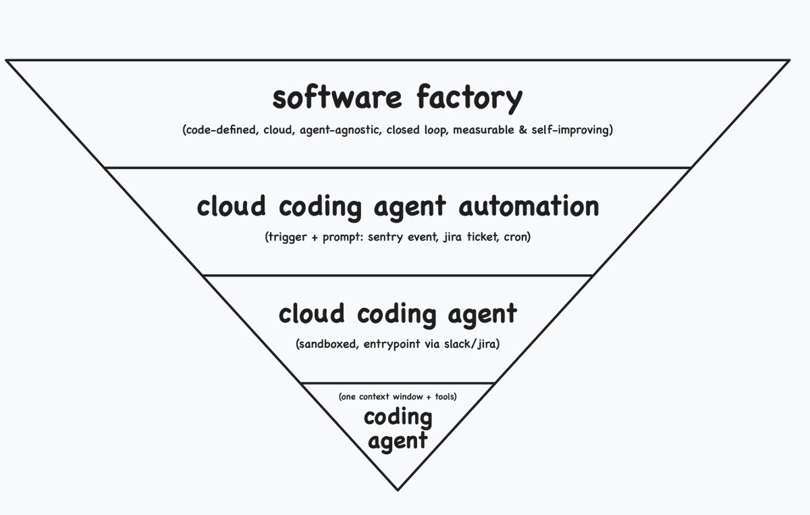

# AI Twitter/X 热点 Digest · 2026-11-07（周六）

## 今日要点

1. **贵模型当经理、便宜模型当工人**继续被写进可复制手册：OpenCode 侧 Opus 调度 DeepSeek 子代理，Docker 把控制面挂到远程。  
2. **隐私与记忆同时升温**：Claude Code 被指把登录邮箱写进出站 `User-Agent`；Anthropic 则用「dreaming」讲清 agent memory 怎么整理经验。  
3. **控制面继续外延**：T3 Code 讲手机遥控多实验、Devin 晒 20 能力含 ACP 第三方 agent；Aseprite / Arc 则把 coding agent 接到像素与链上工作流。

---

## 1. OpenCode：Opus 调度 DeepSeek 子代理，server 可 Docker 远程连

**要点**：@thdxr 分享仍在跑通的长会话打法——每个项目一个长跑 session，让 **Opus 把活全部派给 DeepSeek 子代理**：建任务时 scope 要严、要 proof of work 而不是摘要、再做一步 diff 审查；他总结「opus is amazing at this role」。同日再发：`opencode server` 可 **Docker** 跑起来（`serve --hostname 0.0.0.0 --port 4096`），再用 TUI / 桌面连上。

**为何值得看**：把「贵模型管规划、开源/便宜模型干重活」从口头禅落成 **OpenCode 可复制操作**，且控制面能容器化远程接。

- thdxr：Opus → DeepSeek 子代理：https://x.com/thdxr/status/2118755687274532893  
- thdxr：Docker 跑 opencode server：https://x.com/thdxr/status/2118763115953213831

---

## 2. T3 Code：停车楼手机调度，并回击「浪费 token」

**要点**：@theo 引用 @texoport__ 的体验——在停车楼边用手机对 **T3 Code**「yapping」，让 agent 在 GCP 上跑约 40 个实验、持续约 5 小时——并喊「This is why we built T3 Code」。晚间再怼「T3 浪费 token」论；被引用帖称实测平均约省 **40%** usage。中文侧也有从 Grok Bot / Cursor 额度焦虑迁到 T3 栈的搬家叙事。

**为何值得看**：把 T3 从「又一个壳」讲成 **手机遥控本机多 agent** 的产品故事，并正面回应成本质疑（与昨日「T3×Grok Bot」角度不同）。

- theo：This is why we built T3 Code：https://x.com/theo/status/2118668096965861448  
- texoport__：停车楼手机调度：https://x.com/texoport__/status/2118516088912941131  
- theo：回击浪费 token：https://x.com/theo/status/2118831869567647810  
- aarondelasy：约省 40% usage：https://x.com/aarondelasy/status/2118831501722972295

---

## 3. Claude Code：登录邮箱进 HTTP User-Agent（隐私事故）

**要点**：多条讨论指向同一问题：Claude Code 在网页搜索 / 出站请求时，把**登录邮箱**塞进 HTTP **`User-Agent`**，被第三方站点看见。安全媒体与开发者汇总发酵；用户侧建议升级到较新版本并关注 Anthropic 对「从模型上下文去掉邮箱」一类修复表述。事故细节以 issue / 官方回应为准，勿夸张成「全库泄露」。

**为何值得看**：coding agent 自主出站时，「上下文里的身份」会变成供应链隐私面——比又一次功能发布更刺痛。

- The_Cyber_News：User-Agent 泄露邮箱：https://x.com/The_Cyber_News/status/2118716305243312209  
- CR1337：讨论与截图：https://x.com/CR1337/status/2118538550904021001  
- Austen：builder 摘要含此条：https://x.com/Austen/status/2118680123654189164

---

## 4. Anthropic：Claude Memory 与「dreaming」工程博文

**要点**：@AnthropicAI 发文解释 memory 如何让 Claude 从经验中学习，以及 **「dreaming」** 如何帮助整理所学、纠错、下次更快找回。@omarsar0 跟帖强调 harness 里 memory 仍是最大杠杆之一，主张保持简单并混用情景记忆。

**为何值得看**：官方把 agent 记忆从产品口号落到工程叙事，正好对接社区「跨 session 不忘事」的焦虑。

- AnthropicAI：The components of agent memory：https://x.com/AnthropicAI/status/2118814753154064501  
- omarsar0：harness 里 memory 杠杆：https://x.com/omarsar0/status/2118838318180037041

---

## 5. johnbai @ Compile NYC：Grok Bot 从个人助手到团队协作

**要点**：@johnbai 总结 Compile NYC 演讲 *Building Something Worth Using*：回看 **Grok Bot** 早期设计迭代，并展望把个人助手演进为**整个团队可用**；现场多图。中文日报号亦将其列为当日值得看的现场信号。

**为何值得看**：活动现场 + 产品负责人亲口定调「个人→团队」，比二手合集会更可引用（与昨日 T3×Grok Bot 组合帖不重复）。

- johnbai：Compile NYC 收官：https://x.com/johnbai/status/2118750928035569738

---

## 6. Devin / Devin Desktop：官方「你可能不知道的 20 件事」

**要点**：@devindevelopers 发长线程巡礼功能：Local Hands（云端操控本机）、Element Picker、移动端 VM、Session Branching、Memory、Skills、Sandbox、Local/Cloud Handoff，以及**桌面内跑 Claude Code / Codex 等 40+ ACP agent**、Agent Command Center 等。

**为何值得看**：官方一次把 Devin Desktop 定位从「单一云 agent」扩成 **本机 + 云 + 第三方 ACP 控制台**。

- devindevelopers：20 things / Local Hands：https://x.com/devindevelopers/status/2118851585707053162  
- devindevelopers：Third-party ACP agents：https://x.com/devindevelopers/status/2118851625255416110  
- devindevelopers：Agent Command Center：https://x.com/devindevelopers/status/2118851618456174879

---

## 7. 手写 mini harness：DeepSeek / Pi / Claude Code / Codex / Grok Bot → mini Conductor

**要点**：@antiAIvo 提出学习路线——分别手写 **DeepSeek Harness、Pi、Claude Code、Codex、Grok Bot** 的 mini 版，最后做一个多 agent 并行的 **mini Conductor**；开源的对着代码复刻，闭源的对着公开原理，并计划开源代码与文章。中文圈有人转述认同「复刻调度层比再开会员靠谱」。Conductor 被 Meta 收购为昨日背景，本条是学习向回应。

**为何值得看**：把「订阅堆叠」反转为 **harness 课**，把编排层当成可学的工程对象。

- antiAIvo：Agent 学习路线：https://x.com/antiAIvo/status/2118502776393355437

---

## 8. Aseprite AI Artist：MCP 让 coding agent 在 Aseprite 里画画

**要点**：@dextune 介绍 **Aseprite AI Artist**——MCP server + 扩展，让 Claude Code / OpenCode / Codex / Gemini CLI / Cursor / VS Code / Windsurf 等在已打开的 Aseprite 窗口**逐像素**作画，并有 critic agent 打分；知识库含规则、像素模板与大量调色板。GitHub `with-pebbly/aseprite-ai-artist` **created_at 约 2026-09-08**（星数百级）——今日是产品安利向讨论，**不是过去 24h 刚开源**。

**为何值得看**：典型「agent 出编辑器、进专业创意工具」的 MCP 落地，收藏/赞比很高。

- dextune：Aseprite AI Artist：https://x.com/dextune/status/2118516217032098248

---

## 9. Arc Studio CLI：coding agent 交接链上工作

**要点**：@arc 宣布 **Arc Studio CLI**，使 Claude Code / Codex / Cursor 可交接 onchain 工作：检查 sandbox、审结果、把代码拉回项目。

**为何值得看**：加密/链开发工作流被收进现有 coding agent，而不是另起 IDE。

- arc：Arc Studio CLI：https://x.com/arc/status/2118543528536183176

---

## 10. Zach Lloyd：Coding agent 术语表 + 示意图

**要点**：@zachlloydtweets 发术语表，区分 coding agent、cloud coding agent、automation、software factory 等，并再发「in diagram form」配图，试图给社区对齐词汇。

**为何值得看**：当 agent / harness / 控制面说法混战时，一张图能当 digest 的概念锚点。

- zachlloydtweets：glossary：https://x.com/zachlloydtweets/status/2118725953966715217  
- zachlloydtweets：diagram：https://x.com/zachlloydtweets/status/2118814452791578843

---
