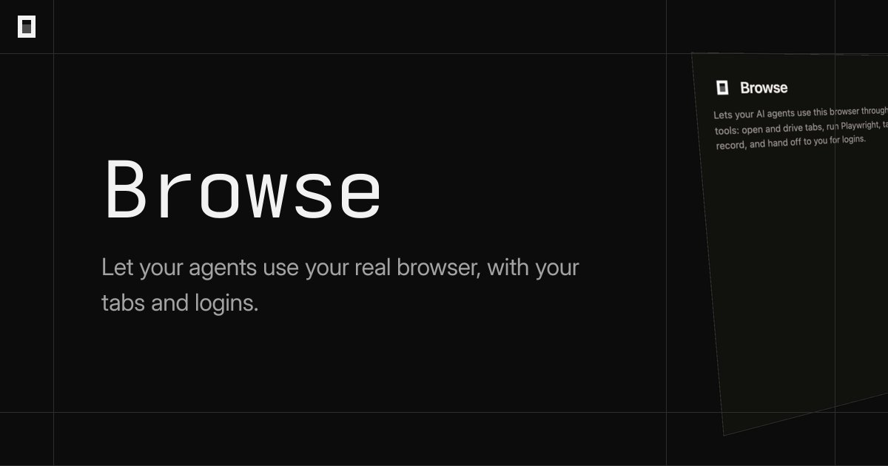
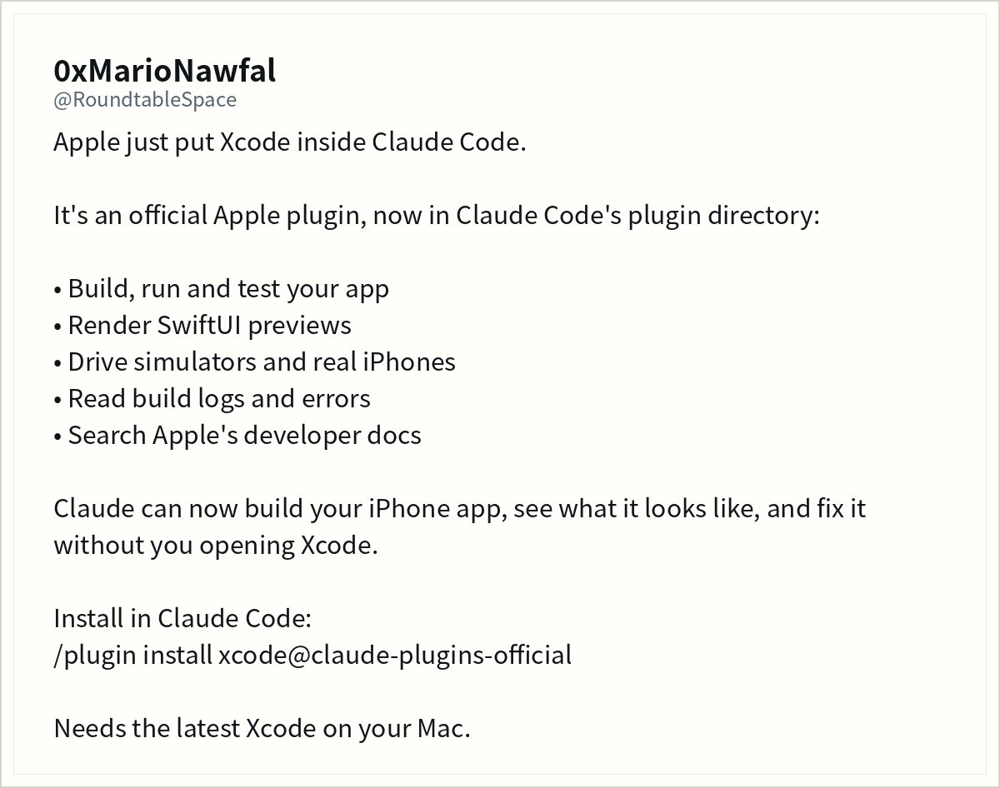
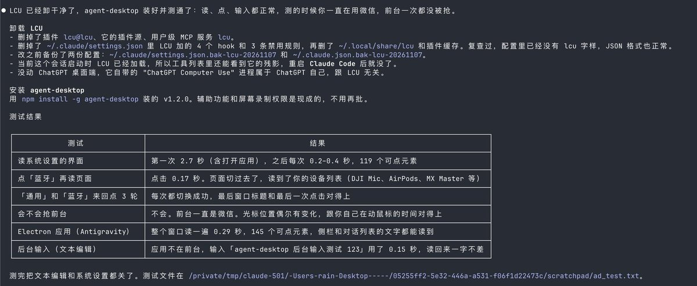
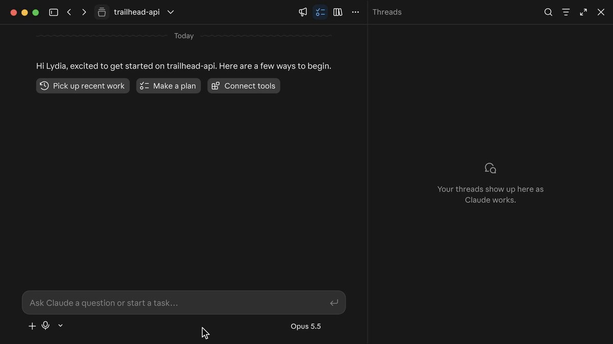
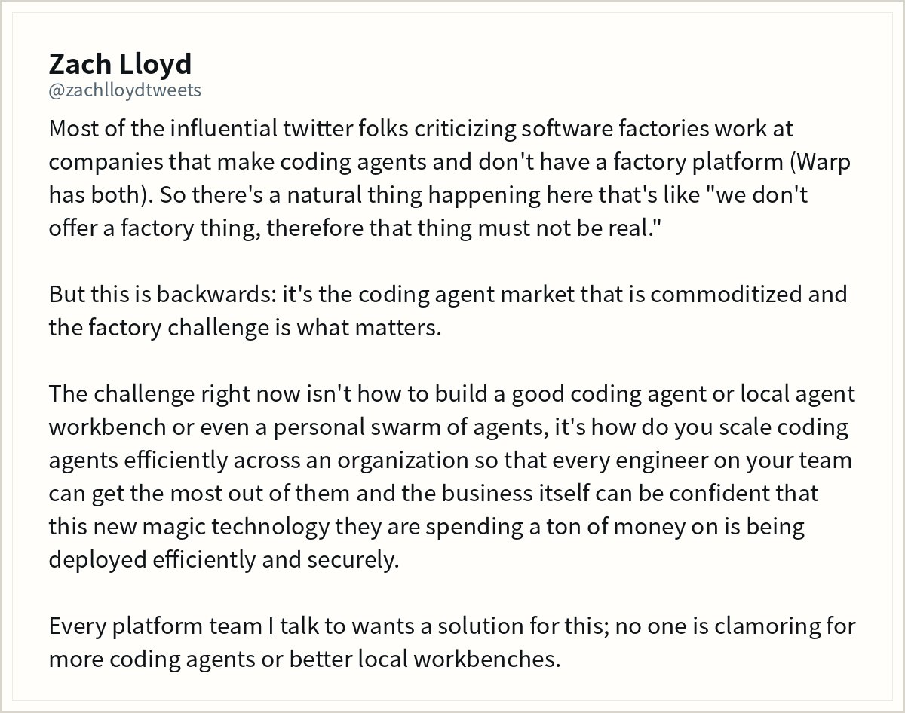
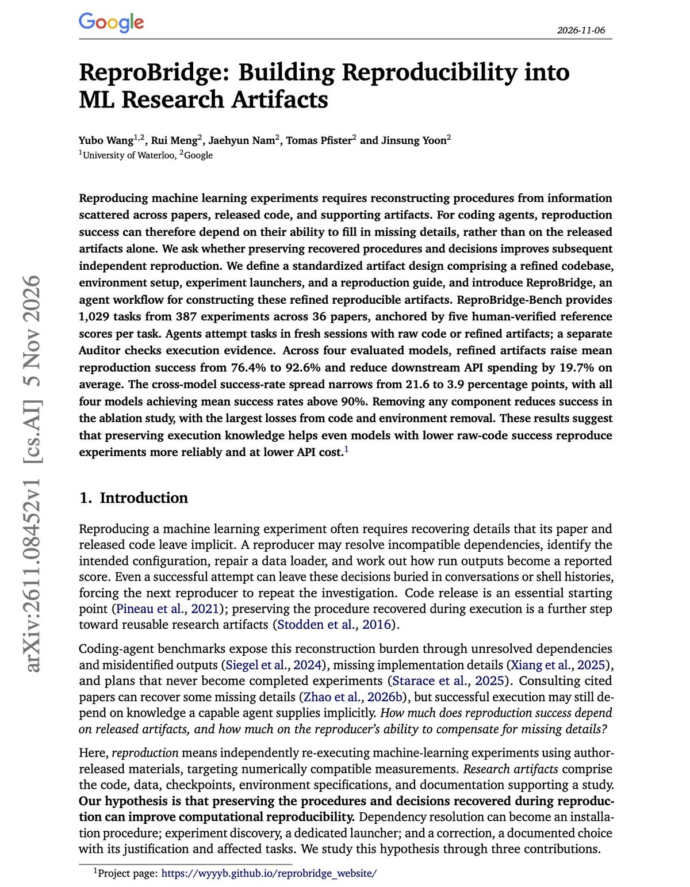
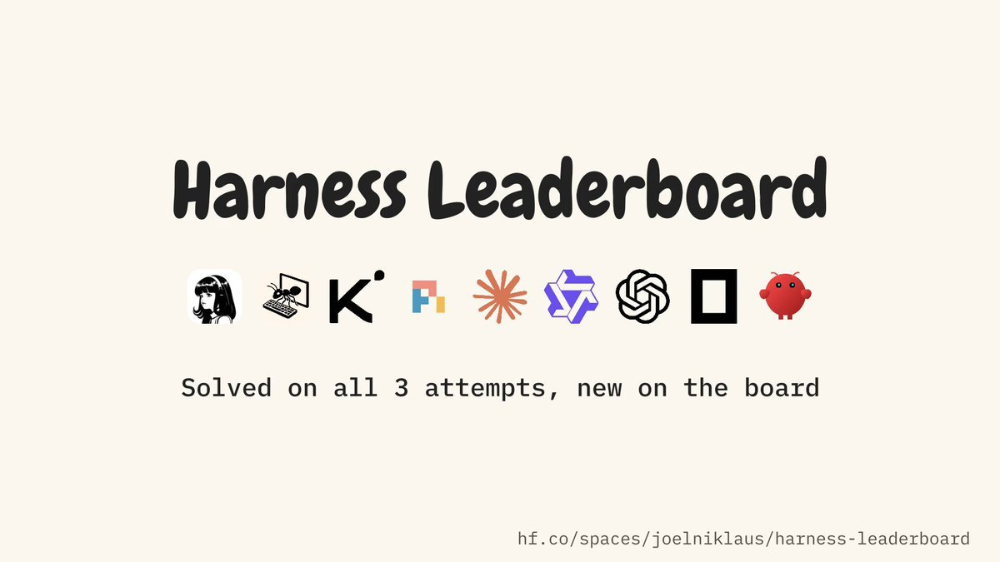

# AI Twitter/X Hots Digest · 2026-11-08 (Sunday)

## Today's highlights

1. **OpenCode ships Browse**: your agent can drive your real browser (open tabs, logins, and extensions), and the agent and the browser can even live on different machines.  
2. **An Apple Inc.–authored Xcode plugin** is now in Claude Code’s official directory (the PR merged on Nov 6; public discussion heated up today). Install with `/plugin install xcode@claude-plugins-official`.  
3. **Qoder launches stealth model Qoduck** (origin undisclosed, free every day for individual users for a limited time). The same day, Antigravity reset everyone’s Gemini / Argon quota, and desktop computer-use comparisons landed among Aside, Cua, and agent-desktop.

---

## 1. OpenCode Browse launches: your agent can drive your real browser

**Key points**: @opencode announced that **Browse is now available**: a coding agent can control your real browser, including the tabs you already have open, your logins, and your extensions. The product page is https://opencode.ai/product/browse. Co-founder @thdxr had earlier asked for testers, saying a release was imminent, that it would work with any agent, and sharing a Chrome Web Store extension link. After the official post went up, he quoted it and said this lets OpenCode — or any agent — do a great deal locally without connecting your accounts to a centralized cloud agent, adding that the implementation is “stealthy.” The same day he noted that Browse supports running the agent and the browsers on different machines: he develops on a remote server and can still orchestrate browsers on his desktop and laptop. The product page describes it as an MCP server plus a Chromium extension; when a login, 2FA prompt, or payment comes up, the tab is handed back to you and the agent continues after you click Continue.

**Why it matters**: This was the day’s highest-engagement coding-tool launch, pushing agents from “write the code” to “use the browser you’re already signed into.” It sits alongside this week’s desktop computer-use conversation, but Browse drives a real Chromium session rather than clicking through an accessibility tree.

- opencode: Browse is now available: https://x.com/opencode/status/2118895128152621153  
- thdxr: looking for testers: https://x.com/thdxr/status/2118878460391137310  
- thdxr: keep it on-device, no centralized cloud agent: https://x.com/thdxr/status/2118895958305980490  
- thdxr: agent and browsers can live on different machines: https://x.com/thdxr/status/2118973784162238748

---

## 2. Apple puts Xcode into Claude Code as an official plugin

**Key points**: @RoundtableSpace wrote that Apple put Xcode inside Claude Code. It’s an official plugin in Claude Code’s plugin directory: it can build, run, and test your app, render SwiftUI previews, drive simulators and real iPhones, read build logs and errors, and search Apple’s developer docs. The install command is `/plugin install xcode@claude-plugins-official`, and you need the latest Xcode on your Mac. The post’s own line: “Claude can now build your iPhone app, see what it looks like, and fix it without you opening Xcode.” In the marketplace the author is listed as **Apple Inc.** The PR that added it to `anthropics/claude-plugins-official` **merged on 2026-11-06**; what heated up today is the public conversation, not a same-day GitHub submission.

**Why it matters**: The IDE starts to look like a tool an agent calls, not only a place a person opens to write code. Official plugins signed Apple Inc. are rare in the Claude Code ecosystem, and the impact on iOS workflows is immediate.

- RoundtableSpace: Apple put Xcode inside Claude Code: https://x.com/RoundtableSpace/status/2119043277173207238

---

## 3. Antigravity resets everyone’s Gemini and Argon quota for the weekend

**Key points**: @_mohansolo, who builds Antigravity at Google DeepMind, posted that the team is resetting everyone’s **Gemini and Argon quota** on Antigravity — “lots of updates this week,” so people can keep building over the weekend, with more coming next week. That is the confirmed official action from today. A day earlier (**2026-11-06**), the official @antigravity account introduced **Remote Agents**: tasks run in isolated cloud VMs, you can leave your computer, handle permissions from your phone, and come back to passing tests and a clean PR, available on all paid consumption plans. That launch belongs to yesterday, not today — useful background, not “just shipped.” @jnagal later quoted the Remote Agents post.

**Why it matters**: A quota reset is itself a signal that Antigravity is running coding agents on Gemini / Argon, and that official messaging is tying “this week’s updates” to weekend usage. Together with the slightly earlier Remote Agents note, cloud-hosted coding runs are becoming the default story.

- _mohansolo: resetting Gemini and Argon quota: https://x.com/_mohansolo/status/2118855362518675720  
- jnagal: quoting Remote Agents: https://x.com/jnagal/status/2118900731810128378  
- antigravity: Remote Agents (Nov 6 background): https://x.com/antigravity/status/2118530564428833010

---

## 4. Qoder launches stealth model Qoduck — origin undisclosed, free daily for individuals

**Key points**: Qoder’s official account @qoder_ai_ide posted back-to-back about a stealth model, **Qoduck**: don’t ask where it came from; it is free every day for all individual users, for a limited time. A later post added: “Name: Qoduck. Origin: undisclosed. Ask not where it came from. Watch where it goes.” Alibaba Cloud’s official account @alibaba_cloud repeated the same story and pointed to the Qoder download page. Official posts did not publish benchmarks, parameter counts, or any claim that it matches a known existing model. Nearly identical marketing copy then spread across low-signal accounts; those are not independent reviews.

**Why it matters**: This is one of the few new models announced by a product official today, and it is deliberately framed as stealth / origin-undisclosed — the opposite of a public leaderboard launch.

- qoder_ai_ide: Qoduck lands: https://x.com/qoder_ai_ide/status/2118889023339208755  
- qoder_ai_ide: Name / Origin: undisclosed: https://x.com/qoder_ai_ide/status/2119067112501379261  
- alibaba_cloud: the same Qoduck announcement: https://x.com/alibaba_cloud/status/2118992047613080032

---

## 5. Desktop computer-use showdown: Aside ships, Cua posts scores, agent-desktop gets rediscovered

**Key points**: @garrytan quoted Aside’s Computer Use launch and called the experience “amazing,” adding that it uses a real Chromium browser that few sites can block. Aside’s original post went out a bit earlier and claimed it was **2.7× faster with 65% fewer tokens** versus Codex (*based on internal evals*), can run in the background across multiple apps on macOS, and is available now on Mac and Windows. On the timeline, @DashHuang threw cold water with a different set of numbers: on macOS background tasks, Cua Driver fully passed 58%, Codex computer use 33%, and Vercel agent-desktop 20%. @brenhubr shared user feedback that Aside was “4–7x faster at about a fifth of the tokens” compared with agent-desktop / Cua. In the evening, @Pluvio9yte’s long post made a detailed case for `vercel-labs/agent-desktop`: it reads the system accessibility tree instead of clicking screenshot coordinates, does not steal the mouse by default, and includes the author’s own Mac timings plus `npm install -g agent-desktop`. The post says the repo already has 18k GitHub stars. To be clear: `vercel-labs/agent-desktop` was **created on 2026-02-19**; this is not a fresh open-source drop. **v1.2.0 shipped on 2026-11-05** and added MCP support. Today’s Chinese-language circulation is an older project being rediscovered, on top of that recent release. Aside’s 2.7× / 65% figures are its internal evals; the Cua 58% / 33% / 20% numbers come from a separate user post. Do not merge them into one benchmark.

**Why it matters**: Coding agents are stepping out of the terminal and onto the whole computer. In a single day you get a new product pitch, a set of bench numbers, and a Chinese-language rediscovery of a CLI that has existed for months — better compared in one item than split across three.

- garrytan: Aside Computer Use: https://x.com/garrytan/status/2118951284376285508  
- DashHuang: Cua / Codex / agent-desktop pass rates: https://x.com/DashHuang/status/2118890851887874519  
- brenhubr: Aside comparison feedback: https://x.com/brenhubr/status/2118882078188241243  
- Pluvio9yte: a case for agent-desktop: https://x.com/Pluvio9yte/status/2119080693233754506  
- AsideAI: Computer Use launch (earlier): https://x.com/AsideAI/status/2118783186859884688

---

## 6. Anthropic: Claude Code Projects can cover much of a Conductor workflow

**Key points**: Claude Code teammate @lydiahallie wrote that if you were using Conductor, you can do many of the same things with **Claude Code Projects** — add your repo and ask Claude to pick up the branches you pushed. She starred a caveat: they don’t have multiplayer yet, but the rest of the workflow should feel familiar. This is a direct answer to where users go after Meta acquired Conductor. The acquisition itself already circulated a couple of days ago; this item is the official alternative path, not a rerun of that news.

**Why it matters**: Official messaging positions Claude Code Projects as a landing place for Conductor workflows, and it is honest about the missing multiplayer piece. That is actionable advice for people who just watched their platform change hands.

- lydiahallie: Claude Code Projects for former Conductor users: https://x.com/lydiahallie/status/2118863157569737109

---

## 7. Zach Lloyd: coding agents are commoditized; the real challenge is the software factory

**Key points**: Warp’s @zachlloydtweets argued that many influential voices criticizing “software factories” work at companies that make coding agents but do not have a factory platform (he notes that Warp has both), which makes it easy to conclude that “we don’t offer that thing, therefore that thing must not be real.” He says this is backwards: the coding-agent market is already commoditized, and the real challenge is how to deploy agents at organizational scale — efficiently, securely, and in a way every engineer can use and the business paying the bill can trust. The platform teams he talks to want that, not more local agents or a better personal workbench. This is a new argument, not a recap of yesterday’s agent glossary.

**Why it matters**: It pulls the product debate from “which agent is stronger” to “how does an organization scale agents,” a useful counterweight to the day’s more microscopic launches around Browse, desktop computer use, and harness comparisons.

- zachlloydtweets: the hard problem is the software factory: https://x.com/zachlloydtweets/status/2119077756017238215

---

## 8. Google paper ReproBridge: refined artifacts lift reproduction from 76.4% to 92.6%

**Key points**: @omarsar0 highlighted a Google and University of Waterloo paper, **ReproBridge**: turn one successful experiment reproduction into a reusable package (cleaned code, environment setup, launch scripts, and a written guide) that the next agent can rerun in a fresh session, with a separate auditor checking that the runs actually happened. Across four models, refined artifacts raised reproduction success from **76.4% to 92.6%** and cut downstream API spending by **19.7%** on average. The benchmark covers 1,029 tasks from 36 papers, each with five human-verified reference scores. The gap between the best and worst model shrank from 21.6 points to 3.9; removing the code or the environment setup caused the largest losses. Those figures match the abstract of [arXiv:2611.08452](https://arxiv.org/abs/2611.08452). Authors are Yubo Wang (Waterloo / Google), Rui Meng, Jaehyun Nam, Tomas Pfister, and Jinsung Yoon (the last four listed as Google). The project page at https://wyyyb.github.io/reprobridge_website/ already existed; this is a paper discussion, not a “just open-sourced” drop.

**Why it matters**: It answers a practical question: when coding agents fail to reproduce a paper, is the missing piece a bigger model, or the environment and steps left behind by the first successful run? The numbers are specific and check out against the abstract.

- omarsar0: ReproBridge paper: https://x.com/omarsar0/status/2119085975880212842

---

## 9. Harness Leaderboard update: best shells hit half per try, only about a third every time

**Key points**: The full **Harness Leaderboard** was published on **2026-11-05**: 28,849 trials and $4,746 of inference, holding the model, provider, and reasoning effort fixed and changing only the harness, on Terminal-Bench 2.1 and DeepSWE. Averaged over three open models, mini-swe-agent solved 51.4% of tasks and OpenClaw 27.3%. Pi landed at 49.4% for $0.29 per solved task, about 45% less than mini-swe-agent’s $0.53. OpenCode cost $3.35 per solved task, about 11.7× Pi. The best harness depends on the model: mini-swe-agent on GLM-5.3-Flash, Hermes on DeepSeek-V4.1-Flash, and Kimi Code on Flint. Today @joelniklaus added a reliability view that matters for unattended runs: how often the same harness solves the same task on all three attempts. Averaged over three open models, mini-swe-agent solves **51.4%** per attempt, **68.6%** at least once in three tries, and **33.0%** every time. Five other harnesses land between 32.0% and 33.3% every time — too close to call — while OpenClaw is at 15.3%. On Flint, the weakest model, Hermes Agent reaches 28.6% at least once but only 10.0% every time. The board lives at https://huggingface.co/spaces/joelniklaus/harness-leaderboard. This is not the same item as yesterday’s “hand-write a mini harness” learning path. @ariG23498 also listed the leaderboard among the week’s takeaways.

**Why it matters**: It turns “the harness can matter more than the model” from a launch claim into a reliability number you can inspect: solving half the tasks once is not the same as solving them every time when nobody is watching.

- joelniklaus: solved-on-all-three-attempts view: https://x.com/joelniklaus/status/2119082748870844870  
- joelniklaus: full Harness Leaderboard launch (Nov 5): https://x.com/joelniklaus/status/2118373808692437403  
- ariG23498: the board as a weekly takeaway: https://x.com/ariG23498/status/2118975791702675608

---

## 10. Overnight harvest: Opus 5.5 commands a DeepSeek V4 flash swarm; author says HarmonyOS caught up with iOS

**Key points**: @chunxiangai offered a short “version answer”: Claude Opus 5.5 as commander, DeepSeek V4 flash as an intelligent swarm; leave the company computers on overnight, collect the results in the morning — and, the author says, native HarmonyOS progress has now caught up with iOS. This is a personal overnight workflow report, not an official product announcement. The post does not include a repo, a benchmark, or a verifiable progress screenshot. The claim that HarmonyOS has aligned with iOS should be read as the author’s own account; it has not been independently verified.

**Why it matters**: It is a lived example of the “expensive model directs, cheaper fast models do the swarm work” overnight pattern. Treat the specific progress claim as a personal report, not product news.

- chunxiangai: Opus as commander + DeepSeek as swarm: https://x.com/chunxiangai/status/2119055245796143359

---
