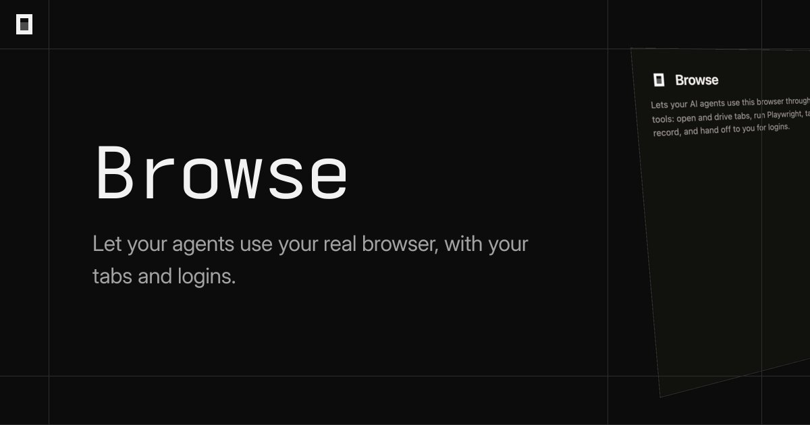
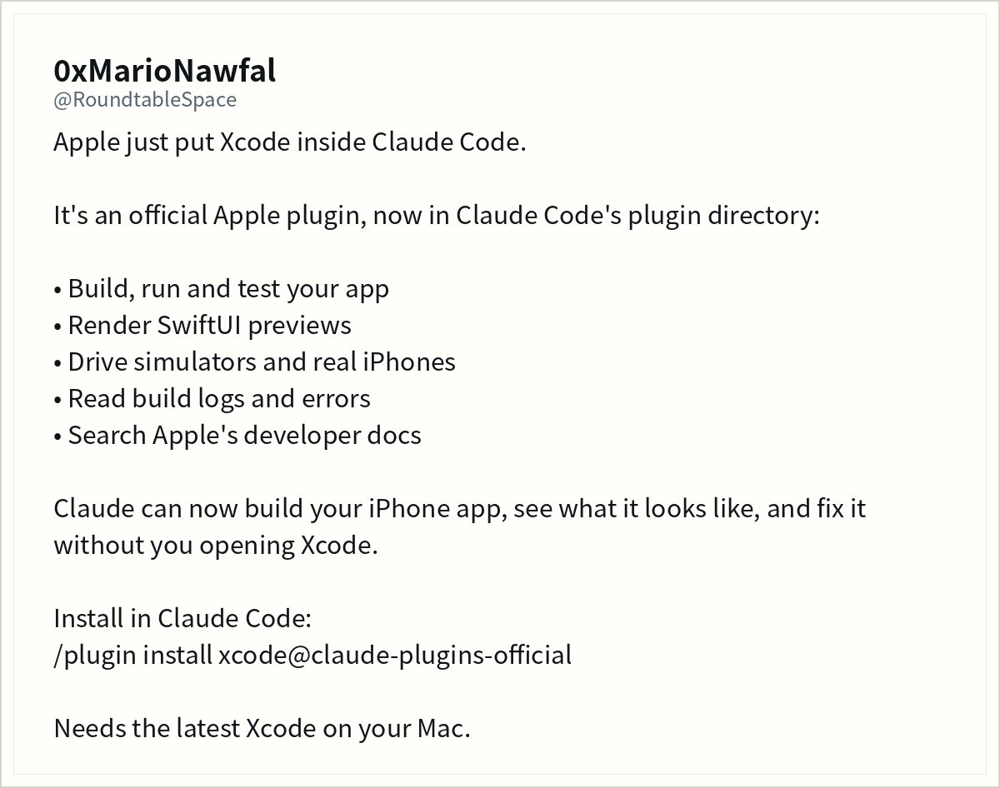
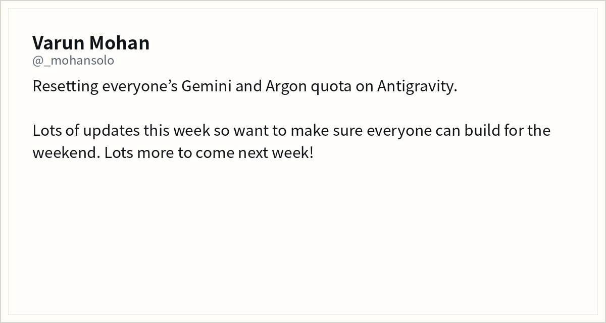
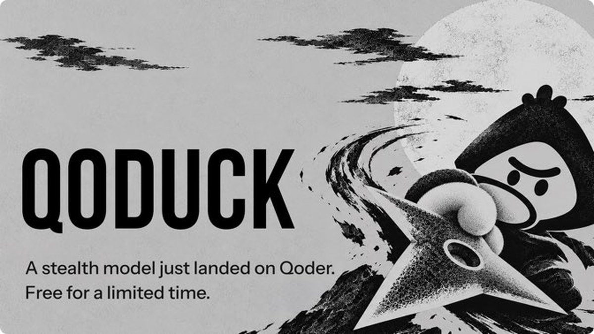
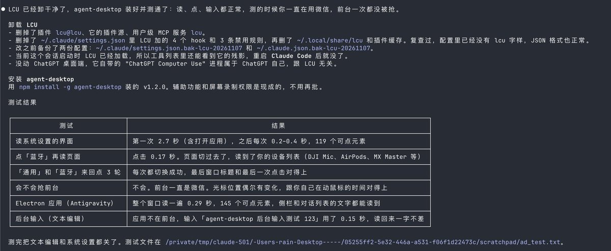
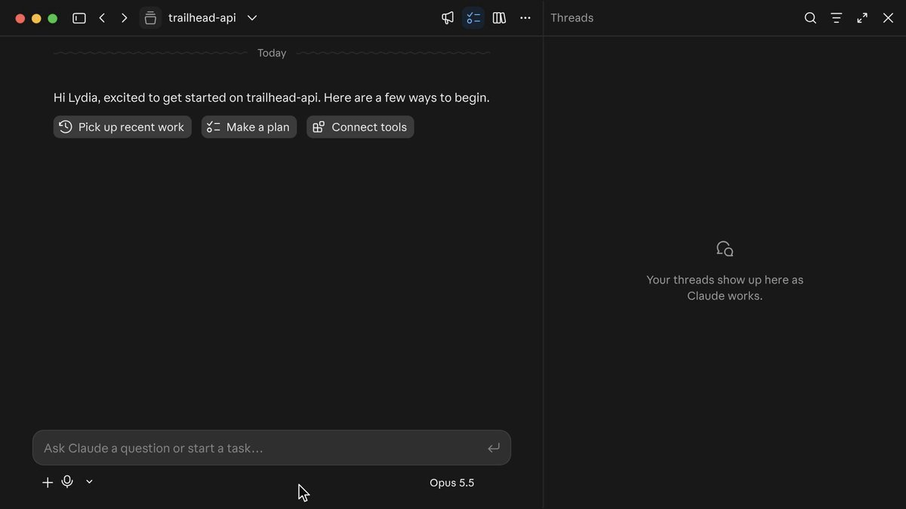
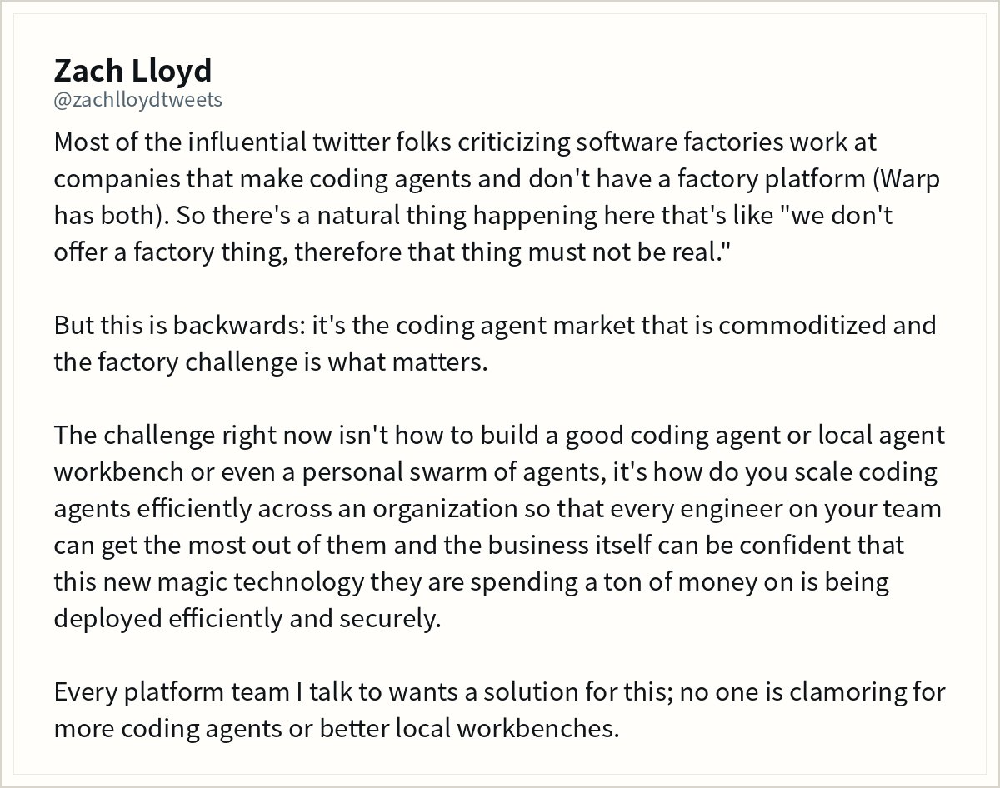
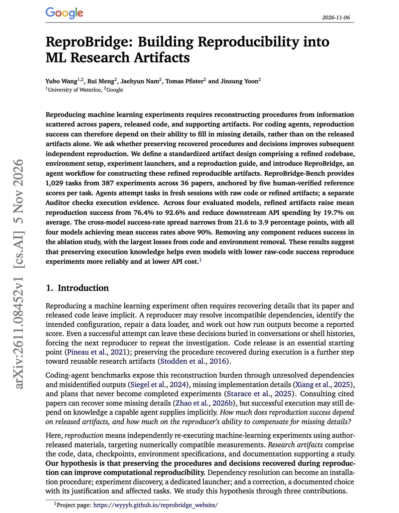
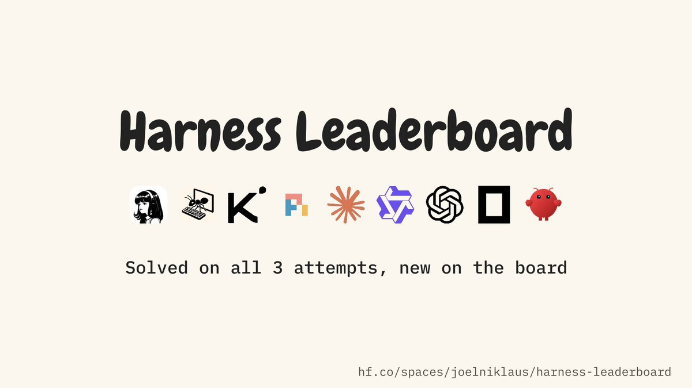
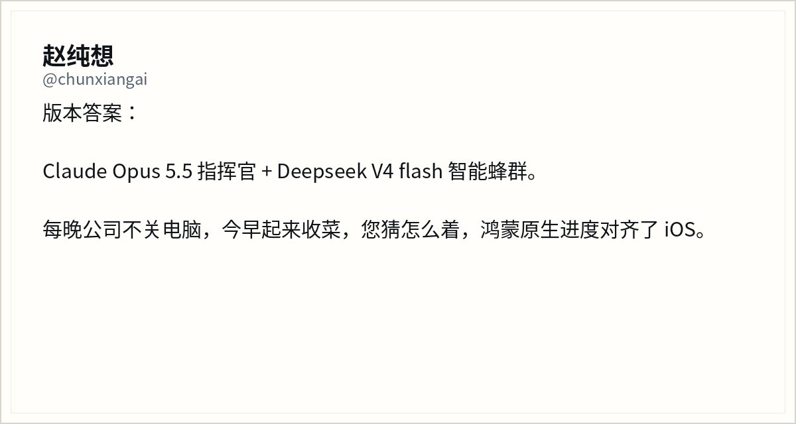

# AI Twitter/X 热点 Digest · 2026-11-08（周日）

## 今日要点

1. **OpenCode 推出 Browse**：Agent 可以直接驱动你的真实浏览器（已打开的标签、登录态和扩展），而且支持 Agent 与浏览器跑在不同机器上。  
2. **苹果署名的 Xcode 插件**进入 Claude Code 官方目录（PR 于 11-06 合并，公开讨论在今天升温）；安装命令是 `/plugin install xcode@claude-plugins-official`。  
3. **Qoder 上线隐身模型 Qoduck**（来源未披露，个人用户限时每日免费）；同一天还有 Antigravity 重置全员 Gemini / Argon 配额，以及桌面 Computer Use（Aside / Cua / agent-desktop）的对比讨论。

---

## 1. OpenCode Browse 上线，Agent 能操控你的真实浏览器

**要点**：@opencode 宣布 **Browse 现已可用**：编码 Agent 可以控制你的真实浏览器，包括已经打开的标签页、登录态和扩展。产品页是 https://opencode.ai/product/browse。联合创始人 @thdxr 稍早发过测试召集，称即将发布、可用在任意 Agent 上，并给出 Chrome Web Store 扩展链接；官方帖发出后他又引用该帖，说这能让 OpenCode 或任意 Agent 在本地完成大量操作，而不把账号接到中心化云端 Agent，还提到实现上「很 stealth」。同日他补充：Browse 支持 Agent 和浏览器跑在不同机器上——他自己用远程服务器开发，仍可编排桌面和笔记本上的浏览器。产品页写明它是 MCP server 加 Chromium 扩展；遇到登录、2FA 或支付时，会把标签交还给你，点 Continue 后再继续。

**为何值得看**：这是当天互动最高的编码工具产品发布，把「写代码的 Agent」推进到「使用你已经登录的浏览器」。和桌面 Computer Use 是同一时期的平行话题，但 Browse 走的是真实 Chromium 会话，而不是无障碍树点选。

- opencode：Browse 现已可用：https://x.com/opencode/status/2118895128152621153  
- thdxr：测试召集：https://x.com/thdxr/status/2118878460391137310  
- thdxr：本地完成、不接中心化云端：https://x.com/thdxr/status/2118895958305980490  
- thdxr：Agent 与浏览器可分机：https://x.com/thdxr/status/2118973784162238748

---

## 2. 苹果把 Xcode 做成 Claude Code 官方插件

**要点**：@RoundtableSpace 写道：Apple 把 Xcode 放进了 Claude Code。这是 Claude Code 插件目录里的官方插件，能构建、运行和测试应用，渲染 SwiftUI 预览，驱动模拟器和真机 iPhone，读取构建日志与错误，并搜索 Apple 开发者文档。安装命令是 `/plugin install xcode@claude-plugins-official`，需要 Mac 上装好最新 Xcode。原帖的表述是「Claude 现在可以构建 iPhone 应用、看到效果并修复，而不必你打开 Xcode」。插件目录里作者署名为 **Apple Inc.**；把它合入 `anthropics/claude-plugins-official` 的 PR 在 **2026-11-06** 合并，今天升温的是公开讨论，而不是「刚刚提交到 GitHub」。

**为何值得看**：IDE 从「人打开来写代码的地方」变成 Agent 调用的工具。这是 Claude Code 生态里少见的由 Apple Inc. 署名的官方插件，对 iOS 开发工作流影响直接。

- RoundtableSpace：苹果把 Xcode 放进 Claude Code：https://x.com/RoundtableSpace/status/2119043277173207238

---

## 3. Antigravity 清空 Gemini 与 Argon 配额，方便周末接着做

**要点**：Google DeepMind / Antigravity 团队的 @_mohansolo 发帖：正在重置所有人在 Antigravity 上的 **Gemini 和 Argon 配额**，因为「这周更新很多」，希望大家周末能继续构建，并说下周还有更多。这是可以确认的官方动作。稍早一天（**2026-11-06**），官方 @antigravity 介绍过 **Remote Agents**：任务跑在独立云虚拟机里，人可以离开电脑、用手机处理权限，回来看到测试通过和干净的 PR，并写明对所有付费消费计划开放——那是前一天的发布，这里只作背景，不是「今天刚上线」。随后 @jnagal 引用了这条远程 Agent 帖。

**为何值得看**：配额重置本身说明 Antigravity 在用 Gemini / Argon 做编码 Agent，且官方把「这周的更新」和周末用量绑在一起；结合稍早的 Remote Agents，云端代跑编码任务正在变成默认叙事。

- _mohansolo：重置 Gemini 与 Argon 配额：https://x.com/_mohansolo/status/2118855362518675720  
- jnagal：引用 Remote Agents：https://x.com/jnagal/status/2118900731810128378  
- antigravity：Remote Agents（11-06 背景）：https://x.com/antigravity/status/2118530564428833010

---

## 4. Qoder 上线隐身模型 Qoduck，来源保密、个人用户限时免费用

**要点**：Qoder 官方 @qoder_ai_ide 连续发帖介绍隐身模型 **Qoduck**：不要问它从哪来；对所有个人用户每日免费，限时供应。下午一条补充 “Name: Qoduck. Origin: undisclosed. Ask not where it came from. Watch where it goes.” 阿里云官方账号 @alibaba_cloud 同步转发同一叙事，并给出 Qoder 产品下载页。官方没有公布基准分、参数量，也没有说明它是否与某个已有模型相同。搜索里随后出现大量句式几乎相同的营销号，不宜当成独立评测。

**为何值得看**：这是当天少有的、由产品官方亲自宣布的新模型，而且刻意做成「隐身 / 来源未披露」，和公开打榜的路线相反。

- qoder_ai_ide：Qoduck 落地：https://x.com/qoder_ai_ide/status/2118889023339208755  
- qoder_ai_ide：Name / Origin: undisclosed：https://x.com/qoder_ai_ide/status/2119067112501379261  
- alibaba_cloud：同步介绍 Qoduck：https://x.com/alibaba_cloud/status/2118992047613080032

---

## 5. 桌面 Computer Use 对决：Aside 出新、Cua 跑分、agent-desktop 被中文圈捡起来

**要点**：@garrytan 引用 Aside 的 Computer Use 发布帖，称体验「amazing」，而且用的是真实 Chromium，几乎不会被网站拦截。Aside 原帖稍早发出，自称相对 Codex「快 2.7 倍、少用 65% token」（标注 *based on internal evals*），可在 macOS 后台跨多个 App 运行，Mac 与 Windows 现已可用。时间线上 @DashHuang 用另一组数字泼冷水：在 macOS 后台任务上，Cua Driver 完整通过率 58%，Codex computer use 33%，Vercel agent-desktop 20%。@brenhubr 则贴出用户反馈，称 Aside 比 agent-desktop / Cua「快 4–7 倍，token 大约五分之一」。晚上 @Pluvio9yte 的长帖详细安利 `vercel-labs/agent-desktop`：走系统无障碍树而不是截图点坐标，默认不抢鼠标，并给出自己的 Mac 实测和 `npm install -g agent-desktop` 安装步骤；文中写「GitHub 已经有 1.8 万 star」。需要说清楚：这个仓库创建于 **2026-02-19**，并不是今天刚开源；**v1.2.0 发布于 2026-11-05**，更新里包含 MCP 支持。今天中文圈的热传，是旧项目被重新发掘，叠加上近日的版本更新。Aside 的 2.7x / 65% 是其内部评测，Cua 的 58% / 33% / 20% 来自另一条用户帖，两套数字不要混写成同一次基准。

**为何值得看**：编码 Agent 正在从终端走到整台电脑。同一天里既有新品站台、也有基准数字、还有中文圈把已存在数月的开源 CLI 重新发掘出来，适合放在一条里对比。

- garrytan：Aside Computer Use 体验：https://x.com/garrytan/status/2118951284376285508  
- DashHuang：Cua / Codex / agent-desktop 通过率：https://x.com/DashHuang/status/2118890851887874519  
- brenhubr：Aside 对比反馈：https://x.com/brenhubr/status/2118882078188241243  
- Pluvio9yte：安利 agent-desktop：https://x.com/Pluvio9yte/status/2119080693233754506  
- AsideAI：Computer Use 发布（稍早）：https://x.com/AsideAI/status/2118783186859884688

---

## 6. Anthropic：用 Claude Code Projects 接住原来的 Conductor 工作流

**要点**：Claude Code 团队的 @lydiahallie 发帖说：如果你以前用 Conductor，用 **Claude Code Projects** 可以做其中很多事——把仓库加进去，让 Claude 捡起你推上去的分支。她特别加了星号：还没有 multiplayer，但其余工作流应该会熟悉。这是对 Meta 收购 Conductor 之后用户去向的直接回应；收购消息前两天已经出现过，本条是官方给出的替代路径，不是把收购再讲一遍。

**为何值得看**：官方亲自把 Claude Code Projects 定位成 Conductor 的替代路径，并诚实承认还缺多人协作。对刚经历平台易主的用户是可执行建议。

- lydiahallie：Claude Code Projects 接住 Conductor 工作流：https://x.com/lydiahallie/status/2118863157569737109

---

## 7. Zach Lloyd：编程 Agent 已经商品化，真正的难题是软件工厂

**要点**：Warp 的 @zachlloydtweets 写：批评「software factory」的意见领袖，很多就职于做编程 Agent、却没有 factory 平台的公司（他注明 Warp 两者都有），于是容易推出「我们不提供的东西肯定不真实」。他认为这说反了：编程 Agent 市场已经商品化，真正的挑战是如何在组织里规模化、安全、高效地部署这些 Agent，让每位工程师用得上、也让买单的业务侧放心。他接触的平台团队要的是这类方案，而不是更多本地 Agent 或更好的个人工作台。这和他昨天分享的 agent 术语表不是同一件事。

**为何值得看**：把产品争论从「哪个 Agent 更强」拉到「组织如何规模化用 Agent」，和当天 Browse、桌面 Computer Use、Harness 对比等微观发布形成对照。

- zachlloydtweets：软件工厂才是难题：https://x.com/zachlloydtweets/status/2119077756017238215

---

## 8. Google 论文 ReproBridge：精炼产物让 Agent 复现成功率从 76.4% 升到 92.6%

**要点**：@omarsar0 介绍 Google 与滑铁卢大学的论文 **ReproBridge**：把一次成功的实验复现沉淀成可复用产物（清理后的代码、环境、启动脚本和书面指南），供下一个 Agent 在全新会话里复跑，并由独立 Auditor 检查是否真的执行过。四个模型上，精炼产物把复现成功率从 **76.4% 提高到 92.6%**，下游 API 花费平均减少 **19.7%**；基准覆盖 36 篇论文的 1029 个任务（各有五次人工核实的参考分数）；最好与最差模型的差距从 21.6 个百分点缩小到 3.9；去掉代码或环境配置损失最大。这些数字与 [arXiv:2611.08452](https://arxiv.org/abs/2611.08452) 摘要一致。作者为 Yubo Wang（Waterloo / Google）、Rui Meng、Jaehyun Nam、Tomas Pfister、Jinsung Yoon（后四位标注 Google）。项目页 https://wyyyb.github.io/reprobridge_website/ 此前已经存在，这次是论文讨论，不是「刚刚开源」。

**为何值得看**：直接回答「编码 Agent 复现论文时到底缺的是更大的模型，还是上一次跑通留下的环境与步骤」。数字具体，且已与论文摘要交叉核对。

- omarsar0：ReproBridge 论文：https://x.com/omarsar0/status/2119085975880212842

---

## 9. Harness 榜更新：最好的壳单次对一半，无人值守时三次全过只有约三分之一

**要点**：完整的 **Harness Leaderboard** 发布于 **2026-11-05**：28,849 次试验、花费 $4,746 inference，固定模型 / 供应商 / 推理强度只换 harness，跑 Terminal-Bench 2.1 与 DeepSWE。三模型平均，mini-swe-agent 单次解决 51.4%、OpenClaw 27.3%；Pi 为 49.4% 且每个解决任务 $0.29（约比 mini-swe-agent 的 $0.53 低 45%）；OpenCode 每个解决任务 $3.35，约为 Pi 的 11.7 倍。最佳 harness 随模型变化：GLM-5.3-Flash 上是 mini-swe-agent，DeepSeek-V4.1-Flash 上是 Hermes，Flint 上是 Kimi Code。今天 @joelniklaus 补上一个对无人值守很重要的视图：同一个任务三次尝试里有多少次全过。按三个开源模型平均，mini-swe-agent 单次解决 **51.4%**、三次里至少一次 **68.6%**、三次全过 **33.0%**；另有五个 harness 的三次全过落在 32.0%–33.3%，分不出高下；OpenClaw 为 15.3%。在最弱的 Flint 上，Hermes Agent 至少一次能到 28.6%，但三次全过只有 10.0%。榜单地址：https://huggingface.co/spaces/joelniklaus/harness-leaderboard 。这和昨天那条「手写 mini harness 学习路径」不是同一件事。@ariG23498 也把该榜列为当周收获之一。

**为何值得看**：把「换壳比换模型更致命」从一次发布推进成可检查的可靠性数字：单次能做对一半，并不等于无人值守时每次都能做对。

- joelniklaus：三次全过的可靠性视图：https://x.com/joelniklaus/status/2119082748870844870  
- joelniklaus：Harness Leaderboard 完整发布（11-05）：https://x.com/joelniklaus/status/2118373808692437403  
- ariG23498：把该榜列为当周收获：https://x.com/ariG23498/status/2118975791702675608

---

## 10. 通宵「收菜」：Opus 5.5 指挥 + DeepSeek V4 flash 蜂群，作者称鸿蒙进度对齐 iOS

**要点**：@chunxiangai 用很短的一段话给出自己的「版本答案」：Claude Opus 5.5 做指挥官，DeepSeek V4 flash 做智能蜂群；公司电脑整夜不关，早上起来收成果，称鸿蒙原生进度已经对齐 iOS。这是作者的个人通宵工作流报告，不是官方发布，帖子也没有给出仓库、基准或可核验的进度截图。「鸿蒙对齐 iOS」只能视为作者自述，尚未独立核实。

**为何值得看**：它代表一种正在被实践的「贵模型指挥 + 便宜快模型群体干活」过夜模式；具体进度主张请当作个人报告来读，而不是产品新闻。

- chunxiangai：Opus 指挥 + DeepSeek 蜂群：https://x.com/chunxiangai/status/2119055245796143359

---
