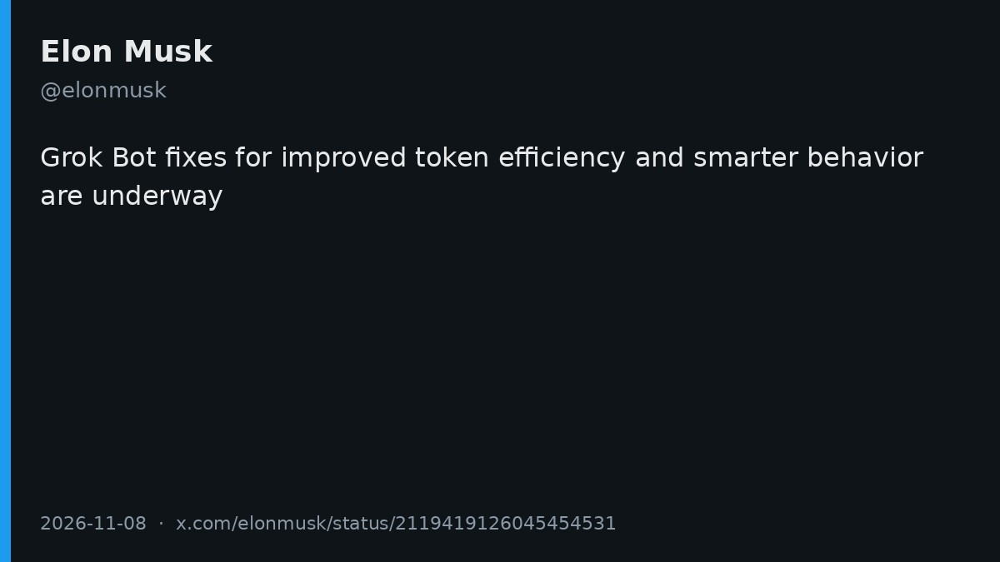
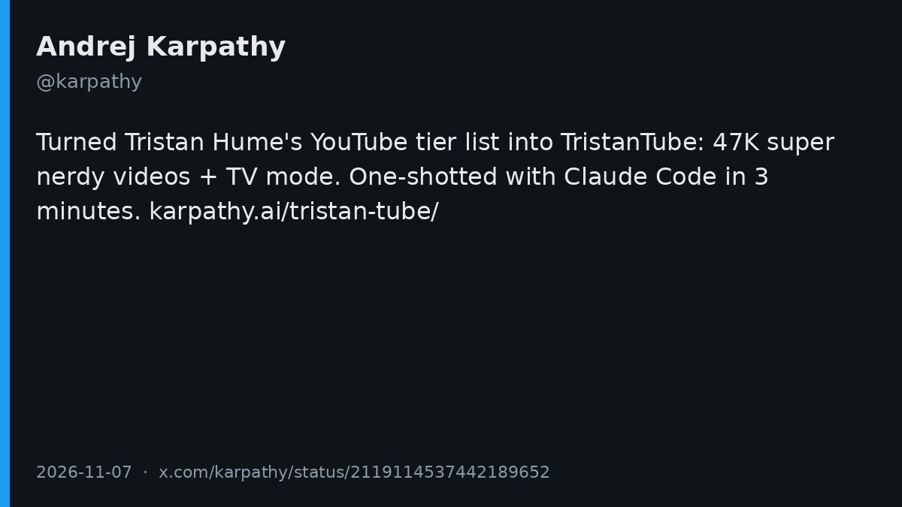
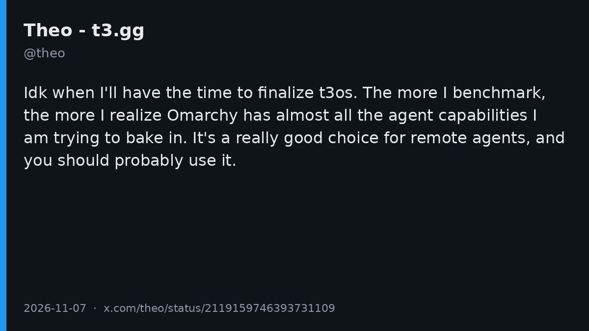
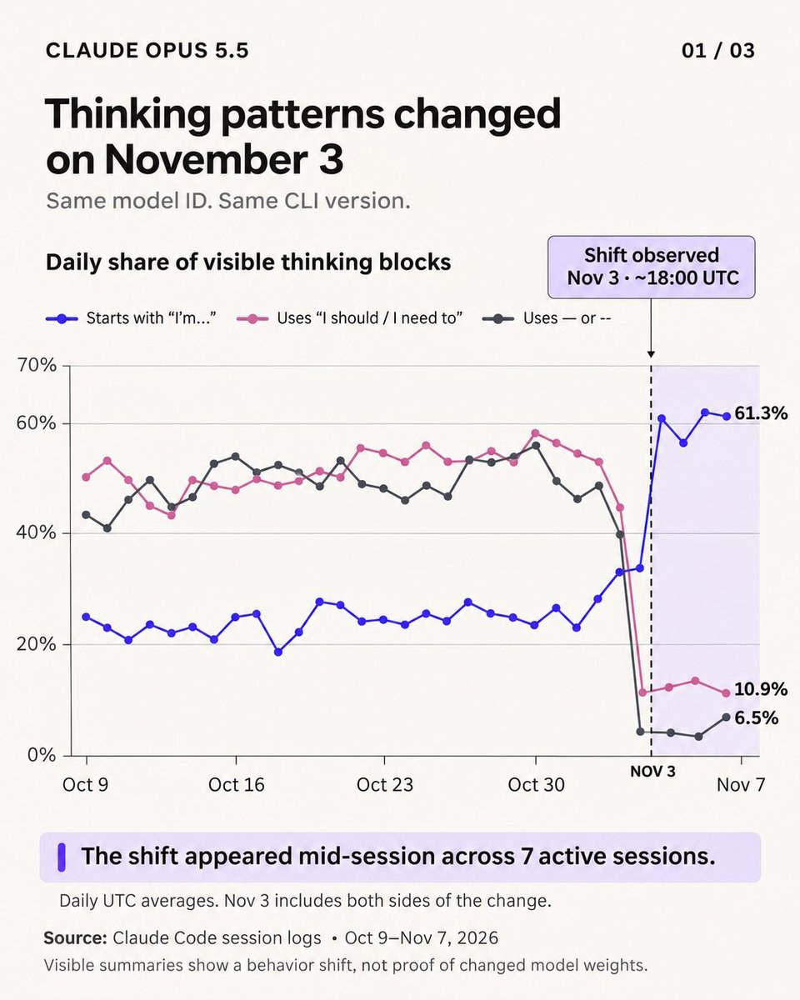
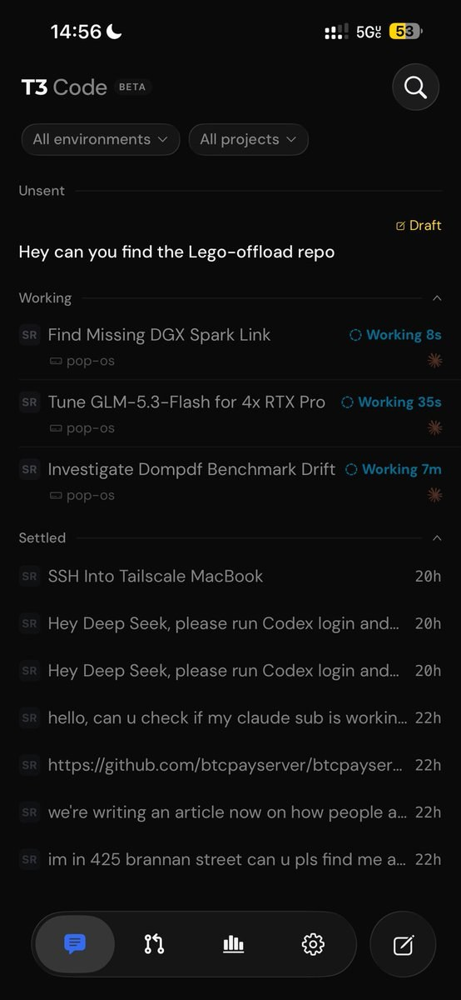
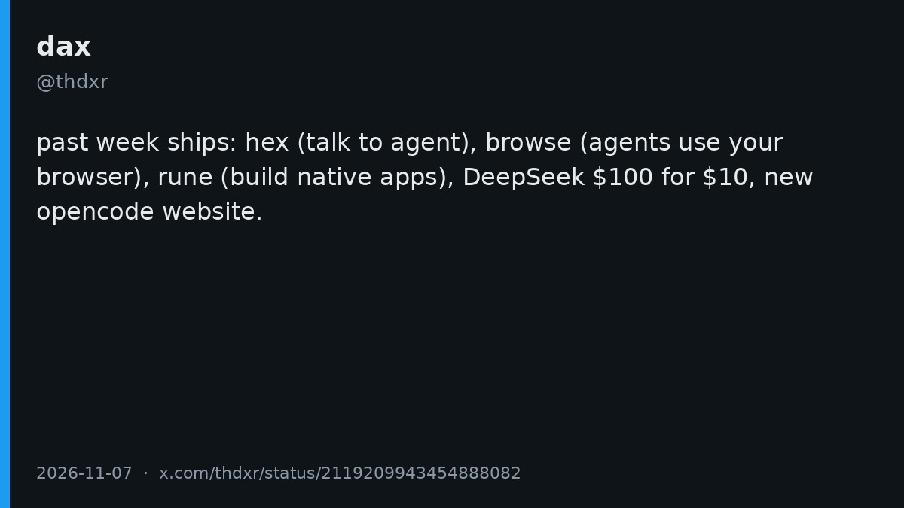
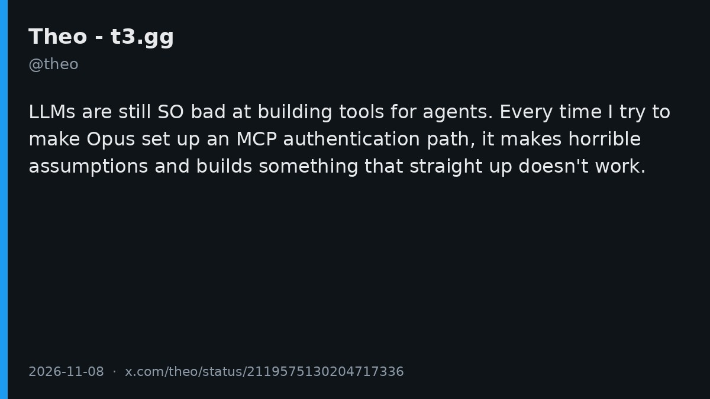
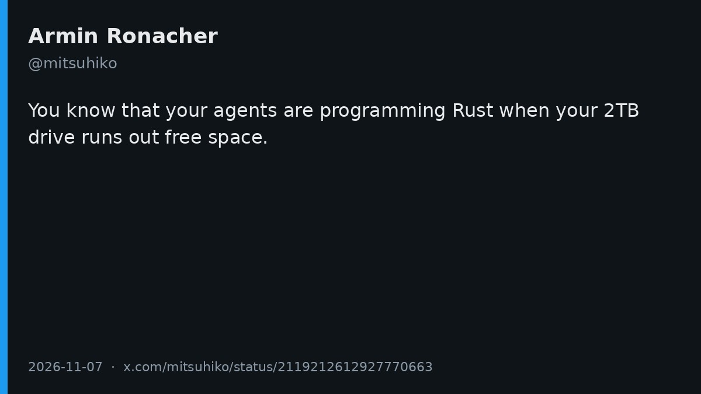

# AI Twitter/X Hots Digest · 2026-11-09 (Monday)

## Today's highlights

1. **Elon says Grok Bot is being fixed**: better token efficiency, and smarter behavior. It was the day's highest-engagement product statement.  
2. **Karpathy one-shotted TristanTube with Claude Code in three minutes**, turning Tristan Hume's YouTube tier list into a site with about 47K nerdy videos and a TV mode.  
3. **The Opus 5.5 "nerf" debate**: someone had Gemini 4 Argon review 1,400 Claude Code sessions and argued the reasoning style shifted on November 3; Theo later said it looks like Anthropic is rolling out a reasoning summarizer change per account, and he sees no capability drop.

---

## 1. Elon: Grok Bot fixes for token efficiency and smarter behavior are underway

**The point**: @elonmusk posted a short product note: Grok Bot fixes are underway for improved token efficiency and smarter behavior. There is no timeline, changelog, or benchmark. Elsewhere on the timeline, a few users said their Grok Bot and Grok Build allowances felt tighter after those products were folded into an X subscription — those are low-engagement personal reports, not an official explanation.

**Why it matters**: This was the day's highest-engagement product statement, and it answers recent complaints about Grok Bot usage and behavior. Whether the next build actually feels better still has to be checked after it ships.

- elonmusk: Grok Bot token efficiency and behavior fixes: https://x.com/elonmusk/status/2119419126045454531

---

## 2. Karpathy one-shots TristanTube with Claude Code in three minutes

**The point**: @karpathy wrote that Tristan Hume published a YouTube channel tier list earlier in the week (the page is dated **2026-11-01**). It looked excellent, so he turned it into [TristanTube](https://karpathy.ai/tristan-tube/): about **47K** super nerdy videos, plus a TV mode for laid-back watching. He says he one-shotted it with Claude Code in three minutes. The original list is on [thume.ca](https://thume.ca/2026/11/01/youtube-tier-list-2026/). He also quoted his earlier HackerTube weekend hack; that is an older post, not a new project from today.

**Why it matters**: This is not a model or IDE launch. It is a high-signal demo of what Claude Code can do with a public list: turn it into something you can actually watch. The 47K figure comes from the original post; the site is there to check.

- karpathy: TristanTube, one-shotted with Claude Code in three minutes: https://x.com/karpathy/status/2119114537442189652

---

## 3. Theo: t3os is still unfinished, and Omarchy is the remote-agent OS to use

**The point**: @theo said he does not know when he will have time to finalize **t3os**, and he apologized to people who are still waiting. The more he benchmarks, the more he realizes **Omarchy** already has almost all the agent capabilities he was trying to bake in. He called it a really good choice for remote agents and said people should probably use it. The post does not list which capabilities he compared, and there is no benchmark table.

**Why it matters**: A product author is publicly delaying his own OS project and pointing people at something that already exists. For anyone leaving a machine up for remote agents and still choosing a system, that is actionable advice rather than another "I will build an OS" teaser.

- theo: t3os can wait; use Omarchy for remote agents: https://x.com/theo/status/2119159746393731109

---

## 4. Was Opus 5.5 nerfed? Theo thinks a reasoning summarizer is rolling out per account

**The point**: @shanemelaugh asked whether Opus 5.5 had been nerfed. He had **Gemini 4 Argon** analyze **1,400** of his Claude Code sessions and concluded that something happened on **November 3**: the model name did not change, but the way it does reasoning took a sharp turn. That is his analysis with another model, not an official note from Anthropic. @theo followed up: Anthropic appears to be rolling out a change to the **reasoning summarizer** on a per-account basis. He sees no sign of degraded capability, and he thinks they are trying to fix reasoning traces that have been "utter garbage" for weeks — something he said he complained about the day before.

**Why it matters**: It separates "the model feels worse" from "the thinking summary you see has changed." The first is a user-side hypothesis; the second is Theo's read. From the outside the two can look identical, which is why "it got dumber" is not data by itself.

- shanemelaugh: a turn on November 3 across 1,400 sessions: https://x.com/shanemelaugh/status/2119192075505893695  
- theo: more likely a per-account reasoning-summarizer rollout: https://x.com/theo/status/2119238026136330313

---

## 5. Antigravity official: DeepMind chemists propose candidate molecules, with synthesis routes, in about an hour

**The point**: The official @antigravity account posted a video: Google DeepMind chemists used Antigravity to extract compound data from patents and papers, analyze what drives potency, and propose new candidate molecules with synthesis routes in about an hour. The agent also launches an interactive viewer so chemists can browse retrieved molecules, inspect their properties, and plot how molecular structure shapes potency. This is an official demo, not a third-party eval. A community roundup posted a bit earlier is useful only as background.

**Why it matters**: Official messaging here presents Antigravity as a scientific research assistant, not only a coding agent. The "one hour" claim and the workflow come from the official post itself.

- antigravity: DeepMind chemists proposing molecules with Antigravity: https://x.com/antigravity/status/2119490135049867264

---

## 6. In the Chinese-speaking circle: Magpie's agy-cli routes Google Ultra into other agents

**The point**: @muihbb said a Google Ultra subscription can be wired into other agents through Magpie's **agy-cli**, whether you use Codex, Claude Code, DeepSeek Harness, or OpenCode. In his telling, it calls the official Antigravity CLI rather than a typical reverse proxy; he later added not to install the wrong package — the one he means is "Antigravity (local agy CLI)." Two caveats: **Magpie itself is not a new release today** (it was already discussed earlier this week), and what heated up today is this "use the official CLI as a shared quota door into several harnesses" workflow. Regional subscription pricing is a user claim; this digest does not walk through how to buy it.

**Why it matters**: The conversation moved from "yet another aggregator" to "can the official CLI be a shared quota entry point?" The original post does not offer a checkable benchmark or a terms-of-service review, so treat it as a user report.

- muihbb: routing Google Ultra into other agents via Magpie agy-cli: https://x.com/muihbb/status/2119376355184025848

---

## 7. T3 Code: praise for mobile and environments, a ban on slop review bots, and a reminder that it is not a harness

**The point**: @0xSero wrote that nothing else right now is better than T3 Code, calling out the mobile app and environments; @theo reposted that. Theo then added that anyone who sets up a bot to leave nonstop slop review comments on every PR in the T3 Code repo will be banned. @MiaAI_lab separately clarified that their own harness is not a fork of T3 Code — first of all T3 Code is not a harness. It drives other agents, such as Codex or Claude Code, and does not run a coding loop of its own. T3 Code as a product already circulated earlier this week; today's discussion is more about lived usage, repo moderation, and where the category boundary sits.

**Why it matters**: After the launch heat, the product is hitting real maintenance issues. At the same time, someone is drawing a clean line between a control room for other agents and an actual harness, so comparisons do not start from the wrong object.

- 0xSero: T3 Code's mobile app and environments: https://x.com/0xSero/status/2119564971227152484  
- theo: slop review bots on the repo will get you banned: https://x.com/theo/status/2119567959052231138  
- MiaAI_lab: T3 Code is not a harness: https://x.com/MiaAI_lab/status/2119560738910114124

---

## 8. OpenCode's week in review: Hex, Browse, and Rune

**The point**: OpenCode cofounder @thdxr posted a list of the past week's ships: **hex**, a great way to talk to an agent; **browse**, a great way for agents to use your browser; **rune**, a great way to build native apps; a DeepSeek deal of $100 of credit for $10; and a new OpenCode website. He also joked that he wrote zero essays about what a software factory is, so "they will be punished." The dates are not the same: Browse was yesterday's lead story, not a launch from today; Hex is a local, cross-platform voice app whose stable release landed around late October; Rune is [anomalyco/rune](https://github.com/anomalyco/rune), a native GPU UI framework aimed at agents, with demos around November 6. This post is a weekly recap, not five same-day releases.

**Why it matters**: It folds a week's shipping into one checklist, and it answers the "software factory" chatter of the moment — the author points at that debate himself, in a joke.

- thdxr: this week's ships, including Hex, Browse, and Rune: https://x.com/thdxr/status/2119209943454888082

---

## 9. Theo: LLMs are still bad at building tools for agents, and Opus bungles MCP auth

**The point**: @theo wrote that LLMs are still "SO bad" at building tools for agents. Every time he tries to have Opus set up an MCP authentication path, the model makes horrible assumptions and builds something that does not work. This is a specific engineering complaint; he did not attach failure logs or a reproducible repo.

**Why it matters**: After a day of product news, this returns to a narrow but common pain: the tool layer around an agent, especially auth, is still easy for a model to assemble in a way that looks plausible and then fails. The post showed up on the user's timeline, and it sits next to the day's other multi-agent orchestration talk.

- theo: LLMs are still bad at building tools for agents: https://x.com/theo/status/2119575130204717336

---

## 10. mitsuhiko: when your agents are writing Rust, a 2TB drive can run out of space

**The point**: @mitsuhiko (Armin Ronacher) wrote: you know your agents are programming Rust when your 2TB drive runs out of free space. It is a one-line field report. He did not name a project, and he did not say whether the usage came from build caches, `target` directories, or something else.

**Why it matters**: Local agents filling disks are no longer a one-off story. When a veteran engineer turns it into a joke, the side effect is common enough that cleanup and quotas belong in the workflow before the drive fills up.

- mitsuhiko: agents writing Rust can fill a 2TB drive: https://x.com/mitsuhiko/status/2119212612927770663

---
