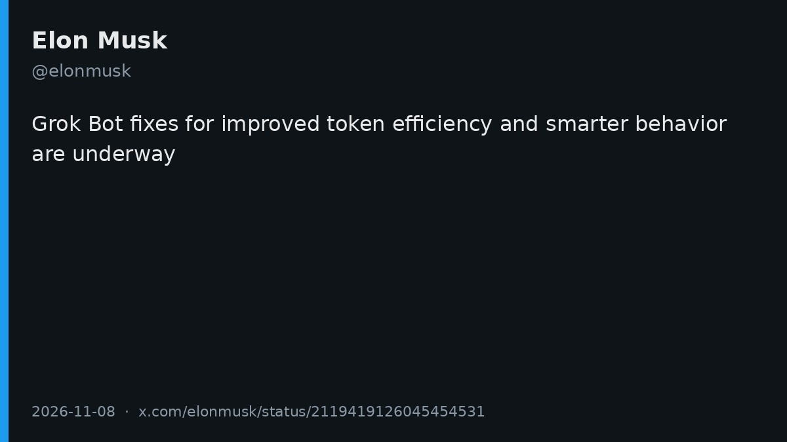
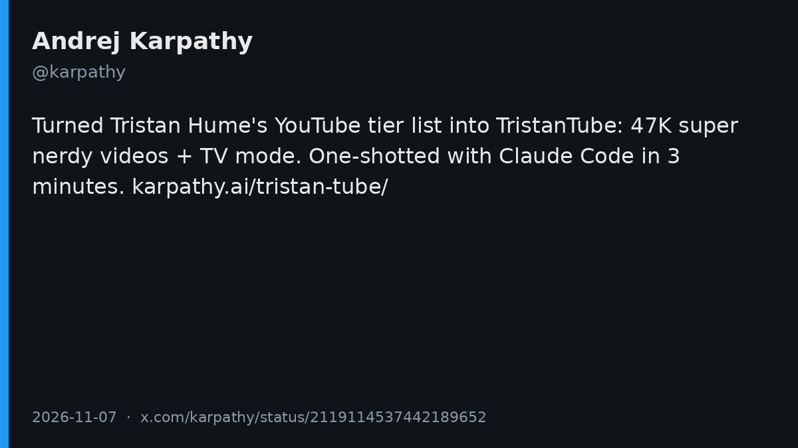
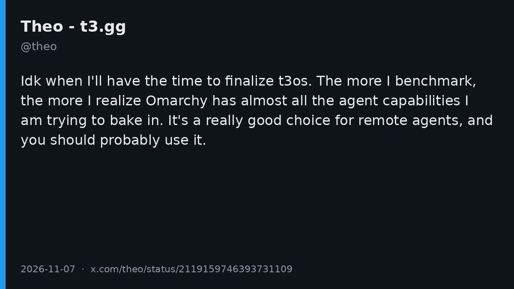
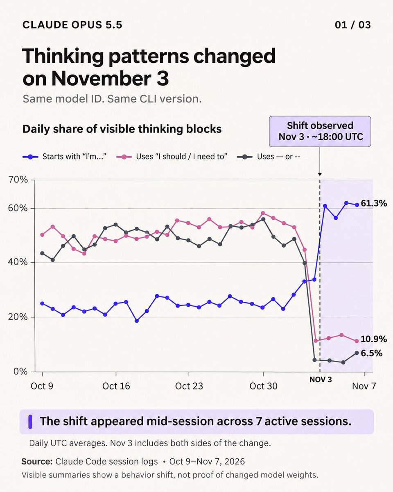
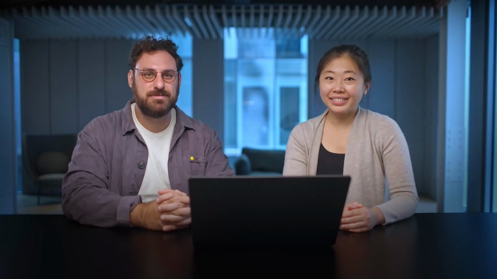
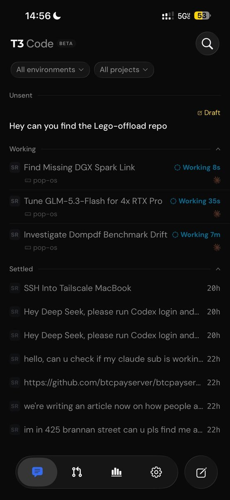
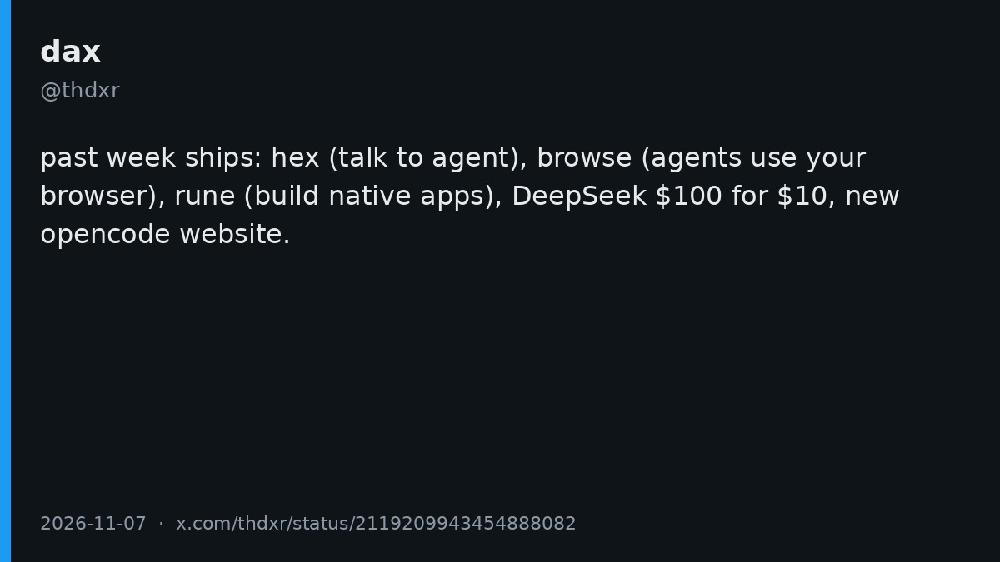
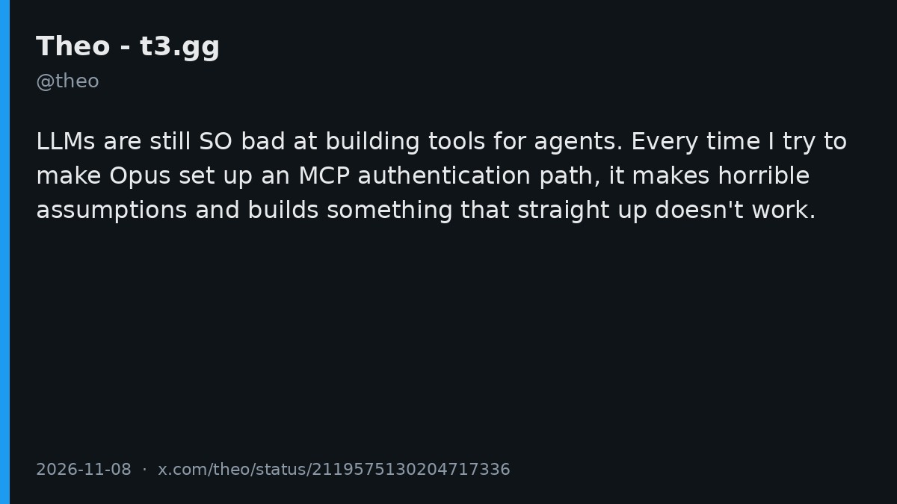
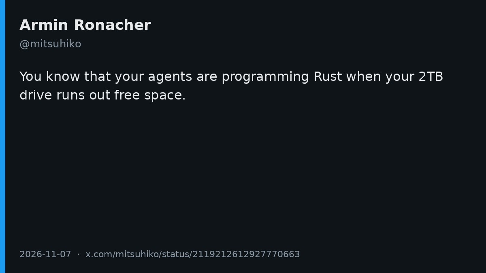

# AI Twitter/X 热点 Digest · 2026-11-09（周一）

## 今日要点

1. **Elon 宣布改进 Grok Bot**：正在提升 token 效率，并让行为更聪明。这是当天互动最高的产品表态。  
2. **Karpathy 用 Claude Code 三分钟做出 TristanTube**：把 Tristan Hume 的 YouTube 频道分级清单做成一个有 4.7 万条极客向视频、带 TV 模式的站点。  
3. **Opus 5.5「变钝」争议**：有人让 Gemini 4 Argon 分析 1400 个 Claude Code 会话，认为 11 月 3 日推理方式急转；Theo 随后判断，这更像 Anthropic 在按账号滚动更新推理摘要器，他这边没看到能力下降。

---

## 1. Elon：Grok Bot 正在改进 token 效率和更聪明的行为

**要点**：@elonmusk 发了一句很短的产品表态：Grok Bot 正在修复，目标是更好的 token 效率，以及更聪明的行为。没有给出时间表、具体改动或基准数字。同一时间线上也有用户在聊 Grok Bot 与 Grok Build 合并进 X 订阅之后额度变紧，但那些是低互动的个人体验，不能当成官方说明。

**为何值得看**：这是当天互动最高的产品表态，直接回应了近期关于 Grok Bot 用量和行为的抱怨。至于修完之后手感会不会真的变好，还要等后续版本来验证。

- elonmusk：Grok Bot 正在改进 token 效率与行为：https://x.com/elonmusk/status/2119419126045454531

---

## 2. Karpathy 用 Claude Code 三分钟做出 TristanTube

**要点**：@karpathy 写道：Tristan Hume 本周早些时候更新了一份 YouTube 频道分级清单（页面日期是 **2026-11-01**），看起来很不错，于是他把它做成了 [TristanTube](https://karpathy.ai/tristan-tube/)——大约 **4.7 万**条极客向视频，还加了适合躺着看的 TV 模式。他标注这是用 Claude Code 三分钟 one-shot 出来的。清单原文在 [thume.ca](https://thume.ca/2026/11/01/youtube-tier-list-2026/)。他同时引用了自己稍早的 HackerTube 周末 hack，那是更早的一条帖，不是今天的新项目。

**为何值得看**：不是新模型或新 IDE 发布，而是一条高信号的创作示范：一份公开清单，加上 Claude Code，就能很快变成可看的产品。4.7 万这条数字来自原帖，站点本身可以点进去核对。

- karpathy：TristanTube，Claude Code 三分钟 one-shot：https://x.com/karpathy/status/2119114537442189652

---

## 3. Theo：t3os 还做不完，远程 Agent 建议先用 Omarchy

**要点**：@theo 说自己还不知道什么时候能抽出时间把 **t3os** 做完，对仍在等待的人表示抱歉。他越做对照，越发现 **Omarchy** 几乎包含他想做进这个系统的 Agent 能力；他认为它很适合 remote agents，并建议大家先用它。帖子没有列出他对过哪些具体能力，也没有给出基准表。

**为何值得看**：这是产品作者公开推迟自己的操作系统项目，并指向一个已经存在的方案。对打算给 Agent 留一台远程机器、又还没选好系统的人，是可执行的建议，而不是又一个「我要做新 OS」的预告。

- theo：t3os 还做不完，远程 Agent 建议用 Omarchy：https://x.com/theo/status/2119159746393731109

---

## 4. Opus 5.5 被质疑「变钝」，Theo 认为是推理摘要器在按账号灰度

**要点**：@shanemelaugh 问：Opus 5.5 是不是被砍了？他让 **Gemini 4 Argon** 分析了自己的 **1400** 个 Claude Code 会话，认为 **11 月 3 日**发生了变化——模型名字没变，但推理方式急转。这是他用另一个模型做的会话分析，不是 Anthropic 的官方说明。随后 @theo 跟进：Anthropic 似乎在按账号滚动更新 **reasoning summarizer**；就他观察到的而言，没有能力下降的迹象。他觉得官方是在修已经糟糕了好几周的推理摘要，并提到自己前一天也抱怨过这些 traces。

**为何值得看**：它把「手感变差」和「你看到的思考摘要变了」拆开。前者是用户侧的分析假设，后者是 Theo 的判断；两套说法从外面看起来很像，所以「它变笨了」本身还不能当数据用。

- shanemelaugh：1400 个会话里看到 11 月 3 日的转折：https://x.com/shanemelaugh/status/2119192075505893695  
- theo：更像是推理摘要器在按账号灰度：https://x.com/theo/status/2119238026136330313

---

## 5. Antigravity 官方：DeepMind 化学家一小时提出带合成路线的候选分子

**要点**：官方账号 @antigravity 发视频介绍：Google DeepMind 的化学家用 Antigravity 从专利和论文里提取化合物数据，分析什么在驱动效力，并在大约一小时内提出带合成路线的新候选分子。Agent 还会打开一个交互式查看器，方便化学家浏览检索到的分子、检查属性，并画出分子结构如何影响效力。这是官方演示，不是第三方评测。稍早还有一条社区作品合集，用作背景即可。

**为何值得看**：官方这次把 Antigravity 讲成科学研究助手，而不只是写代码的 Agent。视频里的「一小时」和流程是官方自己的叙述。

- antigravity：DeepMind 化学家用 Antigravity 提案新分子：https://x.com/antigravity/status/2119490135049867264

---

## 6. 中文圈：用 Magpie 的 agy-cli 把 Google Ultra 接到其他 Agent

**要点**：@muihbb 说，买到的 Google Ultra 可以通过 Magpie 的 **agy-cli** 接到别的 Agent 上用，不管是 Codex、Claude Code、DeepSeek Harness 还是 OpenCode。按他的说法，原理是调用 Antigravity CLI 的官方接口，和常规反代不同；他后来补充不要装错，对应的是「Antigravity (local agy CLI)」。需要说清楚：**Magpie 本身不是今天新发布的**，前几天已经讨论过；今天升温的是这条「走官方 CLI、把一处额度接到多个 harness」的用法。地区订阅差价是用户自述，这里不展开购买步骤。

**为何值得看**：讨论焦点从「又一个聚合器」变成了「官方 CLI 能不能当统一额度入口」。是否稳定、是否符合各家服务条款，原帖没有提供可核对的基准，只能当用户报告来读。

- muihbb：Google Ultra 经 Magpie agy-cli 接到其他 Agent：https://x.com/muihbb/status/2119376355184025848

---

## 7. T3 Code：有人赞移动端，Theo 警告别用 slop 机器人刷 PR，也有人澄清它不是 harness

**要点**：@0xSero 写道，现在没有比 T3 Code 更好的东西，移动应用和环境都很出色；@theo 转发了这条。Theo 随后自己补充：如果有人给 T3 Code 仓库的每个 PR 都安排机器人刷 slop review，会被封禁。@MiaAI_lab 则澄清，自己的 harness 不是 T3 Code 的 fork——首先 T3 Code 就不是 harness，它驱动其他 Agent（例如 Codex、Claude Code），并不自己跑一套编码循环。T3 Code 作为产品在前几天已经热传过，今天更多是使用体验、仓库治理，以及「它到底是不是 harness」的边界讨论。

**为何值得看**：热度过去之后，产品开始面对真实的维护问题；同时有人把它和真正的 harness 区分开，避免比较对象从一开始就错位。

- 0xSero：T3 Code 的移动端与环境：https://x.com/0xSero/status/2119564971227152484  
- theo：用 slop 机器人刷 PR 会被封禁：https://x.com/theo/status/2119567959052231138  
- MiaAI_lab：T3 Code 不是 harness：https://x.com/MiaAI_lab/status/2119560738910114124

---

## 8. OpenCode 一周复盘：Hex、Browse、Rune

**要点**：OpenCode 联合创始人 @thdxr 发了一张本周交付清单：**hex**，适合和 Agent 说话；**browse**，适合让 Agent 使用你的浏览器；**rune**，适合做原生应用；DeepSeek「100 美元额度卖 10 美元」；以及新的 OpenCode 网站。他同时调侃自己没写任何关于 software factory 的文章，所以「会被惩罚」。需要分开看时间：Browse 是昨天的头条，不是今天刚上线；Hex 是本地跨平台语音应用，稳定版大约在 10 月底；Rune 是 [anomalyco/rune](https://github.com/anomalyco/rune) 这一套面向 Agent 的原生 GPU UI 框架，11-06 前后有过演示。这条帖是一周复盘，不是五件事同一天发布。

**为何值得看**：它把分散在一周里的交付收成一张清单，也和当天关于「软件工厂」的议论对上了号——作者自己用一句玩笑把这件事点出来。

- thdxr：本周交付 Hex、Browse、Rune 等：https://x.com/thdxr/status/2119209943454888082

---

## 9. Theo：LLM 仍然不擅长给 Agent 做工具，Opus 配 MCP 认证会瞎假设

**要点**：@theo 写道：LLM 仍然非常不擅长给 Agent 构建工具。每次他试着让 Opus 去配置一条 MCP 认证路径，模型都会做出很糟糕的假设，最后做出根本不能用的东西。这是一条具体的工程吐槽，没有给出失败日志或可复现的仓库。

**为何值得看**：从产品发布回到一个很窄、但很常见的痛点——Agent 的工具层，尤其是认证，仍然容易被模型用「看起来合理、实际跑不通」的方式搭出来。这条出现在用户时间线上，也和当天其他「多 Agent 编排」讨论连在一起。

- theo：LLM 仍然不擅长给 Agent 做工具：https://x.com/theo/status/2119575130204717336

---

## 10. mitsuhiko：Agent 写 Rust 时，2TB 硬盘也会被写满

**要点**：@mitsuhiko（Armin Ronacher）写：当你的 Agent 在写 Rust，你就知道 2TB 硬盘为什么会没有剩余空间。这是一条经验吐槽，没有指出具体项目，也没有给出占用是来自编译缓存、target 目录还是别的文件。

**为何值得看**：本地 Agent 把磁盘吃满，已经不是个别现象。资深开发者会拿它当梗，说明副作用足够常见，值得在工作流里提前做清理和限额。

- mitsuhiko：Agent 写 Rust 能写满 2TB 硬盘：https://x.com/mitsuhiko/status/2119212612927770663

---
