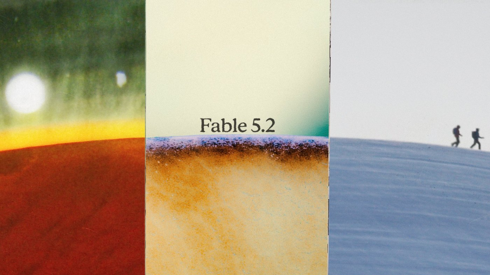
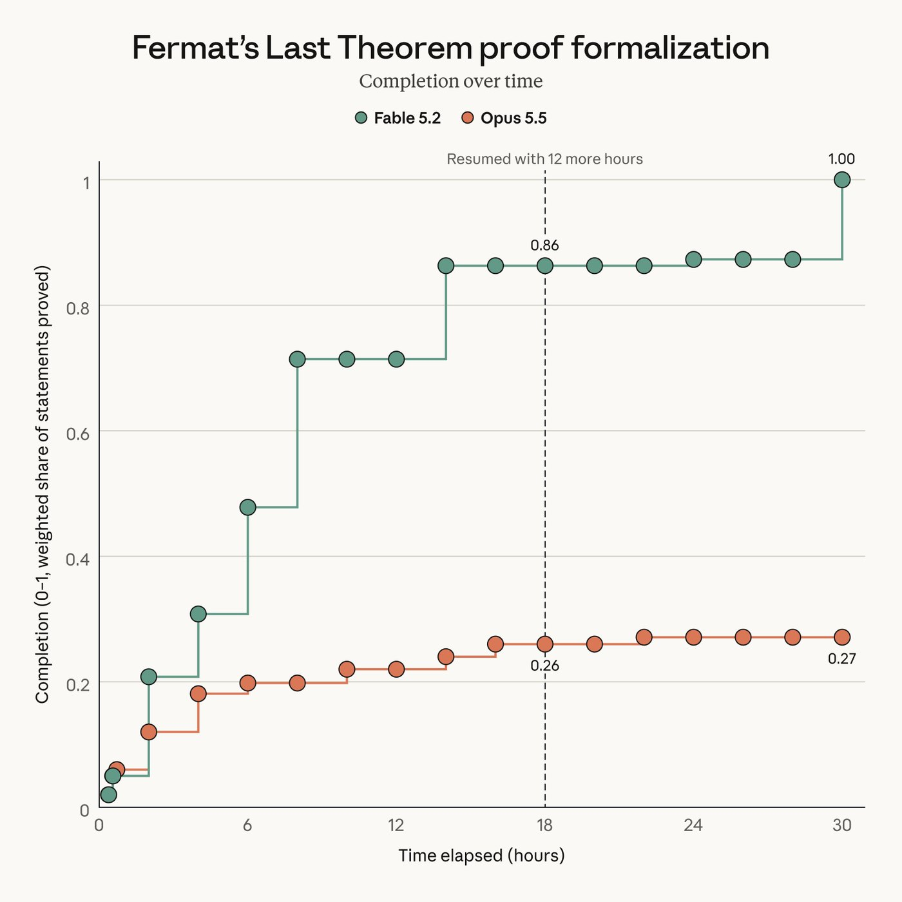
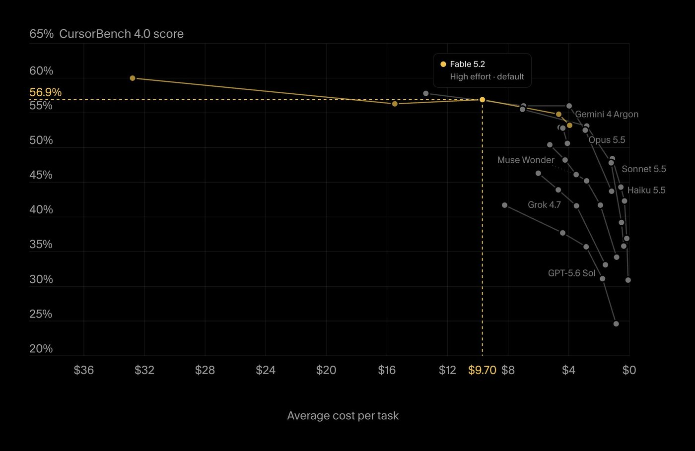
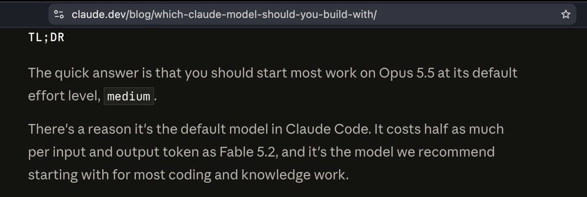
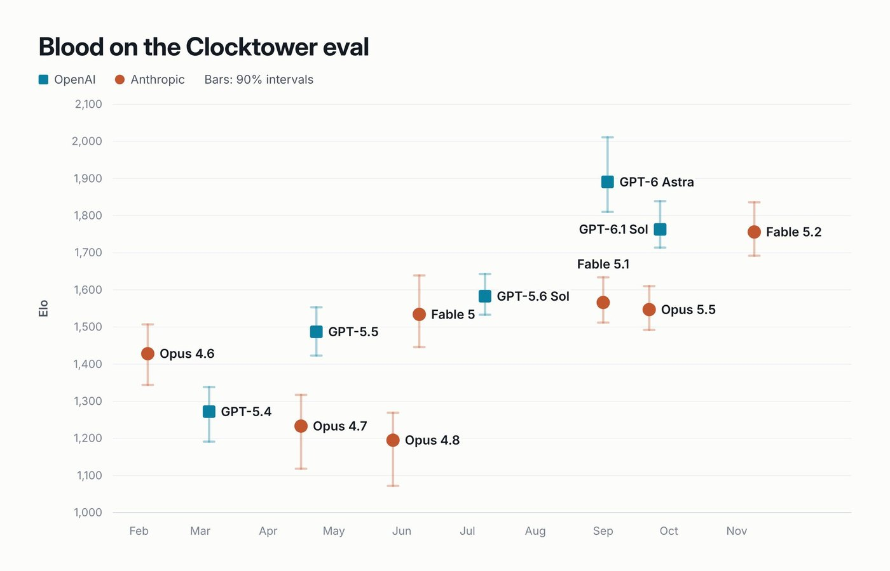
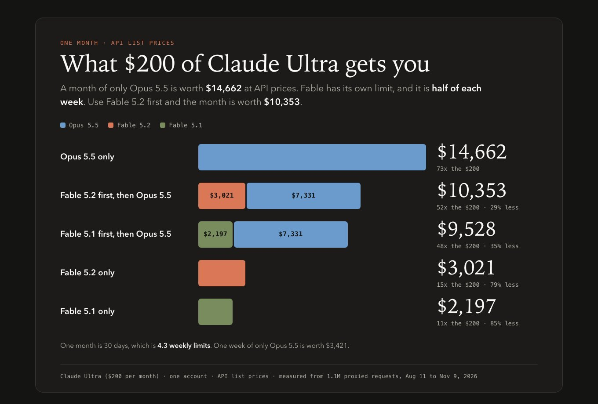
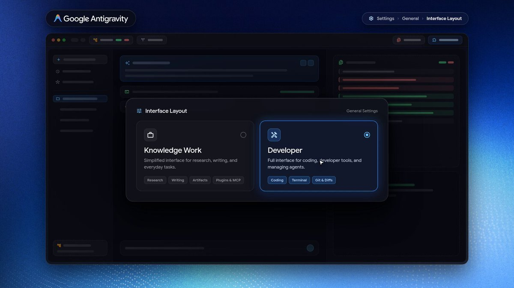
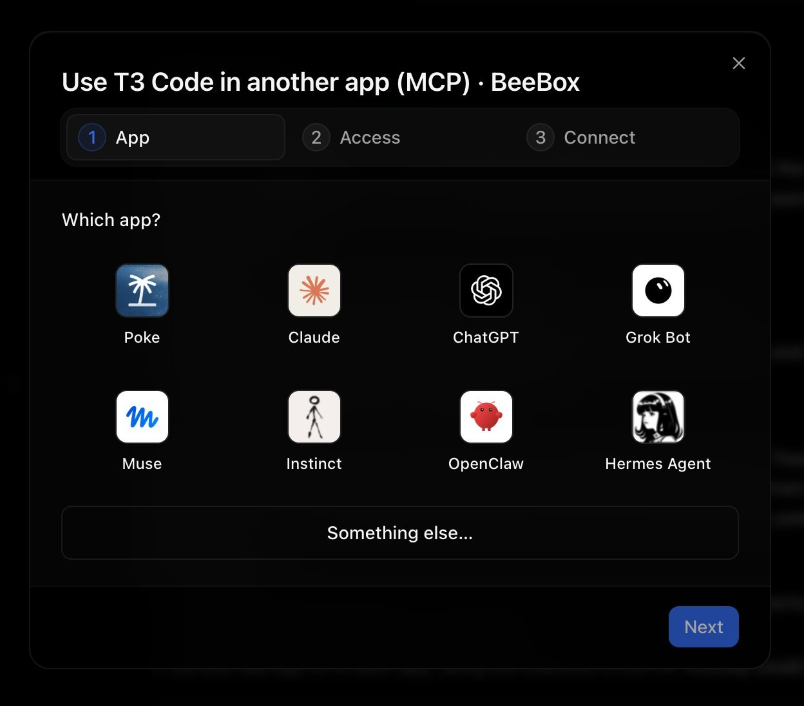
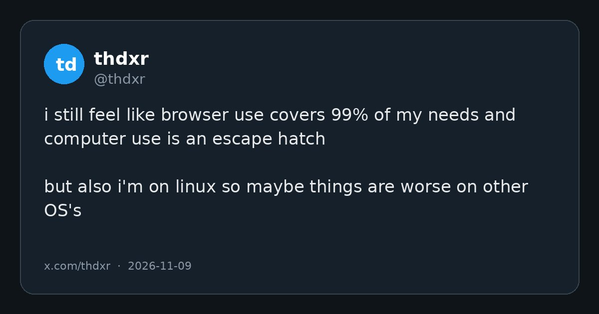

# AI Twitter/X Hots Digest · 2026-11-10 (Tuesday)

## Today's highlights

1. **Anthropic released Claude Fable 5.2 and Mythos 5.2**: official posts describe them as collaborators on the hardest technical work, a step above Opus 5.5 on almost every capability Anthropic evaluated, with outputs up to 30% faster and API pricing down to **$8 / $40** per million tokens. Fable is for all paying users; Mythos requires a life-sciences or cyber verification program. Anthropic also says most everyday coding and knowledge work should still start with Opus 5.5.
2. **Coding tools turned it on quickly**: Cursor, GitHub Copilot in VS Code, Devin Desktop/CLI, and Vercel AI Gateway all announced support. Cursor's numbers: CursorBench rose from 49.2% on Fable 5.1 to **56.9%** at default effort, and **60%** at max effort.
3. **Feel and quota started to get reconciled**: Alex Albert shared how he uses the model; Theo warned that xhigh / max are not automatically better on code benches, and that Fable burns faster than Opus on Claude Ultra, with official policy capping Fable at 50% of the weekly limit.

---

## 1. Anthropic releases Claude Fable 5.2 and Mythos 5.2

**The point**: @claudeai introduced **Claude Fable 5.2** and **Claude Mythos 5.2** as models designed to tackle the most daunting technical challenges, with improvements in areas such as coding, reasoning, and vision. A follow-up said they sit a step above **Opus 5.5** in almost all the capabilities Anthropic evaluated. Testers found them clearer than earlier Fable and Mythos models, and they generate outputs up to **30%** faster than the 5.1 versions. Fable 5.2 is available today on all paid plans, the Claude Platform, and major clouds, at **$8 per million input tokens and $40 per million output tokens**, down from $10 and $50. The accompanying blog also describes an optional fast mode that speeds up token generation by up to 2.5 times, priced at $16 / $80. Fable and Mythos are the same underlying model; Fable ships with stronger cybersecurity and biology safeguards, which is why it is broadly available, while organizations pursuing beneficial work in cybersecurity or biomedical research can apply for Mythos through the Life Sciences and Cyber Verification Programs. Anthropic is explicit about positioning: these models are best for ambitious, open-ended technical work. For most coding and knowledge tasks, it still recommends starting with Opus 5.5, its strongest daily driver, then moving up to Fable or Mythos — or down to Sonnet 5.5 or Haiku 5.5 — depending on scope. Medium is the default effort in Claude apps and Claude Code.

**Why it matters**: This was the day's highest-engagement product launch, and it explains why people who expected "Fable 5.5" got 5.2 instead. Official messaging does not present it as the next default daily driver. It presents a more expensive, more selective model above Opus. The figures and the access boundary come from the official posts and the [launch post](https://www.anthropic.com/claude-fable-and-mythos-5-2), not from a third-party recap.

- claudeai: introducing Claude Fable 5.2 and Mythos 5.2: https://x.com/claudeai/status/2119867114450268322
- claudeai: a step above Opus 5.5 on most evals, outputs up to 30% faster: https://x.com/claudeai/status/2119867117642146270
- claudeai: live on paid plans at $8 / $40: https://x.com/claudeai/status/2119867138987176141

---

## 2. Official demos: electronics, Fermat's Last Theorem, black-hole physics, and robots

**The point**: In the same launch thread, Anthropic pulled out several pre-release projects. From a one-paragraph prompt, Fable 5.2 designed three working electronic devices, including a home voice-assistant hub: it wrote the specifications, chose components, routed four-layer boards, designed 3D-printed enclosures, and programmed the software. Anthropic said each board was ready to manufacture in under a day, and all three devices worked without electrical modifications. Separately, a team of about **1,000** Fable 5.2 agents fully formalized Fermat's Last Theorem in **30 hours**, translating the proof into a language a computer can check step by step. With the same setup, Opus 5.5 completed only about **26%** in 18 hours and barely moved further by hour 30. @swyx noted that someone had just proved Fermat's Last Theorem as a launch demo. In a later thread, Anthropic also said Fable 5.2 solved two open theoretical-physics calculations related to black holes (one of them a laborious calculation laid out in 2003 and left unfinished) and outperformed other models it tested — plus most AI systems built specifically for robot control — on the public RoboDojo simulated two-arm benchmark. There were additional examples, including writing complete synthesis routes from a single molecular image and improving listed solutions in the MIPLIB optimization library. All of this is Anthropic's own account; the chemistry routes have not been tested in a lab.

**Why it matters**: The launch is not just a benchmark table. By putting hardware, formal mathematics, physics, and robotics in the same day's demos, Anthropic is selling Fable as a model for long-running technical projects that can break themselves into pieces, not only as a better autocomplete. The specific numbers should be checked against the original posts or the blog, especially where outside lab or peer review has not happened yet.

- claudeai: 1,000 agents formalized Fermat's Last Theorem in 30 hours: https://x.com/claudeai/status/2119867129751056485
- claudeai: robot control on RoboDojo: https://x.com/claudeai/status/2119867132452221045
- claudeai: three working devices from a one-paragraph prompt: https://x.com/claudeai/status/2119899459761131615
- swyx: Fermat's Last Theorem as a launch demo: https://x.com/swyx/status/2119935240202539147

---

## 3. Cursor, Copilot, Devin, and Vercel turn on Fable 5.2

**The point**: Coding tools followed the launch quickly. @cursor_ai said Fable 5.2 is now in Cursor: at max effort it is the top model on CursorBench at **60%**; at default effort it scores **56.9%**, up from **49.2%** for Fable 5.1. Cursor also noted the $8 / $40 price, 20% below Fable 5.1, and warned that effort levels do not behave the same as they did on 5.1 — start at the default rather than carrying over an old setting. @code said Claude Fable 5.2 is generally available in GitHub Copilot for VS Code, aimed at complex, multi-step work across large codebases. @cognition announced it in Devin Desktop and the Devin CLI, citing a **49.1** score on FrontierCode 2.0 (the same Xhigh figure Anthropic published). @vercel_dev said Fable 5.2 is live on AI Gateway as `anthropic/claude-fable-5.2`. @factory separately said it is available in Factory. These are each vendor's own launch notes, not a shared eval.

**Why it matters**: Once a new model is selectable inside the tools people already use, the conversation moves from "it shipped" to "how does it feel here?" Cursor's note that effort levels changed lines up with the later discussion about not reaching for max by default.

- cursor_ai: Fable 5.2 in Cursor, with CursorBench scores: https://x.com/cursor_ai/status/2119880829212172509
- code: generally available in GitHub Copilot for VS Code: https://x.com/code/status/2119929137141788955
- cognition: live in Devin Desktop and CLI: https://x.com/cognition/status/2119869931135406452
- vercel_dev: Fable 5.2 on AI Gateway: https://x.com/vercel_dev/status/2119869860096466990

---

## 4. How to use Fable: ask what is wrong first, and do not jump straight to max effort

**The point**: Anthropic's @alexalbert__ wrote that he really likes Fable 5.2, and that on big, open-ended work it feels like a major step above Opus 5.5. His tips: ask what is wrong with your idea before it builds anything — it is strong at brainstorming and will push back; start on **medium / high** effort and save **xhigh** for the hardest problems; say up front what needs your approval (for example deletions) and that the rest is its call; and give it a whole project rather than a next step, then let it run for hours, which is where he thinks it shines. He later shared a prompt he runs on all of his projects whenever a new model drops: "Read this entire project and find everything that's broken, inconsistent, inefficient, or no longer needed. Fix what you're sure about and list the rest for me to review." @theo offered an alternate reading of the effort tip: "don't use max reasoning." He also quoted Anthropic's own model-selection note: start most work on Opus 5.5 at its default medium effort; it is the default model in Claude Code and costs about half as much per token as Fable 5.2. He later added that on Slopalytics, when he switched to a code-only view, xhigh and max scored worse on the code benches than high.

**Why it matters**: Official materials can say Xhigh posts the highest FrontierCode score and still set Medium as the default, while recommending Opus for everyday work. The first-night usage talk is less "is one more notch always smarter?" and more "this model's knobs do not match last month's habits." Alex's prompt and Theo's reading are field notes, not documentation.

- alexalbert__: four tips for using Fable 5.2: https://x.com/alexalbert__/status/2119869724247077229
- alexalbert__: the project-audit prompt he runs on every new model: https://x.com/alexalbert__/status/2119884951550386671
- theo: quoting Anthropic — start most work on Opus 5.5 at medium: https://x.com/theo/status/2119939401161851374  
- theo: an alternate reading — "don't use max reasoning": https://x.com/theo/status/2119952427797643345

---

## 5. First-night evals: a Slopalytics lead, Clocktower still behind Astra, and a portal FPS

**The point**: Numbers started showing up outside Anthropic's own tables. @theo said the latest benchmarks were up on Slopalytics (via Artificial Analysis) and that Fable was "mogging so hard," with a **5**-point lead. @dwarkesh_sp compared models on Blood on the Clocktower: Fable 5.2 is still worse than **GPT-6 Astra**, though much better than Opus 5.5 or Fable 5.1. @_sholtodouglas posted a video of an arena FPS with portals and said Fable 5.2 is the first model that clears his bar for a game that is seriously fun and beautiful; they had already spent a few evenings playtesting it at the office. These are personal or third-party scoreboards, not a substitute for the official evals.

**Why it matters**: The same night produced three very different answers to "is it good?": a lead on a composite leaderboard, a loss to Astra on a social-reasoning game, and someone already shipping a playable game. First-night conclusions will be messy, but they are closer to real use than the launch charts alone.

- theo: a 5-point Fable lead on Slopalytics: https://x.com/theo/status/2119946060361818578
- dwarkesh_sp: still behind GPT-6 Astra on Blood on the Clocktower: https://x.com/dwarkesh_sp/status/2119942657812451482
- _sholtodouglas: an arena FPS with portals: https://x.com/_sholtodouglas/status/2119935331499925557

---

## 6. Theo: on Ultra, Fable burns faster than Opus and can use only half the weekly limit

**The point**: @theo compared usage from the Claude Code request logs he keeps. He wrote that the $200 Claude Ultra plan yields about **$15,000** of Opus 5.5 in a month, but only around **$3,000** of Fable — the original post says "Fable 5.5," while the model that shipped today is Fable 5.2; his follow-ups discuss the newly released Fable 5.2. He flagged another constraint: Fable can be used for only **50%** of the weekly limit, so exclusive Fable use leaves half the allowance unused. That matches Anthropic's launch note: for a week, plans and seats that include Fable get one to three Fable resets based on tenure, and on Pro plans and standard Team seats Fable is included for up to 50% of weekly usage. Theo later posted that Fable 5.2 is cheaper than 5.1 ($10 / $50 down to $8 / $40) and appears to extract more output per dollar from other efficiency wins as well. He called these early numbers.

**Why it matters**: Official copy can say "stronger and cheaper" while subscribers feel "stronger, but only half your week, and it burns the remaining allowance faster." Those statements can both be true. Choosing a model now means reading the plan rules, not only the per-million-token list price.

- theo: Opus vs. Fable usage on Ultra: https://x.com/theo/status/2119960608816988596
- theo: Fable is capped at 50% of the weekly limit: https://x.com/theo/status/2119961085185040823
- theo: Fable 5.2 is cheaper than 5.1, with other efficiency wins: https://x.com/theo/status/2119962060230742105

---

## 7. Antigravity ships a Knowledge Work layout

**The point**: The official @antigravity account said it is launching a new **Knowledge Work** interface layout tuned for research, writing, and artifacts: the same agent harness, plugins, and MCP tools, without the terminal and git clutter. The layout can be selected in the General tab of Settings. The stated goal is to help more professionals use Antigravity, not only software developers. Teammate @kevinhou22 added that many non-developers already liked what the team had built for software development, so they made the product friendlier and more capable for knowledge workers — and that this is only the beginning. @_mohansolo posted a matching note. This is an official product update, not a third-party review.

**Why it matters**: After presenting Antigravity as a scientific research assistant the day before, the team is now splitting the UI itself: one layout for developers, another for knowledge work that hides the terminal and git. Same agent, different shell — an attempt to grow the audience beyond people who write code.

- antigravity: the Knowledge Work layout: https://x.com/antigravity/status/2119913586109579283
- kevinhou22: making Antigravity usable for more professionals: https://x.com/kevinhou22/status/2119954182971261437

---

## 8. T3 Code: remote MCP control from other devices, plus experimental tab-complete

**The point**: @theo said he overhauled the flow for controlling T3 Code from other devices: you can now hit **cmd+k**, type `mcp`, and set up the connector for whichever agents you want to steer T3 Code from. He also turned on an experimental toggle for "Tab complete" prompt suggestions. @0xSero wrote that T3 Code environments already have a Grok Bot-like experience, and that he can take over from his MacBook. T3 Code itself is not a new product today — it circulated earlier this week. What is new today is the remote-control setup and an editor-style suggestion feature.

**Why it matters**: The conversation is moving from "yet another control plane" to a more concrete path: send instructions from another agent or from a phone, then pick the session back up on your own machine. Tab-complete suggests the app is starting to grow small IDE-like comforts, not only a remote control.

- theo: cmd+k mcp to set up remote control: https://x.com/theo/status/2119948325705462260
- theo: experimental tab-complete prompt suggestions: https://x.com/theo/status/2119952067171430740
- 0xSero: a Grok Bot-like experience in environments: https://x.com/0xSero/status/2119944454656405556

---

## 9. Someone rebuilt a personal Grok Bot in under an hour with T3 Code

**The point**: @nickvasilescu wrote that Grok Bot had cut his limits, so he rebuilt it himself in under an hour using @theo's T3 Code as a software factory, with every prompt recorded on camera. This is a usage demo, not an official feature drop from T3 Code or Grok Bot, and the original post does not include a checkable repo or benchmark. Two things should stay separate: it shows how quickly a control plane plus existing subscriptions can stand up a personal assistant, and it is not a substitute for an official note about Grok Bot itself.

**Why it matters**: After complaints about tighter allowances, someone responded not by switching subscriptions but by moving the workflow onto coding agents he had already paid for. The bookmark count suggests other people are looking for a similar path. It remains a personal demo, not a product launch.

- nickvasilescu: rebuilding a Grok Bot in under an hour with T3 Code: https://x.com/nickvasilescu/status/2119832877206741285

---

## 10. thdxr: browser use already covers 99% of his needs; computer use is an escape hatch

**The point**: OpenCode cofounder @thdxr wrote that he still feels **browser use** covers 99% of his needs, and that **computer use** is more of an escape hatch — though he is on Linux, and things may be worse on other operating systems. It is a usage judgment, with no benchmark table and no specific product version attached. It showed up on the user's timeline, right after the past two days of talk about OpenCode Browse and desktop computer use.

**Why it matters**: While many demos show an agent driving an entire desktop, someone who builds this kind of product put the priority bluntly: let the agent use the browser first, and keep desktop control as the exception. That will not fit every workflow, but it is a reminder that once the capability boundary gets wider, the default path should stay as narrow as it can.

- thdxr: browser use covers 99%; computer use is an escape hatch: https://x.com/thdxr/status/2119933430276247577

---
