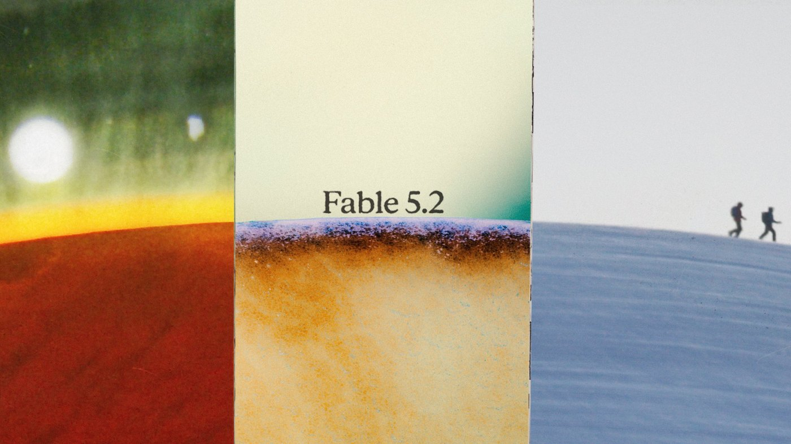
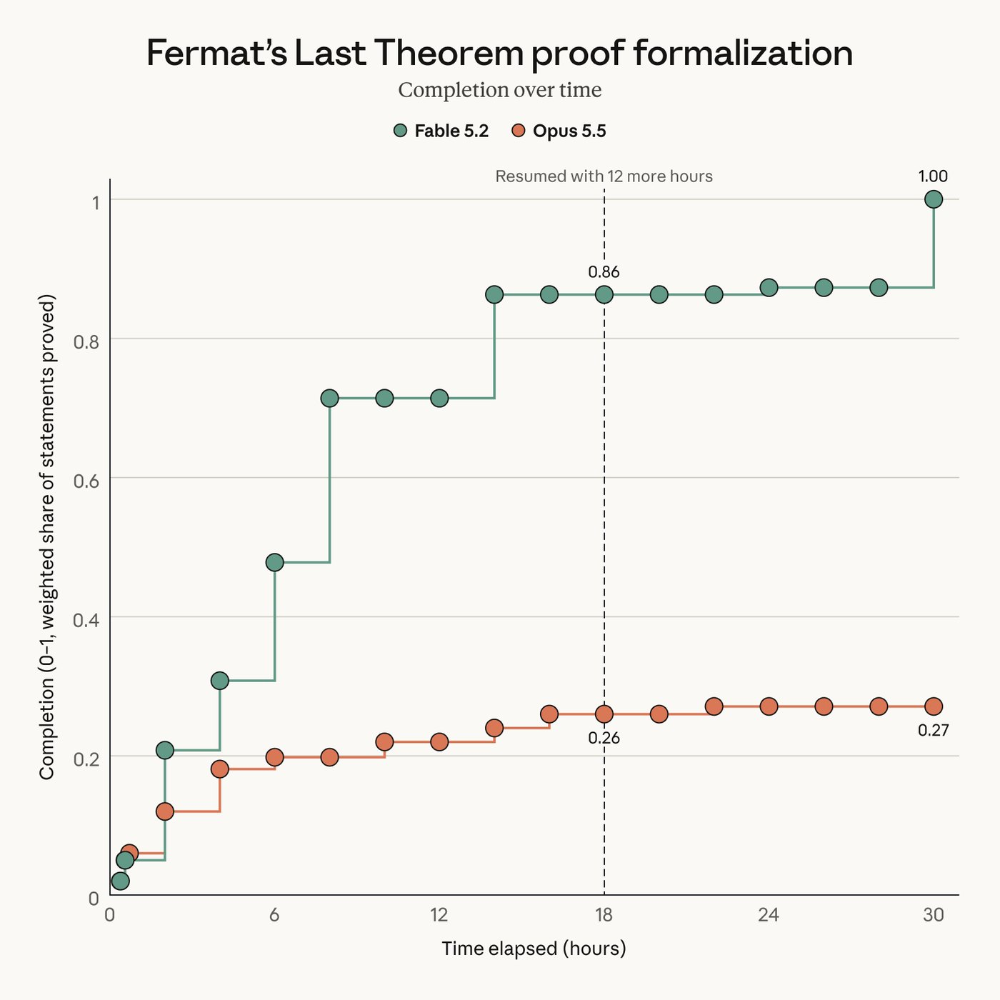
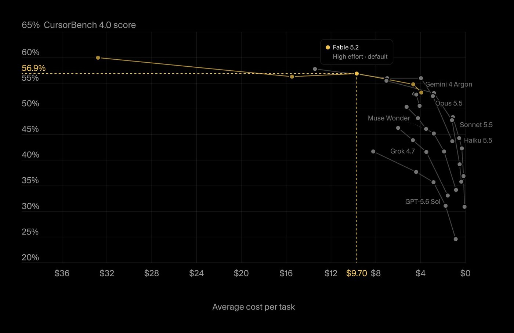
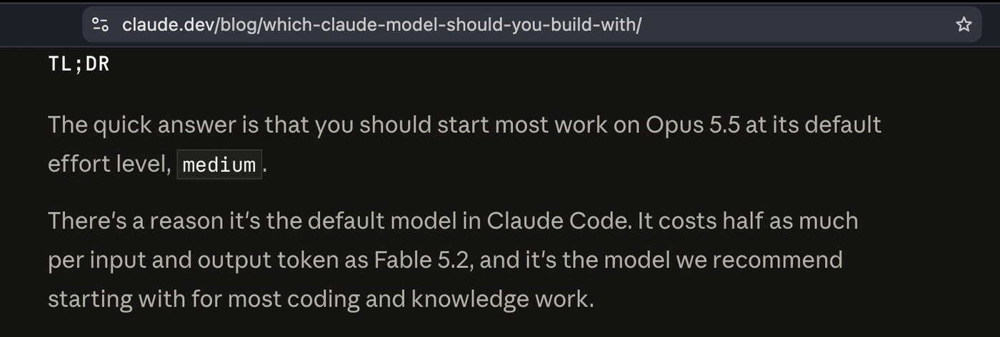
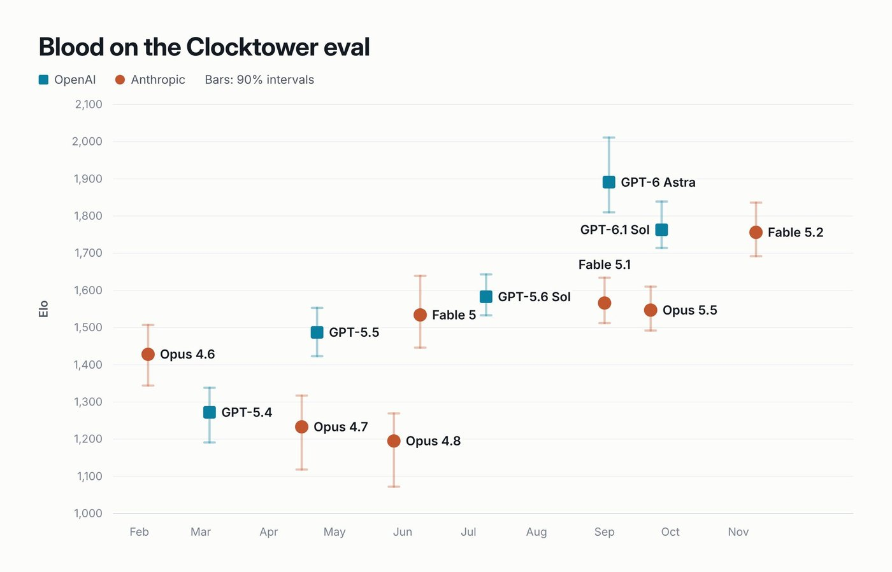
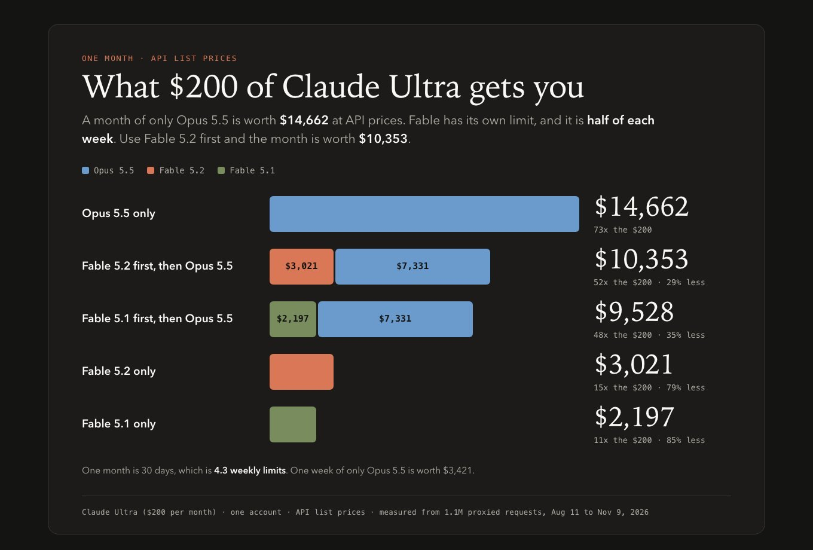
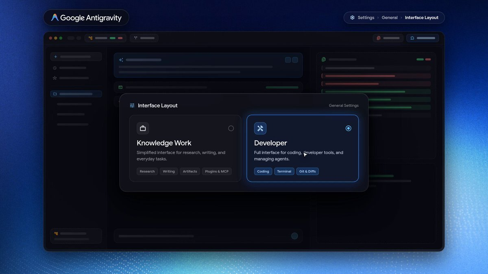
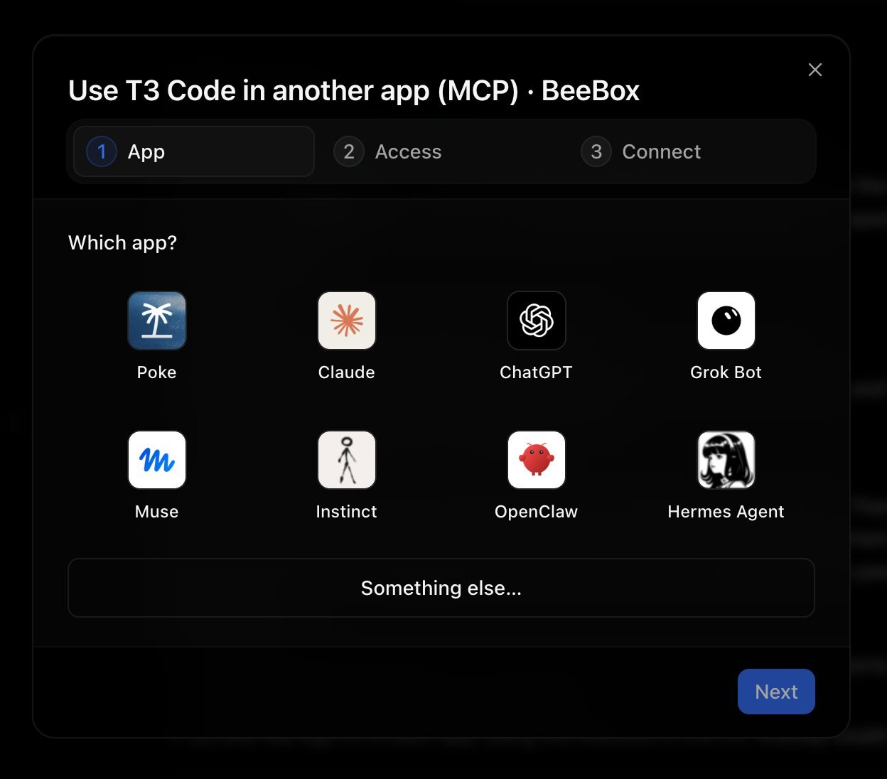
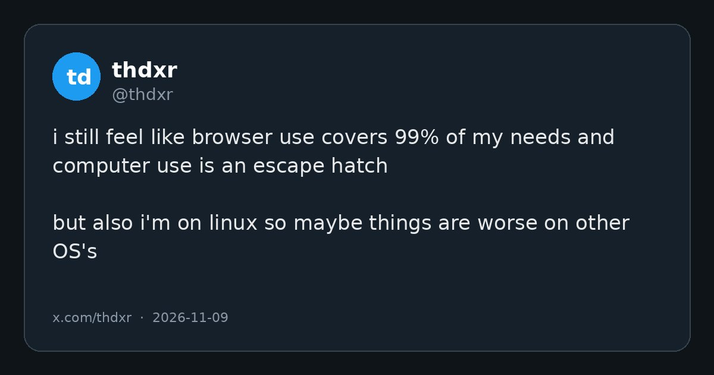

# AI Twitter/X 热点 Digest · 2026-11-10（周二）

## 今日要点

1. **Anthropic 发布 Claude Fable 5.2 与 Mythos 5.2**：官方称它们面向最难的技术工作，在多数评测上比 Opus 5.5 高一档，输出最多快 30%，API 价格降到每百万 token **$8 / $40**。Fable 面向所有付费用户；Mythos 需通过生命科学或网络安全审核。官方同时建议：大多数日常编码和知识工作仍从 Opus 5.5 起步。
2. **编程工具迅速接入**：Cursor、VS Code 的 GitHub Copilot、Devin Desktop/CLI、Vercel AI Gateway 等都宣布上线。Cursor 给出的数字是：默认 effort 下 CursorBench 从 Fable 5.1 的 49.2% 升到 56.9%，max effort 时为 60%。
3. **手感和额度开始对账**：Alex Albert 分享了自己的用法；Theo 则提醒，xhigh / max 在代码基准上不一定更好，而且 Claude Ultra 里 Fable 比 Opus 更烧，官方还把 Fable 限制在每周额度的 50%。

---

## 1. Anthropic 发布 Claude Fable 5.2 与 Mythos 5.2

**要点**：@claudeai 宣布推出 **Claude Fable 5.2** 和 **Claude Mythos 5.2**，定位是「最棘手的技术挑战」上的合作者，并称在编码、推理和视觉等方向有提升。官方随后补充：在他们评测过的几乎所有能力上，这两个模型都比 **Opus 5.5** 高一档；测试者觉得沟通比以往的 Fable / Mythos 更清楚，输出最多比 5.1 快 **30%**。Fable 5.2 即日起在所有付费方案、Claude Platform 以及主要云平台上可用，价格是每百万 token **输入 $8、输出 $40**，低于此前的 $10 / $50。博文还写了可选的 fast mode：生成速度最多再快 2.5 倍，价格是 $16 / $80。Fable 和 Mythos 是同一套底层模型；Fable 带有更强的网络安全和生物学防护，因此面向所有用户；要做有益的网络安全或生物医学研究的机构，可以通过 Life Sciences 和 Cyber Verification 项目申请 Mythos。官方也写得很明白：这两款模型最适合开阔、高难度的技术工作；大多数编码和知识任务，他们仍建议从「最强日常主力」Opus 5.5 起步，再按任务范围上调到 Fable / Mythos，或下调到 Sonnet 5.5 / Haiku 5.5。Medium 是 Claude 应用和 Claude Code 里的默认 effort。

**为何值得看**：这是当天互动最高的产品发布，也解释了为什么大家期待的是「Fable 5.5」、实际出来的是 5.2——官方没有把它写成下一代日常主力，而是写成比 Opus 更贵、也更挑场景的上层模型。数字和适用边界都来自官方帖与 [发布博文](https://www.anthropic.com/claude-fable-and-mythos-5-2)，不是第三方转述。

- claudeai：介绍 Claude Fable 5.2 与 Mythos 5.2：https://x.com/claudeai/status/2119867114450268322
- claudeai：多数评测高于 Opus 5.5，输出最多快 30%：https://x.com/claudeai/status/2119867117642146270
- claudeai：付费方案上线，价格 $8 / $40：https://x.com/claudeai/status/2119867138987176141

---

## 2. 官方演示：电子设备、费马大定理、黑洞物理和机器人

**要点**：同一条发布线里，官方把预发布测试里的几个项目单独拿出来讲。一个约一段话的提示词，Fable 5.2 设计了三件能工作的电子设备（包括家用语音助手中枢）：自己写规格、选元件、布四层电路板、做 3D 打印外壳并编写软件；官方称每块板不到一天就能交付制造，三台设备都没有做电气改动就能工作。另一项是数学形式化：大约 **1000** 个 Fable 5.2 agent 用 **30 小时**把费马大定理的证明翻译成计算机可逐步检查的形式；同样设置下，Opus 5.5 在 18 小时内只完成约 **26%**，之后到 30 小时也几乎没有再推进。@swyx 评论说，有人把「证明费马大定理」直接当成发布演示。后续线程里，官方还称 Fable 5.2 解决了两个与黑洞有关的理论物理未决计算（其中一个是 2003 年列出、此前因过于繁重而没做完的计算），并在公开的 RoboDojo 仿真双臂机器人基准上超过了他们测试过的其他模型，以及多数专门做机器人控制的系统。另外还有从一张分子图写出完整合成路线、以及在 MIPLIB 优化题库里改进既有解等例子；这些都是官方自己的叙述，其中化学路线尚未在实验室验证。

**为何值得看**：发布帖不只是一张基准表。官方把硬件、数学形式化、物理和机器人放进同一天的演示，等于在说 Fable 的卖点是「能跑很久、能自己拆任务」的技术项目，而不只是补全代码。具体数字都应回到原帖或博文核对，尤其是尚未经实验室或外部同行复核的部分。

- claudeai：1000 个 agent、30 小时形式化费马大定理：https://x.com/claudeai/status/2119867129751056485
- claudeai：RoboDojo 上的机器人控制：https://x.com/claudeai/status/2119867132452221045
- claudeai：从一段提示词设计出三件能工作的电子设备：https://x.com/claudeai/status/2119899459761131615
- swyx：费马大定理被拿来当发布演示：https://x.com/swyx/status/2119935240202539147

---

## 3. Cursor、Copilot、Devin 和 Vercel 上线 Fable 5.2

**要点**：模型发布后，各编程工具很快跟进。@cursor_ai 宣布 Fable 5.2 已在 Cursor 可用：max effort 时它是 CursorBench 上的榜首，成绩 **60%**；默认 effort 下是 **56.9%**，高于 Fable 5.1 的 **49.2%**。Cursor 还提醒：价格是 $8 / $40，比 Fable 5.1 低 20%；effort 档位和 5.1 时的表现不一样，不要把旧设置直接搬过来，建议从默认档开始。@code 说 Claude Fable 5.2 已在 VS Code 的 GitHub Copilot 中正式可用，面向大型代码库里的复杂多步任务。@cognition 则宣布 Devin Desktop 和 Devin CLI 已接入，并引用 FrontierCode 2.0 上 **49.1** 的成绩（这和官方给出的 Xhigh 分数一致）。@vercel_dev 写 Fable 5.2 已登上 AI Gateway，模型名是 `anthropic/claude-fable-5.2`。另外 @factory 也宣布在 Factory 里可用。这些都是各产品自己的上线说明，不是统一评测。

**为何值得看**：发布当天就能在常用编程环境里选到新模型，讨论会立刻从「官网上线了」变成「在我用的工具里手感如何」。Cursor 特别点出 effort 档位变了，这和后面关于「别一上来就开 max」的讨论是对上的。

- cursor_ai：Fable 5.2 登陆 Cursor，CursorBench 数字：https://x.com/cursor_ai/status/2119880829212172509
- code：VS Code 的 GitHub Copilot 正式可用：https://x.com/code/status/2119929137141788955
- cognition：Devin Desktop 与 CLI 已接入：https://x.com/cognition/status/2119869931135406452
- vercel_dev：Fable 5.2 登陆 AI Gateway：https://x.com/vercel_dev/status/2119869860096466990

---

## 4. 怎么用 Fable：先问问题出在哪，effort 也不要一上来就拉满

**要点**：Anthropic 的 @alexalbert__ 写，自己很喜欢用 Fable 5.2，在大型、开放式任务上感觉明显比 Opus 5.5 高一档。他给了几条用法：先问「我的想法有什么问题」，再让它动手，它擅长头脑风暴，也会反驳；从 **medium / high** effort 开始，把 **xhigh** 留给最难的问题；事先讲清楚哪些事必须经过你批准（例如删东西），其余交给它自己决定；直接给它一整个项目而不是下一步，让它跑上几个小时——他认为这才是它真正擅长的地方。他随后又分享了自己每次换新模型都会对所有项目跑的一句提示词：「读完整项目，找出所有坏掉的、不一致的、低效的或不再需要的东西。你有把握的就修，其余列出来给我审。」@theo 把前面那条 effort 建议读成另一句：「别用 max reasoning。」他还引用了 Anthropic 自己的选型说明：大多数工作应从 Opus 5.5 的默认 medium effort 开始；它是 Claude Code 的默认模型，每 token 价格大约是 Fable 5.2 的一半。他之后在 Slopalytics 的代码-only 模式下也写到：xhigh 和 max 在代码基准上的分数，反而比 high 更差。

**为何值得看**：官方一边把 Xhigh 写成 FrontierCode 上的最高分，一边又把 Medium 设成默认档，还建议日常先用 Opus。第一夜的使用讨论，核心不是「再推一档是不是一定更强」，而是「这款模型的档位和旧习惯不兼容」。Alex 的提示词和 Theo 的读法都是使用经验，不是官方文档。

- alexalbert__：Fable 5.2 的四条使用建议：https://x.com/alexalbert__/status/2119869724247077229
- alexalbert__：每次换新模型都跑的项目审计提示词：https://x.com/alexalbert__/status/2119884951550386671
- theo：引用 Anthropic「大多数工作从 Opus 5.5、medium 起步」：https://x.com/theo/status/2119939401161851374  
- theo：另一种读法是「别用 max reasoning」：https://x.com/theo/status/2119952427797643345

---

## 5. 第一夜评测：Slopalytics 领先，Clocktower 仍不如 Astra，也有人拿它做传送门 FPS

**要点**：数字开始从官方表格外面冒出来。@theo 说最新基准已经上到 Slopalytics（感谢 Artificial Analysis），并写「Fable 碾压得厉害」，领先 **5** 分。@dwarkesh_sp 用 Blood on the Clocktower 做对照：Fable 5.2 仍然不如 **GPT-6 Astra**，但比 Opus 5.5 或 Fable 5.1 好很多。@_sholtodouglas 则发了一段带传送门的竞技场 FPS 视频，称 Fable 5.2 是第一个达到他「认真好玩、而且好看」门槛的模型，他们已经在办公室里互相试玩了几个晚上。这些都是个人或第三方榜单，不是官方评测的替代品。

**为何值得看**：同一夜里出现了三种完全不同的「好不好用」：综合榜领先、社交推理游戏里仍落后于 Astra、以及有人已经拿它做能玩的游戏。第一夜的结论会很散，但比只看发布图更接近实际使用。

- theo：Slopalytics 上 Fable 领先 5 分：https://x.com/theo/status/2119946060361818578
- dwarkesh_sp：Blood on the Clocktower 上仍不如 GPT-6 Astra：https://x.com/dwarkesh_sp/status/2119942657812451482
- _sholtodouglas：带传送门的竞技场 FPS：https://x.com/_sholtodouglas/status/2119935331499925557

---

## 6. Theo：Ultra 套餐里 Fable 比 Opus 更烧，且只能用每周额度的一半

**要点**：@theo 根据自己在 Claude Code 里逐条记录的请求日志做了一组对照。他写道：$200 的 Claude Ultra 方案一个月大约能换来 **$15,000** 的 Opus 5.5，但大概只有 **$3,000** 的 Fable——原帖里他写成了「Fable 5.5」，而当天发布的是 Fable 5.2；后续几条跟进都在讨论刚发布的 Fable 5.2。他特别提醒：Fable 只能占用每周额度的 **50%**，如果只开 Fable，另一半额度等于浪费掉。这和官方发布说明一致：上线首周，包含 Fable 的方案和席位会按订阅时长获得一到三次 Fable 重置，且 Pro 方案与 Team 标准席位里，Fable 最多占每周额度的 50%。Theo 后来补了一张图：Fable 5.2 比 5.1 便宜（$10 / $50 降到 $8 / $40），再加上其他效率收益，同样的钱似乎能换来更多输出。他也写了这些还是早期数字。

**为何值得看**：官方把 Fable 写成「更强也更便宜」，订阅用户感受到的却是「更强，但每周只能用一半，而且单位额度烧得更快」。两件事并不矛盾，但选模型时要把套餐规则算进去，不能只看每百万 token 的标价。

- theo：Ultra 里 Opus 与 Fable 的用量对照：https://x.com/theo/status/2119960608816988596
- theo：Fable 只能占每周额度的 50%：https://x.com/theo/status/2119961085185040823
- theo：Fable 5.2 比 5.1 便宜，还有其他效率收益：https://x.com/theo/status/2119962060230742105

---

## 7. Antigravity 推出面向知识工作的新界面

**要点**：官方账号 @antigravity 宣布上线一套新的 **Knowledge Work** 界面布局，面向研究、写作和产出物：还是同一套 agent harness、插件和 MCP 工具，但去掉了终端和 git 的干扰。用户可以在 Settings 的 General 标签里选择布局。他们的目标是帮助更多专业人士使用 Antigravity，而不只是软件开发者。团队成员 @kevinhou22 随后补充：他们发现不少非开发者也喜欢这套原先为软件开发做的产品，所以把它改得对知识工作者更友好、也更有能力；并说这只是开始。@_mohansolo 也发了同一件事的说明。这是官方产品更新，不是第三方评测。

**为何值得看**：继前一天把 Antigravity 讲成科研助手之后，官方这次直接把界面从「开发者 IDE」拆出一条给知识工作的布局。同一套 agent，换一套少终端、少 git 的外壳，是在试着把用户从写代码的人扩到更广泛的专业人士。

- antigravity：Knowledge Work 界面布局：https://x.com/antigravity/status/2119913586109579283
- kevinhou22：让更多专业人士用上 Antigravity：https://x.com/kevinhou22/status/2119954182971261437

---

## 8. T3 Code：跨设备 MCP 控制，以及实验性的 Tab complete

**要点**：@theo 宣布重做了从其他设备控制 T3 Code 的流程：现在可以用 **cmd+k** 输入 `mcp`，为你想用来遥控 T3 Code 的各种 agent 设置连接器。他还打开了一项实验开关：「Tab complete」提示建议。@0xSero 则写道，T3 Code 的 environments 里已经有一种类似 Grok Bot 的体验，他可以从自己的 MacBook 接手。T3 Code 本身不是今天新发布的产品，前几天已经热传过；今天新增的是跨设备控制方式，以及编辑器里的提示补全。

**为何值得看**：讨论从「又一个控制面」转向更具体的使用路径：在别的 agent 或手机里发指令，再回到自己的机器上接手。Tab complete 则说明它开始补一些传统 IDE 才有的小功能，而不只做远程遥控器。

- theo：用 cmd+k mcp 设置跨设备控制：https://x.com/theo/status/2119948325705462260
- theo：实验性 Tab complete 提示建议：https://x.com/theo/status/2119952067171430740
- 0xSero：environments 里类似 Grok Bot 的体验：https://x.com/0xSero/status/2119944454656405556

---

## 9. 有人用 T3 Code 不到一小时重做了一个自己的 Grok Bot

**要点**：@nickvasilescu 写道，Grok Bot 削减了他的额度，于是他用 @theo 的 T3 Code 当「软件工厂」，不到一小时重做了一个自己的版本，并且把每一步提示都录了下来。这是一条使用演示，不是 T3 Code 或 Grok Bot 的官方功能更新；原帖也没有给出可核对的复现仓库或评测。需要分开看：它说明的是「控制面 + 已有订阅」能多快搭出一套个人助手，而不能当成对 Grok Bot 官方产品的替代说明。

**为何值得看**：在额度变紧的抱怨之后，有人选择的不是换一家订阅，而是把自己的工作流搬到已经付过钱的编码 agent 上。高收藏说明不少人在找同类办法，但这仍是个人演示，不是产品发布。

- nickvasilescu：用 T3 Code 不到一小时重做 Grok Bot：https://x.com/nickvasilescu/status/2119832877206741285

---

## 10. thdxr：browser use 已经覆盖 99% 的需求，computer use 只是逃生舱

**要点**：OpenCode 联合创始人 @thdxr 写道，他仍然觉得 **browser use** 能覆盖自己 99% 的需求，**computer use** 更像逃生舱；不过他自己用的是 Linux，别的操作系统上也许更糟。这是一条使用判断，没有附基准表，也没有点名具体产品版本。它出现在用户时间线上，接在近两天关于 OpenCode Browse 和桌面 computer use 的讨论后面。

**为何值得看**：当各家都在演示「Agent 能操作整个桌面」时，一个天天做这类产品的人把优先级说得很干脆：先让 Agent 用浏览器，桌面操作留作例外。这不一定适用于所有工作流，但能提醒人：能力边界变宽之后，默认路径仍然应该尽量窄。

- thdxr：browser use 覆盖 99%，computer use 是逃生舱：https://x.com/thdxr/status/2119933430276247577

---
