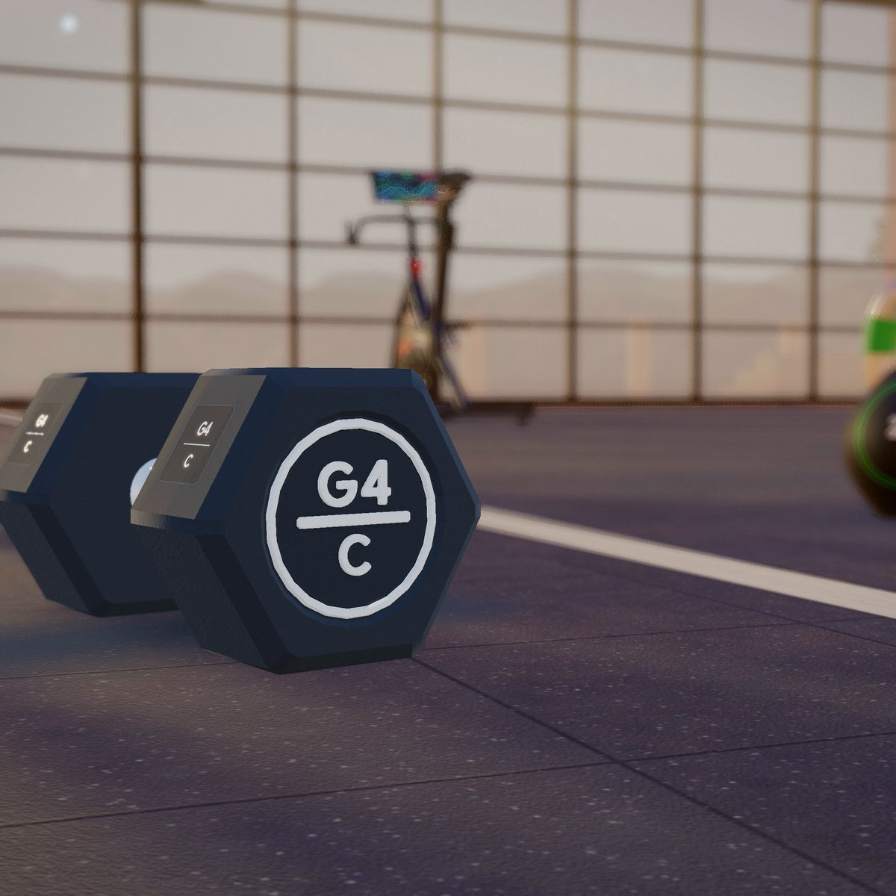
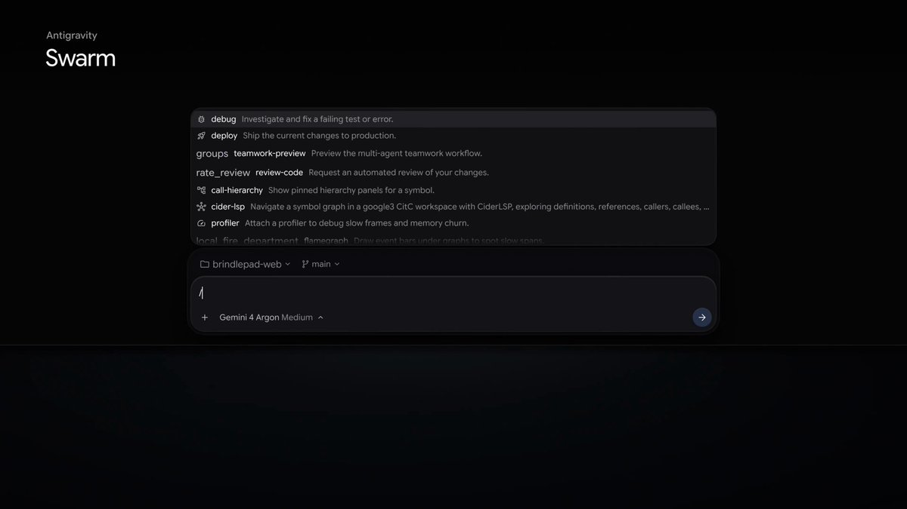
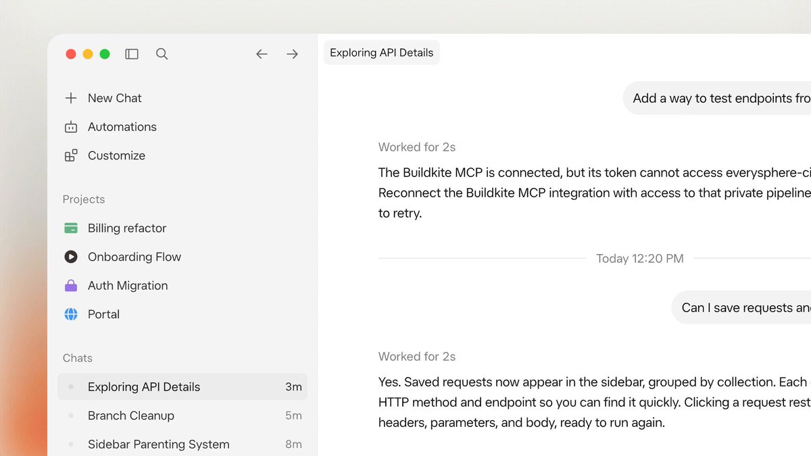
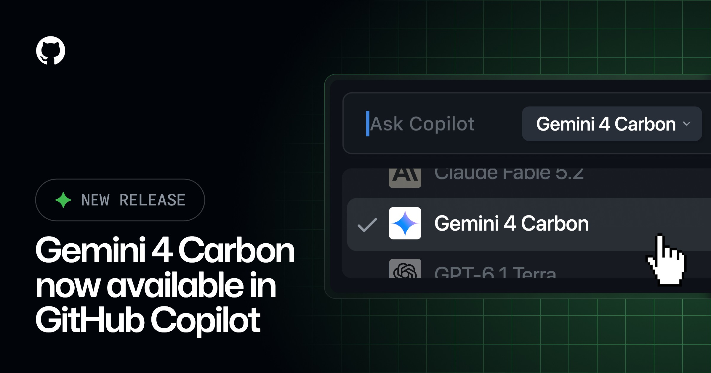
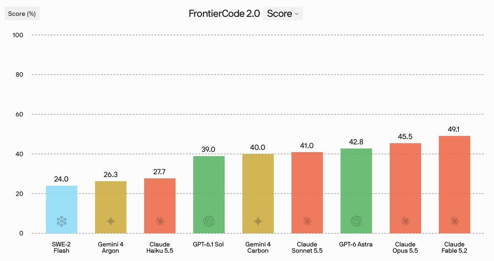
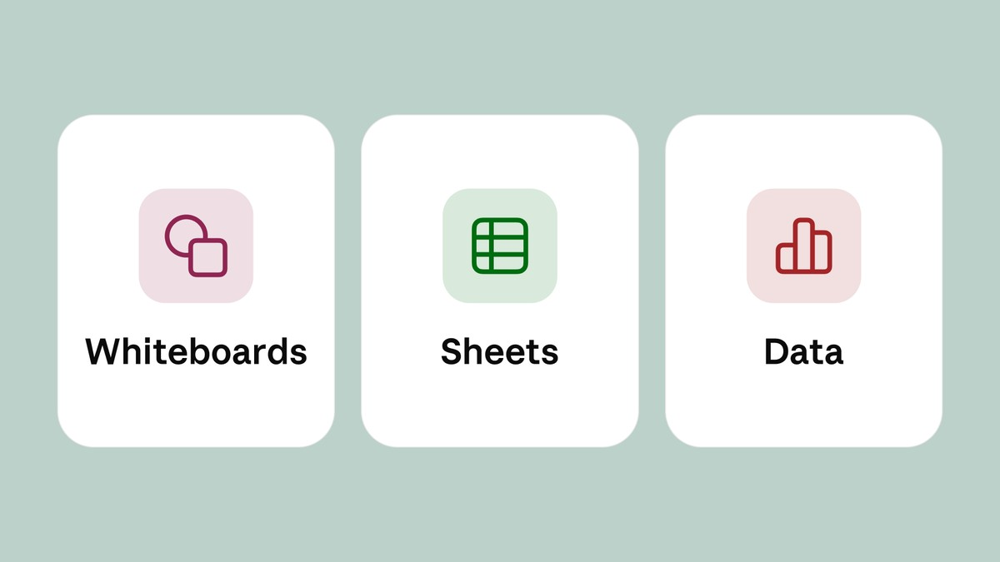
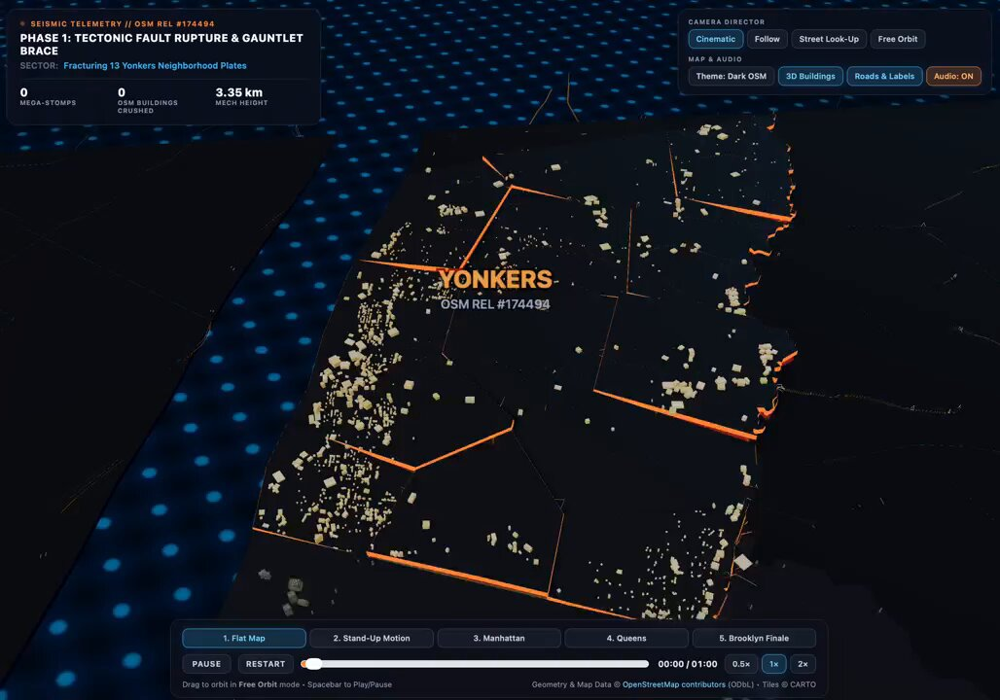
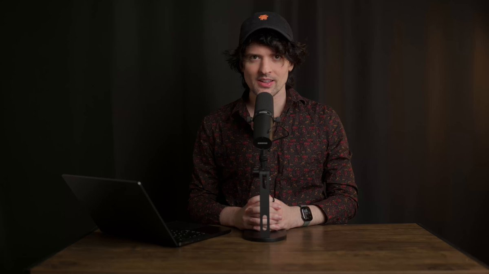

# AI Twitter/X Hots Digest · 2026-11-11 (Wednesday)

## Today's highlights

1. **Gemini 4 Carbon is now generally available**: Google first announced the model on October 28; today it opened it to paying developers, enterprises, and Google AI Ultra subscribers. Official posts call it the company's strongest model, aimed at longer, harder technical work. For most everyday coding and knowledge work, Google still recommends Gemini 4 Argon. The introductory price matches Argon at **$2 / $10** per million tokens, rising to **$4 / $20** after November 30.
2. **Coding tools followed quickly, and Cursor Projects became multiplayer**: Cursor said Carbon leads CursorBench at **60.4%** on high effort, and rebuilt Projects so a team and their agents share a task board and context. Antigravity also previewed **/swarm**. GitHub Copilot, OpenCode, and Devin announced support as well.
3. **Claude shipped whiteboards, sheets, and Data**: official posts started the rollout of Claude Whiteboards and Claude Sheets, and made the former Dashboards generally available as **Claude Data**. The same thread added interactive connectors that open Adobe, Atlassian, and Box beside the conversation.

---

## 1. Gemini 4 Carbon is now open to developers and Ultra subscribers

**The point**: @Google said **Gemini 4 Carbon** is now available, calling it the company's strongest model for long-horizon, multi-step work: if Argon is the right choice for complex tasks, Carbon is the one you bring to the hardest problems. @GoogleAI and @OfficialLoganK added that it is in the Gemini API and rolling out to Google AI Ultra subscribers, who can use it in the Gemini app, AI Mode in Search, Google Antigravity, and Google AI Studio. Paying developers and enterprises can call it through the Gemini API in AI Studio and Android Studio, and through Gemini for business. The official blog is explicit about timing: the model was announced on October 28, offered two weeks ago to a set of cybersecurity defenders through the Fairwind Program, and only today opened more broadly to developers, enterprises, and consumers. On positioning, **Argon remains the preferred choice for most software engineering and knowledge work**. Carbon spends more tokens to explore, reason, and verify more thoroughly, and is meant for complex multi-step coding and debugging and for open-ended research. The introductory price matches Argon at **$2** per million input tokens and **$10** per million output tokens through November 30, then **$4 / $20**. Logan also noted that Carbon and Argon are expensive, so they are not the models Google expects to roll out at the widest scale; the team is still working on more accessible ones.

**Why it matters**: Yesterday's main thread was still Anthropic's Fable 5.2. Today Google put a previously announced model into the products people actually use. Official messaging does not present Carbon as the new default daily driver in place of Argon. It presents a more expensive, more selective model for harder work. The price, the scope, and the access window come from the official posts and the [launch post](https://blog.google/innovation-and-ai/models-and-research/gemini-models/gemini-4-carbon-now-available/), not from a third-party recap.

- Google: Gemini 4 Carbon is now available: https://x.com/Google/status/2120186185423159331
- GoogleAI: where Ultra, developers, and enterprises can use it: https://x.com/GoogleAI/status/2120187753329791341
- OfficialLoganK: live in the API and for Ultra subscribers: https://x.com/OfficialLoganK/status/2120186016254624039

---

## 2. Official demos: a campus 3D game, a textile visualizer, and a songbird organ

**The point**: In the launch thread, Google pulled out several projects built with Carbon. One post said Carbon and /swarm in Antigravity were used to build Pelican Quest, an open-world 3D browser game in which you explore the Mountain View campus as a pelican riding a GBike. A follow-up said subagents modeled and rigged assets in Blender, and Carbon wrote the 60 FPS Three.js game. Another post showed a materials-research demo: from a 2026 paper on knitted-textile mechanics, Carbon built an interactive 3D visualizer in Antigravity that tracks **110** individual fibers under tension. A long post from @GoogleAI also described turning avian research into an interactive 3D simulation that synthesizes the sounds of six bird species live. These are official demonstrations; details should be checked against the original posts or the blog.

**Why it matters**: Much as Anthropic put hardware and formal mathematics into yesterday's launch demos, Google is using long-running multi-agent projects to explain what Carbon is for, not only a benchmark table. The demos are not a substitute for how the model feels in your own repo, but they show the kind of work official materials want people to try.

- Google: a campus 3D game built with Carbon and /swarm: https://x.com/Google/status/2120260356413051147
- Google: a knitted-textile visualizer tracking 110 fibers: https://x.com/Google/status/2120279087314837642
- GoogleDeepMind: start building long-horizon work with Carbon: https://x.com/GoogleDeepMind/status/2120219371473617099

---

## 3. Antigravity previews /swarm: one prompt spins up a parallel agent team

**The point**: @antigravity announced a new slash command, **/swarm** (in preview), for orchestrating specialized agents in parallel in the desktop app and the CLI. The agents plan, build, and verify together on a live message board, and different roles can be pinned to different models. Google had already previewed the feature in the Carbon launch thread, and official materials suggest assigning Carbon to high-reasoning roles such as architectural design, coordination, and auditing, while faster, lighter models do the parallel implementation and testing. Follow-up posts showed the coordinator and shared message board, a live board and graph timeline, and the ability to pin a model to one agent. The Antigravity blog adds that workers edit in isolated git worktrees so changes do not collide, and idle agents consume no tokens. This is an official product update, not a third-party review. An internal-dogfooding note is that even with zero-cost idle time, a parallel multi-agent run still burns quota much faster than a normal chat.

**Why it matters**: Carbon's general availability and /swarm arrived as a package. The model is meant to think longer; the product turns multi-agent parallelism into a workflow you can watch. That is the same class of problem Cursor is tackling by making Projects multiplayer: one person directing a fleet of agents is no longer the whole story.

- antigravity: announcing /swarm: https://x.com/antigravity/status/2120279327589773639
- Google: previewing /swarm in the Carbon launch thread: https://x.com/Google/status/2120186189147734376
- antigravity: the coordinator agent and shared message board: https://x.com/antigravity/status/2120279354596811230

---

## 4. Cursor: Carbon tops CursorBench, and Projects becomes multiplayer

**The point**: @cursor_ai first said Gemini 4 Carbon is now in Cursor: at **high effort**, it is the top model on CursorBench, at **60.4%**. Cursor also said the model is 50% off through November 30, at **$2 / $10** per million tokens, rising to **$4 / $20** on December 1. Later the same day, the official account said **Projects has been rebuilt for multiplayer**: each teammate keeps their own agents, everyone works from one shared task board and shared context, and when an agent needs something from a teammate's work, it asks that teammate's agent directly. A follow-up linked the blog post and said Team Projects lets agents share plans before they start and flag conflicts as they work, with a beta rolling out to all users today. @mattyp posted a demo video. @jennywen wrote that she had been skeptical of multiplayer Projects, but watching the team build together in a shared space — including building this feature — felt "just right." @poteto quoted the official announcement and added that Grok Bot can also create and manage Cursor Projects if you ask it to. These are Cursor's own notes and teammates' impressions; the CursorBench figure comes from Cursor's leaderboard, not a shared eval.

**Why it matters**: Cursor did two related things in one day: it added a long-horizon model, and it turned Projects — previously aimed mainly at one person directing a fleet — into a place where teammates' agents can coordinate with each other. The Grok Bot note shows that this workflow is already leaking out of the editor itself.

- cursor_ai: Carbon in Cursor, at 60.4% on CursorBench: https://x.com/cursor_ai/status/2120193584670580857
- cursor_ai: $2 / $10 through November 30: https://x.com/cursor_ai/status/2120193596972474586
- cursor_ai: Projects rebuilt for multiplayer: https://x.com/cursor_ai/status/2120295553309565139
- poteto: Grok Bot can create and manage Projects: https://x.com/poteto/status/2120313779691168082

---

## 5. Copilot and OpenCode add Carbon; OpenCode also adds Fable 5.2

**The point**: @github and @code said Gemini 4 Carbon is generally available in GitHub Copilot, aimed at complex coding, agent, and reasoning work, with a particular mention of security-related tasks. The official changelog says it is for Copilot Pro+, Max, Business, and Enterprise, can be selected in VS Code, Visual Studio, the Copilot CLI, the coding agent, the GitHub app and website, mobile, and JetBrains, Xcode, and Eclipse, is billed at provider list pricing, and is rolling out gradually. @opencode said both Carbon and Claude Fable 5.2 are now available in OpenCode. A later post said **Inkling 2 Small** is free on OpenCode for a limited time, listing a 1M context window, multimodal support, a 594B MoE with 17B active parameters, and a regional limit; that is OpenCode's own description. Inkling 2 Small is not a model that first appeared today, and the free tier had already been circulating, so this is recorded as an official reminder, not as a new launch.

**Why it matters**: As with yesterday's rush to add Fable, Carbon showed up in familiar coding environments as soon as it was generally available. Copilot emphasized security-oriented work; OpenCode turned on both of the upper-tier models the two labs had been discussing.

- github: Carbon generally available in GitHub Copilot: https://x.com/github/status/2120244851853996126
- code: available in Copilot for VS Code: https://x.com/code/status/2120261024947356156
- opencode: Carbon and Fable 5.2 are now in OpenCode: https://x.com/opencode/status/2120230826898293238
- opencode: Inkling 2 Small free for a limited time: https://x.com/opencode/status/2120256195017781692

---

## 6. Devin adds Carbon, and puts Mythos 5.2 into managed security scans

**The point**: @cognition said Gemini 4 Carbon is now in Devin Desktop and the Devin CLI, and published its own numbers: on FrontierCode 2.0, Carbon scores **40.0%**, up from Gemini 4 Argon's **26.3%**, making it the best-performing Google model on that benchmark. The same day, the company said **Claude Mythos 5.2** is now available in Devin's managed security scans, and that it is giving **$100M+** in credits to help companies find and fix critical vulnerabilities with Mythos 5.2, with eligibility criteria and conditions. It also said Mythos 5.2 scores **73.5** on Cognition's internal cyber benchmark, up from **56.9** for Mythos 5.1. These are Cognition's own launch notes and internal benches, not an external shared eval.

**Why it matters**: Devin folded both labs' upper-tier models into its product on the same day: Carbon for general coding, and Mythos 5.2 for security work that requires verification to use. The credit figure is large, but the original post already attaches eligibility limits; who gets how much should be read from later official details, not inferred here.

- cognition: Carbon in Devin Desktop and CLI: https://x.com/cognition/status/2120196422360506385
- cognition: Mythos 5.2 in managed security scans, with $100M+ in credits: https://x.com/cognition/status/2120227474223292477

---

## 7. Claude ships Whiteboards, Sheets, and Data, and can open full tools beside the chat

**The point**: @claudeai said it is starting to roll out **Claude Whiteboards**, **Claude Sheets**, and **Claude Data**: think a plan through on a board, build a tracker in a sheet, and tell a story with your data. Follow-ups said Whiteboards can turn a messy discussion into a board a team can edit together, and Sheets can turn a request for a tracker or a budget into a working spreadsheet people can keep building. Both are in beta on paid plans. Claude Data, renamed from Dashboards, is now generally available on paid plans; besides dashboards, it can draft data stories and narrated videos from your metrics for you to review before sharing. Certified queries and live sharing remain in beta. The same thread added **interactive connectors**: you can open the full version of Adobe, Atlassian, and Box inside Claude, make changes yourself, or ask Claude to make them with you, rolling out on web and desktop. Official posts note that the updates are rolling out gradually, so they may not all be visible at once. Details are in the [official article](https://claude.com/resources/articles/sheets-whiteboards-data).

**Why it matters**: This was the day's highest-engagement product post, but the pitch is not a new model. It is Claude expanding from chat and code into boards, spreadsheets, and data stories. For people who write code, the more immediately relevant piece may be the interactive connectors: some external tools no longer have to be copied back and forth, and can sit beside the conversation.

- claudeai: starting the rollout of Whiteboards, Sheets, and Data: https://x.com/claudeai/status/2120206365759094857
- claudeai: whiteboards and sheets in beta on paid plans: https://x.com/claudeai/status/2120206368619831597
- claudeai: Data generally available; certified queries and live sharing still in beta: https://x.com/claudeai/status/2120206372478566799
- claudeai: opening Adobe, Atlassian, and Box beside the chat: https://x.com/claudeai/status/2120206375137484875

---

## 8. First-night feel: poteto says Carbon is worth trying, and simonw built a Three.js animation

**The point**: Numbers started showing up outside official tables. @poteto quoted Cursor's Carbon announcement and wrote, "it's quite a good model, give it a try!" @simonw ran his usual checks: Carbon is still good at pelican SVGs, "but that's nothing new for Gemini." The more interesting prompt he used asked for a Three.js animation in which Yonkers stands up as a giant mech, stomps around Manhattan, Queens, and Brooklyn, and uses OpenStreetMap data. He also posted the same prompt run against Claude Fable 5.2 the day before. These are personal trials, not a substitute for official evals.

**Why it matters**: Launch-day official boards can put Carbon first on CursorBench and similar tests, while personal trials stay messier: one person recommends trying it, another keeps using followable tasks like pelicans and short animations as a comparison. First-night conclusions will be scattered, but they are closer to real use than the launch graphics alone.

- poteto: quoting Cursor's launch note, Carbon is worth trying: https://x.com/poteto/status/2120232138603975020
- simonw: a Three.js mech animation with Carbon: https://x.com/simonw/status/2120258951594037732
- simonw: the same prompt on Fable 5.2: https://x.com/simonw/status/2120259268364718331

---

## 9. Theo stayed up until 3am on a Fable 5.2 review video, calling it the greatest model ever released

**The point**: On the same day Carbon became generally available, @theo posted a video about **Claude Fable 5.2**, which had launched the day before, and wrote: "Fable 5.2 is the greatest model ever released. I stayed up until 3am getting this video ready for y'all." That is his personal judgment and review, not an official Anthropic conclusion, and not a comparison against Carbon. He later added that he burned a usage reset so he could report the behavior accurately in the video. The previous day he had already discussed effort levels and how, on the Ultra plan, Fable burns faster than Opus and can use only half the weekly limit. This video continues that discussion; it is not a second launch of the model.

**Why it matters**: The day after a model ships, the conversation usually moves from official numbers to fuller recorded use. Theo's wording is emphatic, and it should be read as a high-signal personal review, not a final ranking. It is also a reminder that talk about Fable 5.2 did not stop just because Carbon came out.

- theo: the Fable 5.2 review video: https://x.com/theo/status/2120284921839394847

---
