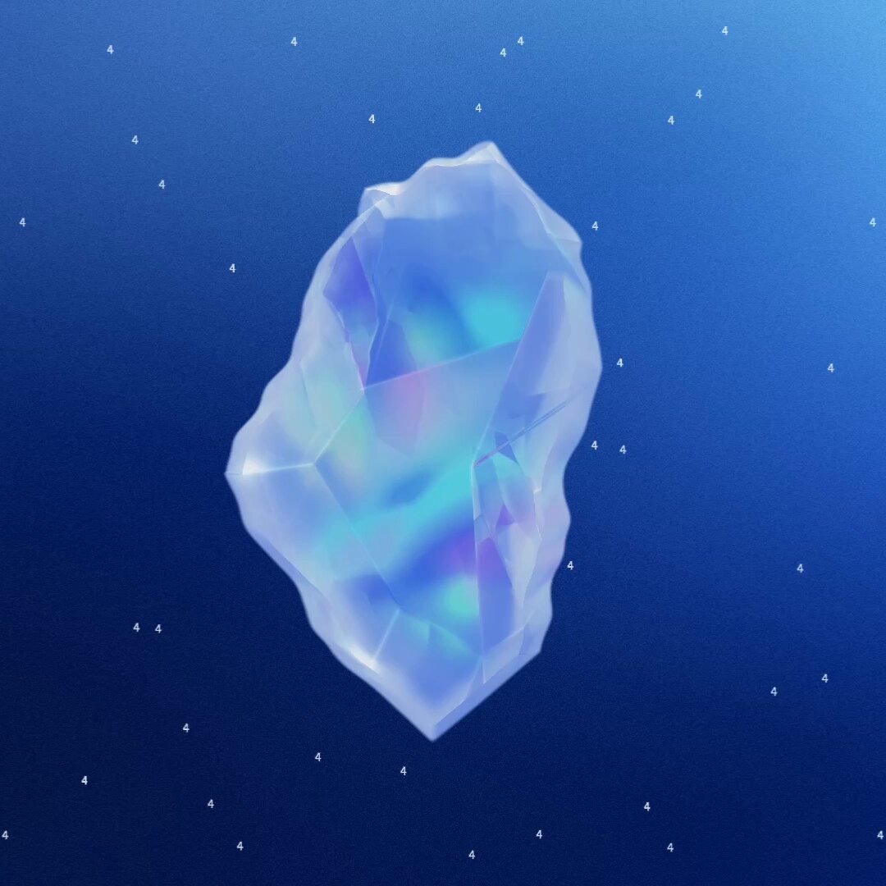
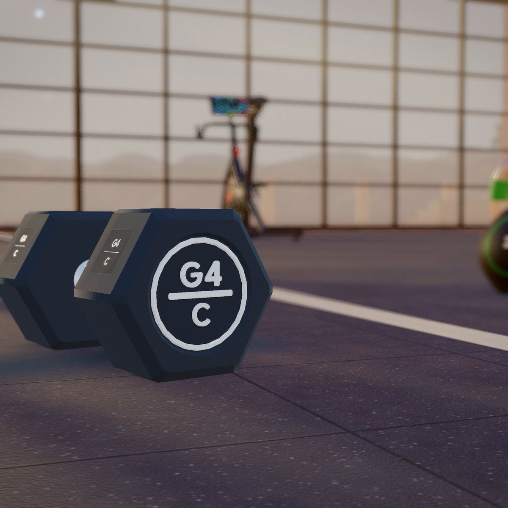
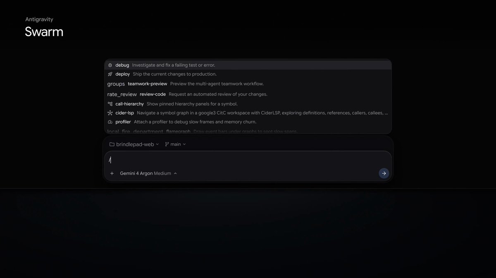
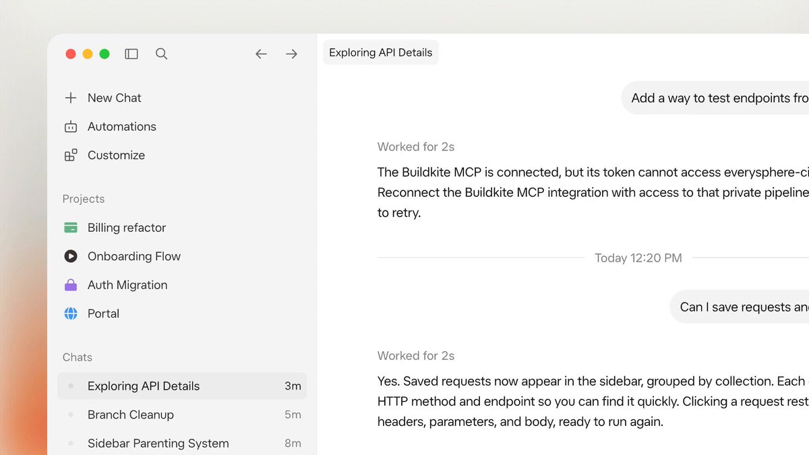
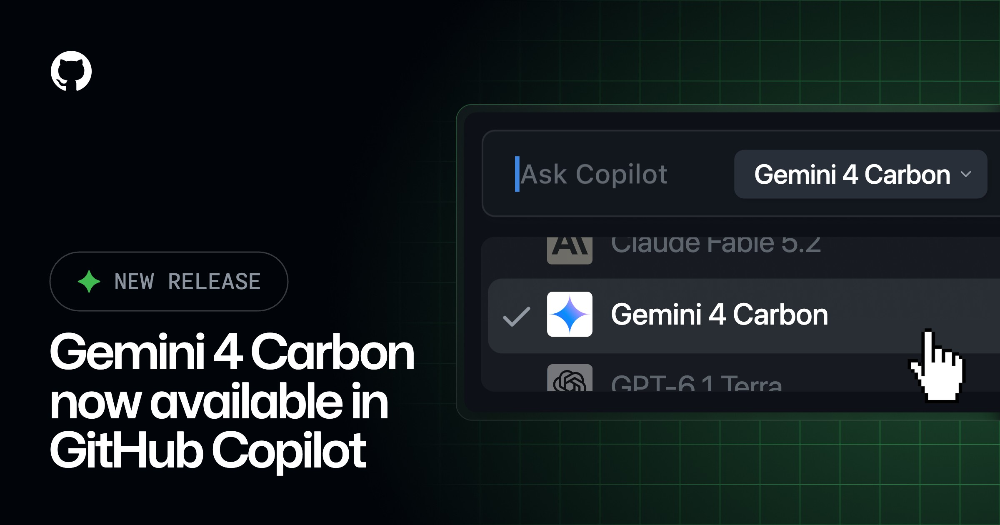
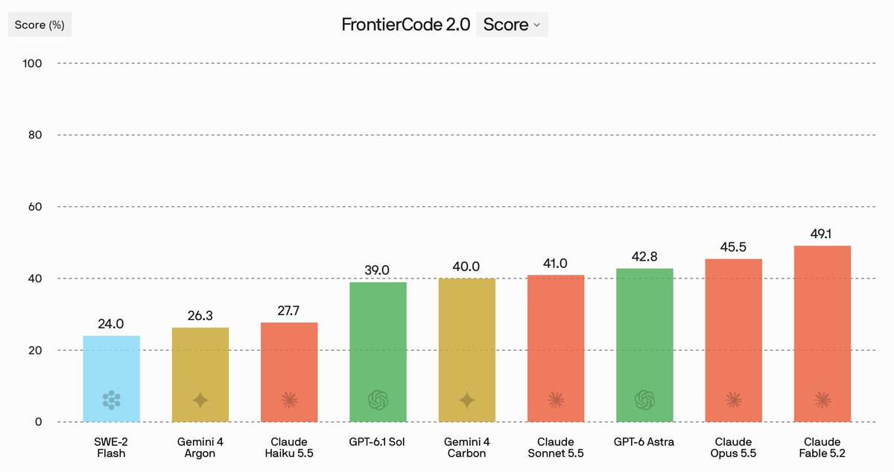
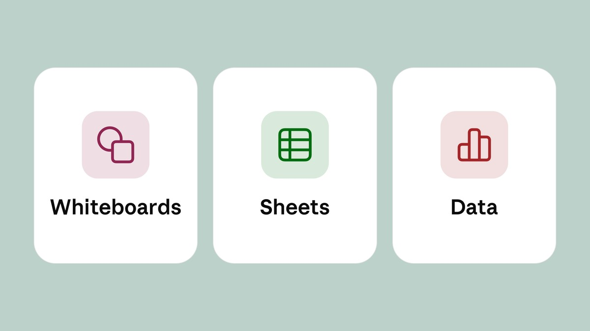
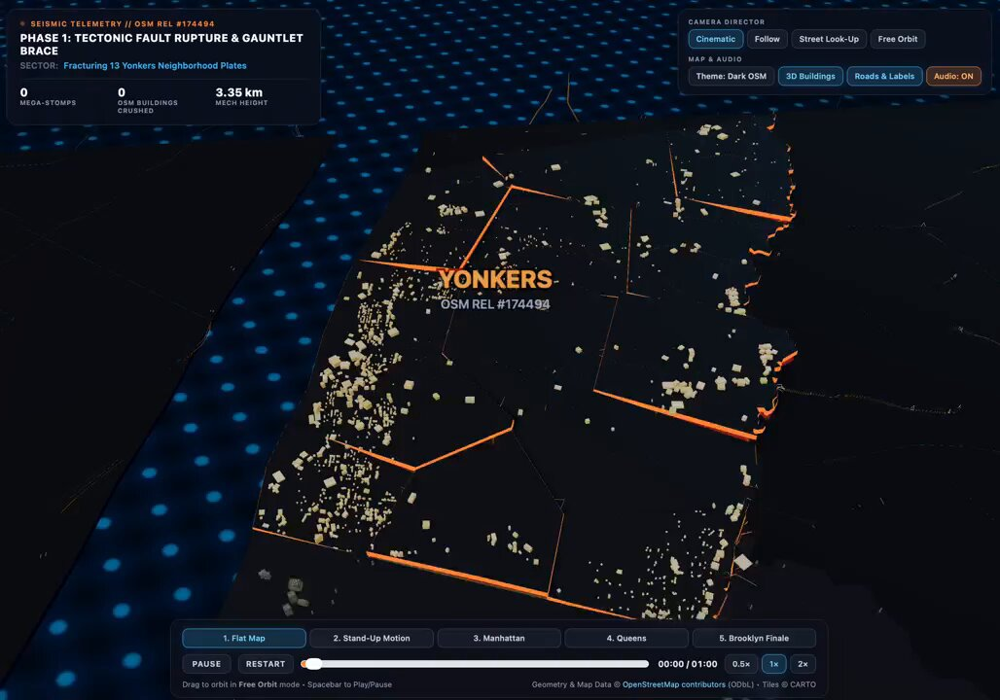

# AI Twitter/X 热点 Digest · 2026-11-11（周三）

## 今日要点

1. **Gemini 4 Carbon 正式开放**：Google 在 10 月 28 日已经宣布过这款模型，今天把它开放给付费开发者、企业和 Google AI Ultra 用户。官方把它写成「最强模型」，专门处理更长、更难的技术任务；多数日常编码和知识工作，他们仍建议先用 Gemini 4 Argon。导入价与 Argon 相同，是每百万 token **$2 / $10**，11 月 30 日后调整为 **$4 / $20**。
2. **编程工具迅速跟进，Cursor Projects 还改成了多人**：Cursor 称 high effort 下 Carbon 以 **60.4%** 登上 CursorBench，并把 Projects 改成团队和各自的 agent 共享任务板与上下文；Antigravity 同时预览了 **/swarm**。GitHub Copilot、OpenCode 和 Devin 也宣布接入。
3. **Claude 推出白板、表格和 Data**：官方开始推送 Claude Whiteboards、Claude Sheets，并把原来的 Dashboards 以 **Claude Data** 正式开放；同一线程里还上了可在对话旁打开 Adobe、Atlassian 和 Box 的交互式连接器。

---

## 1. Gemini 4 Carbon 正式向开发者和 Ultra 用户开放

**要点**：@Google 宣布 **Gemini 4 Carbon** 现已可用，称它是目前最强的模型，适合更长周期、需要多步推理的难题；如果 Argon 适合复杂任务，Carbon 就是要拿到最难问题上的那一档。@GoogleAI 和 @OfficialLoganK 补充：它已进入 Gemini API，并向 Google AI Ultra 订阅用户滚动开放；Ultra 用户可以在 Gemini 应用、搜索里的 AI Mode、Google Antigravity 和 Google AI Studio 里使用。付费开发者和企业可通过 AI Studio、Android Studio 的 Gemini API，以及 Gemini for business 调用。官方博文写得很明确：这款模型 10 月 28 日已经宣布，两周前先通过 Fairwind 项目提供给一部分网络安全人员，今天才面向更广泛的开发者、企业和消费者开放。定位上，**Argon 仍是大多数软件工程和知识工作的首选**；Carbon 会用掉更多 token，把时间花在更彻底的探索、推理和校验上，适合复杂的多步编码、调试和开放式科研。导入价与 Argon 相同，每百万 token 输入 **$2**、输出 **$10**，优惠期到 11 月 30 日，之后变为 **$4 / $20**。Logan 还说，Carbon 和 Argon 都偏贵，所以不是适合大规模铺开的那一档，团队还在做更容易普及的模型。

**为何值得看**：昨天讨论的主线还是 Anthropic 的 Fable 5.2，今天 Google 把已经预告过的 Carbon 真正放到常用产品里。官方没有把它写成「取代 Argon 的日常默认模型」，而是写成更贵、也更挑场景的上层模型。价格、适用范围和开放范围都来自官方帖与[发布博文](https://blog.google/innovation-and-ai/models-and-research/gemini-models/gemini-4-carbon-now-available/)，不是第三方转述。

- Google：Gemini 4 Carbon 现已可用：https://x.com/Google/status/2120186185423159331
- GoogleAI：面向 Ultra、开发者和企业的开放范围：https://x.com/GoogleAI/status/2120187753329791341
- OfficialLoganK：API 与 Ultra 订阅上线：https://x.com/OfficialLoganK/status/2120186016254624039

---

## 2. 官方演示：校园 3D 游戏、织物可视化和歌声器官

**要点**：发布线程里，Google 把几个用 Carbon 做出来的项目单独拿出来讲。一条帖说，用 Carbon 和 Antigravity 里的 /swarm，他们做了名为 Pelican Quest 的开放世界 3D 浏览器游戏：人可以骑着 GBike、以鹈鹕的身份逛 Mountain View 园区；后续说明里写，子 agent 在 Blender 里建模和绑定，Carbon 再用 Three.js 写出 60 FPS 的游戏。另一条展示的是材料研究：根据 2026 年一篇针织物力学论文，Carbon 在 Antigravity 里做了可交互的 3D 可视化，跟踪 **110** 根纤维在张力下的变化。@GoogleAI 的长帖还提到，它把鸟类研究做成了可交互的 3D 模拟，现场合成六种鸟的叫声。这些都是官方自己的演示，细节应回到原帖或博文核对。

**为何值得看**：和前一天 Anthropic 把硬件、数学形式化放进发布演示类似，Google 也在用「能跑很久的多 agent 项目」来解释 Carbon 的卖点，而不只是一张基准表。演示本身不能代替你在自己仓库里的手感，但能说明官方希望人们拿它做什么。

- Google：用 Carbon 和 /swarm 做的园区 3D 游戏：https://x.com/Google/status/2120260356413051147
- Google：针织物可视化，跟踪 110 根纤维：https://x.com/Google/status/2120279087314837642
- GoogleDeepMind：开始用 Carbon 做长周期任务：https://x.com/GoogleDeepMind/status/2120219371473617099

---

## 3. Antigravity 预览 /swarm：一个提示词拉起一组并行 agent

**要点**：@antigravity 宣布上线新的斜杠命令 **/swarm**（预览），可在桌面应用和 CLI 里编排一组专门的 agent 并行工作：它们在一块实时留言板上一起做计划、实现和校验，并且可以为不同角色指定不同模型。Google 在 Carbon 的发布线程里已经预告过这一功能，官方建议把 Carbon 用在架构设计、协调和审计这类更吃推理的位置，并行的实现和测试交给更快、更轻的模型。随后的说明帖展示了协调 agent 与共享留言板、实时看板和关系图时间线，以及给单个 agent 固定模型。Antigravity 的博文还写：worker 会在隔离的 git worktree 里改代码，免得互相覆盖；空闲的 agent 不消耗 token。这是官方产品更新，不是第三方评测。内部试用的提醒是：即便空闲不计费，并行多 agent 仍会比普通对话更快耗额度。

**为何值得看**：Carbon 的开放和 /swarm 是同一天打包出现的。模型负责「想得更久」，产品则把多 agent 并行做成一条可观察的工作流。这和当天 Cursor 把 Projects 改成多人协作，走的是同一类问题：一个人带一组 agent，已经不够用了。

- antigravity：宣布 /swarm：https://x.com/antigravity/status/2120279327589773639
- Google：在 Carbon 发布线程里预览 /swarm：https://x.com/Google/status/2120186189147734376
- antigravity：协调 agent 与共享留言板：https://x.com/antigravity/status/2120279354596811230

---

## 4. Cursor：Carbon 登上 CursorBench，Projects 也改成了多人协作

**要点**：@cursor_ai 先宣布 Gemini 4 Carbon 已在 Cursor 可用：在 **high effort** 下，它是 CursorBench 上的榜首，成绩 **60.4%**。Cursor 还写，该模型在 11 月 30 日前五折，价格是每百万 token **$2 / $10**，12 月 1 日起恢复为 **$4 / $20**。同一天稍晚，官方又宣布 **Projects 已按多人协作重建**：每个成员保留自己的 agent，大家在同一块共享任务板和共享上下文里工作；当某个 agent 需要用到队友正在做的事，它会直接向对方的 agent 询问。后续帖给出了博文，并称 Team Projects 会让 agent 在动手前同步计划、在过程中标记冲突，今天起以 beta 向所有用户推送。@mattyp 发了演示视频；@jennywen 写自己本来对多人 Projects 很怀疑，但看团队在共享空间里一起做（包括做这个功能本身）之后，觉得「正好就是该有的样子」。@poteto 转发了官方公告，并提醒：Grok Bot 也可以帮你创建和管理 Cursor Projects，直接向它提就行。这些是 Cursor 官方说明和团队成员的使用感受，CursorBench 数字来自 Cursor 自己的榜，不是统一评测。

**为何值得看**：Cursor 一天里做了两件相关的事：把新的长周期模型接进来，再把原来主要服务单人的 Projects，改成人和人的 agent 也能互相协调。Grok Bot 能管理 Project，说明这条工作流已经不止发生在编辑器里。

- cursor_ai：Carbon 登陆 Cursor，CursorBench 为 60.4%：https://x.com/cursor_ai/status/2120193584670580857
- cursor_ai：11 月 30 日前价格为 $2 / $10：https://x.com/cursor_ai/status/2120193596972474586
- cursor_ai：Projects 改为多人协作：https://x.com/cursor_ai/status/2120295553309565139
- poteto：Grok Bot 可以创建和管理 Projects：https://x.com/poteto/status/2120313779691168082

---

## 5. Copilot 与 OpenCode 接入 Carbon，OpenCode 同时上了 Fable 5.2

**要点**：@github 和 @code 宣布 Gemini 4 Carbon 已在 GitHub Copilot 正式可用，定位是复杂编码、agent 任务和推理，并特别提到安全相关工作。官方更新说明它面向 Copilot Pro+、Max、Business 和 Enterprise，可在 VS Code、Visual Studio、Copilot CLI、coding agent、GitHub 应用和网站、移动端以及 JetBrains、Xcode、Eclipse 等处选择，按提供方标价计费，并且是逐步推送。@opencode 则宣布 Carbon 和 Claude Fable 5.2 都已在 OpenCode 可用。它随后还发帖说，**Inkling 2 Small** 正在 OpenCode 上限时免费，并列出 1M 上下文、多模态、594B MoE（17B 激活）以及仅限部分地区；这是官方自己的说明。Inkling 2 Small 本身不是今天才出现的模型，免费档此前已经在传播，这里按当天官方重申来记，并不把它写成全新发布。

**为何值得看**：和前一天各工具抢接 Fable 一样，Carbon 一开放，常用编码环境就开始出现选项。Copilot 强调安全向工作，OpenCode 则把 Google 和 Anthropic 头天刚讨论过的两款上层模型一起接进来。

- github：Carbon 在 GitHub Copilot 正式可用：https://x.com/github/status/2120244851853996126
- code：在 VS Code 的 Copilot 中可用：https://x.com/code/status/2120261024947356156
- opencode：Carbon 与 Fable 5.2 已在 OpenCode 可用：https://x.com/opencode/status/2120230826898293238
- opencode：Inkling 2 Small 限时免费：https://x.com/opencode/status/2120256195017781692

---

## 6. Devin 接入 Carbon，并用 Mythos 5.2 做托管安全扫描

**要点**：@cognition 宣布 Gemini 4 Carbon 已在 Devin Desktop 和 CLI 可用，并给出自家数字：在 FrontierCode 2.0 上，Carbon 为 **40.0%**，高于 Gemini 4 Argon 的 **26.3%**，是该榜上表现最好的 Google 模型。同一天，它还宣布 **Claude Mythos 5.2** 已用于 Devin 的托管安全扫描，并将提供 **超过 1 亿美元** 的额度，帮助企业用 Mythos 5.2 查找和修复关键漏洞，但写明需满足资格条件。官方称，在其内部网络安全基准上，Mythos 5.2 得到 **73.5**，高于 Mythos 5.1 的 **56.9**。这些都是 Cognition 自己的上线说明和内部基准，不是外部统一评测。

**为何值得看**：Devin 把当天两家的上层模型都接进了自己的产品：Carbon 走通用编码，Mythos 5.2 走受审核才能用的安全方向。额度计划的数字很大，但原帖已经加上了资格限制，具体能给谁、给多少，只能以官方后续说明为准。

- cognition：Carbon 登陆 Devin Desktop 与 CLI：https://x.com/cognition/status/2120196422360506385
- cognition：Mythos 5.2 用于托管安全扫描，并提供超过 1 亿美元额度：https://x.com/cognition/status/2120227474223292477

---

## 7. Claude 推出白板、表格和 Data，对话旁也能打开完整工具

**要点**：@claudeai 宣布开始推送 **Claude Whiteboards**、**Claude Sheets** 和 **Claude Data**：可以在白板上把计划理清楚，在表格里做跟踪表，再用数据讲故事。官方随后说明：Whiteboards 适合把杂乱的讨论铺到一块团队可一起改的板上；Sheets 可以根据「做一份跟踪表或预算」这样的请求，生成一份大家能继续改的工作表。这两项目前是付费方案上的 beta。Claude Data 由原来的 Dashboards 更名而来，已在付费方案上正式开放；除了仪表盘，它还可以根据指标起草数据故事和旁白视频，供你审阅后再分享。认证查询和实时分享仍是 beta。同一线程里还有 **交互式连接器**：可以在 Claude 里打开 Adobe、Atlassian 和 Box 的完整界面，自己改，或让 Claude 一起改，正在向网页版和桌面版推送。官方提醒这些更新是逐步开放，不一定马上全部看到。说明见[官方介绍](https://claude.com/resources/articles/sheets-whiteboards-data)。

**为何值得看**：这是当天互动最高的产品帖，但卖点不是新模型，而是把 Claude 从对话和代码，延伸到看板、表格和数据故事。对写代码的人来说，更直接相关的可能是交互式连接器：一部分外部工具不用再复制来复制去，可以开在对话旁边。

- claudeai：开始推送 Whiteboards、Sheets 和 Data：https://x.com/claudeai/status/2120206365759094857
- claudeai：白板和表格在付费方案上进入 beta：https://x.com/claudeai/status/2120206368619831597
- claudeai：Data 正式开放，认证查询和实时分享仍是 beta：https://x.com/claudeai/status/2120206372478566799
- claudeai：可在对话旁打开 Adobe、Atlassian 和 Box：https://x.com/claudeai/status/2120206375137484875

---

## 8. 第一夜手感：poteto 认为 Carbon 值得一试，simonw 拿它做了 Three.js 动画

**要点**：数字开始从官方表格外面冒出来。@poteto 引用 Cursor 上线 Carbon 的公告，写「这模型确实不错，值得一试」。@simonw 则按自己的老习惯做了测试：他觉得 Carbon 画鹈鹕 SVG 仍然熟练，但这对 Gemini 来说并不新鲜；更有意思的是他用的那句提示词——让 Yonkers 站起来变成机甲，踩过曼哈顿、皇后区和布鲁克林，并用 OpenStreetMap 数据——Carbon 据此做了 Three.js 动画。他还贴了前一天用 Claude Fable 5.2 跑同一句提示词的对照。这些都是个人试用，不是官方评测的替代品。

**为何值得看**：发布日的官方榜会把 Carbon 写成 CursorBench 等项目上的第一，个人试用则更碎：有人直接推荐去试试，有人继续用「画鹈鹕、做小动画」这种自己跟得上的题目来对比。第一夜的结论会很散，但比只看发布图更接近实际使用。

- poteto：引用 Cursor 的上线说明，认为 Carbon 值得一试：https://x.com/poteto/status/2120232138603975020
- simonw：用 Carbon 做 Three.js 机甲动画：https://x.com/simonw/status/2120258951594037732
- simonw：同一提示词在 Fable 5.2 上的对照：https://x.com/simonw/status/2120259268364718331

---

## 9. Theo：通宵做完 Fable 5.2 评测视频，称之为他用过最强的模型

**要点**：在 Carbon 开放的同一天，@theo 发布了一条关于前一天刚上市的 **Claude Fable 5.2** 的视频，并写道：「Fable 5.2 是有史以来最强的模型。我熬到凌晨 3 点，把这支视频做给你们。」这是他的个人判断和评测，不是 Anthropic 的官方结论，也不是对 Carbon 的对比评测。他后来还补充，为了在视频里把行为讲清楚，自己专门用掉了一次额度重置。前一天他已经讨论过 effort 档位和 Ultra 套餐里 Fable 更烧、且只能占每周额度一半的问题；这条视频是那一轮讨论的继续，而不是模型本身的第二次发布。

**为何值得看**：新模型发布后的第二天，讨论通常会从官方数字转向更完整的使用录像。Theo 的措辞很满，应当把它当成一份高信号的个人评测，而不是最终排名。它也提醒：Fable 5.2 的讨论并没有因为 Carbon 上线就结束。

- theo：Fable 5.2 评测视频：https://x.com/theo/status/2120284921839394847

---
