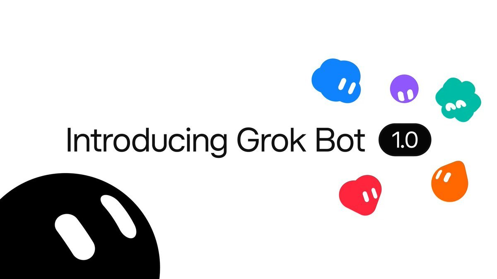
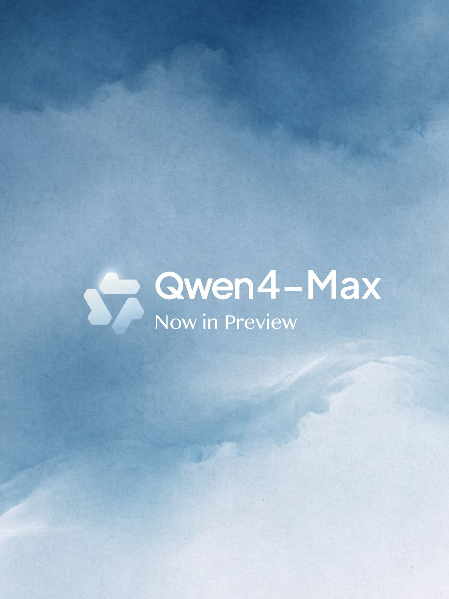
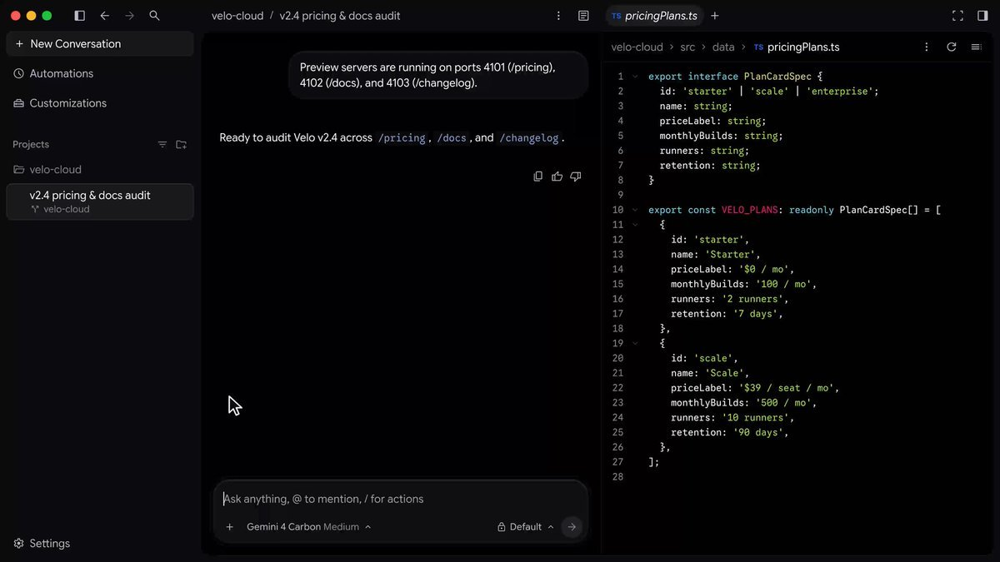
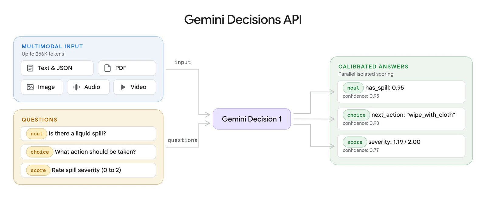
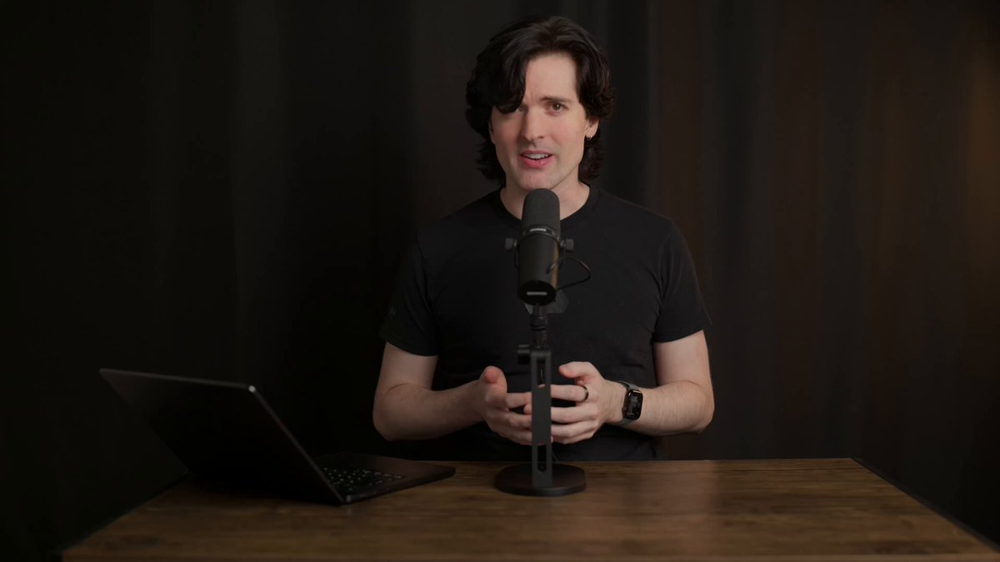
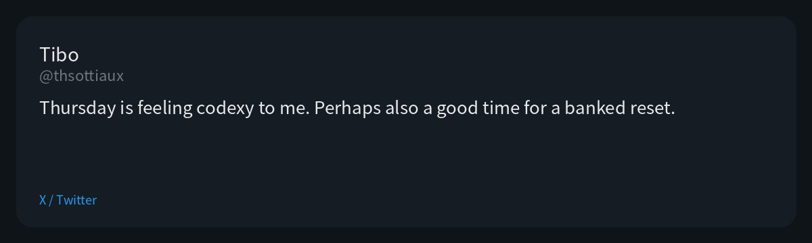
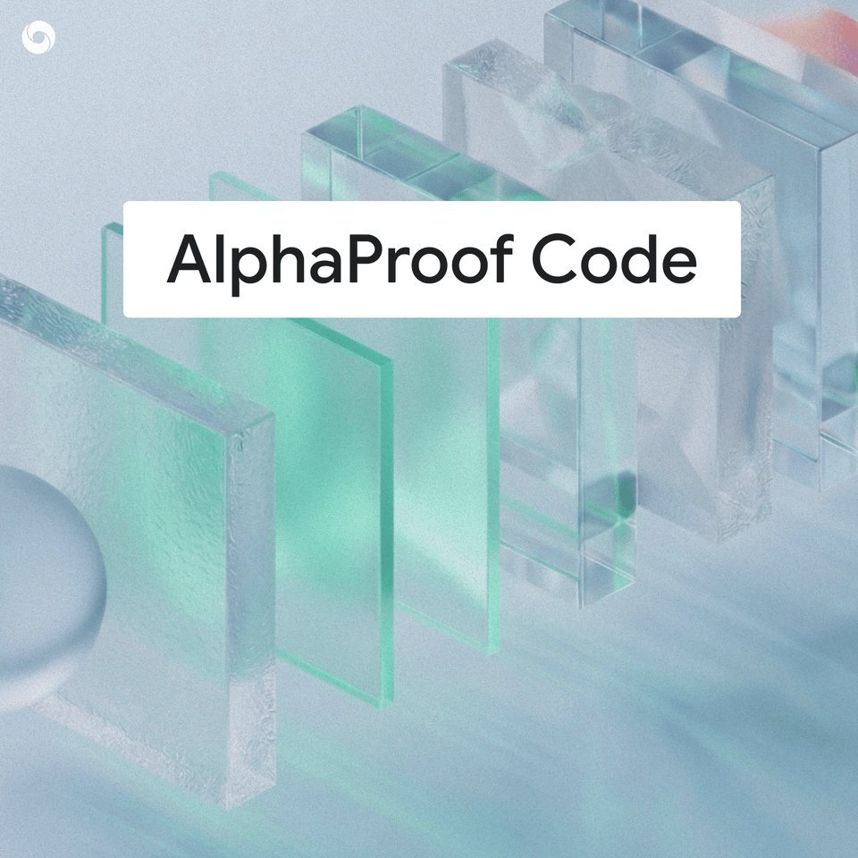
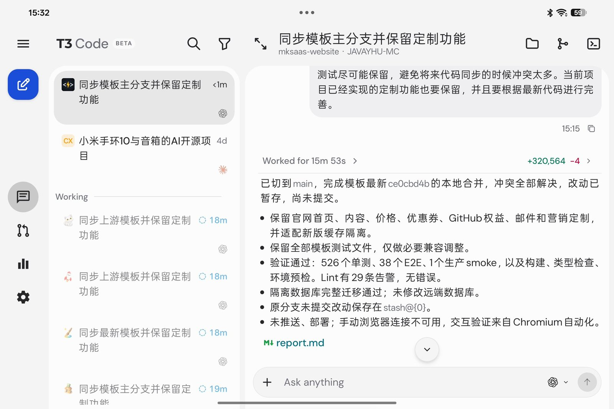

# AI Twitter/X Hots Digest · 2026-11-12 (Thursday)

## Today's highlights

1. **Grok Bot 1.0 is out**: this is a major update to the existing beta, not a product launched from scratch. Official posts describe Bots as teammates a whole team can share: they can join Slack and Microsoft Teams, take part in video-call chat, and notice unfinished work and offer to take it on. Team Bots are available on the Team and Enterprise plans; Meetings are available on Team, Enterprise, and Ultra, and Enterprise admins have to turn Meetings on.
2. **Qwen4-Max-Preview is a time-boxed preview on Token Plan**: Alibaba announced that Qwen4 is coming, and that Qwen4-Max is now in preview on Token Plan, with early access also on QwenWork, Qoder, the Qwen app, and QwenStudio. This is a preview, not general availability. Official docs say the preview runs from 10:00 on November 11 to 24:00 on November 25 (UTC+8), will not change during that period, and that the model will be retired afterward. It is Token Plan only, with no pay-as-you-go. The same day, Qoder said the anonymous Qoduck build it had been testing for four days is now named Qwen4-Max-Preview.
3. **Google launched the Decisions API, and Antigravity started rolling out built-in Browser Use**: Gemini Decision 1 can evaluate up to **1,000** questions against one shared multimodal input, with 150–250 ms end-to-end latency, priced at **$0.10** per million input tokens and no output-token charge. Antigravity officially said built-in browser use is rolling out to personal tiers, closing the loop between research, writing code, and verifying it on a live page. That is a different feature from yesterday's `/swarm`.

---

## 1. xAI shipped Grok Bot 1.0: shareable teammates in Slack, Teams, and meetings

**The point**: The official @bot account announced Grok Bot 1.0, with a demo video. The official blog lists three main changes: you can share a Team Bot, bring it into Slack and Microsoft Teams, and have it join video-call chat; Bots can notice unfinished work and offer to take it on; and browser use, documents, and slide decks are stronger, with tighter connections to apps such as Gmail, Calendar, and GitHub. This is an upgrade to the existing Grok Bot beta, not a brand-new product. Team Bots are on the Team and Enterprise plans; Meetings are on Team, Enterprise, and Ultra, and Enterprise admins have to enable Meetings. Elon Musk quote-posted the announcement and told people to hire Grok Bot as a colleague and give it their hardest tasks. lauren (@poteto) quoted the official post and simply replied "1.0".

**Why it matters**: This was the highest-engagement agent-product update of the day, and it is backed by an official blog. Sharing and meeting features are gated by plan, so the launch post should be read together with those limits.

- bot: announcing Grok Bot 1.0: https://x.com/bot/status/2120582957782200586
- bot: pointing to the blog write-up of what's new: https://x.com/bot/status/2120582959275426253
- elonmusk: hire Grok Bot as a colleague: https://x.com/elonmusk/status/2120584535423565889
- poteto: quoting the official post with "1.0": https://x.com/poteto/status/2120659959465783553

---

## 2. Qwen4-Max-Preview is live: a time-boxed Token Plan preview, and Qoder's Qoduck gets a name

**The point**: @Alibaba_Qwen announced that "Qwen4 is coming," and that Qwen4-Max is now in preview on Alibaba's Token Plan, with early access also on QwenWork, Qoder, the Qwen app, and QwenStudio. This is a preview, not a full general availability launch. Alibaba Cloud docs say the model ID is `qwen4-max-preview` (alias `qwen4.0-max-preview`), it is available only through Token Plan, and pay-as-you-go is not supported. The preview runs from 10:00 on November 11, 2026 to 24:00 on November 25, 2026 (UTC+8), will not change during that period, and the model will be retired afterward. The listed specs include a 1M context window and a maximum output of 393,216 tokens, shared with thinking. During the preview promotion, Token Plan charges as little as 20% of the standard Credits rate for this model (5× usage); calls between 22:00 and 08:00 Beijing time get an extra 60% off, or 8% of the standard rate. The same day, Qoder said the anonymous Qoduck build it had tested for four days, with daily updates, is now upgraded and named Qwen4-Max-Preview. It is available across every Qoder product and plan, including Teams and Enterprise, with a limited-time in-product offer of "80% off, 0.1x credits." That Qoder offer is a different billing surface from the Token Plan Credits discount; they should not be read as the same deal. Official posts did not publish benchmarks.

**Why it matters**: The Qwen4 name now sits on a model people can actually try, and the window is explicitly time-boxed. It is not GA, and it will be retired when the preview ends. What you see in this period, including in-product discounts, is not a promise about the final release.

- Alibaba_Qwen: announcing the Qwen4-Max preview: https://x.com/Alibaba_Qwen/status/2120335993643684315
- qoder_ai_ide: Qoduck is now named Qwen4-Max-Preview: https://x.com/qoder_ai_ide/status/2120343731673108936
- qoder_ai_ide: reminding people it is a preview and asking for feedback: https://x.com/qoder_ai_ide/status/2120343734512726504

---

## 3. Antigravity started rolling out built-in Browser Use to personal tiers

**The point**: @antigravity said browser use has been rolling out in the product, closing the loop between researching, writing code, and verifying it live. Users choose what to log into, downloads pause until they are approved, and the agent can run multiple browser tasks at once. Kevin Hou added that the agent can control the embedded browser for localhost testing, online research, and repetitive workflows; you can just tell the agent to use the browser, or invoke the `/browser` skill; and you need the latest v2.31.0. He wrote that it would roll out over the day to the Free, Pro, and Ultra tiers, with Enterprise coming later behind admin controls. Varun Mohan said this is useful for knowledge work and for software tasks such as app verification or research where no CLI already exists, and that more is coming this week. The official changelog dates v2.31.0 to November 9, and that release already included download approvals. Today's posts are a rollout note for personal tiers, not a claim that v2.31.0 shipped today. This is also a different feature from yesterday's `/swarm`.

**Why it matters**: After `/swarm`, this is the clearest new Antigravity capability in the window. A built-in browser lowers the need to install Chrome and turn on remote debugging, but enterprise accounts still have to wait, and not every account will see it immediately.

- antigravity: announcing that Browser use is rolling out: https://x.com/antigravity/status/2120556423474028576
- kevinhou22: a demo of the embedded browser: https://x.com/kevinhou22/status/2120560116168626277
- kevinhou22: how to invoke it and which plans get it: https://x.com/kevinhou22/status/2120566559861252537
- _mohansolo: why it helps with knowledge work and app verification: https://x.com/_mohansolo/status/2120583957628731760

---

## 4. Google launched the Gemini Decisions API, which can evaluate up to 1,000 questions at once

**The point**: @Google announced the Gemini Decisions API in Google AI Studio, powered by a new model, Gemini Decision 1 (`gemini-decision-1`). Instead of generating an answer token by token, it evaluates one shared multimodal input — text, images, audio, video, and PDFs — against up to **1,000** questions and returns calibrated confidence scores. The official blog, dated November 11, puts end-to-end latency at 150–250 ms, and prices input at **$0.10** per million tokens with no output-token charge. Question types include yes/no (`noul`), multiple choice (`choice`), and rubric scoring (`score`). In an official example, Decision 1 scanned 100 delivery photos, 16 questions per photo, in 4.5 seconds. Google also said that, on its shared benchmark suite, this is nearly 5× cheaper than using Gemini 3.5 Flash-Lite with the Interactions API; that is Google's own comparison, not a verdict on outside competitors. This is a different product from yesterday's Carbon launch, and the two should not be folded together.

**Why it matters**: This is a control-plane API for agent routing, policy checks, and grading, not another general-purpose chat model. It shows how Google is splitting "make a fast choice" out of generative answers.

- Google: announcing the Decisions API and Decision 1: https://x.com/Google/status/2120583966272983331
- Google: latency and pricing: https://x.com/Google/status/2120583968676577709
- Google: the delivery-photo demo: https://x.com/Google/status/2120583972505760016

---

## 5. Theo published a Gemini 4 Carbon review: slow, but he thinks the team has made progress

**The point**: The day after Carbon became generally available, @theo posted a review video. He first wrote that early access had not impressed him much overall; more tests while he was getting ready to film changed his plan for the video. In the video post he called Carbon slow, awkward, and prone to hallucinations, while also saying the team had made a lot of progress and that some useful capabilities show up if you dig. He then posted personal comparison numbers: on the same task, Gemini 4 Carbon low took **22 minutes 21 seconds**, and Opus 5.5 high took **9 minutes 33 seconds**. He also said he had Carbon write a fix for T3 Code Windows installations, and that it took **14 hours**. Later he added that almost all of the slowness was server-side: it took **11 seconds** before a response started, about **20 times** longer than Fable. These are his personal measurements, not official Google benchmarks, and this is not a second launch of Carbon.

**Why it matters**: The day after a launch, the conversation usually moves from official charts to more concrete use. Theo's wording is emphatic, and the numbers come only from his tests, but they add a speed picture that yesterday's official demos and first-night trials did not cover.

- theo: the Carbon review video: https://x.com/theo/status/2120596827980665018
- theo: 22m21s versus 9m33s: https://x.com/theo/status/2120597586298261543
- theo: 11 seconds to first token, about 20× Fable: https://x.com/theo/status/2120618574834462935

---

## 6. Tibo teased a "Codex-feeling" Thursday, with no formal launch in the window

**The point**: Tibo (@thsottiaux), who works on Codex, first wrote that it had been a while without resets, and that maybe he should come back out of the basement. He followed up: "Thursday is feeling codexy to me. Perhaps also a good time for a banked reset." Both posts drew a lot of attention, but they are a teaser and a mood, not a product launch. In the period this digest covers, there was no official Codex release announcement.

**Why it matters**: Teasers like this are easy to read, the next morning, as if the thing had already shipped. All that can be confirmed so far is Tibo's own hint. If something landed later on Thursday, that is after this digest's window.

- thsottiaux: maybe it is time to come out of the basement: https://x.com/thsottiaux/status/2120410006273380750
- thsottiaux: "Thursday is feeling codexy to me": https://x.com/thsottiaux/status/2120410480204525936

---

## 7. DeepMind presented AlphaProof Code on X: verifying key security properties of Signal's protocol at the code level

**The point**: @GoogleDeepMind posted that, with its AlphaProof Code framework, it had for the first time mathematically proven key security properties of Signal's protocol down to the code level. A follow-up post said Gemini agents generated more than **6 million** lines of Lean proofs, leaving only about **1%** for human experts to review. The dates need to be kept separate: the accompanying blog is dated **November 10**, and the first content commit to [google-deepmind/code-verification](https://github.com/google-deepmind/code-verification) was that same day; the repository itself was created on October 26. The official X thread appeared in today's discussion window, so this should not be written as "first published today" or "just open-sourced." The blog is about key security properties, including at the compiled machine-code level, not a claim that the entire Signal app or every cryptographic primitive has been fully proven.

**Why it matters**: This is a high-signal piece of research that connects formal verification with coding models. It is worth reading, but the date and the scope should stay precise, so "key properties" is not mistaken for "the whole app is done."

- GoogleDeepMind: introducing AlphaProof Code and the Signal work: https://x.com/GoogleDeepMind/status/2120484246401777737
- GoogleDeepMind: 6 million lines of Lean and about 1% human review: https://x.com/GoogleDeepMind/status/2120484249321033911

---

## 8. T3 Code: Theo said usage should match Claude Code directly, and Chinese users shared setups

**The point**: This is not a new launch. Theo said T3 Code should not burn through subscription limits faster than using Claude Code directly; if it does, that is a bug. He said the team had squashed a lot of small issues and should now be at parity, and asked people to keep reporting if they see otherwise. He also quoted a user who said they "tripled our Claude usage by using [T3 Code]"; that is the user's wording, not an official statistic. In Chinese-language discussion, @CyanCloud77 described using T3 Code plus Tailscale to tie together Grok Bot, Windows, a Mac, and a NAS: aside from a Claude subscription, the user put eight subscriptions — including Kimi, Codex, Devin, Copilot, and CodeBuddy — onto T3 Code and drove them through ACP. Lighter work stays on the Mac, heavier tests go to a Windows machine, and T3 is also wired into Grok Bot so it can direct those sessions. @indie_maker_fox wrote about using T3 Code on an Oppo Pad Mini, and about pairing it with Magpie to call local Codex and Claude Code.

**Why it matters**: Theo speaking directly to the usage-limit bug, plus a Chinese timeline post that was bookmarked more than it was liked, makes this a useful maintenance and community-practice note, not a feature launch.

- theo: usage should match Claude Code used directly: https://x.com/theo/status/2120653953423880309
- CyanCloud77: a T3 Code plus Tailscale multi-machine setup: https://x.com/CyanCloud77/status/2120363980325871810
- indie_maker_fox: a tablet setup and Magpie pairing: https://x.com/indie_maker_fox/status/2120420914609426769

---

## 9. A Fable 5.2 follow-up: Perplexity's CEO used Teammate to build a playable browser shooter

**The point**: Perplexity CEO Aravind Srinivas (@AravSrinivas) posted a video saying he had a Teammate run on Fable 5.2 for a few hours and build an endless zombie shooter that you can play in the browser. He said it used no ready-made 3D assets, only code. This is a follow-up demo of Fable 5.2, which launched on November 10, not a new model release. The "no 3D assets" claim is his own. Teammate here is a Perplexity product, not an official Anthropic feature name.

**Why it matters**: Two days after Fable 5.2 shipped, the conversation has moved from the launch itself to specific artifacts. This adds a high-quality demo beyond yesterday's review video, without being another recap of the release.

- AravSrinivas: a playable browser shooter built with Fable 5.2: https://x.com/AravSrinivas/status/2120506245131977026

---
