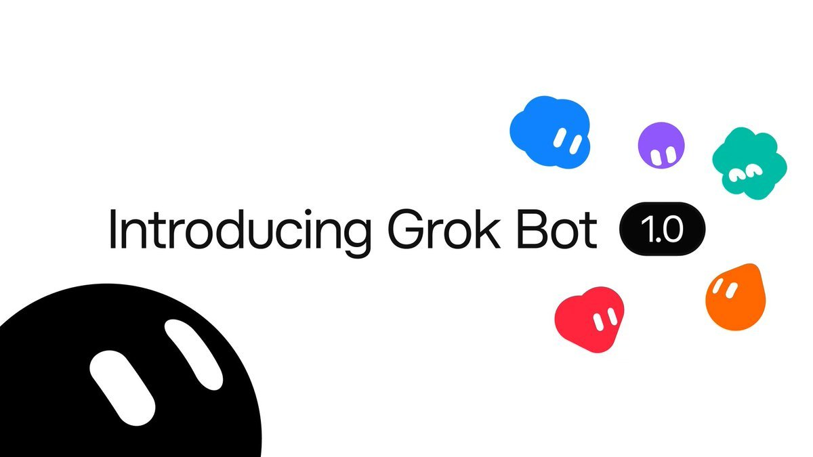
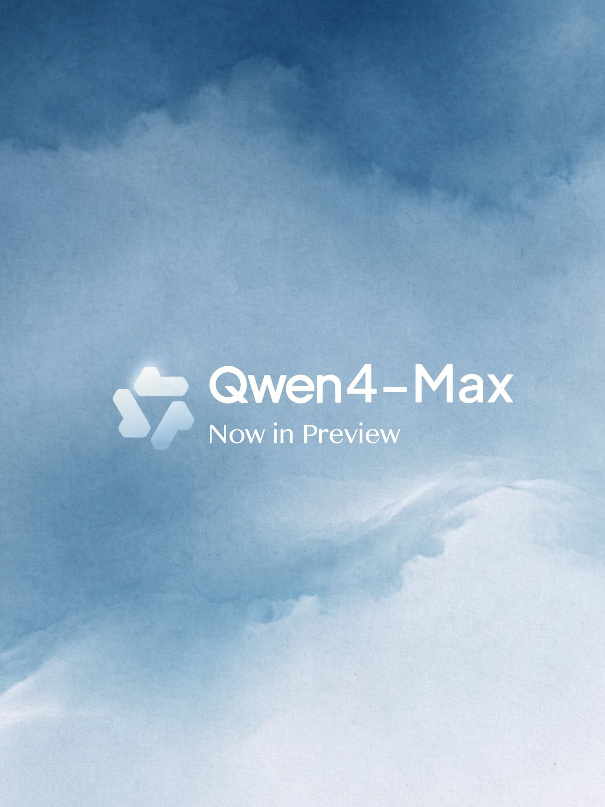
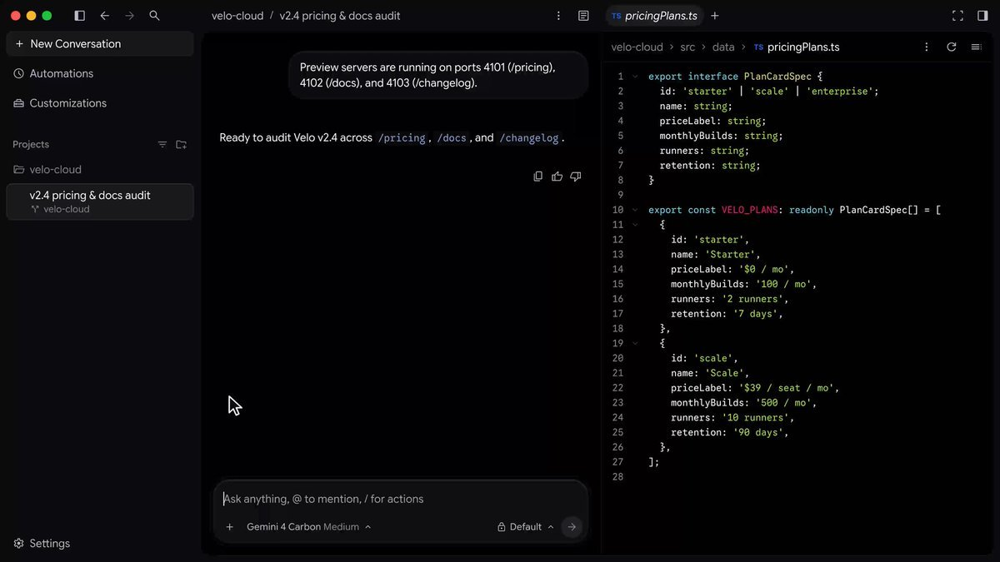
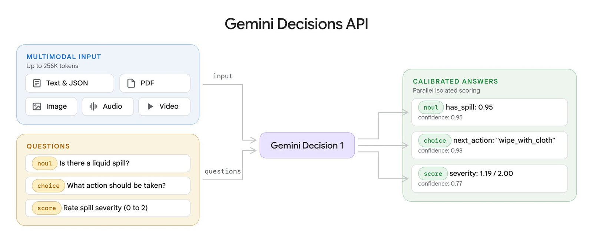
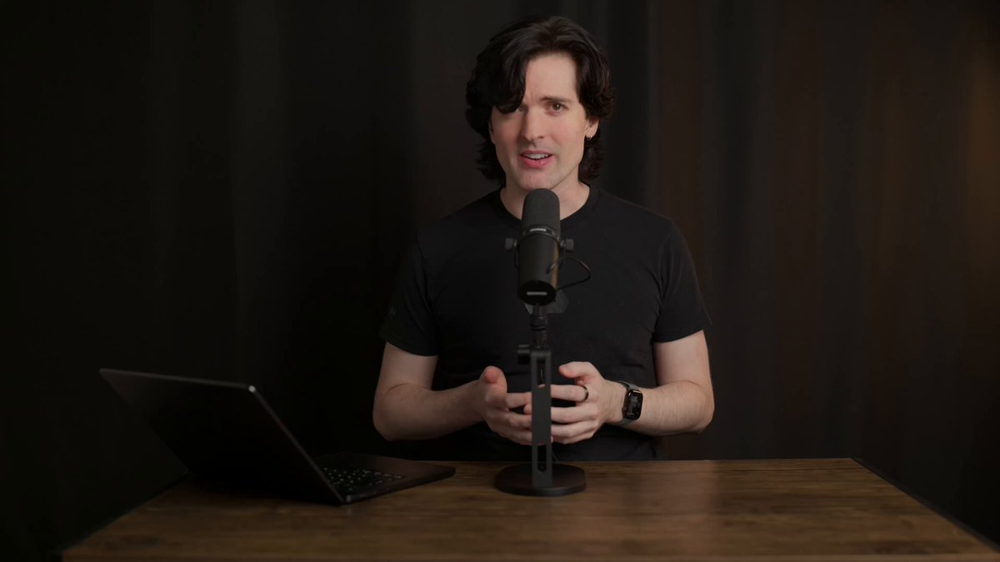
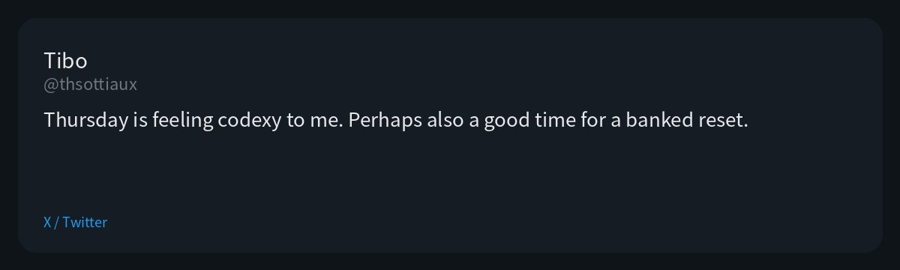
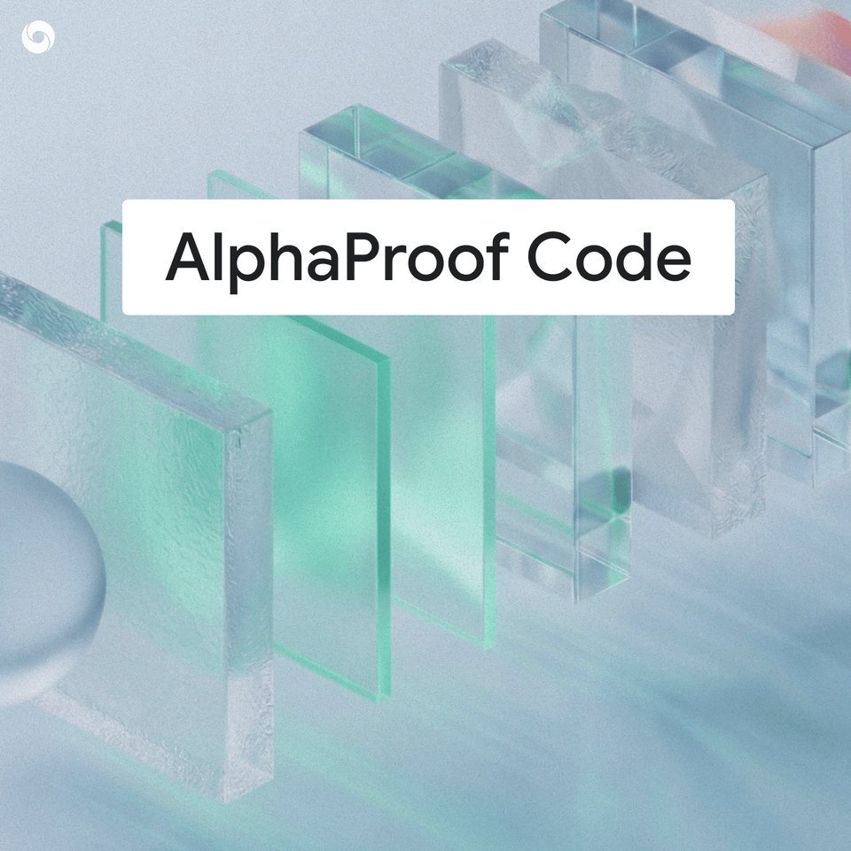
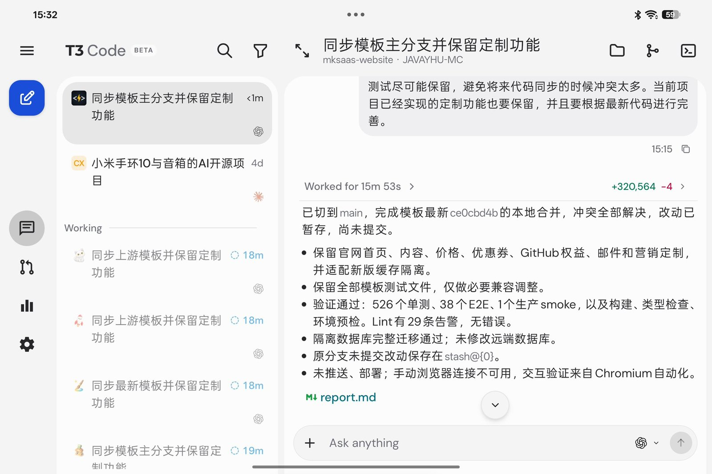

# AI Twitter/X 热点 Digest · 2026-11-12（周四）

## 今日要点

1. **Grok Bot 1.0 发布**：这是对已有 beta 的一次大版本更新，不是从零推出的新产品。官方把 Bot 写成可共享的团队队友：可以接入 Slack、Microsoft Teams，也可以加入视频会议的聊天；还可以主动发现未完成的工作并提议接手。Team Bots 在 Team 和 Enterprise 方案提供；Meetings 在 Team、Enterprise 和 Ultra 方案提供，Enterprise 需管理员开启。
2. **Qwen4-Max-Preview 在 Token Plan 开启限时预览**：阿里官方宣布 Qwen4 即将到来，Qwen4-Max 已在 Token Plan 开放预览，也可在 QwenWork、Qoder、Qwen APP 和 QwenStudio 抢先试用。这是预览，不是正式 GA。官方文档写明预览期为 11 月 11 日 10:00 至 11 月 25 日 24:00（UTC+8），期间不做变更，预览结束后模型会下线；仅走 Token Plan，不提供按量计费。同日 Qoder 宣布，此前匿名测试了 4 天的 Qoduck 正名为 Qwen4-Max-Preview。
3. **Google 推出 Decisions API，Antigravity 同时推送内置 Browser Use**：Gemini Decision 1 可对同一份多模态输入一次评估最多 **1,000** 个问题，端到端时延 150–250 毫秒，输入按每百万 token **$0.10** 计费，不收取 output。Antigravity 官方则宣布内置浏览器使用正在向个人档位滚动推送，用于把调研、写代码和在真实页面上验证连起来；这与昨天的 `/swarm` 不是同一功能。

---

## 1. xAI 发布 Grok Bot 1.0：可共享的团队队友，接入 Slack、Teams 和会议

**要点**：官方账号 @bot 宣布推出 Grok Bot 1.0，并配了演示视频。官方博客写明三项主要变化：可以共享 Team Bot，接入 Slack 与 Microsoft Teams，并加入视频会议聊天；可以主动发现未完成的工作并提议接手；浏览器使用、文档和演示稿更稳，也加强了和 Gmail、Calendar、GitHub 等应用的连接。这是对既有 Grok Bot beta 的升级，不是新产品从零发布。Team Bots 在 Team 和 Enterprise 方案提供；Meetings 在 Team、Enterprise 和 Ultra 方案提供，Enterprise 需管理员开启。Elon Musk 同步转发，呼吁把 Grok Bot 当作同事，把最难的任务交给它。lauren（@poteto）引用官方帖，只回了「1.0」。

**为何值得看**：这是过去一天里互动最高、且有官方博客可核验的 Agent 产品更新。共享能力和会议能力并不在所有档位默认开放，读公告时要把方案门控一并看进去。

- bot：宣布 Grok Bot 1.0：https://x.com/bot/status/2120582957782200586
- bot：说明博客里的更新内容：https://x.com/bot/status/2120582959275426253
- elonmusk：把 Grok Bot 当作同事：https://x.com/elonmusk/status/2120584535423565889
- poteto：引用官方帖，回复「1.0」：https://x.com/poteto/status/2120659959465783553

---

## 2. Qwen4-Max-Preview 上线：Token Plan 限时预览，Qoder 上的 Qoduck 正名

**要点**：@Alibaba_Qwen 宣布「Qwen4 is coming」，并说明 Qwen4-Max 已在阿里 Token Plan 开启预览，也可在 QwenWork、Qoder、Qwen APP 和 QwenStudio 试用。这是预览，不是正式全量发布。阿里云文档写明：模型 ID 为 `qwen4-max-preview`（别名 `qwen4.0-max-preview`），仅通过 Token Plan 提供，不支持按量计费；预览期为 2026 年 11 月 11 日 10:00 至 11 月 25 日 24:00（UTC+8），期间不做变更，预览结束后下线。规格包括 1M 上下文，最大输出 393,216 token（与 thinking 共享）。Token Plan 在预览促销期间把该模型的 Credits 消耗降到标准费率的 20%（相当于 5 倍用量），北京时间 22:00 到次日 08:00 再减 60%，相当于标准费率的 8%。同日 Qoder 官方宣布，此前匿名测试了 4 天、每日更新的 Qoduck，即日起升级并正名为 Qwen4-Max-Preview，所有产品和方案（含 Teams、Enterprise）都可选用，并给出限时「80% off、0.1x credits」的产品内优惠。Qoder 的优惠和 Token Plan 的积分折扣不是同一套计费，不要混在一起读。官方没有发布跑分。

**为何值得看**：Qwen4 的名字终于落到可试用的预览模型上，而且窗口是明确的限期。它不是 GA，预览结束后会下线；现在看到的体验和应用内折扣，都不等于正式版的承诺。

- Alibaba_Qwen：宣布 Qwen4-Max 预览：https://x.com/Alibaba_Qwen/status/2120335993643684315
- qoder_ai_ide：Qoduck 正名为 Qwen4-Max-Preview：https://x.com/qoder_ai_ide/status/2120343731673108936
- qoder_ai_ide：提醒这是预览，欢迎反馈：https://x.com/qoder_ai_ide/status/2120343734512726504

---

## 3. Antigravity 内置 Browser Use 开始向个人档位推送

**要点**：@antigravity 宣布，Browser use 正在产品内滚动推送，用来把调研、写代码和在真实页面上验证连成闭环。用户自行选择登录哪些站点，下载会先暂停等待批准，agent 也可以同时用浏览器跑多项任务。员工 Kevin Hou 补充：agent 可以控制内嵌浏览器做 localhost 测试、在线研究和重复工作流；直接让 agent 使用浏览器，或调用 `/browser` skill；需要更新到最新的 v2.31.0。他写道，当天会向 Free、Pro、Ultra 档位滚动推送，Enterprise 稍后在管理员控制后提供。Varun Mohan 称这对知识工作，以及「没有现成 CLI 的应用验证或研究」都有用，并说本周还有后续。官方更新日志里，v2.31.0 的署期是 11 月 9 日，其中已包含下载批准等改动；今天这条是面向个人档位的推送说明，不要写成「今天才发布 v2.31.0」。这与昨天已经写过的 `/swarm` 不是同一功能。

**为何值得看**：这是 Antigravity 在 `/swarm` 之后，窗口里最明确的新能力说明。内嵌浏览器降低了另装 Chrome、再开远程调试的门槛，但企业档位还要再等，也不是所有账号都会立刻看到。

- antigravity：宣布 Browser use 正在推送：https://x.com/antigravity/status/2120556423474028576
- kevinhou22：内嵌浏览器演示：https://x.com/kevinhou22/status/2120560116168626277
- kevinhou22：调用方式和档位说明：https://x.com/kevinhou22/status/2120566559861252537
- _mohansolo：对知识工作与应用验证的用途：https://x.com/_mohansolo/status/2120583957628731760

---

## 4. Google 推出 Gemini Decisions API：一次最多评估 1,000 个问题

**要点**：@Google 宣布在 Google AI Studio 上线 Gemini Decisions API，背后是新模型 Gemini Decision 1（`gemini-decision-1`）。它不是按 token 逐个生成一段文字，而是对同一份多模态输入（文本、图片、音频、视频和 PDF）一次评估最多 **1,000** 个问题，返回带置信度的判断。官方博客署期 11 月 11 日，写明端到端时延 150–250 毫秒，输入按每百万 token **$0.10** 计费，不收取 output。问题类型包括是否判断（noul）、多项选择（choice）和量表打分（score）。官方举例：对 100 张配送照片、每张 16 个问题，Decision 1 用 4.5 秒扫完。官方还称，在他们的共享基准上，这比用 Gemini 3.5 Flash-Lite 走 Interactions API 几乎便宜约 5 倍；这是 Google 自己的对比，不是对外部竞品的结论。这条与昨天的 Carbon 开放是不同的产品，不要写在一起。

**为何值得看**：这是一条面向 agent 路由、策略检查和分级的控制面 API，而不是又一个通用聊天模型。它让人看到 Google 如何把「快速做选择」从生成式回答里拆出来。

- Google：宣布 Decisions API 与 Decision 1：https://x.com/Google/status/2120583966272983331
- Google：时延与定价说明：https://x.com/Google/status/2120583968676577709
- Google：配送照片演示：https://x.com/Google/status/2120583972505760016

---

## 5. Theo 发布 Gemini 4 Carbon 评测：慢，但他认为团队有进步

**要点**：在 Carbon 正式开放的第二天，@theo 发布了评测视频。他先写自己拿到早期权限时「整体不太打动」，准备拍摄时又补做了测试，于是视频没有按原计划走。视频说明里他把 Carbon 写成又慢、又别扭、还经常幻觉，同时认为团队进步很大，深层里也有一些他认为有用的能力。他随后给出一组个人对比数字：同一任务上，Gemini 4 Carbon low 用了 **22 分 21 秒**，Opus 5.5 high 用了 **9 分 33 秒**；他让 Carbon 给 T3 Code 的 Windows 安装写修复，跑了 **14 小时**。再往后他又写，几乎所有速度问题都在服务端，开始响应前要等 **11 秒**，大约是 Fable 的 **20 倍**。这些都是他的个人评测，不是 Google 的官方基准，也不要把它读成对 Carbon 的第二次发布。

**为何值得看**：发布次日的讨论通常会从官方榜单转到更具体的使用感受。Theo 的措辞很满，数字也只来自他的测试；它补充了昨天官方演示和第一夜试用没有覆盖的速度体验。

- theo：Carbon 评测视频：https://x.com/theo/status/2120596827980665018
- theo：22 分 21 秒对 9 分 33 秒：https://x.com/theo/status/2120597586298261543
- theo：开始响应前等 11 秒，约 Fable 的 20 倍：https://x.com/theo/status/2120618574834462935

---

## 6. Tibo 预告「周四很有 Codex 的感觉」，窗口内没有正式发布

**要点**：Codex 相关负责人 Tibo（@thsottiaux）先写「好久没有 reset 了，也许我该从地下室出来了」，紧接着又说：「周四感觉很 Codex。也许也是把攒下来的 reset 用掉的好时候。」两条帖的互动都很高，但它们只是预告和气氛，不是产品发布。在今天这份摘要覆盖的时间范围内，没有看到 Codex 的正式发布公告。

**为何值得看**：这类预告经常会在第二天被当成「已经发布」。现在能确认的只有 Tibo 本人的暗示；如果周四白天还有落地，那是这份摘要之后的事。

- thsottiaux：说好久没有 reset，也许该从地下室出来：https://x.com/thsottiaux/status/2120410006273380750
- thsottiaux：「周四很有 Codex 的感觉」：https://x.com/thsottiaux/status/2120410480204525936

---

## 7. DeepMind 在 X 上介绍 AlphaProof Code：在代码层验证 Signal 协议的关键安全性质

**要点**：@GoogleDeepMind 发帖称，他们用 AlphaProof Code 框架，首次在代码层用数学方法证明了 Signal 协议的关键安全性质。官方跟帖写：Gemini agents 生成了超过 **600 万行** Lean 证明，并把需要人类专家复查的部分压到约 **1%**。需要分开写时间：配套博客署期是 **11 月 10 日**，仓库 [google-deepmind/code-verification](https://github.com/google-deepmind/code-verification) 的首次内容提交也在那天；仓库本身创建于 10 月 26 日。官方 X 线程出现在今天的讨论窗口里，不要写成「今天才首次发表」或「刚刚开源」。博客强调的是关键安全性质，以及编译后的机器码层面，而不是整个 Signal 应用或全部密码学原语都已被完全证明。

**为何值得看**：这是把形式化验证和编码模型讨论接到一起的高信号研究。它值得看，但要把日期和范围写清楚，避免把「关键性质」读成「整个应用已经证完」。

- GoogleDeepMind：介绍 AlphaProof Code 与 Signal 验证：https://x.com/GoogleDeepMind/status/2120484246401777737
- GoogleDeepMind：600 万行 Lean 证明与约 1% 人工复查：https://x.com/GoogleDeepMind/status/2120484249321033911

---

## 8. T3 Code：Theo 称额度应与直连 Claude Code 持平；中文圈在分享用法

**要点**：这不是一次新发布。Theo 明确说：T3 Code 不应比直接使用 Claude Code 更快打穿订阅额度；如果发生了，就是 bug。他称已经修掉大量小问题，现在应与直连持平，并请用户继续反馈。他还引用一条用户评价「用 T3 Code 后 Claude 用量翻了三倍」，那是用户原话，不是官方统计。中文讨论里，@CyanCloud77 分享了用 T3 Code + Tailscale 打通 Grok Bot、Windows、Mac 和 NAS 的用法：除了 Claude 订阅，他把 Kimi、Codex、Devin、Copilot、CodeBuddy 等一共 8 个订阅放到 T3 Code 上，用 ACP 驱动；小任务留在 Mac，更重的测试交给 Windows 主机，并在 Grok Bot 里接入 T3 来指挥。@indie_maker_fox 则写了 T3 Code 在 Oppo Pad Mini 上的使用，以及和 Magpie 搭配调用本地 Codex / Claude Code。

**为何值得看**：Theo 本人就额度问题表态，加上中文时间线里收藏比点赞还高的用法分享，适合当作产品维护和社区实践来看，而不是新功能发布。

- theo：额度应与直连 Claude Code 持平：https://x.com/theo/status/2120653953423880309
- CyanCloud77：T3 Code + Tailscale 多机用法：https://x.com/CyanCloud77/status/2120363980325871810
- indie_maker_fox：平板与 Magpie 搭配：https://x.com/indie_maker_fox/status/2120420914609426769

---

## 9. Fable 5.2 跟进：Perplexity CEO 用 Teammate 做出可在浏览器里玩的射击游戏

**要点**：Perplexity CEO Aravind Srinivas（@AravSrinivas）发视频说，他让 Teammate 在 Fable 5.2 上跑了几个小时，做出一个可在浏览器里玩的无尽僵尸射击游戏，并称没有使用任何现成 3D 资产，全部用代码完成。这是对 11 月 10 日发布的 Fable 5.2 的跟进演示，不是新模型发布。「没用 3D 资产」是他的自述。这里的 Teammate 是 Perplexity 的产品语境，不是 Anthropic 的官方功能名。

**为何值得看**：Fable 5.2 发布两天后，讨论已经从官方宣布转到具体作品。它补充了昨天评测视频之外的一条高质量演示，但不要再复述模型发布本身。

- AravSrinivas：用 Fable 5.2 做出可玩的浏览器射击游戏：https://x.com/AravSrinivas/status/2120506245131977026

---
