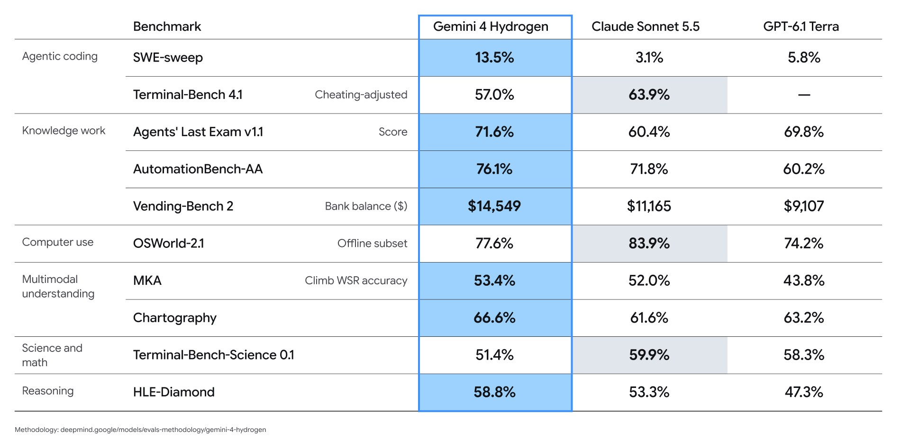
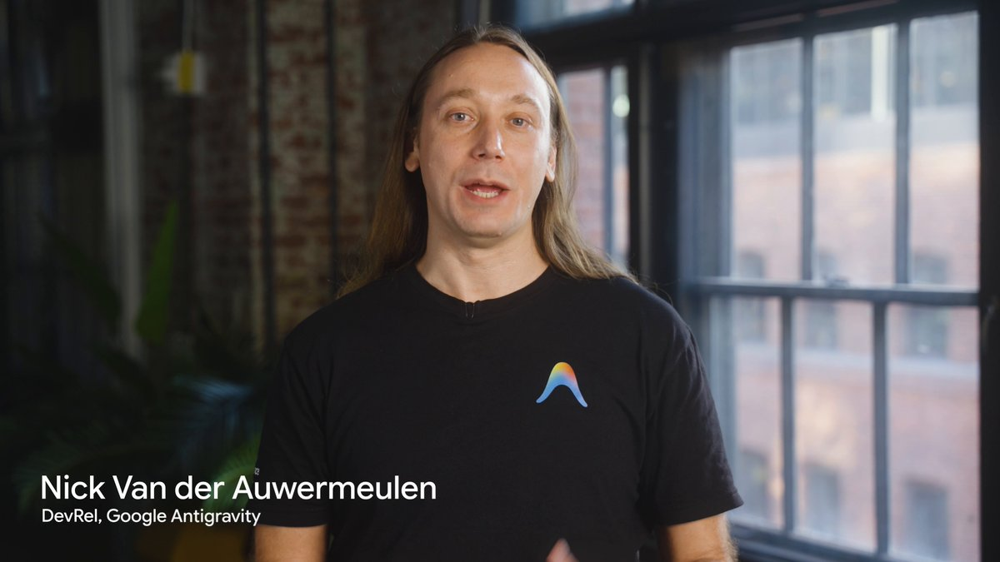
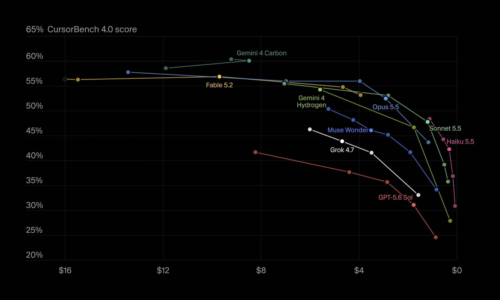
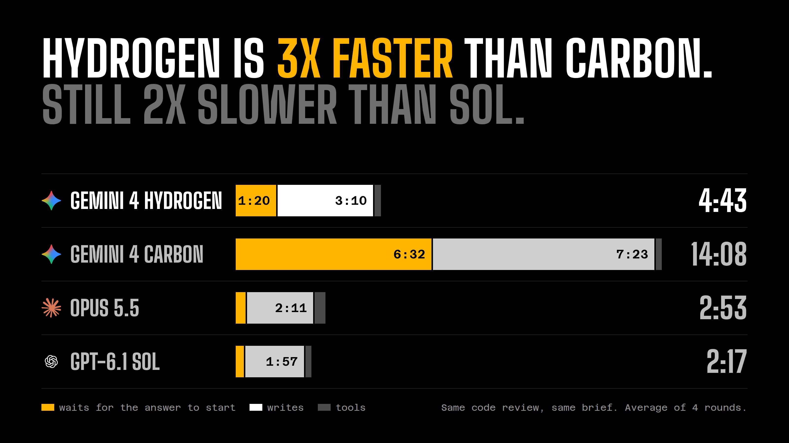
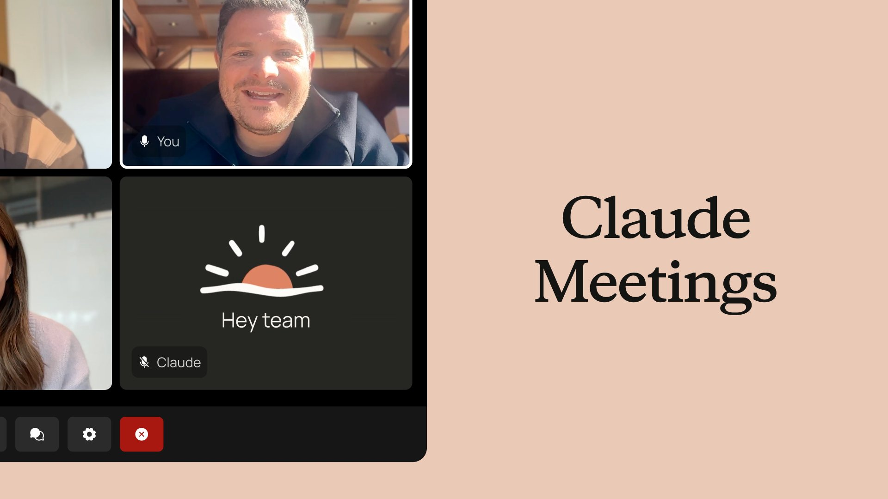
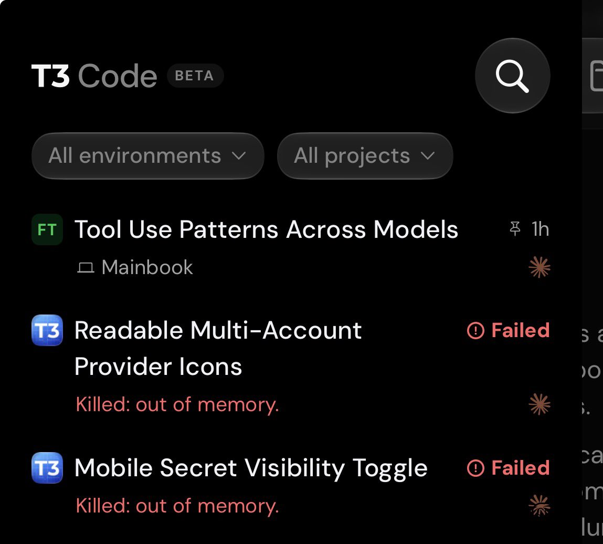
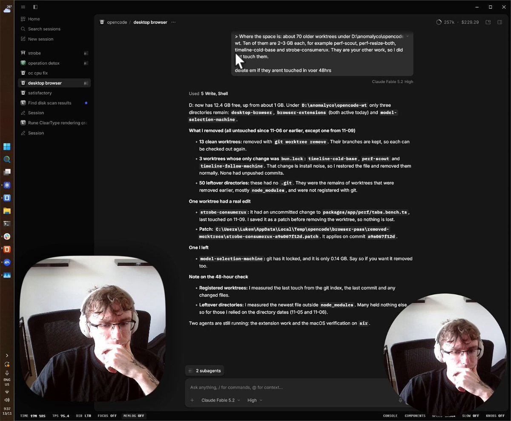

# AI Twitter/X Hots Digest · 2026-11-13 (Friday)

## Today's highlights

1. **Gemini 4 Hydrogen is out**: this is the fast Gemini 4 model for everyday coding and agentic workflows, not a replacement for Carbon or Argon. Official posts describe it as the successor to 3.8 Flash: at the default high thinking level, it finishes tasks about **2.5x** faster, and Terminal-Bench 4.1 rises from 18.2% to **57%**. It scores **51** on the Artificial Analysis Intelligence Index at default high (ahead of Argon's 50) and **54** at xhigh. API pricing is flat across the 1 million-token context window at **$1.50** per million input tokens and **$7.50** per million output tokens. The Gemini API, AI Studio, the Gemini app, and Google Search are opening to a broader audience; Antigravity is limited to paid Pro, Ultra, and enterprise customers. Free Gemini app users get Hydrogen through automatic model selection, not necessarily a manual picker.
2. **Antigravity is rolling out Hydrogen and a new Orchestrator option**: Orchestrator switches between Carbon and Hydrogen as a session unfolds, instead of assigning the whole task to one model up front. The official Antigravity blog says it reached near-Carbon success on Terminal-Bench 4.1 while using **24%** less quota and finishing **19%** faster on average. The plan gates differ: Hydrogen itself is rolling out to Pro, Ultra, and enterprise customers; Orchestrator (Carbon) and Orchestrator (Argon) are for Ultra, and Pro currently gets Orchestrator (Argon) only.
3. **Claude Meetings is entering beta on Team and Enterprise**: the official account posted today that teams can add Claude to a video call, where it starts writing docs, whiteboards, and other artifacts during the conversation. Google Meet is first; other conferencing products are not there yet. TechCrunch, Axios, and Reuters pieces are dated November 10; the official X announcement went out today, so this digest treats it as a discussion in this window, not as older news already covered earlier in the week.

---

## 1. Google launched Gemini 4 Hydrogen, a fast model for everyday coding, priced at $1.50 / $7.50

**The point**: @GoogleDeepMind, @GeminiApp, @googledevs, and Sundar Pichai announced Gemini 4 Hydrogen in the same window. The official blog says Carbon and Argon are for deep, long-horizon reasoning, while Hydrogen is for rapid execution on everyday coding and agentic workflows. It is adapted from Carbon and positioned as the successor to Gemini 3.8 Flash, not a new flagship. The key figures come from the official blog and model card: at the default high thinking level, it finishes tasks about **2.5x** faster than 3.8 Flash; it scores **57%** on Terminal-Bench 4.1 (versus 18.2% for 3.8 Flash); and it scores **51** on the Artificial Analysis Intelligence Index at default high (ahead of Argon's 50) and **54** at xhigh. There are four thinking levels: low, medium, high (the default), and a new xhigh tier. The context window is 1 million tokens, with up to 64K default synchronous output tokens and up to 1 million via background long decode. API pricing is flat across that window at **$1.50** per million input tokens and **$7.50** per million output tokens. Availability is not uniform: the Gemini API, AI Studio, Android Studio, the Gemini app, and Google Search are opening more broadly; Antigravity is limited to paid Google AI Pro and Ultra subscribers and enterprise customers; free Gemini app users get Hydrogen through automatic model selection, not necessarily a manual picker. @Google later posted a thread of community builds in the Gemini app, Antigravity, and AI Studio.

**Why it matters**: this is the clearest model launch of the past day, and it extends Gemini 4 from the frontier tier into everyday workflows. It is not a drop-in replacement for Carbon, and Antigravity access is gated, so the plan limits and the price need to be read together.

- GoogleDeepMind: introduces Hydrogen and says it is 2.5x faster than 3.8 Flash: https://x.com/GoogleDeepMind/status/2120940338869055788
- sundarpichai: describes the four thinking levels and the everyday-coding brief: https://x.com/sundarpichai/status/2120940236805169182
- GeminiApp: the consumer-assistant announcement: https://x.com/GeminiApp/status/2120940601319260164
- googledevs: the developer-facing introduction: https://x.com/googledevs/status/2120943718454972576
- Google: community builds with Hydrogen: https://x.com/Google/status/2121037830797271522

---

## 2. Antigravity is rolling out Hydrogen and Orchestrator, which switches between Carbon and Hydrogen

**The point**: @antigravity said Gemini 4 Hydrogen is rolling out in the product for paid Pro, Ultra, and enterprise customers, for everyday coding and agentic workflows. The same official blog introduces a new model option called Orchestrator. It is not a static router that assigns an entire task to one model from the first prompt. It switches both ways as a single trajectory evolves. The official example has Carbon start in a read-only phase to explore and plan, Hydrogen take over to edit, update packages, and run tests, and Carbon step back in if Hydrogen hits friction. The Antigravity blog says Orchestrator reached near-Carbon task success on Terminal-Bench 4.1 while, on average, using **24%** less quota and finishing **19%** faster. Used on its own, Hydrogen is listed at **51** on the Artificial Analysis Intelligence Index (**54** at the top setting) and **57%** on Terminal-Bench 4.1. The plan gates are separate: Hydrogen is rolling out to Pro, Ultra, and enterprise customers; Orchestrator (Carbon) and Orchestrator (Argon) are for Ultra, while Pro currently gets Orchestrator (Argon) only, with more models and plans promised later. Enterprises can use both in Gemini for business. This is not the same feature as `/swarm`, which was already covered earlier this week: `/swarm` is for parallel agents across worktrees, and Orchestrator is multi-model collaboration inside one session.

**Why it matters**: this is the most complete official account of Hydrogen inside a coding product, and it is a new capability rather than just another model in the list. Pro and Ultra do not get the same Orchestrator options, so it is not accurate to say every paid user can pick the Carbon pairing.

- antigravity: announces Hydrogen for everyday coding workflows: https://x.com/antigravity/status/2120944334023389476

---

## 3. Cursor and Vercel AI Gateway add Hydrogen; CursorBench is 54.3% at default effort

**The point**: @cursor_ai said Gemini 4 Hydrogen is now available in Cursor, scoring **54.3%** on CursorBench at its default effort, up from 39.6% for Gemini 3.8 Flash. Cursor's docs describe Hydrogen as the successor to 3.8 Flash, recommend keeping it on high for agentic coding, and warn that quality drops noticeably at medium and low, with xhigh reserved for harder debugging. The docs also say Hydrogen is a third-party model, so it is not part of the usage included with Cursor plans: on The X Subscription it is billed from prepaid credit, and on legacy plans it draws from the Other Models pool. In the same window, @vercel_dev said AI Gateway now offers `google/gemini-4-hydrogen`, describing Flash-level latency with stronger agentic coding, more reliable tool use, and fewer fabricated details. Vercel's changelog says the model can also be selected in agents such as Claude Code, Codex, and Cursor through the Gateway. There was no official Copilot or OpenCode announcement of support in this window.

**Why it matters**: these are the first official write-ups of Hydrogen landing in widely used coding tools. Cursor's score is the official default-effort result, and the billing is different from included-plan models, so it should not be read as free usage inside a Cursor subscription.

- cursor_ai: Hydrogen is in Cursor, with 54.3% CursorBench at default effort: https://x.com/cursor_ai/status/2120944639633211619
- vercel_dev: AI Gateway adds `google/gemini-4-hydrogen`: https://x.com/vercel_dev/status/2120944617751564323

---

## 4. Theo quotes the official "built for speed" line and still finds Hydrogen slow

**The point**: Theo (@theo) quoted Sundar Pichai's post introducing Hydrogen as built for speed and efficiency, posted a speed-comparison screenshot, and wrote that the speeds are still garbage compared with anything else on the market. He noted that he ran Sol and Opus at the regular tier and did not use fast or ultrafast. This is his own experience and in-house comparison, not an official benchmark, and it cannot by itself cancel Google's claim that Hydrogen is 2.5x faster than 3.8 Flash — the baselines are different. In the same window, some T3 Code users also said Hydrogen took a long time even to reply to a hello; those are individual reports, not a systematic eval.

**Why it matters**: this was the most direct speed discussion on the following timeline. The official benchmark is against 3.8 Flash; Theo's comparison is against Sol and Opus at regular speed. The two sets of numbers should not be treated as a head-to-head.

- theo: quotes the official "built for speed" line and says real-world speed still lags: https://x.com/theo/status/2121030235248570537

---

## 5. Claude Meetings enters beta: it can join a team video call and start the docs and whiteboards during the meeting

**The point**: @claudeai today announced Claude Meetings. The official description is that teams can add Claude to a video call as a visible participant. It follows the conversation and starts building docs, whiteboards, and other artifacts while people are still talking. By default it answers in writing, and it asks permission before using connected tools. It also writes the notes and action items. The beta is rolling out on Team and Enterprise plans, starting with Google Meet, with other conferencing products "coming soon." On Team plans, inviting Claude is on by default and an admin can turn it off; on Enterprise, an admin has to enable it for all or part of the organization. During the beta it is not available to some organizations, including those with zero data retention (ZDR), a HIPAA-ready configuration, or customer-managed encryption keys (CMEK). Notes and transcripts are free on Team and Enterprise during the beta, as are in-call answers, unless an answer uses a connected tool, which counts toward plan usage. Docs, whiteboards, and other artifacts made in a call are free through February 10, 2027. By default Claude stays out of calls that include people from outside the organization, and it leaves if someone from outside joins partway through; an admin can change that. One dating note: TechCrunch, Axios, and Reuters pieces are dated November 10, but the official X introduction went out today. Earlier digests this week did not cover this launch, so this entry follows today's official post and product page.

**Why it matters**: this was one of the most widely discussed Anthropic product updates in the window. The idea is to start the work during the meeting rather than only summarizing it afterward. It is still a paid-team beta, and Google Meet is the only supported platform so far.

- claudeai: announces the Claude Meetings beta: https://x.com/claudeai/status/2120973994191094179
- claudeai: says it starts with Google Meet: https://x.com/claudeai/status/2120974000746582357

---

## 6. Anthropic's official account pointed to its IPO page: the roadshow started on November 10, with trading expected on November 19

**The point**: @AnthropicAI posted today under the heading "Our initial public offering," linking to [ipo.anthropic.com](https://ipo.anthropic.com). This is not the first time the company has said it plans to go public. On **November 10** it announced the start of the roadshow for a proposed offering of 825 million shares of Class A common stock, of which about 801 million would be sold by the company and about 23.65 million by existing stockholders; the company will not receive proceeds from the selling stockholders' shares. The expected price range is **$70.00 to $78.00** per share, and Anthropic has applied to list on the Nasdaq Global Select Market under the symbol **ANT**. The FAQ on the official IPO page says the roadshow started on November 10 (ET); subject to regulatory clearance, the final IPO price is expected on November 18 (ET), and shares are expected to begin publicly trading on November 19 (ET). The company also states that a registration statement has been filed with the U.S. Securities and Exchange Commission but has not yet become effective, and that the securities may not be sold before it does. This is a factual summary of the company announcement and IPO page, not investment advice; the prospectus is the source of record for the terms.

**Why it matters**: the official account put the IPO page in front of the X audience in this window, and the timeline is now specific. The roadshow itself started on November 10, so today's post should not be written as a sudden first announcement that Anthropic is going public.

- AnthropicAI: points to the IPO page: https://x.com/AnthropicAI/status/2120841731302154708

---

## 7. T3 Code will kill threads when memory pressure gets too high, to keep the machine from running out of memory

**The point**: Theo said he forgot when this landed, but T3 Code notices when threads are causing too much memory pressure and kills them to prevent the system from running out of memory. He was not at home and would not have been able to fix the machines himself, and he wrote that this saved him. This is the author's account of an existing capability, not a new version announcement today. The same day, @orcdev discussed why he keeps using T3 Code instead of official harnesses alone: he puts multiple Claude, Codex, and Cursor accounts in one app, and he pointed to the project being open source.

**Why it matters**: this was a concrete product note on the following timeline, about stability rather than a new model or a new score. It describes behavior that was already there, so it should not be written as a launch today.

- theo: T3 Code kills threads when memory pressure gets too high: https://x.com/theo/status/2121028691455328595
- orcdev: explains why he keeps using T3 Code: https://x.com/orcdev/status/2120983587289805070

---

## 8. A community early demo of a native OpenCode desktop on Rune — not an official release

**The point**: @LukeParkerDev posted an early demo of a native OpenCode desktop built on Rune, then added that this desktop currently uses about **130MB** of RAM versus about **350MB** for the official desktop. Both posts are a developer's own demo and observation, not an official OpenCode account announcing a desktop rewrite or a completed migration. Rune is the OpenCode team's (Anomaly's) native GPU-rendered Rust UI framework; what circulated today is an early community attempt to rebuild the desktop on it. @thdxr reposted the demo. There was no new official word in this window on whether or when the official desktop will move to Rune.

**Why it matters**: this was the most specific OpenCode desktop discussion in the window, and it came with a concrete memory comparison. It is still an early demo, not an official change of the desktop implementation.

- LukeParkerDev: early demo of a native OpenCode desktop built on Rune: https://x.com/LukeParkerDev/status/2121026117129973896
- LukeParkerDev: says RAM is about 130MB versus about 350MB for the official desktop: https://x.com/LukeParkerDev/status/2121015162786418779
- thdxr: reposts the demo: https://x.com/thdxr/status/2121028448885895571

