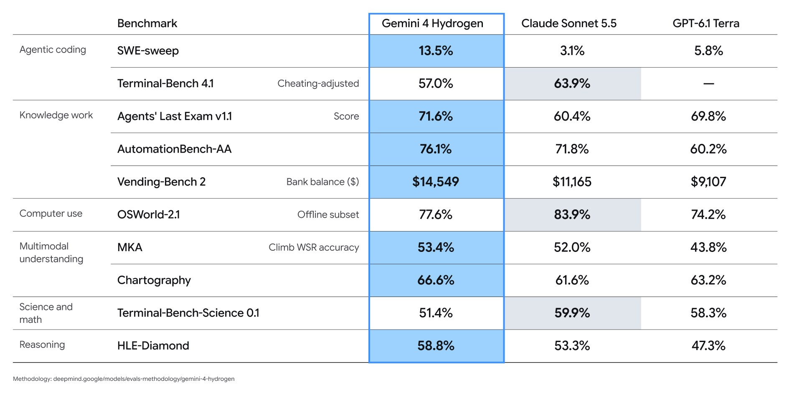
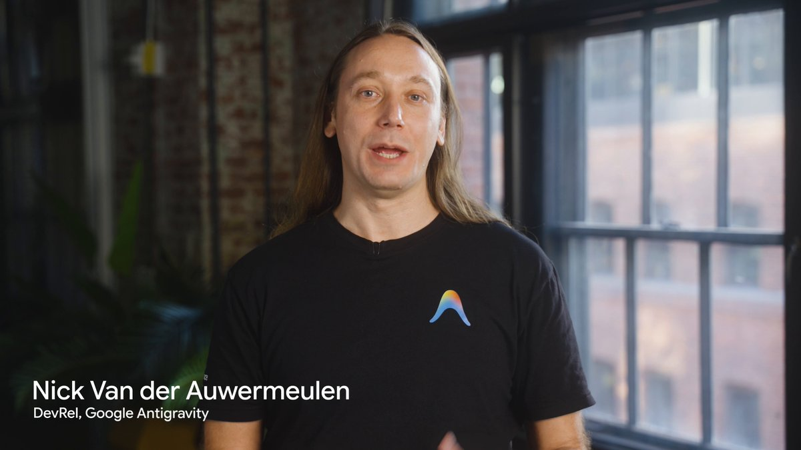
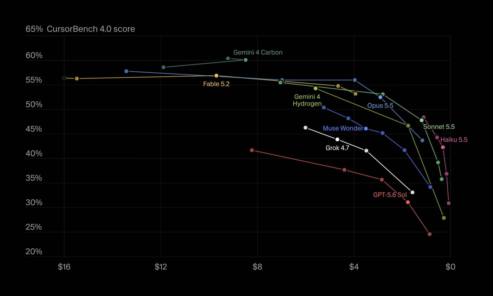
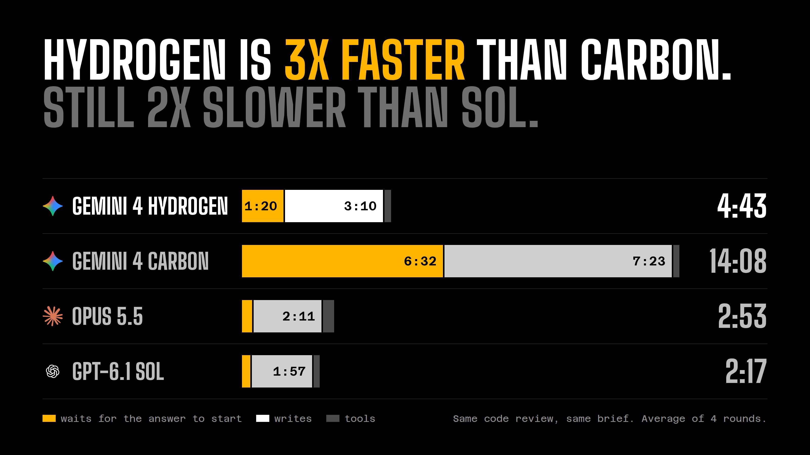
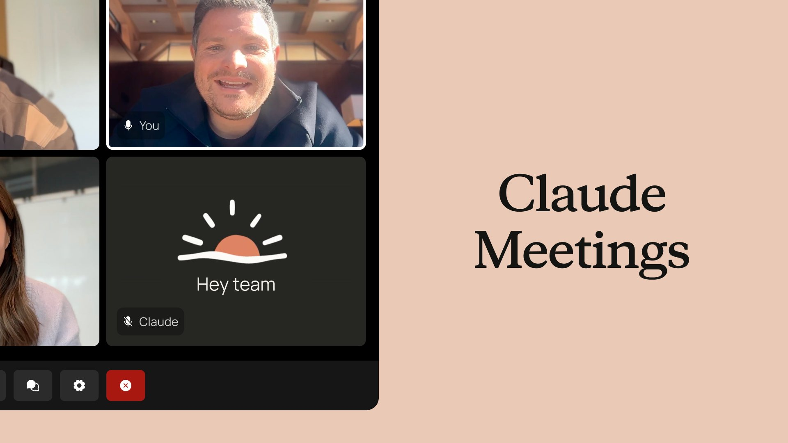
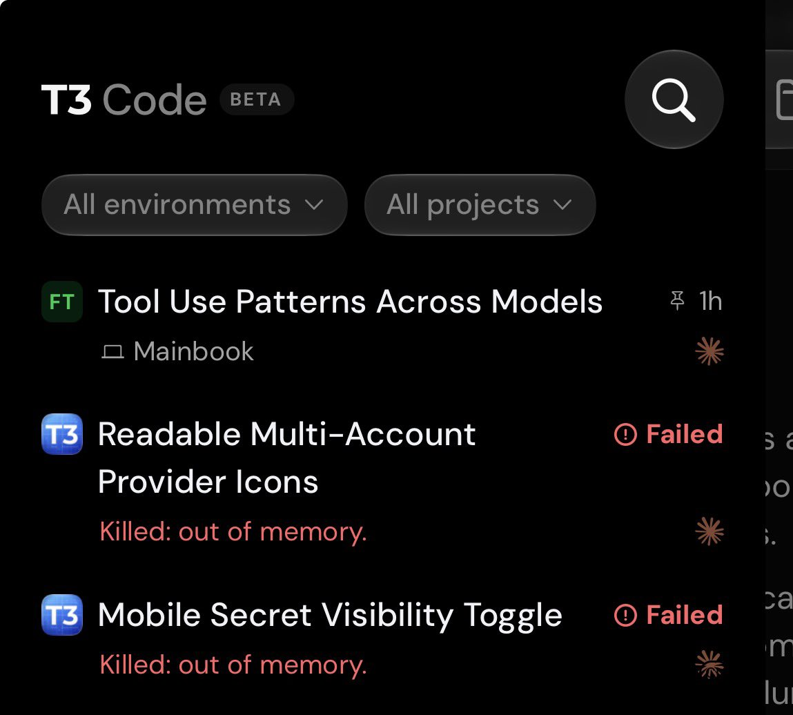
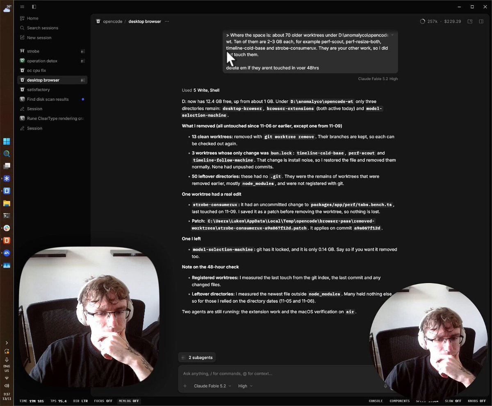

# AI Twitter/X 热点 Digest · 2026-11-13（周五）

## 今日要点

1. **Gemini 4 Hydrogen 正式发布**：这是 Gemini 4 家族里面向日常编码和 agent 工作流的快模型，不是 Carbon 或 Argon 的替代品。官方把它写成 3.8 Flash 的后继：默认 high 思维档下，任务完成速度约为 **2.5 倍**，Terminal-Bench 4.1 从 18.2% 提到 **57%**。Artificial Analysis Intelligence Index 在默认 high 为 **51**（超过 Argon 的 50），最高 xhigh 为 **54**。API 在整个 100 万 token 上下文上统一定价，每百万输入 **$1.50**、输出 **$7.50**。Gemini API、AI Studio、Gemini 应用和 Google 搜索面向更广的用户开放；Antigravity 只对付费的 Pro、Ultra 和企业档位开放。Gemini 应用的免费用户通过自动选模型使用，不保证能在列表里手动点选。
2. **Antigravity 上线 Hydrogen，并推出 Orchestrator**：Orchestrator 会在同一次会话里按阶段在 Carbon 和 Hydrogen 之间切换，而不是一开始就把整项任务交给一个模型。官方 Antigravity 博客写它在 Terminal-Bench 4.1 上接近 Carbon 的成功率，平均少用 **24%** 配额、快 **19%**。档位门控要分开看：Hydrogen 本身向 Pro、Ultra 和企业客户推送；Orchestrator (Carbon) 和 Orchestrator (Argon) 给 Ultra，Pro 目前只有 Orchestrator (Argon)。
3. **Claude Meetings 进入 Team 和 Enterprise 测试**：官方账号今天发帖，介绍可以把 Claude 加进团队视频会议，边谈边写文档、白板和其他产物。目前先支持 Google Meet，其他会议产品还没到。需要说明的是，TechCrunch、Axios、Reuters 等稿件的日期写的是 11 月 10 日；以今天的官方 X 帖和产品说明页为准，把它当作窗口里正在讨论的发布，而不是更早已经写过的旧闻。

---

## 1. Google 发布 Gemini 4 Hydrogen：面向日常编码的快模型，定价 $1.50 / $7.50

**要点**：@GoogleDeepMind、@GeminiApp、@googledevs 和 Sundar Pichai 在同一时段宣布 Gemini 4 Hydrogen。官方博客写明：Carbon 和 Argon 负责深层、长程推理，Hydrogen 负责快速执行日常编码和 agent 工作流；它改编自 Carbon，并被定位为 Gemini 3.8 Flash 的后继，而不是新的旗舰。关键数字来自官方博客和模型卡：默认 high 思维档下，任务完成速度约为 3.8 Flash 的 **2.5 倍**；Terminal-Bench 4.1 为 **57%**（3.8 Flash 为 18.2%）；Artificial Analysis Intelligence Index 默认 high 为 **51**（超过 Argon 的 50），最高 xhigh 为 **54**。思维档共四档：low、medium、high（默认），以及新的 xhigh。上下文窗口为 100 万 token，默认同步输出最多 64K，后台长解码最高可到 100 万。API 在整个上下文上统一定价，每百万输入 **$1.50**、输出 **$7.50**。提供范围要分开读：Gemini API、AI Studio、Android Studio、Gemini 应用和 Google 搜索面向更广的用户；Antigravity 只对 Google AI Pro、Ultra 付费用户以及企业客户开放；Gemini 应用的免费用户通过自动选模型使用 Hydrogen，不保证能手动点选。@Google 稍后还发了一组社区在 Gemini 应用、Antigravity 和 AI Studio 里用 Hydrogen 做的演示。

**为何值得看**：Hydrogen 是过去一天里最明确的模型发布，也把 Gemini 4 从旗舰档扩展到日常工作流。它不是 Carbon 的平替，Antigravity 也不是对所有人开放，读公告时要把档位和定价一起看进去。

- GoogleDeepMind：介绍 Hydrogen，称比 3.8 Flash 快 2.5 倍：https://x.com/GoogleDeepMind/status/2120940338869055788
- sundarpichai：说明四档思维和日常编码定位：https://x.com/sundarpichai/status/2120940236805169182
- GeminiApp：面向日常助手的发布说明：https://x.com/GeminiApp/status/2120940601319260164
- googledevs：面向开发者的介绍：https://x.com/googledevs/status/2120943718454972576
- Google：社区用 Hydrogen 做的演示：https://x.com/Google/status/2121037830797271522

---

## 2. Antigravity 上线 Hydrogen，并推出在 Carbon 与 Hydrogen 之间切换的 Orchestrator

**要点**：@antigravity 宣布，Gemini 4 Hydrogen 正在产品内推送，面向已付费的 Pro、Ultra 和企业客户，用于日常编码和 agent 工作流。同一篇官方博客介绍了新的模型选项 Orchestrator：它不是静态路由，不会仅根据第一条提示词把整项任务交给某个模型，而是在同一次轨迹里按阶段双向切换。官方举例是 Carbon 先只读探索并做计划，Hydrogen 再写代码、改依赖和跑测试，遇到摩擦再交回 Carbon。Antigravity 博客写，Orchestrator 在 Terminal-Bench 4.1 上接近 Carbon 的成功率，平均少用 **24%** 配额、快 **19%**。单独选用 Hydrogen 时，官方给出 Artificial Analysis Intelligence Index **51**（最高档 **54**），以及 Terminal-Bench 4.1 的 **57%**。档位门控是：Hydrogen 向 Pro、Ultra 和企业客户滚动推送；Orchestrator (Carbon) 和 Orchestrator (Argon) 给 Ultra，Pro 目前只有 Orchestrator (Argon)，后续还会加模型和档位。企业客户可通过 Gemini for business 使用。这与本周早些时候已经写过的 `/swarm` 不是同一功能：`/swarm` 面向多工作区的并行 agent，Orchestrator 面向单次会话里的多模型协作。

**为何值得看**：这是 Hydrogen 在编程产品里最完整的官方说明，也是新的产品能力，而不只是模型列表多了一项。Pro 和 Ultra 能用的 Orchestrator 版本并不一样，不能写成所有付费用户都能选 Carbon 组合。

- antigravity：宣布 Hydrogen 与日常编码工作流：https://x.com/antigravity/status/2120944334023389476

---

## 3. Cursor 和 Vercel AI Gateway 上线 Hydrogen；CursorBench 默认 effort 为 54.3%

**要点**：@cursor_ai 宣布 Gemini 4 Hydrogen 已在 Cursor 中可用，默认 effort 下 CursorBench 为 **54.3%**，对比 Gemini 3.8 Flash 的 39.6%。Cursor 文档把 Hydrogen 写成 3.8 Flash 的后继，建议日常 agent 编码保持 high，中低档质量会明显下降，难调试再升到 xhigh。文档同时写明：Hydrogen 是第三方模型，不计入 Cursor 方案的包含用量；在 The X Subscription 上按预付额度计费，旧方案则走 Other Models 池。@vercel_dev 同期宣布，AI Gateway 已提供 `google/gemini-4-hydrogen`，并说它保持 Flash 量级的时延，同时加强 agent 编码、工具调用，并减少编造细节。Vercel 更新说明里写，也可在 Claude Code、Codex、Cursor 等 agent 里通过 Gateway 选用。窗口里没有看到 Copilot 或 OpenCode 官方账号宣布接入。

**为何值得看**：这是模型落地到常用编程工具的第一批官方说明。Cursor 的跑分是官方给出的默认 effort 结果，而且计费方式与方案内模型不同，不要把它理解成套餐额度里的免费用量。

- cursor_ai：Hydrogen 在 Cursor 上线，默认 effort 下 CursorBench 54.3%：https://x.com/cursor_ai/status/2120944639633211619
- vercel_dev：AI Gateway 上线 `google/gemini-4-hydrogen`：https://x.com/vercel_dev/status/2120944617751564323

---

## 4. Theo 引用官方「为速度而建」，对比后认为 Hydrogen 仍然偏慢

**要点**：Theo（@theo）引用 Sundar Pichai 介绍 Hydrogen「为速度和效率而建」的帖，配了一张速度对比图，并写道：和市场上其他东西比，速度仍然很差。他特别说明，对比里的 Sol 和 Opus 都跑在常规档，没有开 fast 或 ultrafast。这是他的使用感受和自家对比，不是官方基准，也不能单独用来否定官方给出的「比 3.8 Flash 快 2.5 倍」——两边比的对象不一样。窗口里也有人在 T3 Code 里反馈 Hydrogen 打招呼就要等很久，这同样是个案，不是系统评测。

**为何值得看**：这是关注时间线里对 Hydrogen 最直白的速度讨论。官方基准对比的是 3.8 Flash，Theo 对比的是 Sol 和 Opus 的常规档，读的时候不要把两组数字直接对打。

- theo：引用官方「为速度而建」，认为实际速度仍偏慢：https://x.com/theo/status/2121030235248570537

---

## 5. Claude Meetings 进入测试：可加入团队视频会议，边谈边写文档和白板

**要点**：@claudeai 今天宣布推出 Claude Meetings。官方说明是：把 Claude 加进团队视频会议，它会作为可见的参与者跟进讨论，并在会议还在进行时开始写文档、白板和其他产物；默认定以文字回复，使用已连接的工具前会征求许可；也会整理笔记和待办。目前在 Team 和 Enterprise 方案以测试版滚动推送，先支持 Google Meet，其他会议产品「即将到来」。Team 方案默认可以邀请 Claude，管理员能关掉；Enterprise 需要管理员为全部或部分组织打开。测试期内，对使用零数据保留（ZDR）、HIPAA 就绪配置或客户管理加密密钥（CMEK）的组织不可用。测试期内，笔记和转写在 Team 和 Enterprise 上免费；会议中的回答也免费，但一旦调用已连接工具，就会计入方案用量。会议中生成的文档、白板和其他产物免费使用至 2027 年 2 月 10 日。默认情况下，有组织外客人时 Claude 不会加入，中途进来也会离开；管理员可以改这项设置。需要标明的是：TechCrunch、Axios、Reuters 等报道的日期写的是 11 月 10 日，但官方 X 介绍帖是今天发出的。此前几天的日报没有写过这一条，这里按今天的官方帖和产品说明来记录。

**为何值得看**：这是窗口里互动很高的一次 Anthropic 产品更新，方向是把会议从「事后总结」改成「当场开始做」。它目前只在付费团队档测试，也只先接 Google Meet，还不是全平台能力。

- claudeai：宣布 Claude Meetings 测试版：https://x.com/claudeai/status/2120973994191094179
- claudeai：说明先支持 Google Meet：https://x.com/claudeai/status/2120974000746582357

---

## 6. Anthropic 官方发帖指向 IPO 页面：路演 11 月 10 日已开始，预计 11 月 19 日交易

**要点**：@AnthropicAI 今天发帖，标题是「Our initial public offering」，并指向 [ipo.anthropic.com](https://ipo.anthropic.com)。这不是今天才第一次说要上市。公司已在 **11 月 10 日** 宣布启动路演：拟议发行 8.25 亿股 A 类普通股，其中约 8.01 亿股由公司发行，约 2365 万股由现有股东出售；公司不会从老股出售中获得所得。发行价预期区间为每股 **$70.00 至 $78.00**，并已申请在纳斯达克全球精选市场以代码 **ANT** 上市。官方 IPO 页面的常见问题写明：路演于 11 月 10 日（美东）开始；在获得监管批准的前提下，最终发行价预计于 11 月 18 日（美东）确定，股票预计于 11 月 19 日（美东）开始公开交易。官方同时写明，相关登记声明已向美国证券交易委员会提交，但尚未生效；在生效前不得出售这些证券。以上内容来自公司公告和 IPO 页面，不是投资建议，具体条款以招股说明书为准。

**为何值得看**：窗口里官方账号把 IPO 页面推到了前台，时间表也写得很具体。但它是 11 月 10 日已经启动的路演，今天这条是官方转发和页面说明，不要写成「今天突然宣布上市」。

- AnthropicAI：指向 IPO 页面：https://x.com/AnthropicAI/status/2120841731302154708

---

## 7. T3 Code 会在内存压力过大时结束线程，以免把机器打满

**要点**：Theo 说他忘了这个功能是何时加上的，但 T3 Code 会在线程造成太大内存压力时把它们结束掉，避免系统陷入内存耗尽。他当时不在家，没办法手动处理这些机器，所以认为这次保了自己一命。这是作者本人对已有能力的说明，不是今天发布的新版本公告。同日 @orcdev 也在讨论为什么继续用 T3 Code，而不是只跑官方 harness：他把多个 Claude、Codex 和 Cursor 账号放在同一个应用里，并强调项目开源。

**为何值得看**：这是关注时间线里对 T3 Code 很具体的一条产品感受，说的是稳定性，而不是新模型或新跑分。它说明的是已有行为，不要写成今天才做上线。

- theo：T3 Code 会在内存压力过大时结束线程：https://x.com/theo/status/2121028691455328595
- orcdev：说明继续使用 T3 Code 的原因：https://x.com/orcdev/status/2120983587289805070

---

## 8. 社区演示基于 Rune 的原生 OpenCode 桌面端：早期演示，不是官方发布

**要点**：@LukeParkerDev 发了一段基于 Rune 的原生 OpenCode 桌面端早期演示，随后补充：目前这套桌面端大约占用 **130MB** 内存，官方桌面端大约是 **350MB**。这两条都是开发者自己的演示和观察，不是 OpenCode 官方账号宣布桌面端改版或迁移完成。Rune 是 OpenCode 团队（Anomaly）的原生 GPU 渲染 Rust 界面框架；这次看到的是社区在其上重做桌面端的早期效果。@thdxr 转发了这段演示。官方是否以及何时把桌面端迁到 Rune，窗口里没有新的官方说明。

**为何值得看**：这是窗口里关于 OpenCode 桌面端最具体的一条讨论，而且有可对照的内存数字。它仍是早期演示，不能写成官方已经换了桌面端实现。

- LukeParkerDev：基于 Rune 的原生 OpenCode 桌面端早期演示：https://x.com/LukeParkerDev/status/2121026117129973896
- LukeParkerDev：称目前内存约 130MB，官方桌面端约 350MB：https://x.com/LukeParkerDev/status/2121015162786418779
- thdxr：转发这段演示：https://x.com/thdxr/status/2121028448885895571

