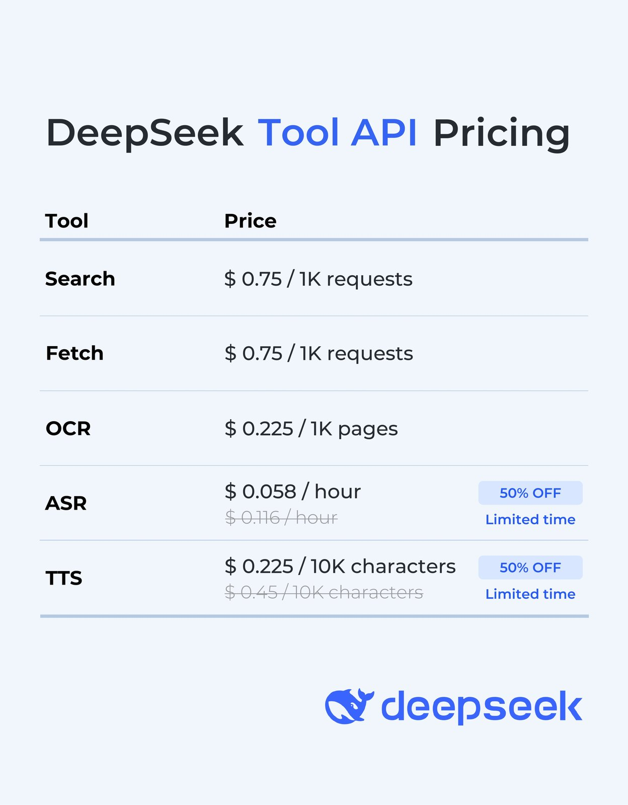
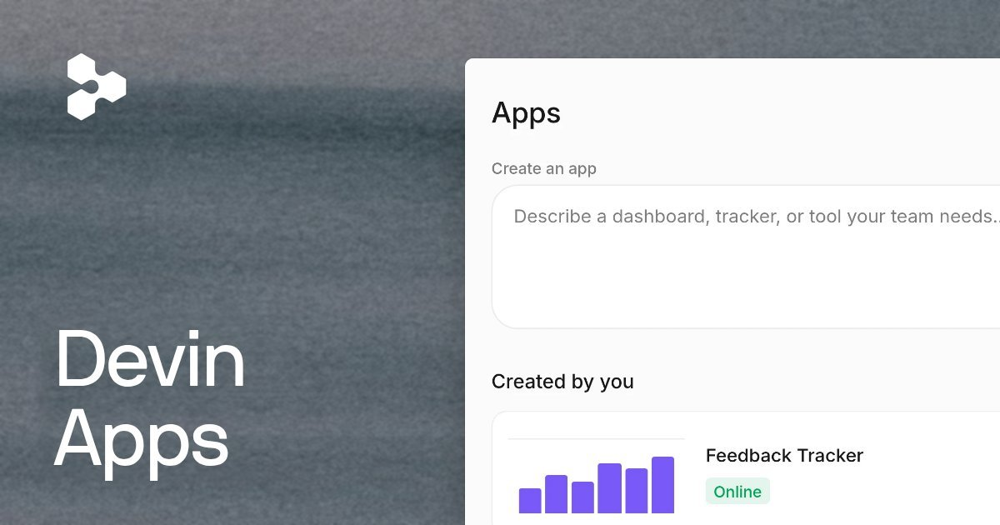
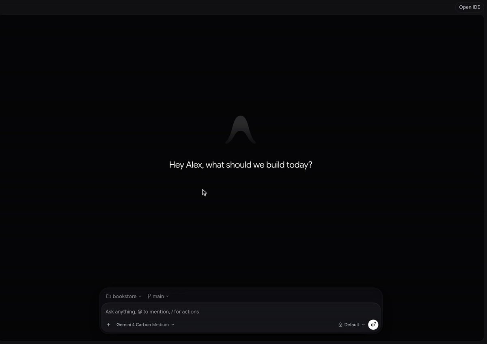
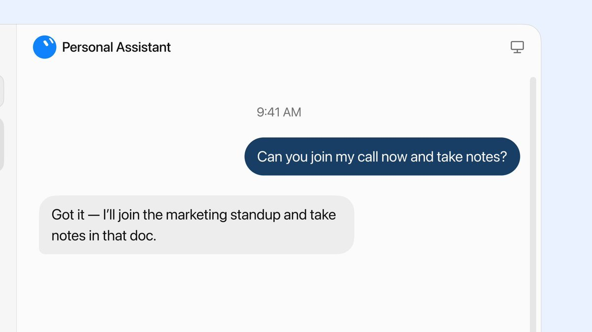
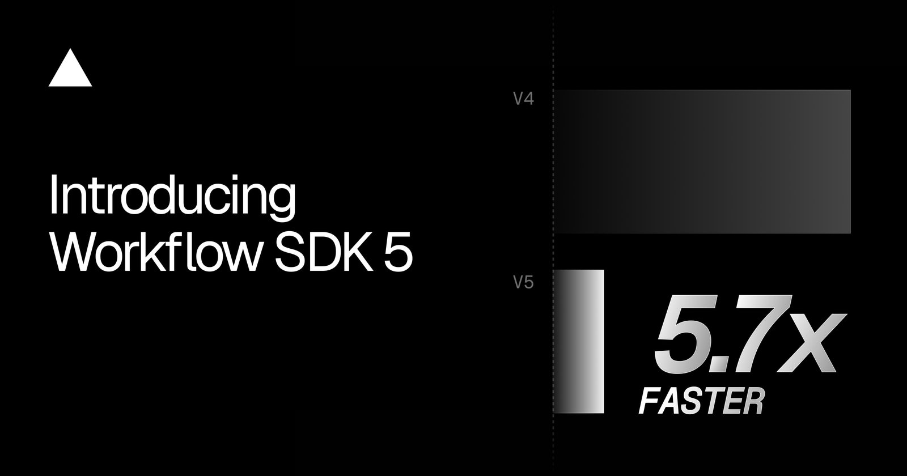
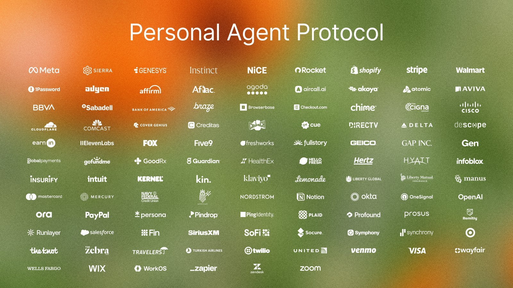
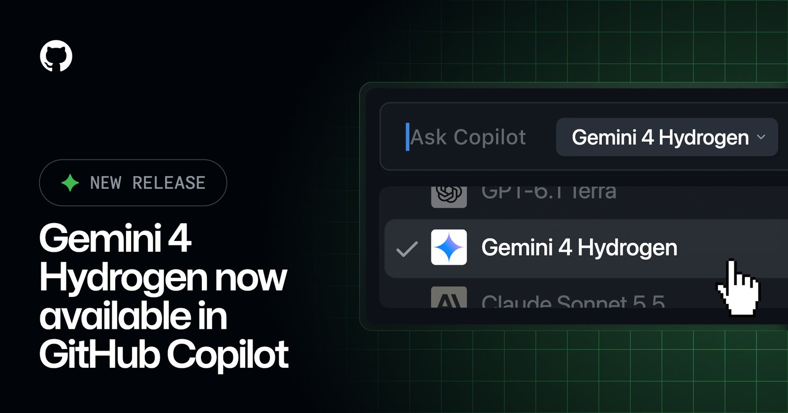
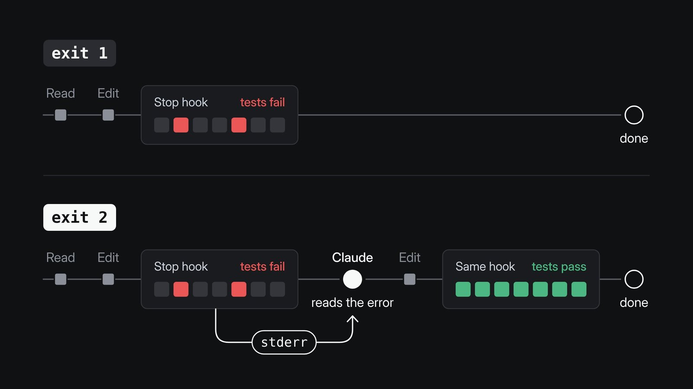

# AI Twitter/X Hots Digest · 2026-11-14 (Saturday)

## Today's highlights

1. **DeepSeek is opening App capabilities through its API**: the official thread says search, files, link reading, safety checks, and voice — the capabilities behind the DeepSeek App — are now available through the API. V4.1-Flash (`deepseek-flash`) supports these built-in features across Messages, Responses, and Chat Completions, with tool calls and context assembly handled on the server. Search, Fetch, OCR, ASR, and TTS are also available as standalone APIs. These extended capabilities carry tool usage fees on top of standard token charges. The official pricing graphic lists Search and Fetch at **$0.75** per 1,000 requests and OCR at **$0.225** per 1,000 pages; ASR is on a limited-time 50% discount at **$0.058** per hour (normally $0.116), and TTS is on a limited-time 50% discount at **$0.225** per 10,000 characters (normally $0.45). Public-facing apps must enable safety checks, and developers remain responsible for content moderation, model registration, and labeling of AI-generated content. The company also released an open-source frontend demo, chat-demo, which can import DeepSeek conversation history. The GitHub repository `deepseek-ai/chat-demo` was created on **2026-11-12**, and it was not in yesterday's digest; today's news is the official API announcement on X, not a repository that was created today.
2. **Cognition launched Devin Apps**: these are private web applications that run on Devin's cloud computer, meant for internal tools, dashboards, and preview environments. Each app has a stable URL, but opening it requires a Devin login; the apps are never public. They are built on memory snapshots: the machine sleeps when nobody is using the app, and billing is based on how long it stays awake. Official docs say this is a good fit for internal tools, not for high-traffic production services. The blog is dated November 13, 2026, which matches the official posts, so this is a new product launch in the window.
3. **Antigravity is rolling out Dynamic Workflows and resetting everyone's Gemini quota**: the official post says `/run-workflow` has the agent write a Python script that coordinates parallel and sequential subagents, with structured handoffs instead of a single drifting conversation. Docs say the feature is available on Google AI Pro and Ultra, in both the Antigravity App and the CLI. This is not the same thing as Orchestrator, which was already covered yesterday: Orchestrator switches models inside one session, while Dynamic Workflows use a script to control a multi-agent flow. Varun Mohan later said the team is resetting everyone's Gemini quota on Antigravity to mark a week of steady shipping. The official posts do not say how long the reset lasts.

---

## 1. DeepSeek opens App capabilities such as search, files, and voice through its API, and releases chat-demo

**The point**: @deepseek_ai said the capabilities behind the DeepSeek App are now available through the API: search, files, links, safety checks, and voice. Developers can turn on built-in features with a few parameters, or call standalone APIs such as OCR, ASR, and TTS, to build richer conversations or recreate the App experience in their own product. The second post says these capabilities are available on V4.1-Flash (`deepseek-flash`) across Messages, Responses, and Chat Completions, with tool calls and context assembly handled on the server. The built-in features include web or image search with citations when thinking is off; Deep Thinking Search, in which the model searches and reads pages across multiple reasoning steps; parsing PDFs, Office files, and images; automatically fetching links in user messages; and safety checks on inputs and outputs, with a refusal marker when a risk is found. Search is enabled with `deepseek_web_search`, and URL reading with `deepseek_read_url`. Public-facing apps must enable safety checks, and developers remain responsible for content moderation, model registration, and labeling of AI-generated content. Search, Fetch, OCR, ASR, and TTS are also available as standalone APIs. The third post includes an official pricing graphic and says these extended capabilities carry tool usage fees on top of standard token charges: Search and Fetch are **$0.75** per 1,000 requests, and OCR is **$0.225** per 1,000 pages; ASR is on a limited-time 50% discount at **$0.058** per hour (normally $0.116), and TTS is on a limited-time 50% discount at **$0.225** per 10,000 characters (normally $0.45). The company also released an open-source frontend demo that can import DeepSeek conversation history: the demo is at https://cdn.deepseek.com/chat-demo , the code is at https://github.com/deepseek-ai/chat-demo , and the guide is at https://api-docs.deepseek.com/guides/build_a_chatbot . @tianyi then quoted the thread and said the core capabilities behind the product are now open through the API. One date to keep separate: the `deepseek-ai/chat-demo` repository was created on **2026-11-12**, and it was not in yesterday's digest. Today's news is the official thread and the public API announcement, not a repository that was created today.

**Why it matters**: this is the highest-signal product announcement in the window, and the most complete. It turns search, files, and voice — capabilities already used in the App — into callable APIs, and it puts pricing and compliance requirements in the same thread.

- deepseek_ai: announces that App capabilities are now available through the API, with a demo and a repo: https://x.com/deepseek_ai/status/2121247896918253875
- deepseek_ai: describes V4.1-Flash built-in tools and standalone APIs: https://x.com/deepseek_ai/status/2121247899699036516
- deepseek_ai: posts the tool-usage pricing graphic: https://x.com/deepseek_ai/status/2121247903603941471
- tianyi: says the core capabilities are now open through the API: https://x.com/tianyi/status/2121248749343420437

---

## 2. Cognition launches Devin Apps, private internal apps that run on Devin's cloud computer

**The point**: @cognition introduced Devin Apps: private, sharable web applications that run directly on Devin's cloud computer, designed for internal tools, preview deployments, and extensions to Devin itself. The official blog confirms that each app has a stable URL, but everyone who opens it has to sign in to Devin; the apps are never public. Because they run on Devin's machine, they can use existing MCPs, integrations, and the codebase, and they can be built with a team's own stack and components or started from a built-in template. They are built on memory snapshots: the machine sleeps when nobody is using the app, and it wakes when someone opens it. The first load after a sleep can take a few seconds, and billing is based on how long the machine is awake. An app runs on one machine. It is a good fit for internal tools, dashboards, and staging, not for high-traffic production services. The blog is dated November 13, 2026, which matches the official posts, so this is a new product launch. @walden_yan added three uses: non-technical users building more than landing pages, internal enterprise apps that are secure by design, and PR previews that are not just the frontend. @DarraghBurke_ also demoed visual editing: tweaking CSS properties, swapping design tokens, and annotating changes for the agent. He said those design tools would reach the Desktop app soon as well. That is a developer demo, not an official announcement that the same editor is already shipping on Desktop.

**Why it matters**: this is Cognition's most complete new product line in the window, and the official write-up is clear about the limits: private, billed on awake time, and not meant for high-traffic production. It should not be described as a public app-hosting platform.

- cognition: introduces Devin Apps: https://x.com/cognition/status/2121255137914077300
- walden_yan: says Apps are powered by memory snapshots and lists three uses: https://x.com/walden_yan/status/2121287289628397926
- DarraghBurke_: demos visual editing and says the design tools will reach Desktop soon: https://x.com/DarraghBurke_/status/2121368079674359904

---

## 3. Antigravity ships Dynamic Workflows and resets everyone's Gemini quota

**The point**: @antigravity said it is rolling out Dynamic Workflows. With `/run-workflow`, the agent writes a Python script that coordinates parallel and sequential subagents, with structured handoffs that give more deterministic control flow instead of prompt drift in a long conversation. Official docs say the script is shown for review before it runs, unless the current permission preset already allows it; the workflow runs in the background, and the main conversation shows each phase and log line; subagents work in their own conversations and cannot see the script. The feature is available on Google AI Pro and Ultra, in both the Antigravity App and the CLI. @_mohansolo (Varun Mohan) later said this is already used heavily inside the team, and that it is powerful to let agents write programs that orchestrate Hydrogen and Carbon. He also said you may not even need to type `/run-workflow`, because the model should be able to decide on its own, similar to swarms. This is not the same feature as Orchestrator, which was already covered yesterday: Orchestrator switches between planner and executor models inside one session, while Dynamic Workflows use a script to control a multi-agent flow, and the official docs list them separately. @_mohansolo later announced that, to mark a week of relentless shipping, the team is resetting everyone's Gemini quota on Antigravity. @kevinhou22 then listed features to try with the reset, including Dynamic Workflows as well as Hydrogen, Orchestrator, and Knowledge work, which were already reported earlier this week and should not be treated as launches today. Neither official post says how long the quota reset lasts.

**Why it matters**: this is another official Antigravity capability after yesterday's Orchestrator, and there is documentation to check against. It can be read together with the quota reset, but previously covered features should not be written up as if they shipped today.

- antigravity: announces Dynamic Workflows and `/run-workflow`: https://x.com/antigravity/status/2121327669534933025
- antigravity: shares the documentation link: https://x.com/antigravity/status/2121327672445849684
- _mohansolo: says Dynamic Workflows are already used heavily internally: https://x.com/_mohansolo/status/2121330487956500615
- _mohansolo: announces a reset of everyone's Gemini quota: https://x.com/_mohansolo/status/2121380918355234957
- kevinhou22: lists features to try with the quota reset: https://x.com/kevinhou22/status/2121382184078692858

---

## 4. Cursor publishes a follow-up investigation: this is a recap of the late-October incident, not a new breach today

**The point**: @cursor_ai published a follow-up investigation update, dated Nov 13, 2026. The timeline matters: Cursor said publicly on October 29 that it was investigating, and it published a security notice on October 30. Today's post is a detailed recap after two weeks of investigation, not a new breach that happened today. The official blog says an attacker obtained an access key Cursor had issued to Fireworks (the post says the key was exposed by Fireworks) and copied data from a read-only bucket. That bucket held limited coding agent traces used for training, mostly from 2025 and from sessions not in Privacy Mode. A small number of those traces contained credentials that had not been redacted; **less than 0.01%** of customers had API credentials exposed. Starting from those credentials, the attacker reached some of the SaaS tools Cursor uses, and from there accessed select archived non-production source repositories (some containing business contact information), limited customer support data and email, usage metrics and contact details, summaries of some agent conversations, and some credentials users had sent to the support team. On October 29, the attacker also used a stolen credential to place a malicious, unauthorized copy of Anthropic's Claude Code extension on the cache that served the Cursor VS Code extension marketplace. The blog is explicit: this was not a vulnerability in Anthropic's product, and the malware was never in the Open VSX source. At most about **5,000** users who requested specific cached versions on October 29 may have received the malicious build, which was available for about **11 hours** before it was removed. The versions involved are `Anthropic.claude-code 2.1.312` or `2.1.313`. Uninstalling the extension alone may not be enough; users should still follow the steps in the October 30 security notice. The blog also lists what was not affected: prompts and code under Privacy Mode; production systems and official Cursor client updates (release signing keys were not exposed); other products, including Cloud Agents for customer teams and Grok Bot; and other marketplace extensions. For users not on Privacy Mode, traces were exposed for fewer than **0.05%** of users, and each of them has been notified — if you did not receive a notification, your data was not in those traces. Cursor says the last attacker activity it has seen was on November 1 and was blocked, and that it has moved inference traffic off Fireworks.

**Why it matters**: this is the official account of impact, exclusions, and remediation for the late-October incident. It is worth reading carefully, but it should not be framed as a new attack that started today.

- cursor_ai: publishes a follow-up investigation update on the security incident: https://x.com/cursor_ai/status/2121411147714970092

---

## 5. Grok Bot posts a meeting demo, plus usage optimizations and in-docs questions

**The point**: @bot posted a meeting demo with the line "Grok Bot can now join meetings": you can ask it questions, assign it work, or have it keep track of what the team decides. A follow-up post says this is available on Super, Ultra, all Team and Enterprise plans, and equivalent legacy plans, and it points to the 1.0 blog. The distinction matters: meeting support was already described in the **November 12 Grok Bot 1.0 blog**, and yesterday's digest already covered 1.0. That blog said meetings were available on Team, Enterprise, and Ultra plans. What is new today is mainly the demo video, the emphasis on meetings, and the addition of Super and legacy plans in the availability wording. This should not be written as the first time meeting support shipped. @elonmusk quoted the meeting demo. In the same window, @SamSokolin said the team shipped a few Grok Bot harness optimizations this week, which should yield about **7%** more usage from a plan and up to about **15%** more on routine runs. That is a statement from a team member; there is no separate official blog to cross-check it against. @ericzakariasson also said you can now ask Grok Bot questions right in the docs: it answers from the docs, links the pages it used, and can draw a diagram of how a task runs. The entry point is https://docs.x.ai/grok-bot/overview .

**Why it matters**: the demo puts a capability already documented in 1.0 in a much more visible place, and the plan list now also names Super and legacy. The usage optimizations and in-docs Q&A are genuinely new discussions in the window, though the usage numbers currently come only from a team member.

- bot: posts the meeting demo: https://x.com/bot/status/2121320089920430181
- bot: lists the plans and links to the 1.0 blog: https://x.com/bot/status/2121320091304505820
- elonmusk: quotes the meeting demo: https://x.com/elonmusk/status/2121335897744372073
- SamSokolin: says harness optimizations may add about 7% to 15% more usage: https://x.com/SamSokolin/status/2121303079803089179
- ericzakariasson: says you can now ask Grok Bot questions in the docs: https://x.com/ericzakariasson/status/2121294195843629360

---

## 6. Dario and Jamie Dimon hold a public conversation, and Anthropic publishes a safety-evaluations guide

**The point**: @AnthropicAI streamed a fireside chat at 12 p.m. ET between Anthropic CEO Dario Amodei and JPMorgan CEO Jamie Dimon, with a standard IPO legal disclaimer attached. The livestream is at https://www.youtube.com/live/YHEaEpeY3ew . In the same window, the company also published an engineering blog post, [Building strong safety evaluations](https://www.anthropic.com/research/building-strong-safety-evaluations), with **10** recommendations for designing, running, and reporting safety evaluations. This is a methods post, not a new model launch. The IPO page itself was already covered in yesterday's digest and should not be treated as a first appearance today. Media coverage in the window continued; @business, for example, reported that institutional investors in mainland China and Hong Kong were excluded from IPO orders. That is a Bloomberg report, not a product announcement confirmed by Anthropic.

**Why it matters**: the conversation is Anthropic's most visible official communication in the window, and the safety-evaluations post is a concrete engineering write-up. Both sit next to IPO communications, but neither is a model or product launch.

- AnthropicAI: previews the livestream with Dario and Jamie Dimon: https://x.com/AnthropicAI/status/2121272083863011714
- AnthropicAI: publishes the safety-evaluations guide: https://x.com/AnthropicAI/status/2121317227618340990
- business: reports that institutional investors in mainland China and Hong Kong were excluded from IPO orders: https://x.com/business/status/2121288241257087330

---

## 7. Vercel ships Workflow SDK 5, with official measurements showing late-run overhead down as much as 25×

**The point**: @vercel announced Workflow SDK 5, built for fast agent loops, and listed three claims: up to **25×** lower latency and overhead, every payload encrypted by default, and regional workload isolation and failover. The blog page is marked Published: November 12, 2026, and it was not in yesterday's digest; the official announcement on X is in today's window. It should not be written as a blog post that went up today. The official blog makes the "up to 25×" figure more specific: in one comparison, late-run overhead at p75 fell from **1,748 ms** to **70 ms**, or **25×**; step-to-step overhead at p75 fell from 618 ms to 109 ms, which is the **5.7×** shown on the card. The blog also says these measurements describe one workload, in one region, against the Vercel World; they are a view of runtime overhead, not a prediction for every application. On encryption, the blog confirms default end-to-end encryption with AES-256-GCM and a unique key for each run, with zero configuration on Vercel-hosted workloads. @rauchg then called Workflow SDK 5 and Vercel Workflows a substantial step for agents, especially in time to first step and time between steps. In the same window, @vercel_dev said Vercel Sandbox now starts up to **4×** faster, and @rauchg quoted that update.

**Why it matters**: this is a formal release that pushes durable workflows further into agent loops. The 25× figure comes from late-run overhead in the official measurement table; it should not be read as if every kind of latency became 25 times lower.

- vercel: announces Workflow SDK 5: https://x.com/vercel/status/2121272480786731294
- rauchg: highlights improvements in time to first step and time between steps: https://x.com/rauchg/status/2121277727940776114
- vercel_dev: says Sandbox starts up to 4× faster: https://x.com/vercel_dev/status/2121346552476377102
- rauchg: quotes the Sandbox update: https://x.com/rauchg/status/2121347136965210286

---

## 8. Sierra releases Poppy 1.0, with Shopify merchants and Meta's Muse going live

**The point**: @SierraPlatform announced Personal Agent Protocol (Poppy) v1.0. Both the official post and the blog are dated November 13: it is on for everyone who uses Meta's AI agent Muse, enabled for every merchant on Shopify, and backed by more than **100** design partners. The context matters: the protocol was already announced last month in draft form with design partners including Meta, Shopify, Stripe, and Walmart. Today's news is the **v1.0 release and broader rollout**, not a standard that appeared from nowhere. The blog says every Shopify store now automatically publishes a Poppy file, on top of the existing Universal Commerce Protocol (UCP), and that Muse looks for Poppy first when it visits a site. About **60** additional companies are joining as design partners, bringing the total to more than 100. Live examples include Mercury, Synchrony, and Turkish Airlines. The protocol is largely built on existing standards such as MCP, OpenAPI, and UCP, with OAuth so customers can control what a personal agent is allowed to do.

**Why it matters**: this is the most complete official release in the window about how personal agents should talk to companies and websites. The story is the v1.0 release and the Shopify / Muse rollout, not a claim that the protocol was proposed for the first time today.

- SierraPlatform: announces Poppy v1.0 and the Muse and Shopify coverage: https://x.com/SierraPlatform/status/2121296788766519431
- SierraPlatform: shares the official blog post: https://x.com/SierraPlatform/status/2121296967011844102

---

## 9. GitHub Copilot makes Gemini 4 Hydrogen generally available

**The point**: @github said Google's Gemini 4 Hydrogen is now generally available in GitHub Copilot, describing it as designed for fast, efficient agentic coding, tool use, and multistep workflows, with improved instruction following over Gemini 3.8 Flash. The official changelog adds that the model is billed at provider list pricing under usage-based billing; that it is available to Copilot Pro, Pro+, Max, Business, and Enterprise users; and that it can be selected in the model picker in VS Code, Visual Studio, Copilot CLI, the coding agent, the GitHub Copilot app, github.com, GitHub Mobile, JetBrains IDEs, Xcode, Eclipse, and the Copilot SDK. The rollout is gradual, so it may take some time to appear. Enterprise and Business administrators can manage access through the model policy. Hydrogen itself launched yesterday; today's news is Copilot's official availability, not another Google model launch.

**Why it matters**: yesterday's digest already covered Hydrogen landing in Cursor and Vercel AI Gateway. Copilot is the new official product channel in this window. Billing is at provider list prices, so it should not be read as included usage on every Copilot plan.

- github: announces that Gemini 4 Hydrogen is generally available in Copilot: https://x.com/github/status/2121319695626518823

---

## 10. Claude Code Stop hooks: a failed check needs exit code 2; exit code 1 will not trigger a retry

**The point**: @lydiahallie shared a practical Claude Code reminder: you can use a Stop hook to have Claude try again when a check fails, but the hook must exit with code **2**. Exit code 2 sends Claude back to retry with the hook's stderr; exit code 1 is non-blocking, so Claude finishes even when the check failed. This is a developer's tip, not a new official Anthropic document or product release.

**Why it matters**: this is one of the more concrete Claude Code discussions in the window, with a high bookmark count and a clear diagram of the two exit codes. It describes existing hook behavior, and should not be written as a capability that shipped today.

- lydiahallie: explains that a Stop hook needs exit code 2 to trigger a retry: https://x.com/lydiahallie/status/2121313048820617645

