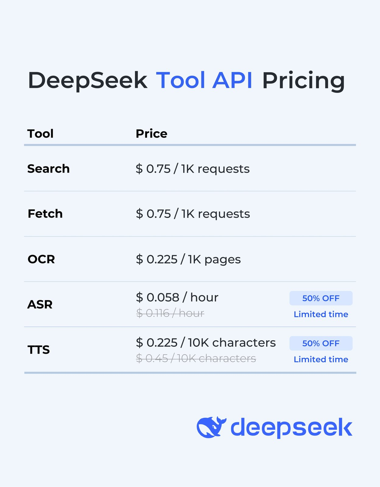
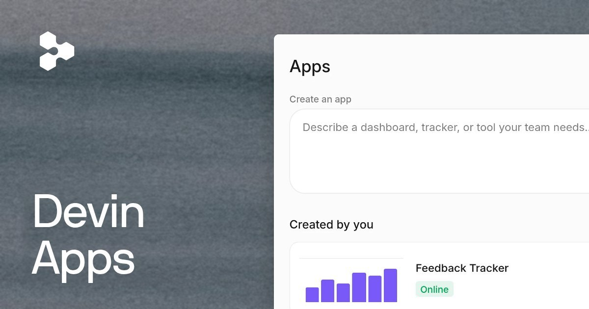
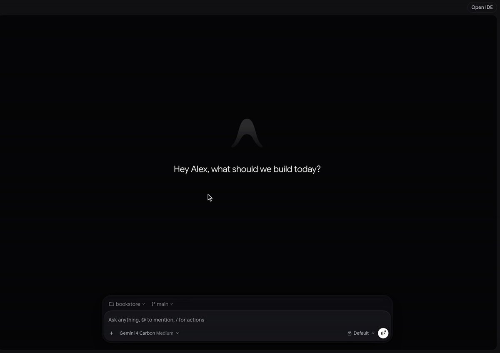
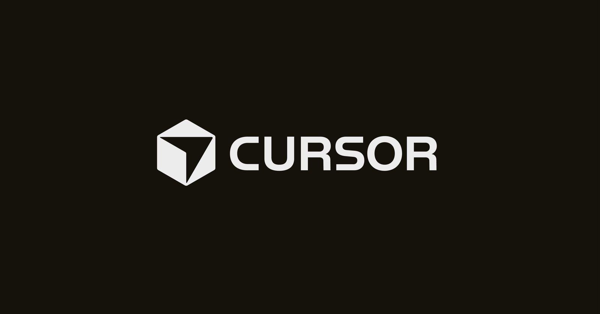
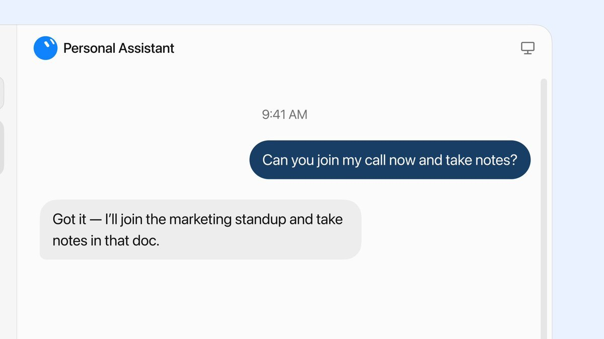
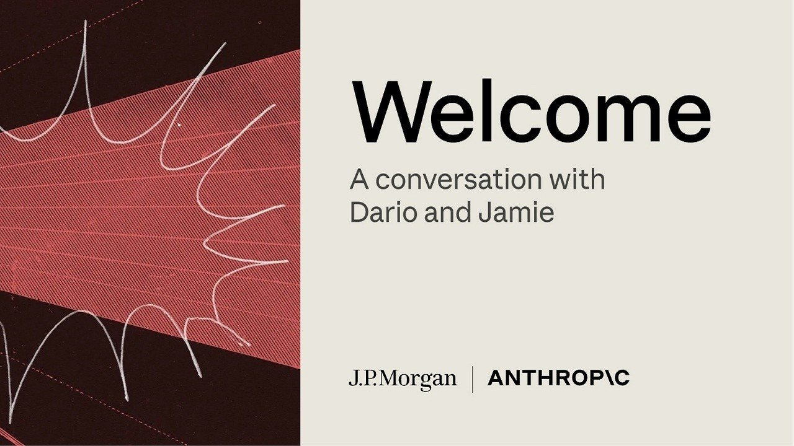
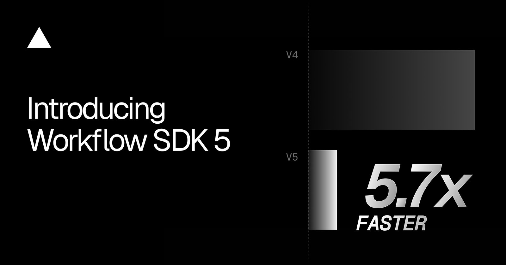
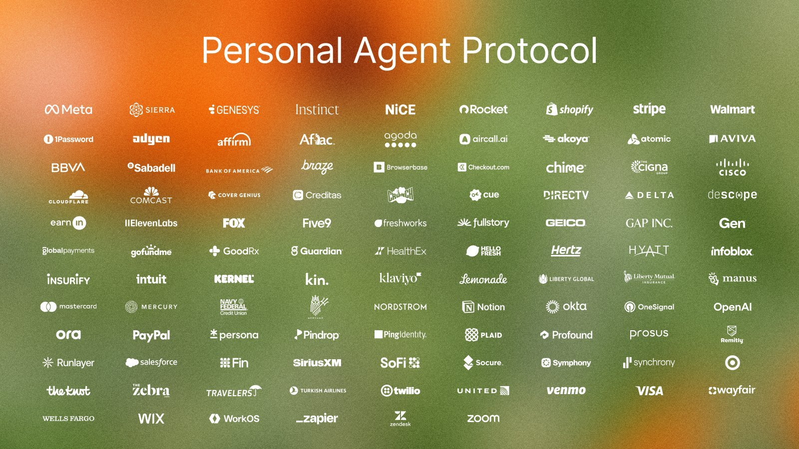
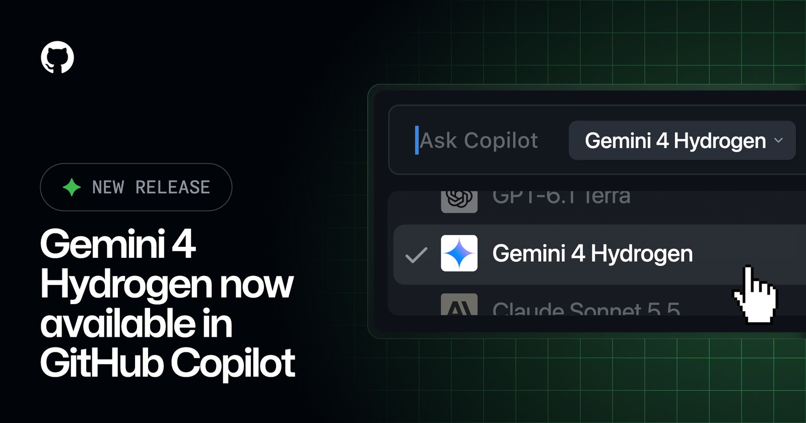
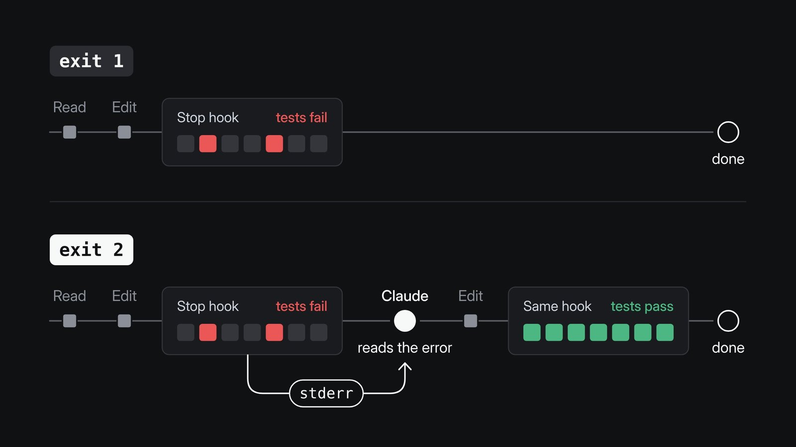

# AI Twitter/X 热点 Digest · 2026-11-14（周六）

## 今日要点

1. **DeepSeek 把 App 能力开放为 API**：官方线程宣布，搜索、文件、链接阅读、安全检查和语音等 DeepSeek App 背后的能力，现在可以通过 API 使用。V4.1-Flash（`deepseek-flash`）在 Messages、Responses 和 Chat Completions 上支持这些内置能力，工具调用和上下文拼装由服务端完成；Search、Fetch、OCR、ASR、TTS 也提供独立 API。这些扩展能力在标准 token 费用之外另收 tool usage fees。官方定价图写明：Search 和 Fetch 均为每千次请求 **$0.75**，OCR 为每千页 **$0.225**；ASR 限时五折为每小时 **$0.058**（原价 $0.116），TTS 限时五折为每万字符 **$0.225**（原价 $0.45）。面向公众的应用必须开启安全检查，开发者仍需自行承担内容审核、模型备案和 AI 生成内容标识等义务。官方同时放出开源前端演示 chat-demo，支持导入 DeepSeek 对话历史。GitHub 仓库 `deepseek-ai/chat-demo` 创建于 **2026-11-12**，不要把它写成今天才建仓；今天的新闻点是官方在 X 上宣布 API 能力开放。
2. **Cognition 推出 Devin Apps**：这是跑在 Devin 云电脑上的私有 Web 应用，用来做内部工具、仪表盘和预发环境。应用有稳定 URL，但打开时必须登录 Devin，从不会变成公开地址。它建立在 memory snapshots 上，没人使用时机器休眠，计费按唤醒时长；适合内部工具，不适合高流量生产服务。官方博客日期是 2026 年 11 月 13 日，属于窗口内的新产品发布。
3. **Antigravity 上线 Dynamic Workflows，并重置全员 Gemini 配额**：官方宣布用 `/run-workflow` 让 agent 写 Python 脚本，编排并行和串行的子 agent，并用结构化交接来代替一轮过长的对话。文档写明这项功能面向 Google AI Pro 和 Ultra，覆盖 App 和 CLI。这与昨日已经报道的 Orchestrator 不是同一件事：Orchestrator 是同一次会话里在模型之间切换，Dynamic Workflows 是用脚本控制多 agent 的确定流程。随后 Varun Mohan 宣布，为纪念一周持续发版，重置所有人在 Antigravity 上的 Gemini 配额。重置会持续多久，官方帖里没有另作说明。

---

## 1. DeepSeek 把搜索、文件、语音等 App 能力开放进 API，并放出 chat-demo

**要点**：@deepseek_ai 宣布，DeepSeek App 背后的能力现在可以通过 API 使用：搜索、文件、链接、安全检查和语音。开发者既可以用少量参数打开内置功能，也可以单独调用 OCR、ASR、TTS 等独立 API，用来搭建更完整的对话，或在自己的应用里复现 App 体验。第二条说明这些能力由 V4.1-Flash（`deepseek-flash`）在 Messages、Responses 和 Chat Completions 上提供，工具调用和上下文拼装在服务端完成。内置能力包括：关闭思考时的网页或图片搜索并带引用；打开思考时的 Deep Thinking Search，模型会在多步推理中自行搜索并阅读页面；解析 PDF、Office 和图片等文件；自动抓取用户消息里的链接；以及对输入和输出做安全检查，发现风险时返回拒绝标记。搜索用 `deepseek_web_search`，读链接用 `deepseek_read_url`。面向公众的应用必须开启安全检查，开发者仍需自行承担内容审核、模型备案和 AI 生成内容标识。Search、Fetch、OCR、ASR、TTS 也提供独立 API。第三条配了官方定价图，并写明这些扩展能力在标准 token 费用之外另收 tool usage fees：Search 和 Fetch 均为每千次请求 **$0.75**，OCR 为每千页 **$0.225**；ASR 限时五折为每小时 **$0.058**（原价 $0.116），TTS 限时五折为每万字符 **$0.225**（原价 $0.45）。官方还放出了开源前端演示，支持导入 DeepSeek 对话历史：演示地址是 https://cdn.deepseek.com/chat-demo ，代码在 https://github.com/deepseek-ai/chat-demo ，说明文档在 https://api-docs.deepseek.com/guides/build_a_chatbot 。@tianyi 随后转发，称产品背后的核心能力均已通过 API 开放。需要分开看的是：仓库 `deepseek-ai/chat-demo` 创建于 **2026-11-12**，昨天的日报没有写入这条；今天的新闻点是官方线程和 API 能力的公开宣布，不是今天才建仓。

**为何值得看**：这是窗口里互动最高、也最完整的一条产品宣布。它把 App 里已经在用的搜索、文件和语音能力做成了可调用的 API，而定价和合规要求都写在同一条线程里，需要一并阅读。

- deepseek_ai：宣布 App 能力进入 API，并给出演示和仓库：https://x.com/deepseek_ai/status/2121247896918253875
- deepseek_ai：说明 V4.1-Flash 的内置工具和独立 API：https://x.com/deepseek_ai/status/2121247899699036516
- deepseek_ai：给出 tool usage 定价图：https://x.com/deepseek_ai/status/2121247903603941471
- tianyi：称核心能力已通过 API 开放：https://x.com/tianyi/status/2121248749343420437

---

## 2. Cognition 推出 Devin Apps：跑在 Devin 云电脑上的私有内部应用

**要点**：@cognition 宣布推出 Devin Apps：这是直接跑在 Devin 云电脑上的私有、可分享 Web 应用，用来支撑内部工具、预发环境，以及对 Devin 本身的扩展。官方博客确认，应用有稳定 URL，但打开时必须登录 Devin，从不会变成公开地址。因为跑在 Devin 自己的机器上，应用可以使用已有的 MCP、集成和代码库，也可以用团队自己的技术栈和组件，或从内置模板开始。它建立在 memory snapshots 上：没人使用时机器休眠，有人打开时再唤醒，第一次加载可能要几秒钟；计费按机器处于唤醒状态的时长计算。应用跑在单台机器上，适合内部工具、仪表盘和预发，不适合高流量生产服务。博客日期是 November 13, 2026，与官方帖一致，属于新产品发布。@walden_yan 补充了三个方向：非技术用户不再只做落地页，企业内部应用默认更安全，以及 PR 预发可以不只是前端。@DarraghBurke_ 还演示了可视化编辑：可以直接改 CSS、替换 design tokens，并以标注的方式把改动交给 agent；他同时说这些设计工具很快也会到 Desktop 本地应用。这是开发者自己的演示，不是官方宣布 Desktop 已经上线同一套编辑器。

**为何值得看**：这是窗口里 Cognition 最完整的一条新产品线，而且官方把使用边界写得很清楚：私有、按唤醒计费、不适合高流量生产。不要把它写成对外公开的应用托管平台。

- cognition：宣布 Devin Apps：https://x.com/cognition/status/2121255137914077300
- walden_yan：说明 Apps 建立在 memory snapshot 上，并列举三类用途：https://x.com/walden_yan/status/2121287289628397926
- DarraghBurke_：演示可视化编辑，并称设计工具很快会到 Desktop：https://x.com/DarraghBurke_/status/2121368079674359904

---

## 3. Antigravity 上线 Dynamic Workflows，团队并重置全员 Gemini 配额

**要点**：@antigravity 宣布正在推出 Dynamic Workflows。使用 `/run-workflow` 后，agent 会写一段 Python 脚本，编排并行和串行的子 agent，并用结构化交接提供更确定的控制流，而不是靠提示词在一轮长对话里慢慢偏离。官方文档写明：脚本写好后会先让你审阅，除非当前权限预设已经允许；工作流在后台运行，主对话里会看到各个阶段和日志；子 agent 各自使用独立会话，互相看不到脚本。这项功能面向 Google AI Pro 和 Ultra，覆盖 Antigravity App 和 CLI。@_mohansolo（Varun Mohan）随后说，这是团队内部已经高频使用的能力，用来让 agent 写程序去编排 Hydrogen 和 Carbon；他还提到不一定非要手动输入 `/run-workflow`，模型应当能像 swarms 那样自己决定。这与昨日已经报道的 Orchestrator 不是同一功能：Orchestrator 是同一次会话里在规划模型和执行模型之间切换，Dynamic Workflows 是用脚本控制多 agent 流程，官方文档也把两者分开列出。稍后 @_mohansolo 又宣布，为纪念一周持续发版，重置所有人在 Antigravity 上的 Gemini 配额。@kevinhou22 随即列出可搭配这次重置试用的功能，其中包含 Dynamic Workflows，也包含本周已经报道过的 Hydrogen、Orchestrator、Knowledge work 等，后者不要再写成今天才首发。配额重置会持续多久，这两条官方帖都没有另作说明。

**为何值得看**：这是 Antigravity 在昨日 Orchestrator 之后的又一项正式能力，而且有文档可核对。把它和配额重置放在一起看即可，不要把本周已经写过的功能再当今天的发布。

- antigravity：宣布 Dynamic Workflows 和 `/run-workflow`：https://x.com/antigravity/status/2121327669534933025
- antigravity：给出文档链接：https://x.com/antigravity/status/2121327672445849684
- _mohansolo：称 Dynamic Workflows 已在内部高频使用：https://x.com/_mohansolo/status/2121330487956500615
- _mohansolo：宣布重置全员 Gemini 配额：https://x.com/_mohansolo/status/2121380918355234957
- kevinhou22：列出可搭配配额重置试用的功能：https://x.com/kevinhou22/status/2121382184078692858

---

## 4. Cursor 公布安全事件后续调查：这是对 10 月底事件的复盘，不是今天的新爆发

**要点**：@cursor_ai 发布了一篇后续调查更新，博客日期是 Nov 13, 2026。需要先把时间线看清楚：10 月 29 日 Cursor 已经公开在查，10 月 30 日发过安全通告；今天是过去两周调查之后的详细复盘，不是「今天刚被攻破」。官方博客称，起因是攻击者拿到了 Cursor 签发给 Fireworks 的 access key（博客写明该密钥由 Fireworks 暴露），并从只读 bucket 复制数据。bucket 里主要是用于训练的 coding agent traces（多为 2025 年、且不在 Privacy Mode 下）；其中极少数 traces 含有未脱敏凭证，**不到 0.01%** 的客户 API 凭证因此暴露。攻击者随后进入 Cursor 使用的部分 SaaS，接触到部分归档的非生产源码（含商务联系信息）、有限的客服数据和邮件、用量指标与联系方式、部分 agent 对话摘要，以及用户发给支持团队的某些凭证。10 月 29 日，攻击者还用窃取的凭证，在 Cursor VS Code 扩展市场的缓存上放置了 Anthropic Claude Code 扩展的恶意、未授权副本。博客明确：这不是 Anthropic 产品漏洞，Open VSX 源站也没有这份恶意软件。最多约 **5000** 名在 10 月 29 日请求特定缓存版本的用户可能拿到恶意构建，约 **11 小时**后下架。涉及版本是 `Anthropic.claude-code 2.1.312` 或 `2.1.313`；仅卸载扩展可能不够，仍需按 10 月 30 日安全通告里的步骤处理。博客同时写明未受影响的范围：Privacy Mode 下的 prompts 和代码；生产系统和正式 Cursor 客户端更新（签名密钥未暴露）；面向客户团队的 Cloud Agents、Grok Bot 等其他产品；市场上的其他扩展。非 Privacy Mode 用户中，traces 暴露少于 **0.05%**，且已逐一通知——没收到通知即不在这批 traces 里。官方称最后见到的攻击活动是 11 月 1 日，已被阻断，并已将推理流量移离 Fireworks。

**为何值得看**：这是官方把 10 月底事件的影响面、排除范围和补救措施写清楚的一篇长文。它值得认真读，但不要写成今天突发的新攻击。

- cursor_ai：发布安全事件后续调查更新：https://x.com/cursor_ai/status/2121411147714970092

---

## 5. Grok Bot 放出会议演示，团队还做了用量优化和文档问答

**要点**：@bot 发布了一段会议演示，文案写的是 Grok Bot can now join meetings：可以提问、分配工作，或记下团队决定。续帖把可用性写成 Super、Ultra、全部 Team 和 Enterprise，以及 equivalent legacy plans，并指向 1.0 博客。这里必须分开看：会议能力已经写在 **11 月 12 日的 Grok Bot 1.0 博客**里，昨日日报也已经覆盖 1.0；当时博客写的是 Meetings 面向 Team、Enterprise 和 Ultra。今天的新信息主要是演示视频、对会议能力的强调，以及可用性表述里多了 Super 和 legacy plans。不要写成「今天首次支持进会」。@elonmusk 转发了这条会议演示。同一窗口里，@SamSokolin 称本周做了一些 Grok Bot harness 优化，套餐用量大约能多出 **7%**，常规 routine runs 最多大约多 **15%**。这是团队成员自己的说明，未见独立官方博客交叉验证。@ericzakariasson 则宣布可以在文档里直接问 Grok Bot：它会根据文档作答、给出用过的页面链接，还可以画出任务如何运行的图，入口是 https://docs.x.ai/grok-bot/overview 。

**为何值得看**：会议演示把已经写进 1.0 的能力推到了更显眼的位置，套餐范围也比博客多写了 Super 和 legacy。用量优化和文档问答则是窗口里真正的新讨论，但前者目前只有团队成员的自我说明。

- bot：放出会议演示：https://x.com/bot/status/2121320089920430181
- bot：说明可用套餐，并指向 1.0 博客：https://x.com/bot/status/2121320091304505820
- elonmusk：转发会议演示：https://x.com/elonmusk/status/2121335897744372073
- SamSokolin：称 harness 优化可带来约 7% 到 15% 的额外用量：https://x.com/SamSokolin/status/2121303079803089179
- ericzakariasson：宣布可在文档里直接问 Grok Bot：https://x.com/ericzakariasson/status/2121294195843629360

---

## 6. Dario 与 Jamie Dimon 公开对谈，Anthropic 同时发布安全评测指南

**要点**：@AnthropicAI 在美东时间中午 12 点直播了 Anthropic CEO Dario Amodei 与摩根大通 CEO Jamie Dimon 的公开对谈，并附上了标准的 IPO 法律免责声明。直播页是 https://www.youtube.com/live/YHEaEpeY3ew 。同一窗口里，官方还发了一篇工程博客 [Building strong safety evaluations](https://www.anthropic.com/research/building-strong-safety-evaluations)，给出设计、运行和汇报安全评测的 **10** 条建议。这是评测方法文，不是新模型发布。IPO 页面本身已经在昨日日报里写过，今天不要再当成首次上线。窗口内的媒体报道仍在继续，例如 @business 称中国大陆与香港的机构投资者被排除在 IPO 下单之外；这是彭博社的报道，不是 Anthropic 官方确认的产品新闻。

**为何值得看**：对谈是窗口里 Anthropic 最显眼的官方沟通，安全评测博客则给出了一份可核对的工程建议。两者都和 IPO 沟通叠在一起，但都不是模型或产品发版。

- AnthropicAI：预告 Dario 与 Jamie Dimon 的直播对谈：https://x.com/AnthropicAI/status/2121272083863011714
- AnthropicAI：发布安全评测指南：https://x.com/AnthropicAI/status/2121317227618340990
- business：报道中国大陆与香港机构投资者被排除在 IPO 下单之外：https://x.com/business/status/2121288241257087330

---

## 7. Vercel 发布 Workflow SDK 5：官方称后期开销最高可降到原来的 1/25

**要点**：@vercel 宣布 Workflow SDK 5，面向更快的 agent 循环，并列出三点：最高 **25 倍**更低的延迟和开销、默认加密所有 payload、以及区域级工作负载隔离和故障转移。博客页标注 Published: November 12, 2026，昨天的日报没有收录；X 上的官方宣布在今天的窗口里。不要写「博客今天刚发」。官方博客把「最高 25 倍」写得更具体：在一次对照测试里，长任务后期开销（p75）从 **1,748 ms** 降到 **70 ms**，也就是 **25×**；步骤之间的开销（p75）从 618 ms 降到 109 ms，也就是卡片图上的 **5.7×**。博客同时说明，这些数字来自针对 Vercel World 的一组测量，用来观察运行时开销，并不是对所有应用的预测。加密方面，博客确认默认用 AES-256-GCM 做端到端加密，每个 run 使用独立密钥；在 Vercel 托管上无需额外配置。@rauchg 随后称，Workflow SDK 5 和 Vercel Workflows 对 agent 是很大的一步，尤其改善了 time to first step 和 time between steps。同一窗口里，@vercel_dev 还宣布 Vercel Sandbox 启动最高可快 **4 倍**，@rauchg 转发了这条更新。

**为何值得看**：这是把 durable workflow 进一步推向 agent 循环的一次正式版本更新。25 倍这个数字来自官方测量表里的后期开销，不要把它理解成所有延迟都变成了 1/25。

- vercel：宣布 Workflow SDK 5：https://x.com/vercel/status/2121272480786731294
- rauchg：补充 first step 和 between steps 的改善：https://x.com/rauchg/status/2121277727940776114
- vercel_dev：宣布 Sandbox 启动最高可快 4 倍：https://x.com/vercel_dev/status/2121346552476377102
- rauchg：转发这条 Sandbox 更新：https://x.com/rauchg/status/2121347136965210286

---

## 8. Sierra 发布 Poppy 1.0：个人 Agent 协议落地 Shopify 全商家与 Meta Muse

**要点**：@SierraPlatform 宣布发布 Personal Agent Protocol（Poppy）v1.0。官方帖和博客都写在 11 月 13 日：它已对所有使用 Meta AI agent Muse 的用户开启，Shopify 上的每个商家都已启用，并且有超过 **100** 家设计伙伴支持。需要先说清楚背景：该协议上个月已经与 Meta、Shopify、Stripe、Walmart 等设计伙伴一起宣布过草稿，今天是 **v1.0 发布和规模化落地**，不是从零突然出现的新标准。博客确认，Shopify 会为每个商家自动发布 Poppy 文件，叠加已有的 Universal Commerce Protocol（UCP）；Muse 访问站点时会优先寻找 Poppy。新加入约 **60** 家设计伙伴，总数超过 100。现场案例写了 Mercury、Synchrony 和 Turkish Airlines。协议主要建立在 MCP、OpenAPI 和 UCP 等已有标准上，并通过 OAuth 让用户控制个人 agent 能做什么。

**为何值得看**：窗口里关于「个人 agent 如何跟商家和网站打交道」最完整的一条正式发布。重点是 v1.0 和 Shopify / Muse 的落地，而不是把这项协议写成今天才第一次提出。

- SierraPlatform：宣布 Poppy v1.0，并说明 Muse 与 Shopify 的覆盖范围：https://x.com/SierraPlatform/status/2121296788766519431
- SierraPlatform：给出官方博客：https://x.com/SierraPlatform/status/2121296967011844102

---

## 9. GitHub Copilot 全面上线 Gemini 4 Hydrogen

**要点**：@github 宣布 Google 的 Gemini 4 Hydrogen 已在 GitHub Copilot 正式可用，面向快速、高效的 agentic coding、工具使用和多步工作流，并称其指令遵循能力相对 Gemini 3.8 Flash 有所提升。官方 changelog 写明：该模型按提供方标价、走 usage-based billing；面向 Copilot Pro、Pro+、Max、Business 和 Enterprise 用户；可在 VS Code、Visual Studio、Copilot CLI、coding agent、GitHub Copilot app、github.com、GitHub Mobile、JetBrains、Xcode、Eclipse 和 Copilot SDK 的模型选择器里选用。推送是逐步进行的，如果暂时看不到，需要再等一段时间。Enterprise 和 Business 管理员可以通过模型策略管理访问。Hydrogen 模型本身是昨天发布的，今天的新闻点是 Copilot 的官方接入，不是 Google 再次发版。

**为何值得看**：昨日已经写过 Cursor 和 Vercel AI Gateway 接入 Hydrogen，Copilot 是窗口里新出现的官方产品渠道。计费走提供方标价，不要理解成包含在所有 Copilot 套餐额度里。

- github：宣布 Gemini 4 Hydrogen 在 Copilot 正式可用：https://x.com/github/status/2121319695626518823

---

## 10. Claude Code Stop hook：失败要退出码 2，退出码 1 不会让它重试

**要点**：@lydiahallie 分享了一条 Claude Code 的实用提醒：可以用 Stop hook 在检查失败时让 Claude 再试，但必须确保 hook 以退出码 **2** 结束。退出码 2 会把 hook 的 stderr 送回给 Claude 并触发重试；退出码 1 是非阻塞的，即使检查失败，Claude 也会直接结束。这是开发者的实践分享，不是 Anthropic 官方的新文档或发版公告。

**为何值得看**：这是窗口里关于 Claude Code 很具体的一条踩坑说明，书签很高，而且有一张把两种退出码差异画清楚的图。它说明的是已有 hook 行为，不要写成今天才新增的能力。

- lydiahallie：说明 Stop hook 要用退出码 2 才会重试：https://x.com/lydiahallie/status/2121313048820617645

