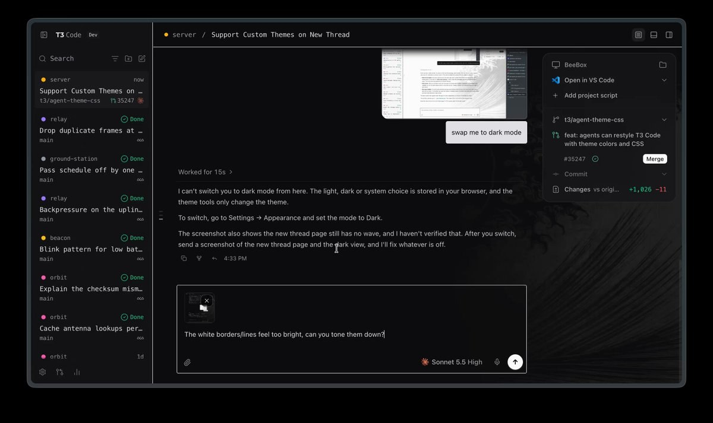
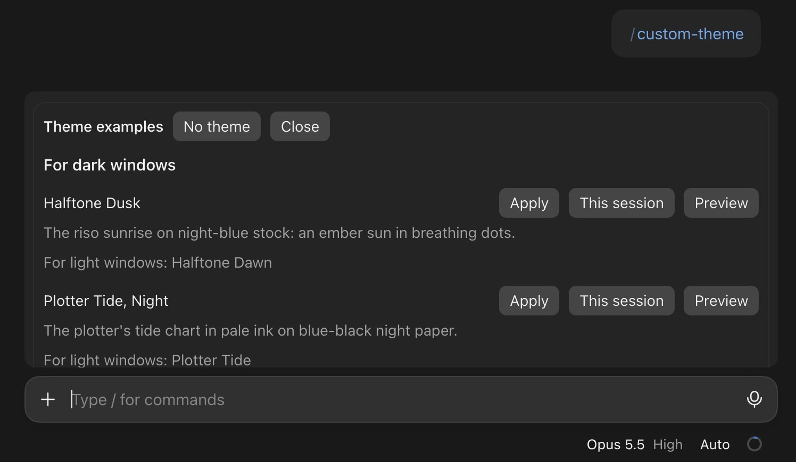
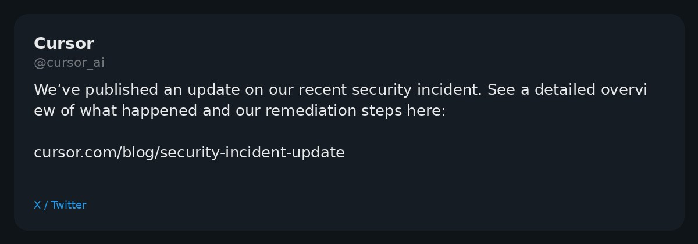
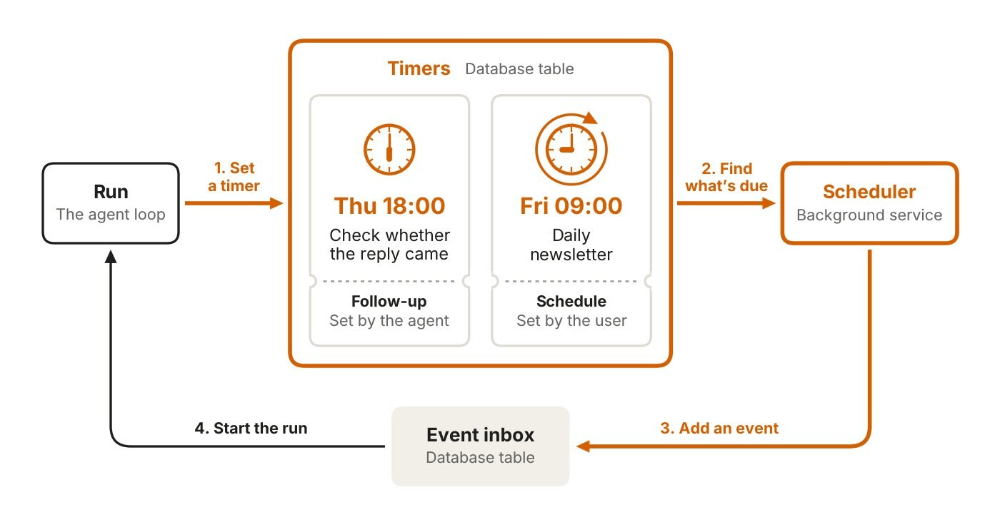
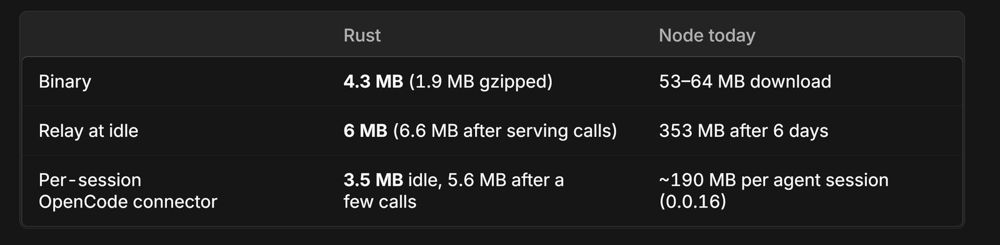
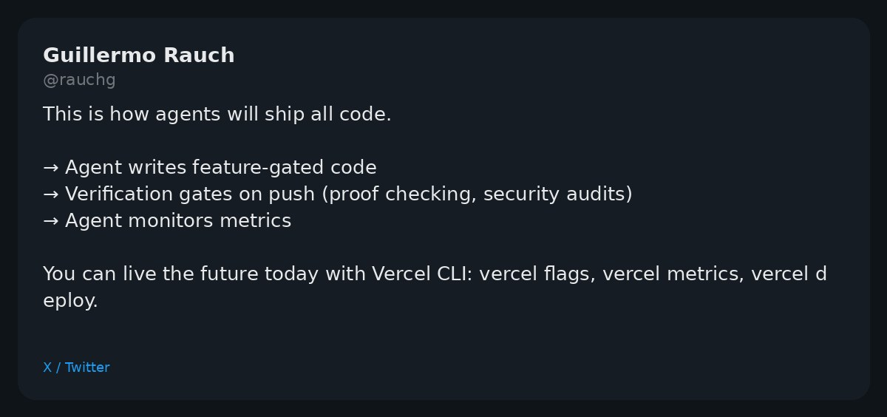
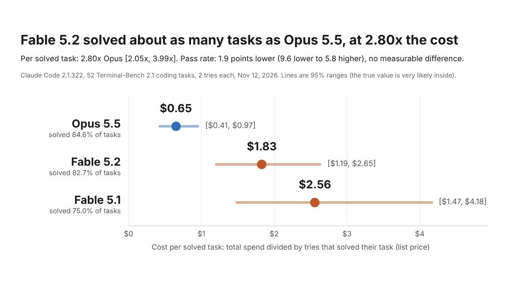
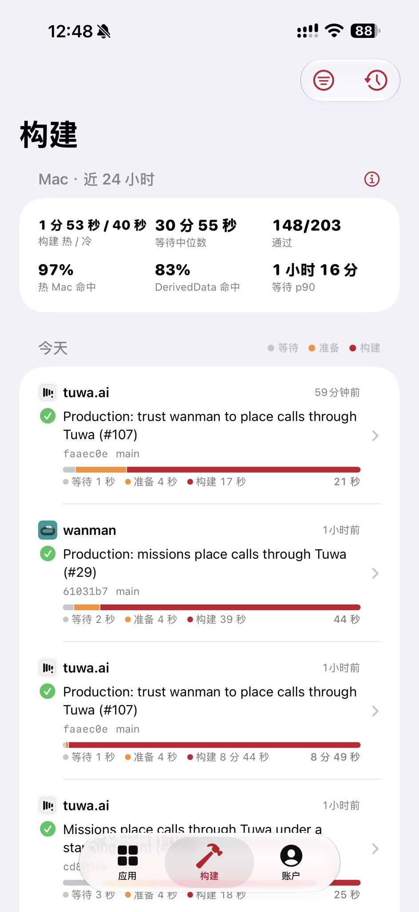

# AI Twitter/X Hots Digest · 2026-11-15 (Sunday)

## Today's highlights

1. **T3 Code can let an agent change the UI in the app itself**: @theo said you can now ask the agent to edit the UI, and the changes apply immediately. The feature is in nightly only for now, with stable coming later. The community moved quickly: one person got Doom running using only the customization features. Theo later noticed that this landed at almost the same time as Claude Code's desktop themes, and confirmed it was an organic case of both sides doing a similar thing at the same time, not a coordinated launch. Someone also asked an agent to customize a stable install; because the feature is not in stable yet, the agent cloned the source, and that person is now running a fork.
2. **Claude Code desktop themes, plus a more proactive Projects coordinator**: @ClaudeDevs said you can now build custom themes for Claude Code on desktop with mods — change colors, add an animated background, or just tell Claude how you want it to look, or start from the theme-examples plugin. That official post went out at 07:59 CST on 2026-11-14, about 55 minutes before today's window, and it was not in yesterday's digest. In-window posts are enough to catch it up: @hany99dev walked through Settings → Customize → Plugins → Discover, adding theme-examples, then using `/custom-theme` in a new session. @addyosmani described themes as mods with a cleaner UI surface. A little earlier, @ClaudeDevs also posted a Projects update (06:51 CST on 2026-11-14, about two hours before the window): Claude coordinates tasks across parallel threads, and the coordinator is now much more proactive, answering questions in the project chat and reporting on in-flight threads. In the window, @turingou said the main development work for every project at the company had already moved to Claude cloud projects, with environments connecting back to servers, a build service, and a personal computer by remote control. That is one team's migration note, not an official recommendation that everyone should move to the cloud immediately.
3. **Cursor published a long investigation of its recent security incident, filling in yesterday's headline**: this is not a new breach today. Yesterday's digest already covered unredacted credentials in training traces, and API credentials exposed for less than 0.01% of customers. The official blog post is dated November 13, 2026; the official post in today's window lays out the full investigation. The company's account is that the attack started with an access key issued to Fireworks; Cursor says Fireworks exposed that key. The attacker used it to copy data from a read-only bucket of limited coding-agent traces (mostly from 2025, from sessions not in Privacy Mode). A small number of those traces contained unredacted credentials. The attacker later reached some of the SaaS tools Cursor uses, and accessed selected archived non-production repositories, limited customer-support and email data, product usage and contact details, summaries of some coding-agent conversations, and some credentials users had sent to Cursor support. On October 29, the attacker also placed a malicious, unauthorized copy of Anthropic's Claude Code extension on the cache that serves Cursor's VS Code extension marketplace. Anthropic did not publish that copy, and this was not a vulnerability in Anthropic's product; the marketplace source, Open VSX, never had the malware. Cursor estimates that at most about 5,000 users who requested specific cached versions on October 29 may have received the malicious build. It was available for about 11 hours, as Anthropic.claude-code 2.1.312 and 2.1.313. The company says the last attacker activity it saw was on November 1 and was blocked, and that inference traffic has been moved off Fireworks. Prompts and code from Privacy Mode users were not affected. For users not in Privacy Mode, Cursor separately says coding-agent traces were exposed for fewer than 0.05% of users, and that those users were notified. The company's "what was not affected" list includes production systems, the official Cursor app and release-signing keys, customer code repositories, and other plugins downloaded from the Cursor Marketplace. If you installed or updated to those two versions from Cursor's VS Code marketplace during the exposure window, uninstalling the extension alone may not be enough; follow the official security notice.

---

## 1. T3 Code can let an agent change the in-app UI on the fly, for now only in nightly

**The point**: @theo said T3 Code now lets you fully customize the UI in the app: ask the agent to make changes, and they update immediately. A follow-up post said the feature is in nightly only for now, and will reach stable soon. The community reacted quickly. Theo quoted a flashy customization demo and wrote that he might regret shipping the feature. @BennettSchwartz said not to worry: it runs Doom, and the app did not have to be modified outside the customization features. Theo later quoted the Claude Code desktop-themes announcement, asked whether both sides had accidentally done this at the same time, and confirmed in a reply that it was an organic "same thing at the same time," not something planned together. In another post, a nontechnical friend saw the demo and asked an agent to customize a stable install; because the feature is not in stable yet, the agent cloned the source, and that friend is now on a fork. In the Chinese-language discussion, @chunxiangai posted a video of eight agents tearing into T3 Code at once.

**Why it matters**: this is one of the highest-engagement product announcements in the window, and the boundary is clear: nightly first, not stable yet. It landed at almost the same time as Claude Code's desktop themes, but both sides described that as a coincidence, not a joint launch.

- theo: announces in-app UI edits that an agent can apply immediately: https://x.com/theo/status/2121455838414201200
- theo: says it is in nightly only for now, with stable coming soon: https://x.com/theo/status/2121457226309382443
- theo: quotes a community demo and says the feature may be something to regret: https://x.com/theo/status/2121482155805290699
- BennettSchwartz: says Doom runs through the customization features alone: https://x.com/BennettSchwartz/status/2121472699062952375
- theo: confirms the overlap with Claude Code themes was a coincidence: https://x.com/theo/status/2121680917391700227
- theo: a friend on stable asked an agent to customize, and ended up on a fork: https://x.com/theo/status/2121711410745061572
- chunxiangai: posts a video of eight agents editing T3 Code at once: https://x.com/chunxiangai/status/2121502422770348237

---

## 2. Claude Code desktop themes and a more proactive Projects coordinator, both announced just before today's window

**The point**: @ClaudeDevs said you can now build custom themes for Claude Code on desktop with mods: change the colors, add an animated background, tell Claude how you want it to look, or start quickly with the theme-examples plugin. That official post was published at 07:59 CST on 2026-11-14, about 55 minutes before today's window, and it was not in yesterday's digest. In-window discussion is enough to include it here. @hany99dev posted concrete steps: Settings → Customize → Plugins → Discover, search for and add theme-examples, open a new session, then use `/custom-theme`. @addyosmani wrote that themes are mods with a cleaner UI surface, including animated backdrops and custom colors. A little earlier, @ClaudeDevs also announced a Projects update (06:51 CST on 2026-11-14, about two hours before the window): in a project, Claude coordinates tasks across parallel threads, and the coordinator is now much more proactive, answering questions in the project chat and giving updates on ongoing threads. In the window, @turingou said the main development work for every company project had already moved to Claude cloud projects, with environments connecting to servers, a build service, and a personal computer by remote control, and argued that keeping inference and compute in one place is hard for other harnesses to match. That is a user's migration note, not an official claim that everyone should move to cloud projects immediately.

**Why it matters**: both the themes and Projects updates are Claude Code product changes, but both official posts landed slightly before today's window. This is a catch-up on discussion that continued today, not a launch that happened today. The themes post also sits next to T3 Code's live UI editing; both sides said the overlap was a coincidence.

- ClaudeDevs: announces custom desktop themes via mods (07:59 CST on 2026-11-14, slightly before today's window): https://x.com/ClaudeDevs/status/2121392666244186327
- hany99dev: walks through installing theme-examples and using `/custom-theme`: https://x.com/hany99dev/status/2121411361716765057
- addyosmani: describes themes as mods with a cleaner UI surface: https://x.com/addyosmani/status/2121489809453776909
- ClaudeDevs: announces a more proactive Projects coordinator (06:51 CST on 2026-11-14, about two hours before today's window): https://x.com/ClaudeDevs/status/2121375309287301360
- turingou: says main development work has already moved to Claude cloud projects: https://x.com/turingou/status/2121500754716524934

---

## 3. Grok Bot: an efficiency update gets amplified, and the team describes a seven-week launch

**The point**: @elonmusk reposted a note about Grok Bot efficiency improvements. The original post is from @SamSokolin and was published at 18:04 UTC on 2026-11-13, which is outside today's window: it said a few harness optimizations shipped this week, and that you should get about 7% more usage out of the same plan, and up to about 15% more on routine runs. Yesterday's digest only mentioned Grok Bot in passing and did not make this optimization a main item. Today's increment is Elon's repost, plus the team talking publicly about how it ships. This should not be mixed up with the earlier token-efficiency fix already covered in the November 9 digest; that was a different round of work. @poteto posted an AI Engineer talk on how the Grok Bot team ships quickly without compromising on quality; the video is at https://youtu.be/O_zcc6Xl12g . @ycombinator said Lauren Tan (@poteto) and Roman Ugarte (@romanugarte_) were on the core team that took Grok Bot from the first line of code to launch in seven weeks. The longer official note adds that you can spin up AI teammates with their own identities and logins, and that they keep working in the background; the marketing team gave a bot its own ad budget; and Lauren built an entire feature with a bot in one Slack thread without ever opening Cursor. They also joined the Lightcone podcast to talk about what it is like to work next to bots. Separately, @poteto wrote that asking an agent for the smallest or quickest possible change can make it write worse code; sometimes you want it to fix the root cause, even if the change is more invasive.

**Why it matters**: the Grok Bot discussion in this window is no longer just an efficiency percentage. It is a public account of shipping in seven weeks and working alongside bots that have their own identities. The percentage itself comes from a pre-window post; the repost brought it back into view, and it should not be written as a metric that was first published today.

- elonmusk: reposts the Grok Bot efficiency improvement: https://x.com/elonmusk/status/2121628295234023654
- SamSokolin: the original post on this week's harness optimizations (18:04 UTC on 2026-11-13, before today's window): https://x.com/SamSokolin/status/2121303079803089179
- poteto: posts the AI Engineer talk: https://x.com/poteto/status/2121673563489140863
- ycombinator: describes taking Grok Bot from first line of code to launch in seven weeks: https://x.com/ycombinator/status/2121632207303582049
- poteto: argues against always asking agents for the smallest, quickest patch: https://x.com/poteto/status/2121646643124809848

---

## 4. Cursor publishes a long security investigation: this is not a new incident today

**The point**: @cursor_ai published a detailed update on a recent security incident. The blog post is dated November 13, 2026, and the official post went out in today's window. Yesterday's digest already covered one of the conclusions: unredacted credentials in read-only training traces exposed API credentials for less than 0.01% of customers. This should not be written as a new breach today. What is new is the full official account of the chain, the impact, and the remediation. Cursor's narrative is that the attack started with an access key the company had issued to Fireworks, and that Fireworks exposed the key. The attacker used it to copy data from a read-only bucket of limited coding-agent traces, mostly from 2025, from sessions not in Privacy Mode, which Cursor said it was permitted to use for training. A small number of those traces contained unredacted credentials. From there, the attacker reached selected SaaS tools used by Cursor and accessed selected archived non-production source repositories, limited customer-support data and email conversations, product usage metrics and contact details, summaries of some coding-agent conversations, and some credentials users had sent to the Cursor support team. On October 29, the attacker also placed a malicious, unauthorized copy of Anthropic's Claude Code extension on the cache used to serve Cursor's VS Code extension marketplace. Anthropic did not publish that copy, and this was not a vulnerability in Anthropic's product; the marketplace source, Open VSX, never had the malware. Cursor says at most about 5,000 users who requested specific cached versions on October 29 may have received the malicious build. It was available for about 11 hours, as Anthropic.claude-code 2.1.312 and 2.1.313. The company says the last attacker activity it has seen was on November 1 and was blocked, and that inference traffic has been moved off Fireworks. Prompts and code from Privacy Mode users were not affected. For users not on Privacy Mode, Cursor also says coding-agent traces were exposed for fewer than 0.05% of users, and that those users were notified directly. The official "what was not affected" list includes production systems, the official Cursor app and release-signing keys, customer code repositories, and other plugins downloaded from the Cursor Marketplace. If you installed or updated to those two versions from Cursor's VS Code marketplace during the exposure window, uninstalling the extension alone may not be enough; follow the official security notice.

**Why it matters**: yesterday only had the credential-exposure figure. Today has the full official investigation. The important distinctions are that this is a recap of a late-October incident, not a new intrusion today, and that the counterfeit extension lived in Cursor's marketplace cache — it was not an official Anthropic release, and it was never on Open VSX.

- cursor_ai: publishes the security-incident investigation update: https://x.com/cursor_ai/status/2121411147714970092

---

## 5. Anthropic on always-on agents: inbox, timers, memory, permissions, and an outbox

**The point**: an Anthropic engineering guide began circulating in the window: [Building always-on agents](https://claude.com/resources/articles/building-always-on-agents). @AnthropicAI and @claudeai did not post about it in the window. An early, high-engagement write-up came from @dotey: a 24-hour assistant spends most of its time asleep, without calling the model or spending money, and only wakes when an event arrives. @omarsar0 later recommended the same article. The official piece emphasizes that "always-on" describes the experience, not a model that runs all the time. The architecture is built from five primitives: an event inbox, timers, memory, permissions, and an outbox. Each stretch of work is a run; when it finishes, the agent saves what happened and goes back to sleep. A timer does not start a run by itself; a scheduler writes due items into the inbox. The article also says that on one long-horizon coding benchmark, Opus 5.5 cost 78% less per solved task than Opus 5, compared with 40% less on typical workloads. The memory section mentions dreaming as a way to review past sessions and curate memories. That sits on the same product line as earlier discussions of agent memory; the focus of this post is the always-on architecture, not a claim that dreaming itself launched today.

**Why it matters**: this is a practical breakdown of "always on" into primitives you can implement, and it is explicit that always-on should not mean burning a model 24 hours a day. It is the same class of problem as the still-unreleased Slack / GitHub event intake in the OpenCode console, but the two products should be kept separate.

- dotey: walks through the always-on agents guide and its five primitives: https://x.com/dotey/status/2121406975279792268
- omarsar0: recommends the same guide: https://x.com/omarsar0/status/2121656194465243164

---

## 6. OpenCode rewrites Browse in Rust for about $60, and previews event intake

**The point**: @thdxr said OpenCode Browse had been rewritten in Rust, including reimplementing the Playwright / Patchright pieces they needed, and that it only cost **$60**. Browse itself is not a first launch today; earlier digests already covered it. What is new today is the rewrite, plus a few related product notes. In another post, he said more hardware was now up serving DeepSeek and looking good, and that the team was moving on to figuring out GLM. That is OpenCode's capacity and model plan, and it should not be folded into yesterday's main item about DeepSeek opening App capabilities as an API. He also wrote about positioning: people often read OpenCode's stance as a strong opinion against cloud agents. He is not anti-cloud-agent; OpenCode is a tool that runs on your own computer, and he discussed what happens when you close the laptop, when a machine cannot handle parallel Rust builds, and when you want to pick the work back up on a phone. Later, he described an unreleased console feature: an agent can receive events from Slack, GitHub, and similar sources. People on the team have already been having agents reply in Slack, which he described as being able to talk to a ghost version of everyone on the team 24/7. This is an unreleased preview, not a generally available feature.

**Why it matters**: the Browse rewrite is unusually concrete about cost and engineering choices. The event-intake preview also sits next to Anthropic's always-on guide. Neither post should be read as a finished announcement that agents are already wired into Slack for everyone.

- thdxr: says OpenCode Browse was rewritten in Rust for about $60: https://x.com/thdxr/status/2121692397323350468
- thdxr: says DeepSeek serving capacity is in place, and GLM is next: https://x.com/thdxr/status/2121446870639628468
- thdxr: clarifies the product is not anti-cloud-agent, and discusses the limits of a local tool: https://x.com/thdxr/status/2121633122491998244
- thdxr: previews unreleased Slack / GitHub event intake in the console: https://x.com/thdxr/status/2121722011063914664

---

## 7. Vercel: shipping to production with flags and metrics

**The point**: this is not the same story as yesterday's Vercel Workflow SDK 5, which measured late-run overhead improving by about 25×. @rauchg described a path he thinks agents will use to ship code: the agent writes feature-gated code, verification gates run on push (including proof checking and security audits), and the agent monitors metrics. He said you can do this today with the Vercel CLI: `vercel flags`, `vercel metrics`, and `vercel deploy`. The post quotes @marclou, who wrote that it had been a month since touching localhost: the feature is first made visible only to the author in production, then released to users if it looks good, and the agent is asked to set hourly or daily reminders to check logs and the database. An AGENTS.md file also has rules that force the agent to test everything, and the flow now goes straight from prompt to production.

**Why it matters**: the discussion in this window is not about a new SDK version number. It is about a workflow in which agents ship behind flags, verify on push, and watch production. It is built on existing Vercel CLI capabilities, not another launch announcement.

- rauchg: describes shipping with vercel flags, metrics, and deploy: https://x.com/rauchg/status/2121711321347715093
- marclou: says localhost has gone untouched for a month, with work going from prompt to production: https://x.com/marclou/status/2121571094411067537

---

## 8. An eval: Fable 5.2 does not solve many more tasks than Opus 5.5, but costs about 2.8× as much

**The point**: Fable 5.2 launched around November 10. Today is not a launch day; it is a day of more concrete usage guidance. @garrytan cited 52 coding tasks run in Claude Code 2.1.322: Fable 5.2 solved about 82.7%, and Opus 5.5 solved about 84.6%. The solve rates are close, but Fable cost about **2.80×** as much per solved task. The recommendation was to keep Opus 5.5 as the coding default in Claude Code. Opus already solves most of these tasks, so telling the two models apart will take harder problems. This is one eval with a stated sample and harness, not an official benchmark, and it was not independently reproduced here. @addyosmani later added that Opus 5.5 at medium effort is a strong daily driver; if it struggles, raise the effort before switching models, and keep Fable 5.2 for genuinely hard work such as large migrations. @badlogicgames, based on a smaller personal sample, said Fable 5.2 still struggles at architecture and system design. That last note is an individual result with a smaller sample, and it should be read as a dissenting data point, not as a result on par with the 52-task eval.

**Why it matters**: a few days after the Fable launch, the window finally has a comparison that puts solve rate and cost side by side. This is about how to use the Claude model lineup, not about another model release today.

- garrytan: cites the 52-task eval and recommends keeping Opus 5.5 as the coding default: https://x.com/garrytan/status/2121464508225053153
- addyosmani: suggests raising effort first, and reserving Fable for genuinely hard work: https://x.com/addyosmani/status/2121732470118965298
- badlogicgames: says Fable 5.2 still struggles at architecture and system design in a personal sample: https://x.com/badlogicgames/status/2121709203475792336

---

## 9. Two days after Hydrogen: use cases and speed comparisons; the launch was already covered on November 13

**The point**: the Gemini 4 Hydrogen launch was already in the November 13 digest, and yesterday's digest did not treat it as a new launch either. There is no new official launch today, but the window has a batch of usage notes. @minchoi collected 10 examples from "less than 48 hours" after the drop. One same-scene comparison listed Hydrogen at $4.27 and 1 hour 24 minutes, versus Carbon at $8.83 and 2 hours 39 minutes — about half the price and almost twice as fast. Those figures come from the cited use case, not from an official benchmark. The same thread includes an "Up" house test with one prompt and one shot: Fable 5.2 took 45 minutes and $19.10, while Hydrogen took 13 minutes and about $1.09. The post said Fable's house still won, but the price gap was large. @_mohansolo said it was remarkable what you could do with just a swarm of Hydrogen agents on an Antigravity Pro subscription. @tualatrix wrote that a week's Gemini 4 Argon quota had been used up, then Hydrogen, for about 30% of the weekly quota in total, and that Gemini 4 could actually get work done without needing to be nudged along. @GoGoFly23 showed a test in Antigravity: a single 3D image was given to Hydrogen, which then built a SolidWorks model that was already very close to the original. @StatsWire also circulated Artificial Analysis measurements, saying Hydrogen Medium completed a benchmark in about 1.4 minutes and comparing that with Opus 5.5 and other models. That is a third-party benchmark being reshared in the window, not a new official score published today, and it should not be treated as the same news as the November 13 launch.

**Why it matters**: two days after the launch, what is new is a set of checkable usage notes and comparison figures. It helps to keep the categories separate: time and cost from individual use cases, third-party benchmarks, and the launch already covered earlier.

- minchoi: collects 10 Hydrogen use cases from less than 48 hours after launch: https://x.com/minchoi/status/2121634011676356615
- _mohansolo: says a Hydrogen agent swarm on Antigravity Pro is already making serious progress: https://x.com/_mohansolo/status/2121701777926201660
- tualatrix: describes using Hydrogen after finishing a week of Argon quota: https://x.com/tualatrix/status/2121584973811691803
- GoGoFly23: shows a SolidWorks model rebuilt from a single 3D image: https://x.com/GoGoFly23/status/2121636952479080713
- StatsWire: shares Artificial Analysis timing figures for Hydrogen: https://x.com/StatsWire/status/2121581417792442542

---

## 10. Building iOS apps with Muse or Grok Bot, then shipping to TestFlight through a self-hosted build service

**The point**: @turingou described a self-hosted, very fast build service called HayaBuild. With it in place, local Macs are no longer needed to develop iOS apps: you can build with Muse or Grok Bot, push to GitHub, and a workflow compiles a TestFlight build on the service, uploads it, and automatically generates screenshots and screenshot diffs across versions. The only remaining step is opening TestFlight to install the new build. The author compared it to building "half of an airbuild." This is a personal workflow and a self-hosted service, not a new official feature from Grok, Muse, or Apple.

**Why it matters**: this was a highly bookmarked Chinese-language post in the window. It shows what happens when a coding agent is paired with a cloud build pipeline, so packaging no longer has to happen on a local machine. It should not be written as if that entire path were already an official product.

- turingou: describes developing iOS apps with Muse or Grok Bot, then uploading to TestFlight through HayaBuild: https://x.com/turingou/status/2121451065782796436

