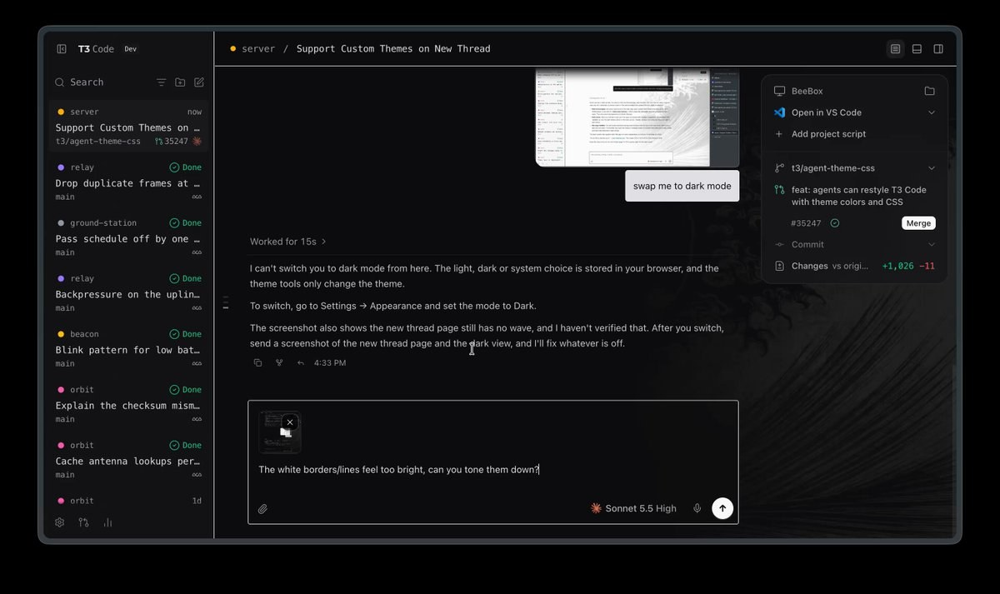
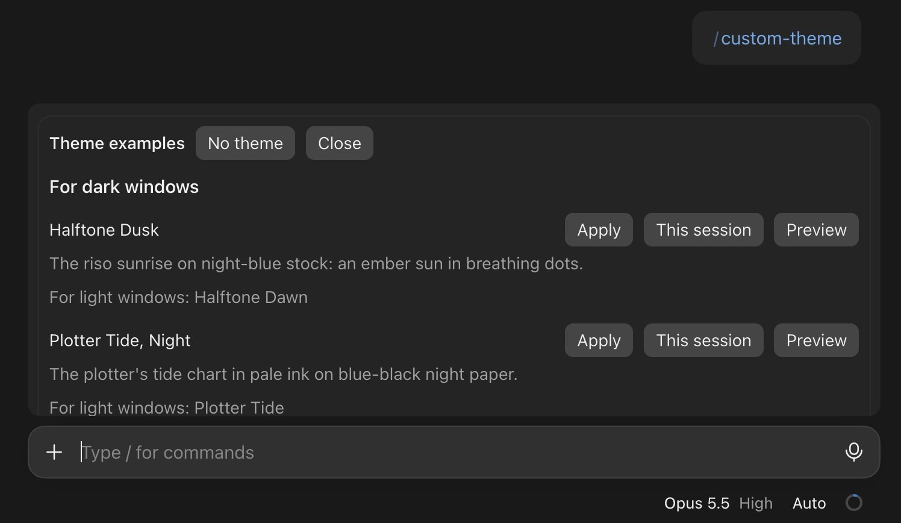
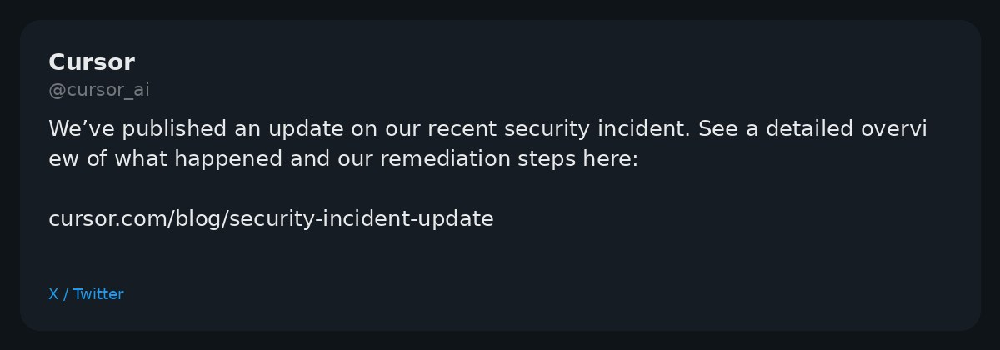
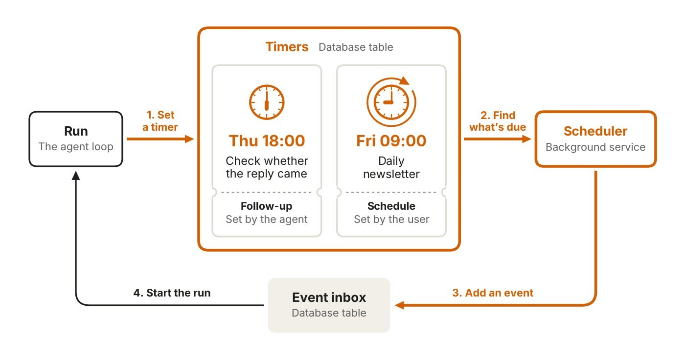
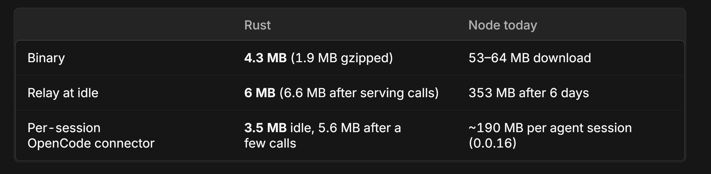
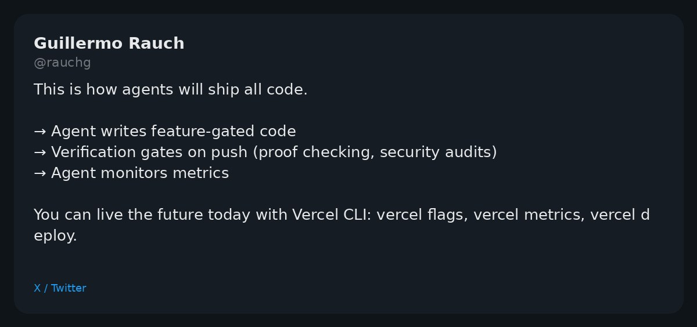
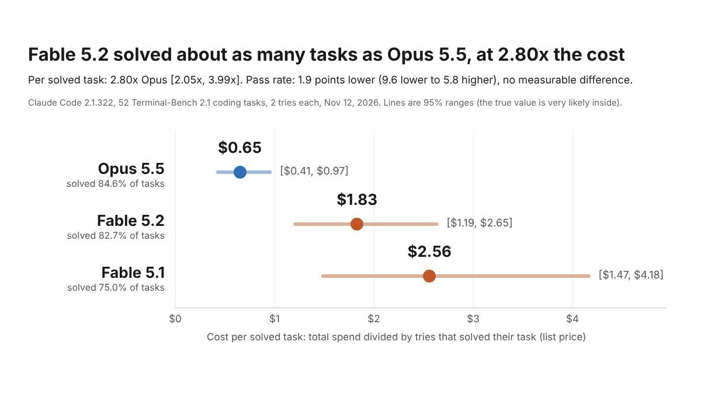
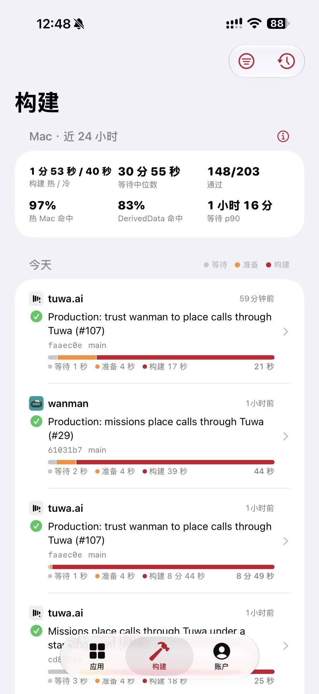

# AI Twitter/X 热点 Digest · 2026-11-15（周日）

## 今日要点

1. **T3 Code 可在应用里让 agent 当场改界面**：@theo 宣布，现在可以直接让 agent 改 UI，改完立刻生效。目前只在 nightly，稳定版还没到。社区很快做出花活，有人只靠定制功能就跑起了 Doom。Theo 后来注意到这和 Claude Code 的桌面主题几乎同时出现，并确认两边是碰巧同一时间做了同一类事，不是联合发布。还有人在稳定版上让 agent 定制，结果 agent 把源码 clone 下来，给她做了个 fork。
2. **Claude Code 桌面主题，以及更主动的 Projects 协调器**：@ClaudeDevs 宣布可在桌面版用 mods 自定义主题，改颜色、加动态背景，或直接告诉 Claude 想做成什么样，也可以先装 theme-examples 插件。窗口内已有分步教程：Settings → Customize → Plugins → Discover，搜索并添加 theme-examples，再在 session 里用 `/custom-theme`。稍早还有一条 Projects 更新：协调器更主动，能在项目聊天里回答问题并汇报进行中的线程。这两条官宣都落在今日窗口开始之前（分别约早 55 分钟和约 2 小时），昨日日报没有写入；今天写的是窗口内仍在继续的讨论，不要当成今天才发布。
3. **Cursor 公布安全事件调查长文，补全昨日标题**：这不是今天的新事故。昨日已经报道过训练 traces 里未脱敏凭证、不到 0.01% 客户的 API 凭证暴露。官方博文日期是 2026 年 11 月 13 日，窗口内的官方帖把完整调查写清楚：攻击始于颁给 Fireworks 的 access key；只读训练桶里有少量未脱敏凭证；攻击者随后还把伪造、非官方的 Anthropic Claude Code 扩展放到 Cursor VS Code 市场缓存（Open VSX 源站没有这份包；约 11 小时，至多约 5000 名请求特定缓存版本的用户可能拿到，版本号为 Anthropic.claude-code 2.1.312 / 2.1.313）。官方称最后一次攻击活动在 11 月 1 日被阻断，已将推理流量从 Fireworks 迁走。Privacy Mode 用户的 prompts 和代码不受影响。若在窗口期内从 Cursor 市场安装过上述版本，卸载扩展可能不够，需要按官方安全说明处理。

---

## 1. T3 Code 可在应用里让 Agent 当场改界面，目前只在 nightly

**要点**：@theo 宣布，T3 Code 现在可以在应用里完全自定义 UI：直接让 agent 改，改完会立刻生效。他随后说明，这个功能目前只在 nightly，稳定版很快会到。社区反应很快：有人演示了夸张的定制界面，Theo 引用时说自己可能会后悔做这个功能；@BennettSchwartz 则说不必担心，它能跑 Doom，而且自己并没有在定制功能之外改应用。Theo 后来引用 Claude Code 的桌面主题官宣，问是不是两边碰巧同时做了这件事，并在回复里确认：这是一次自然的「同一时间做同一类事」，不是事先商量。另有一条补充：一位非技术朋友在稳定版上看到演示后，立刻让 agent 帮她定制；因为稳定版还没有这个功能，agent 把源码 clone 下来，她现在用的是一个 fork。中文区 @chunxiangai 还放出了 8 路 agent「活剥」T3 Code 的视频。

**为何值得看**：这是窗口里互动很高的一条产品功能宣布，而且边界写得很清楚：先在 nightly，还没进稳定版。它和 Claude Code 桌面主题几乎同时出现，但双方都说这是巧合，不要写成联合发布。

- theo：宣布可在应用里让 agent 当场改 UI：https://x.com/theo/status/2121455838414201200
- theo：说明目前只在 nightly，稳定版很快会到：https://x.com/theo/status/2121457226309382443
- theo：引用社区演示，称可能会后悔做这个功能：https://x.com/theo/status/2121482155805290699
- BennettSchwartz：称只靠定制功能就跑起了 Doom：https://x.com/BennettSchwartz/status/2121472699062952375
- theo：确认与 Claude Code 主题是碰巧同时做出来的：https://x.com/theo/status/2121680917391700227
- theo：非技术朋友在稳定版上让 agent 定制，结果用上了 fork：https://x.com/theo/status/2121711410745061572
- chunxiangai：放出 8 路 agent 同时改 T3 Code 的视频：https://x.com/chunxiangai/status/2121502422770348237

---

## 2. Claude Code 桌面主题与更主动的 Projects 协调器，官宣略早于今日窗口

**要点**：@ClaudeDevs 宣布，桌面版 Claude Code 现在可以用 mods 做自定义主题：改颜色、加动态背景，或直接告诉 Claude 想做成什么样；也可以先装 theme-examples 插件。这条官宣发于 2026-11-14 07:59 CST，比今日窗口起始大约早 55 分钟，昨日日报没有写入。窗口内的讨论足够把它补进来：@hany99dev 给出了具体步骤——Settings → Customize → Plugins → Discover，搜索并添加 theme-examples，然后开一个新的 session，再使用 `/custom-theme`。@addyosmani 也介绍说，主题就是带有更干净界面的 mods，可以做动态背景和自定义配色。同一早些时候，@ClaudeDevs 还宣布了 Projects 的更新（2026-11-14 06:51 CST，大约早于窗口 2 小时）：Claude 在项目里协调并行线程，协调器现在更主动，能在项目聊天里回答问题，并汇报进行中的线程状态。窗口内 @turingou 说，已经把公司所有项目的主要开发迁到 Claude 云端项目，环境会以远程控制的方式连接自己的服务器、构建服务和个人电脑，并认为把推理和计算放在一处，是其他 harness 很难相比的。这是使用者的迁移经验，不是官方宣布所有人都应该立刻迁到云端。

**为何值得看**：主题和 Projects 都是 Claude Code 的产品更新，但官宣都略早于今日窗口，所以这里按「昨日可能漏掉、今天仍在热议」来写，不要写成今天才发布。主题这条还和 T3 Code 的热改 UI 形成对照，双方都说是巧合。

- ClaudeDevs：宣布桌面版可用 mods 自定义主题（2026-11-14 07:59 CST，略早于今日窗口）：https://x.com/ClaudeDevs/status/2121392666244186327
- hany99dev：给出安装 theme-examples 并用 `/custom-theme` 的步骤：https://x.com/hany99dev/status/2121411361716765057
- addyosmani：介绍主题是带有更干净界面的 mods：https://x.com/addyosmani/status/2121489809453776909
- ClaudeDevs：宣布 Projects 协调器更主动（2026-11-14 06:51 CST，早于今日窗口约 2 小时）：https://x.com/ClaudeDevs/status/2121375309287301360
- turingou：称已把主要开发迁到 Claude 云端项目：https://x.com/turingou/status/2121500754716524934

---

## 3. Grok Bot：效率优化被转发，团队讲述七周从零上线

**要点**：@elonmusk 转发了 Grok Bot 的效率改进。被转发的原帖来自 @SamSokolin，发于 2026-11-13 18:04 UTC，已经在今日窗口之外：他说本周做了几项 harness 优化，同一套餐大约可以多用 7%，常规任务最高大约 15%。昨日日报只顺带提到过 Grok Bot，没有把这轮优化写成主条；今天的增量是马斯克转发，以及团队公开讲方法。不要把它和 11 月 9 日日报写过的更早 token 效率修复混为一谈，那是另一轮改动。@poteto 放出了自己的 AI Engineer 演讲，讲 Grok Bot 团队如何在不牺牲质量的前提下快速交付，视频在 https://youtu.be/O_zcc6Xl12g 。@ycombinator 则介绍，Lauren Tan（@poteto）和 Roman Ugarte（@romanugarte_）所在的核心团队，用七周时间把 Grok Bot 从第一行代码做到上线。官方长说明还写：可以拉起有独立身份和登录的 AI 队友，并让它们在后台持续工作；市场团队甚至给一个 bot 单独拨了广告预算；Lauren 曾在一条 Slack 里用 bot 做完整功能，全程没有打开 Cursor。他们也上了 Lightcone 播客，谈和 bot 一起工作的实际感受。另外，@poteto 还写了一条工程经验：如果总是要求 agent 做最小、最快的修改，可能会让它写出更差的代码；有时候更应该让它修根因，哪怕改动更大。

**为何值得看**：窗口里关于 Grok Bot 的讨论不再是一句效率数字，而是把「怎么在七周里上线、怎么和有独立身份的 bot 共事」讲清楚了。效率百分比来自窗口外的原帖，转发让它重新被看见，不要写成今天才公布的新指标。

- elonmusk：转发 Grok Bot 效率改进：https://x.com/elonmusk/status/2121628295234023654
- SamSokolin：本周 harness 优化的原帖（2026-11-13 18:04 UTC，早于今日窗口）：https://x.com/SamSokolin/status/2121303079803089179
- poteto：放出 AI Engineer 演讲：https://x.com/poteto/status/2121673563489140863
- ycombinator：介绍 Grok Bot 七周从第一行代码到上线：https://x.com/ycombinator/status/2121632207303582049
- poteto：提醒不要总让 agent 只做最小最快的修补：https://x.com/poteto/status/2121646643124809848

---

## 4. Cursor 公布安全事件调查长文：这不是今天的新事故

**要点**：@cursor_ai 发布了一篇针对近期安全事件的详细更新，博文日期是 2026 年 11 月 13 日，官方帖在窗口内发出。昨日日报已经写过其中一条结论：只读训练 traces 里有未脱敏凭证，不到 0.01% 的客户 API 凭证因此暴露。今天不要把它写成全新事故；值得看的是官方把攻击链条、影响范围和补救写完整了。官方的叙述是：事情始于颁给 Fireworks 的 access key，Cursor 称该密钥由 Fireworks 暴露；攻击者用它从只读存储桶复制数据，桶里是有限的、主要用于模型训练的 coding agent traces（大多来自 2025 年，且来自未开启 Privacy Mode 的会话）。少量 traces 含有未脱敏凭证。攻击者随后进入 Cursor 使用的部分 SaaS 工具，访问了部分已归档的非生产代码仓库、有限的客服与邮件数据、产品用量和联系信息、部分 coding agent 对话摘要，以及用户发给 Cursor 支持团队的一些凭证。10 月 29 日，攻击者还把伪造、非官方的 Anthropic Claude Code 扩展放到了用于服务 Cursor VS Code 市场的缓存上。Anthropic 没有发布过这个副本，这也不是 Anthropic 产品本身的漏洞；市场源站 Open VSX 从未包含这份恶意包。官方估计，至多约 5000 名在 10 月 29 日请求特定缓存版本的用户可能拿到恶意构建，该副本在缓存中约存在 11 小时，涉及版本为 Anthropic.claude-code 2.1.312 和 2.1.313。官方称最后一次看到的攻击活动发生在 11 月 1 日，并且已被阻断；推理流量已从 Fireworks 迁走。Privacy Mode 用户的 prompts 和代码不受影响；对未开 Privacy Mode 的用户，官方另写：coding agent traces 被暴露的比例低于 0.05%，且已逐一通知。生产系统、正式发布的 Cursor 应用和签名密钥、客户代码仓库，以及 Cursor Marketplace 上下载的其他插件，官方列出的未受影响范围里都包括它们。若在曝光窗口内从 Cursor 的 VS Code 市场安装或更新过上述两个版本，卸载扩展可能不够，需要按官方安全说明处理。

**为何值得看**：昨日只写到了凭证暴露的数字，今天才有完整的官方调查。关键要分清：这是对 10 月底事件的复盘，不是今天新爆出的入侵；伪造扩展来自 Cursor 市场缓存，不是 Anthropic 官方发布，也不是 Open VSX 源站上的包。

- cursor_ai：公布安全事件调查更新：https://x.com/cursor_ai/status/2121411147714970092

---

## 5. Anthropic 讲 always-on agents：收件箱、定时器、记忆、权限、发件箱

**要点**：窗口内开始流传 Anthropic 的一篇新工程指南：[Building always-on agents](https://claude.com/resources/articles/building-always-on-agents)。@AnthropicAI 和 @claudeai 在窗口内没有发原帖，较早的高互动解读来自 @dotey：所谓 24 小时在线的助理，大部分时间其实在睡觉，不调用模型也不花钱，有事件进来才醒过来跑一次。@omarsar0 随后推荐了同一篇文章。官方原文强调，always-on 描述的是体验，不是让模型一直跑。架构由五个原语组成：event inbox（事件收件箱）、timers（定时器）、memory（记忆）、permissions（权限）和 outbox（发件箱）。一次工作叫做 run，跑完就保存信息再睡；timer 本身不会直接开跑，而是由调度器把到期项写进收件箱。文章还提到，在某一个长程编码基准上，Opus 5.5 每道解出题的成本比 Opus 5 低 78%，在典型工作负载上则低 40%。记忆一节提到可以用 dreaming 回顾过去的 session、整理记忆，这和更早讨论过的 agent memory 是同一条产品线里的延伸，本篇的重点是 always-on 的整体架构，不是今天新发布了 dreaming。

**为何值得看**：这是一篇把「一直在线」拆成可实现原语的工程指南，而且明确反对把 always-on 理解成 24 小时烧模型。它和后面 OpenCode 控制台里尚未发布的 Slack / GitHub 事件接入是同一类问题，但两边产品要分开看。

- dotey：介绍这篇 always-on agents 指南，并概括五个原语：https://x.com/dotey/status/2121406975279792268
- omarsar0：推荐同一篇指南：https://x.com/omarsar0/status/2121656194465243164

---

## 6. OpenCode 把 Browse 用 Rust 重写花了约 60 美元，并预览事件接入

**要点**：@thdxr 称，已经把 OpenCode Browse 用 Rust 重写，并按需重做了所需的 Playwright / Patchright 部分，成本大约只要 **$60**。Browse 本身不是今天首次推出，更早的日报已经写过；今天的新意是这次重写，以及同期的几条产品说明。他另说，用于服务 DeepSeek 的硬件已经加够、目前看起来不错，接下来开始摸 GLM。这是 OpenCode 一侧的容量和模型安排，不要和昨日 DeepSeek 开放 App API 的主条写成同一件事。他还写了一段关于产品定位的说明：外界常把 OpenCode 的立场理解成反对云端 agent；他并不反对云端 agent，只是强调 OpenCode 是跑在你自己电脑上的工具，并讨论合上笔记本后如何继续、机器扛不住并行 Rust 构建、以及想在手机上接上工作等问题。再往后，他透露控制台里有一个尚未发布的功能：agent 可以接收来自 Slack、GitHub 等来源的事件，团队里已有人让 agent 回 Slack，并用「可以 24/7 跟团队成员的幽灵版本说话」来形容。这是未发布预览，不要写成已经对所有用户开放。

**为何值得看**：Browse 重写把成本和工程选择讲得很具体；同时出现的事件总线预览，又刚好可以和 Anthropic 那篇 always-on 指南对照着看。两者都还不是把「agent 接上 Slack」当成已经完成的产品宣布。

- thdxr：称用 Rust 重写 OpenCode Browse，成本约 60 美元：https://x.com/thdxr/status/2121692397323350468
- thdxr：称 DeepSeek 服务容量已经加上，接下来会摸 GLM：https://x.com/thdxr/status/2121446870639628468
- thdxr：澄清并非反云端 agent，并讨论本地工具的边界：https://x.com/thdxr/status/2121633122491998244
- thdxr：预览控制台里尚未发布的 Slack / GitHub 事件接入：https://x.com/thdxr/status/2121722011063914664

---

## 7. Vercel：用 flags 和 metrics 让 Agent 把功能送进生产

**要点**：这和昨日的 Vercel Workflow SDK 5（长任务后期开销约 25 倍改善）不是同一件事。@rauchg 描述了一条他认为 agent 以后会普遍采用的交付路径：先写带功能开关的代码，再在 push 时做校验（包括 proof checking 和安全审计），然后由 agent 监控指标。他点名用现在的 Vercel CLI 就能开始这样工作：`vercel flags`、`vercel metrics`、`vercel deploy`。这条帖引用了 @marclou：对方说已经一个月没碰 localhost，会先让 AI 把功能做成只对自己可见的生产版本，验证后再对用户放开，并让 agent 按小时或按天去查日志和数据库；AGENTS.md 里也有强制测试的规则，现在是从 prompt 直接进生产。

**为何值得看**：窗口里这条讨论的不是新 SDK 版本号，而是 agent 直接对着生产做开关、校验和盯盘的工作流。它建立在已有的 Vercel CLI 能力上，不是又一次发版公告。

- rauchg：说明用 vercel flags、metrics 和 deploy 让 agent 把功能送进生产：https://x.com/rauchg/status/2121711321347715093
- marclou：称已一个月不碰 localhost，从 prompt 直接进生产：https://x.com/marclou/status/2121571094411067537

---

## 8. 测评：Fable 5.2 并不比 Opus 5.5 多解多少题，成本却高约 2.8 倍

**要点**：Fable 5.2 发布于 11 月 10 日前后，今天不是首发，而是一套具体的用法讨论。@garrytan 引用在 Claude Code 2.1.322 上跑的 52 个编码任务：Fable 5.2 解出约 82.7%，Opus 5.5 约 84.6%，两者解出率接近，但 Fable 每道解出题的成本约为 Opus 的 **2.80 倍**。他的建议是：仍把 Opus 5.5 当作 Claude Code 里的编码默认；Opus 已经能解决其中大多数任务，要把两者分开，还需要更难的题目。这是一组有明确样本和 harness 的评测，不是官方基准，也没有在这里独立复现。@addyosmani 后来补充：中等 effort 的 Opus 5.5 是好的日常选择；如果它卡住，先提高 effort，再考虑换模型；Fable 5.2 更适合真正困难的工作，比如大型迁移。@badlogicgames 则根据自己的有限样本说，Fable 5.2 在架构和系统设计上仍然不行。后一条是个人体验，样本更小，适合作为不同声音，而不是和 52 题评测对等的结论。

**为何值得看**：Fable 发布后这几天，窗口里终于出现了一组把解出率和成本放在一起看的数字。它说明的是「怎么配 Claude 全家桶」，不是今天又发了新模型。

- garrytan：引用 52 题评测，建议仍把 Opus 5.5 当编码默认：https://x.com/garrytan/status/2121464508225053153
- addyosmani：建议卡住时先提高 effort，再考虑换到 Fable：https://x.com/addyosmani/status/2121732470118965298
- badlogicgames：称在自己的样本里 Fable 5.2 的架构和系统设计仍然不行：https://x.com/badlogicgames/status/2121709203475792336

---

## 9. Hydrogen 上线两日：用例与速度对比，发布已在 11-13 报道

**要点**：Gemini 4 Hydrogen 的发布已经写进 11 月 13 日的日报，昨日也没有再把它当新发布来写。今天没有新的官方发布，但窗口里出现了一批使用反馈。@minchoi 汇总了「不到 48 小时」里的 10 个用例。其中一个同场景对比写的是：Hydrogen 为 4.27 美元、1 小时 24 分，Carbon 为 8.83 美元、2 小时 39 分，大约半价、接近快一倍。这些数字来自他引用的用例，不是官方基准。同线程里还有一个「Up」房子测试：同一提示下一遍生成，Fable 5.2 用了 45 分钟、19.10 美元，Hydrogen 用了 13 分钟、约 1.09 美元；他写 Fable 的房子仍然胜出，但价差很大。@_mohansolo 称，在 Antigravity Pro 上只用一组 Hydrogen agent swarm，就已经能做出相当可观的进展。@tualatrix 说自己先用完一周的 Argon 额度，再用 Hydrogen，合计大约 30% 的一周额度，感觉 Gemini 4「能干活，也不是催一下才干一下」。@GoGoFly23 则演示：在 Antigravity 里只喂一张三维图，让 Hydrogen 在 SolidWorks 里把模型建出来，结果已经非常接近原图。另外，@StatsWire 引用 Artificial Analysis 的测量称，Hydrogen Medium 完成基准大约 1.4 分钟，并据此对比 Opus 5.5 等模型。这是三方基准在窗口内的再传播，不要写成今天新跑出来的官方成绩，也不要把它和 11 月 13 日已经报道过的发布消息当成同一条新闻。

**为何值得看**：发布已经过去两天，今天真正新的是一批可核对的使用反馈和对照数字。读的时候要分清：哪些是个人用例里的耗时和费用，哪些是第三方基准，哪些是已经写过的产品发布。

- minchoi：汇总 Hydrogen 上线后不到 48 小时的 10 个用例：https://x.com/minchoi/status/2121634011676356615
- _mohansolo：称 Antigravity Pro 上的 Hydrogen agent swarm 进展可观：https://x.com/_mohansolo/status/2121701777926201660
- tualatrix：用完一周 Argon 额度后再用 Hydrogen 的感受：https://x.com/tualatrix/status/2121584973811691803
- GoGoFly23：演示只喂一张三维图，就在 SolidWorks 里复原模型：https://x.com/GoGoFly23/status/2121636952479080713
- StatsWire：引用 Artificial Analysis 对 Hydrogen 完成时间的测量：https://x.com/StatsWire/status/2121581417792442542

---

## 10. 用 Muse 或 Grok Bot 开发 iOS，再经自建服务送上 TestFlight

**要点**：@turingou 介绍了自己做的超快速构建服务 HayaBuild。他说，有了这套服务之后，开发 iOS 应用不再需要本地的 Mac：可以直接用 Muse 或 Grok Bot 开发，再推到 GitHub；配好工作流后，就会自动在这套构建服务上编译 TestFlight 内测包并上传，不同版本应用的截图和截图对比也会自动生成。他自己要做的只剩下打开 TestFlight 更新内测版本，并觉得像是做了「半个 airbuild」。这是个人工作流和自建服务，不是 Grok、Muse 或 Apple 的官方新功能。

**为何值得看**：窗口里这条中文书签很高，它展示的是编码 agent 加上云端构建之后，本地可以不再承担打包。不要写成官方已经提供了这一整条能力。

- turingou：介绍用 Muse 或 Grok Bot 开发 iOS，再经 HayaBuild 自动上 TestFlight：https://x.com/turingou/status/2121451065782796436

