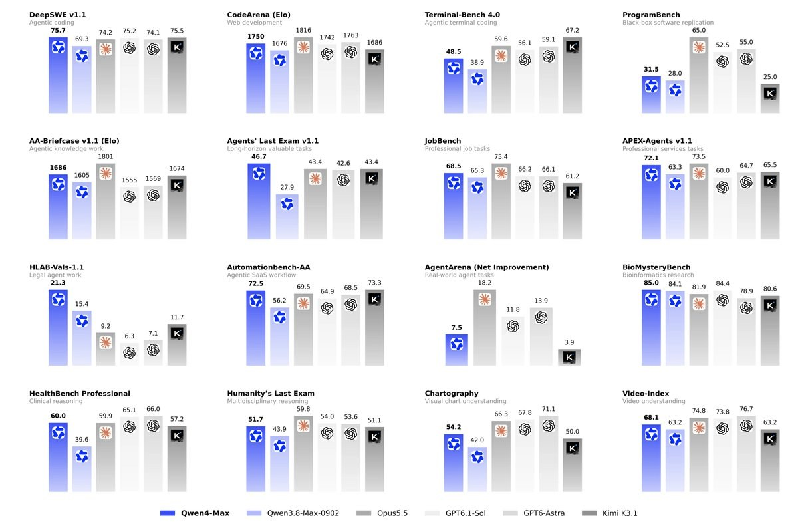
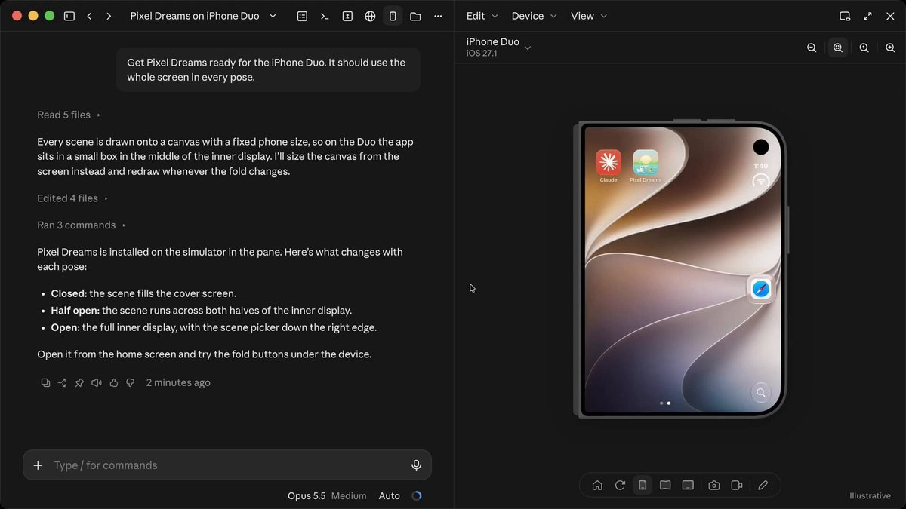
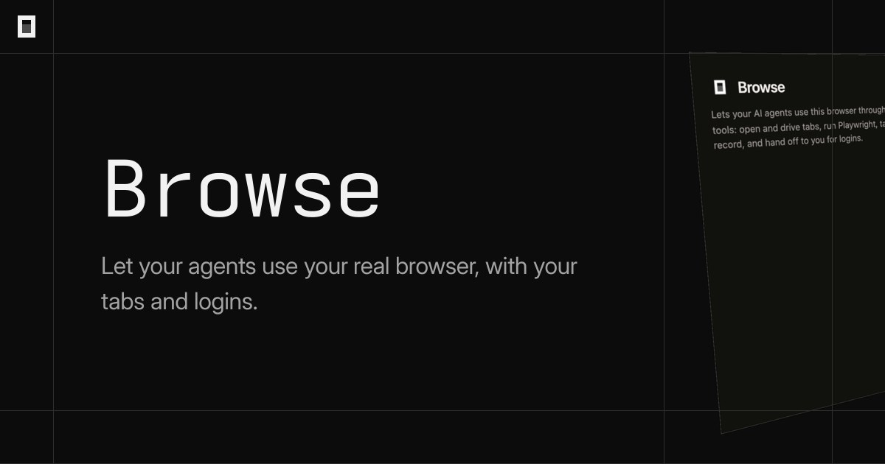
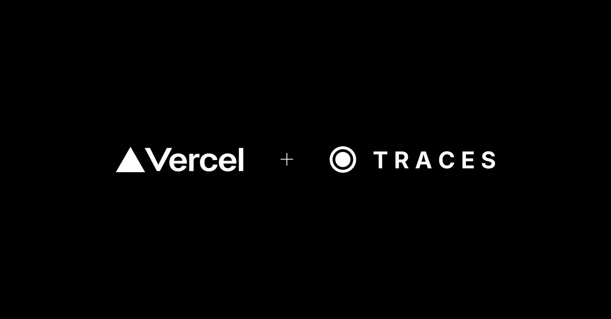
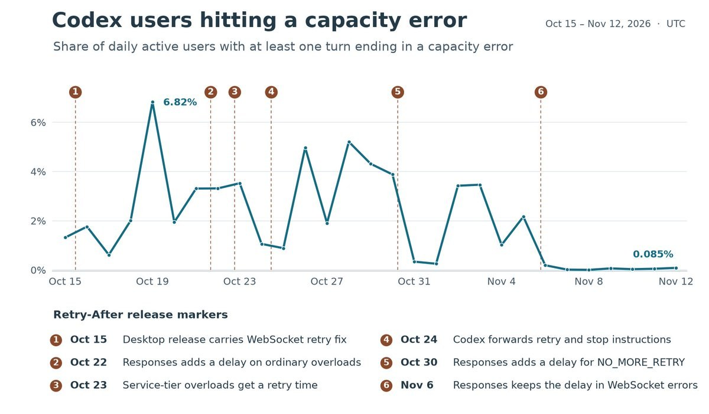
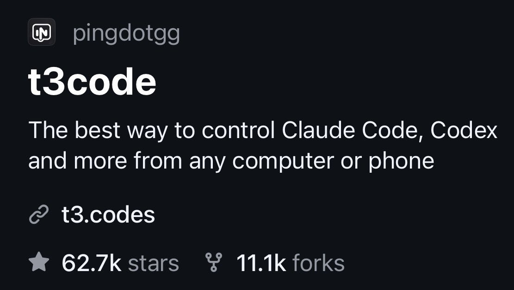
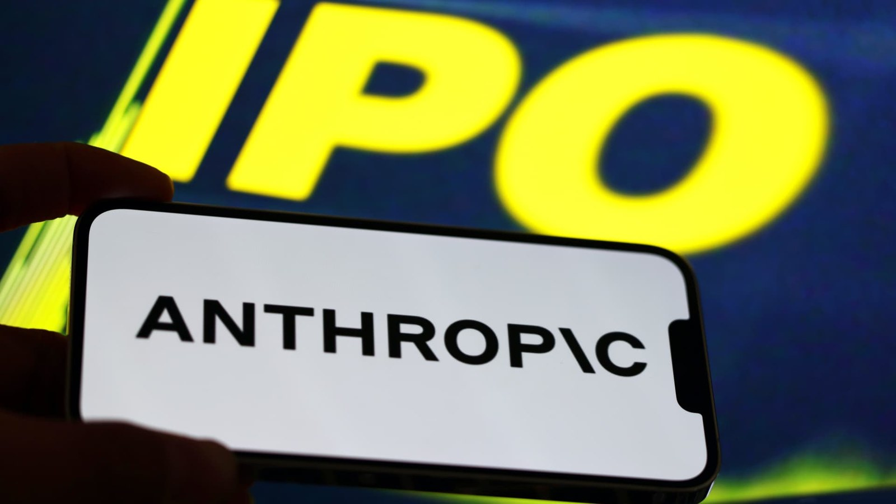
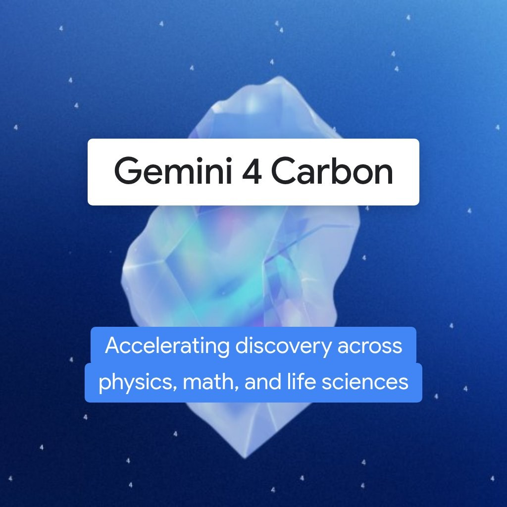
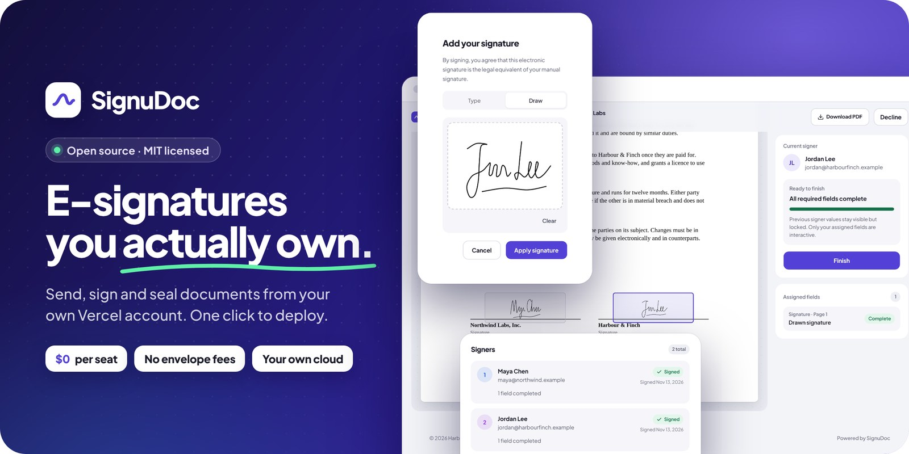

# AI Twitter/X Hots Digest · 2026-11-17 (Tuesday)

## Today's highlights

1. **Qwen4-Max is generally available**: the Qwen team announced the formal release of the new architecture, with 2.4T total parameters, 71B activated per token, native vision, and a 1M-token context window. On the official Work360 eval, average cost per task fell from $4.43 to $1.67. Qoder offered day-0 support and upgraded the picker from Qwen4-Max-Preview to Qwen4-Max; the model also landed in OpenCode Go and other channels the same day. Preview was already reported on November 12, so today is the GA release and broader distribution, not a first appearance.
2. **Claude Code's desktop app is in public beta with the iPhone Duo simulator**: the app can run beside the chat, and Claude can fold or unfold the device to inspect layout. The team then published a verification post saying about 90% of the repository's code is written and reviewed by Claude. The Xcode plugin is now in the official plugin marketplace, but the plugin itself is not a first-time release today.
3. **OpenCode Browse 0.1.0 shipped as a Rust rewrite**: the official post says it uses 25× less memory, is 23× smaller, and drops the Playwright dependency. In the same window, Tencent's Hy4 flash was made nearly unlimited and free for the next two weeks, including on OpenCode Go, where it will not count against Go usage.

---

## 1. Qwen4-Max is generally available: a 2.4T MoE with native vision and a 1M context, and Qoder and OpenCode had it the same day

**The point**: Alibaba's Qwen team announced that Qwen4-Max is generally available. An Alibaba Cloud press release describes a new Qwen4 architecture with 2.4T total parameters, 71B activated per token (25% fewer activated parameters than Qwen3.8-Max at the same 2.4T scale, according to the official text), native vision, and a one-million-token context window. The main launch post also said it can use up to about 50% fewer tokens than Qwen3.8-Max; the press release added that, on Work360 in High effort reasoning mode, token use is 35% lower and average cost per task falls by around 60%. A follow-up post gave the more specific Work360 figures: average cost per task dropped from **$4.43** to **$1.67**. Official posts also said it reached No. 6 on Code Arena's WebDev board, 74 points above Qwen3.8-Max, and posted a +7.5% net gain on Agent Arena, putting Alibaba at No. 5 among labs overall. Qoder said it had worked with the Qwen team and was offering day-0 support, and later noted that Qwen4-Max-Preview in the model picker had been upgraded to Qwen4-Max. The same day, Qwen said the model was live on OpenRouter and OpenCode Go. The press release said it is available on QwenCloud via the Token Plan and API, as well as QwenWork and QwenStudio, and that smaller open-weight models in the Qwen4 series will be released soon. Community checks were mixed: one voxel comparison put the cost at about 1/11 of Opus 5.5, while a Chinese-language post argued that the GA frontend was worse than Preview.

**Why it matters**: this is the largest model launch in the window. Qwen4-Max-Preview was already reported on November 12, so today should be written as Preview becoming formal Max and getting wider distribution, not as a first appearance. The disagreement about how GA feels versus Preview is worth keeping next to the official leaderboard claims.

- Alibaba_Qwen: announces Qwen4-Max is generally available, with native vision and a 1M-token context: https://x.com/Alibaba_Qwen/status/2122148127520289151
- Alibaba_Qwen: says Work360 average cost per task dropped from $4.43 to $1.67: https://x.com/Alibaba_Qwen/status/2122148131982946642
- Alibaba_Qwen: says it reached No. 6 on Code Arena WebDev, 74 points above Qwen3.8-Max: https://x.com/Alibaba_Qwen/status/2122156070781300934
- Alibaba_Qwen: says it posted a +7.5% net gain on Agent Arena, putting Alibaba at No. 5 among labs: https://x.com/Alibaba_Qwen/status/2122161519110844686
- Alibaba_Qwen: says it is live on OpenRouter: https://x.com/Alibaba_Qwen/status/2122171875573068153
- Alibaba_Qwen: says it is live in OpenCode Go: https://x.com/Alibaba_Qwen/status/2122172575648514276
- qoder_ai_ide: announces day-0 support in Qoder: https://x.com/qoder_ai_ide/status/2122208676874436673
- NFT_Chen: a voxel comparison putting the cost at about 1/11 of Opus 5.5: https://x.com/NFT_Chen/status/2122197098812862715
- leo114119: compares the GA frontend with Preview and prefers Preview: https://x.com/leo114119/status/2122180724883410997

---

## 2. Claude Code's desktop app opens a public-beta iPhone Duo simulator, and a team post says about 90% of its code is written and reviewed by Claude

**The point**: @ClaudeDevs announced that Claude Code on desktop (macOS, Xcode 27.1 or later) now supports iPhone Duo in the iOS simulator, in public beta. The app can run beside the chat, and Claude can fold or unfold the device to inspect layout. The same thread said people can install Apple's App Resizability skill, and that terminal users can now install the Xcode plugin from the official plugin marketplace (`/plugin install xcode@claude-plugins-official`). About an hour later, the team published *How the Claude Code team thinks about verification*, a post by Addy Osmani dated November 16, 2026. It said Claude writes better code when it can verify its work, and that about **90%** of the code in the team's repository is written and reviewed by Claude. In internal testing around structured file generation, a separate grader improved task success by up to 10 points.

**Why it matters**: this is the most complete official Claude Code update in the window. The Xcode plugin's pull request was already reported as merged on November 8; today it should be written as entering the official marketplace, not as a first release. The 90% figure comes from the team's own post, not from a third-party audit.

- ClaudeDevs: announces public-beta iPhone Duo support in the desktop iOS simulator: https://x.com/ClaudeDevs/status/2122439098740674839
- ClaudeDevs: says you can ask Claude to get an app ready for iPhone Duo, and can install the App Resizability skill: https://x.com/ClaudeDevs/status/2122439100854939907
- ClaudeDevs: says it is available today in Claude Code on desktop for macOS, with Xcode 27.1 or later: https://x.com/ClaudeDevs/status/2122439102981390562
- ClaudeDevs: says the Xcode plugin is now in the official Claude Code plugin marketplace: https://x.com/ClaudeDevs/status/2122439104419790958
- ClaudeDevs: publishes the team's verification post, saying Claude writes better code when it can verify its work: https://x.com/ClaudeDevs/status/2122457608963395586

---

## 3. OpenCode Browse 0.1.0 moves to Rust, with 25× less memory; Hy4 flash is nearly unlimited and free for two weeks

**The point**: @opencode announced OpenCode Browse **0.1.0**. It has been rewritten in Rust, and the official post says it uses 25× less memory, is 23× smaller, and no longer depends on Playwright, with browser operations exposed directly to the agent. The product page is https://opencode.ai/product/browse . A little earlier, the official account also said Hy4 flash (Tencent's HY4 Flash) would be nearly unlimited and free for the next two weeks, with a 1M context, multimodal support, and ZDR. A follow-up said it is also available on OpenCode Go and will not count against Go usage.

**Why it matters**: the November 15 digest already covered that the Browse rewrite cost about $60. What is new today is the 0.1.0 version number and the performance claims. Hy4 flash is Tencent Hunyuan, not Gemini Hydrogen; what can be confirmed in this window is the OpenCode promotion, not that the model itself first launched today.

- opencode: announces Browse 0.1.0, a Rust rewrite with 25× less memory and a 23× smaller binary: https://x.com/opencode/status/2122377687968678258
- opencode: links the Browse product page: https://x.com/opencode/status/2122377719048519773
- opencode: says Hy4 flash is nearly unlimited and free for the next two weeks: https://x.com/opencode/status/2122231173720224224
- opencode: says Hy4 flash is also on OpenCode Go and will not count against Go usage: https://x.com/opencode/status/2122258314809741673

---

## 4. Traces is joining Vercel; AI Gateway adds Private Inference; the pitch is agent evals

**The point**: Traces founder @tarunsachdeva announced that Traces is joining Vercel. The official blog said the whole team is joining Vercel and will keep working on how teams build software with agents. Existing users are unaffected on day one: they can still share sessions, use the CLI, and add people to existing organizations. New organization creation has been paused as part of the transition. The product says it started in February 2026, now has adapters for 16 coding agents, and has shared nearly 500,000 sessions. @rauchg called traces an essential new primitive of software development, upstream of a git diff. The same day, @vercel said Private Inference is now on AI Gateway at `private/<slug>`, and published *Agents are users, so your software needs evals*. Rauch summarized the shift as: the old way was user interviews; the new way is to treat agents as users and run evals.

**Why it matters**: the window contains a single story with three parts: traces being acquired, private inference landing on AI Gateway, and evals being framed as how you build for agent users. These are not three unrelated changelog notes.

- tarunsachdeva: announces that Traces is joining Vercel: https://x.com/tarunsachdeva/status/2122376451546910742
- rauchg: calls traces an essential new primitive of software development and agentic evolution: https://x.com/rauchg/status/2122391135129858507
- vercel: publishes the post on evals for agent users: https://x.com/vercel/status/2122397118426181962
- rauchg: summarizes the old way as user interviews and the new way as running evals for agent users: https://x.com/rauchg/status/2122415506451841215
- vercel: announces Private Inference on AI Gateway: https://x.com/vercel/status/2122457875364864347

---

## 5. The Codex team says the "model at capacity" errors might actually have been fixed

**The point**: OpenAI Codex-adjacent account @thsottiaux (Tibo) posted: "Codex team might have actually fixed the 'model at capacity' errors that have been pestering you." The attached chart is titled *Codex users hitting a capacity error*, covering October 15 to November 12, 2026 (UTC). The metric is the share of daily active users with at least one turn ending in a capacity error. The chart peaks at **6.82%** around October 19 and falls to **0.085%** by November 12, with several Retry-After-related release markers between October 15 and November 6.

**Why it matters**: capacity errors have been a frequent pain point for Codex, and this is the strongest discussion of the product in the window. The wording has to stay "might have actually fixed"; it should not be written as if an official changelog has already confirmed a complete fix. The chart also only runs through November 12.

- thsottiaux: says the Codex team might have actually fixed "model at capacity" errors, and shares a chart of the falling error rate: https://x.com/thsottiaux/status/2122206990101536852

---

## 6. T3 Code passes 60,000 GitHub stars; Theo compares it with Claude Desktop on iOS and criticizes kanban UIs

**The point**: @theo said T3 Code's repository passed 60,000 GitHub stars while he was on vacation, and that it has been adding more than 1,000 a day consistently. The screenshot he shared already showed about **62.7k** stars. In another post, he said he tried hard to make every other solution work before starting T3 Code, and that he did it to lower his own stress, not to go viral. Quoting Claude Code's iPhone Duo announcement, he joked with a "leaked internal prompt" that T3 Code is stronger at iOS and mobile development. Earlier in the day he also posted a highly engaged critique of "fake-progress kanban" wasting screen space, and said he had been an investor in and contributor to Vibe Kanban, which eventually shut down. He later asked people to show what they had built with in-app UI editing, but that capability was announced on November 14 and already covered in the November 15 digest.

**Why it matters**: today's increment is the star milestone, the comparison with Claude Desktop's iOS support, and the argument about agent UI shape. In-app live UI editing should not be written as a feature that launched today.

- theo: says the repo passed 60,000 stars while he was on vacation, and that it is adding more than 1,000 a day: https://x.com/theo/status/2122458476345717169
- theo: says he tried hard to make every other solution work before starting T3 Code: https://x.com/theo/status/2122461831902138489
- theo: jokes that T3 Code is stronger than Claude Desktop at iOS and mobile development: https://x.com/theo/status/2122473901116805374
- theo: criticizes "fake-progress kanban" as a poor fit for real work: https://x.com/theo/status/2122201652493230343
- theo: says he was an investor in and contributor to Vibe Kanban, which later shut down: https://x.com/theo/status/2122201981167251877

---

## 7. Theo says Fable 5.2 consistently ignores unimportant feedback; Perplexity Teammate used it to build a custom WebGL open-world demo

**The point**: @theo wrote that Fable 5.2 is the first model that consistently ignores unimportant feedback. After repeatedly using Opus and watching a thread run itself into a loop, he said, he would switch to Fable and it would decide "that's enough, ship it." In the same window, Perplexity CEO @AravSrinivas showed an open-world driving game set in neon 1986 Miami, built by Teammate on Fable 5.2 (https://heat.pplx.app). He said it used no game engine, no Three.js, and no external assets, and that Teammate wrote its own WebGL2 renderer.

**Why it matters**: this is the biggest Fable increment in the window: a specific behavioral observation, plus an agent-built demo people can open. Fable 5.2 itself shipped around November 10, so it should not be written as a model launch today.

- theo: says Fable 5.2 is the first model that consistently ignores unimportant feedback: https://x.com/theo/status/2122429147289206976
- AravSrinivas: shows a neon 1986 Miami open-world demo built by Teammate on Fable 5.2: https://x.com/AravSrinivas/status/2122338465648103676

---

## 8. Reports say Anthropic plans to price its IPO on November 18 and list on Nasdaq as ANT on November 19, at about a $1.405T valuation

**The point**: In the window, Bloomberg, Reuters, the FT and others kept framing Anthropic's listing this week as a litmus test for the AI trade. A CNBC IPO guide updated on November 16 was more specific: the offering is expected to price on the evening of November 18, and to begin trading on Nasdaq on November 19 under the ticker **ANT**. Anthropic is offering 825 million Class A shares at $70 to $78 each. At that range, CNBC said, the offering would bring in more than **$64 billion**, implying a valuation of about **$1.405 trillion**, with retail allocations representing up to 20%. The $70–$78 range had already been reported earlier; what is clearer in today's window is the pricing date, the first trading date, and the raise and valuation implied by that range. These are media reports. No official confirmation from @AnthropicAI was found in the window.

**Why it matters**: the calendar turns this listing from "coming soon" into something that can be checked this week. The $64 billion figure is a raise implied by the price range, and $1.405 trillion is the corresponding valuation; they should not be blended with a separate rumor about wanting to raise $90.4 billion. This is also not a product launch.

- business: says Anthropic's IPO this week will be a bellwether for competitors such as OpenAI: https://x.com/business/status/2122459719403028886
- business: calls the IPO a litmus test for AI: https://x.com/business/status/2122292355608760371
- FT: notes that Wall Street's 10 biggest IPOs this year have fallen, fuelling concerns ahead of the listing: https://x.com/FT/status/2122221508210692111
- Reuters: besides Nvidia's earnings, frames the Anthropic IPO as a test of investor appetite: https://x.com/Reuters/status/2122297416149787091

---

## 9. DeepMind expands the Antigravity scientists program to free Gemini 4 Carbon; Mohan says speed improvements may come this week

**The point**: @GoogleDeepMind posted about putting Gemini 4 Carbon to work on multi-step scientific problems in Antigravity, and pointed to lab use cases. In the same thread, it said the Google Antigravity program for 10,000 scientists is being expanded to include free access to Gemini 4 Carbon. In the window, @_mohansolo replied that the team was working on speed and hoped to have improvements this week, and clarified that any action based on Antigravity usage would be limited to Antigravity and would not affect a Google account. In the Chinese-language discussion, @tualatrix continued to criticize the harness for getting stuck, for example when a task still appears to be running long after the logs have ended. The official account also reposted the context-window doubling announcement, but that was a repost, not a new launch today.

**Why it matters**: the in-window increment is the scientists program expanding to free Carbon, a speed-improvement teaser, and continued criticism of the harness. The context-window doubling should not be written as news that happened today.

- GoogleDeepMind: shows Gemini 4 Carbon being used for scientific work in Antigravity: https://x.com/GoogleDeepMind/status/2122366992376107167
- GoogleDeepMind: says the program for 10,000 scientists will include free access to Carbon: https://x.com/GoogleDeepMind/status/2122366997501780327
- _mohansolo: says the team is working on speed and hopes to have improvements this week: https://x.com/_mohansolo/status/2122450999147442642
- _mohansolo: clarifies that actions based on Antigravity usage stay limited to Antigravity and do not affect a Google account: https://x.com/_mohansolo/status/2122421560212611393
- tualatrix: criticizes the Antigravity harness for getting stuck, with a task still showing as running after the logs have ended: https://x.com/tualatrix/status/2122154613604499668

---

## 10. Kevin Rose's open-source SignuDoc goes viral, and Rauch calls it a new era of software; the repo was actually created in March

**The point**: @kevinrose posted that DocuSign wanted $8,100 a year from a 15-person team just to sign PDFs, so he built SignuDoc: open source, one-click deploy to your own Vercel account, $0 per seat, with white-label branding, audit trails, tamper-evident seals, and a promise that documents never leave your cloud. @rauchg quoted it and wrote: "A new era of software is upon us. Personalized, fully owned, open source. And higher quality than what it replaces." The GitHub repository `NYLLON-SOFTWARE/SignuDoc` was created on **2026-03-26** and is MIT licensed. This is an older repo circulating widely today, not a project that was open-sourced today.

**Why it matters**: this was one of the most engaged software threads in the window, and it was quickly attached to the narrative around agents and software you own. It has to be stated clearly: this is not "just open-sourced today," and it is not an official new product from Vercel or DocuSign.

- kevinrose: introduces open-source SignuDoc, with one-click deploy to your own Vercel account and $0 per seat: https://x.com/kevinrose/status/2122394902168473975
- rauchg: says a new era of personalized, fully owned, open-source software is here: https://x.com/rauchg/status/2122396034186014919

