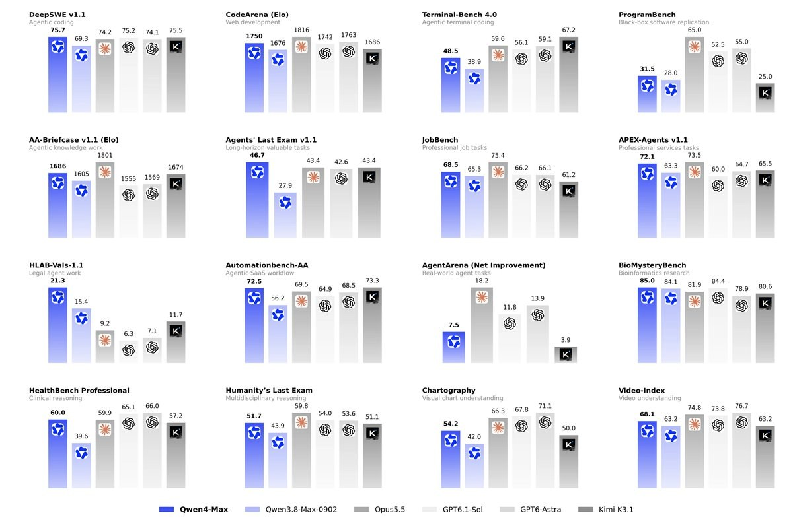
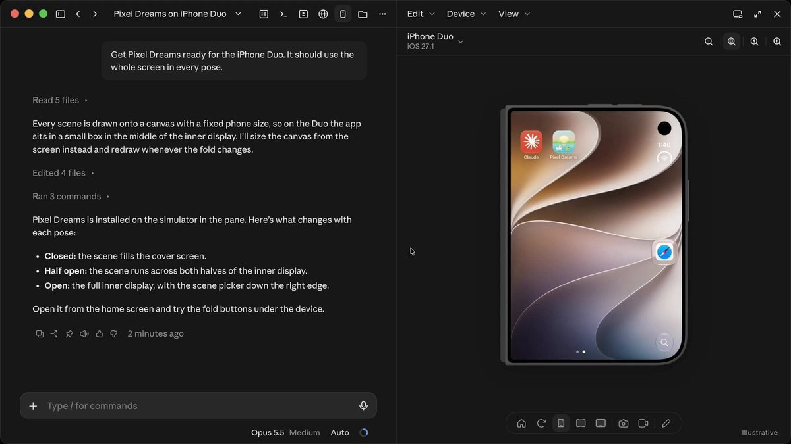
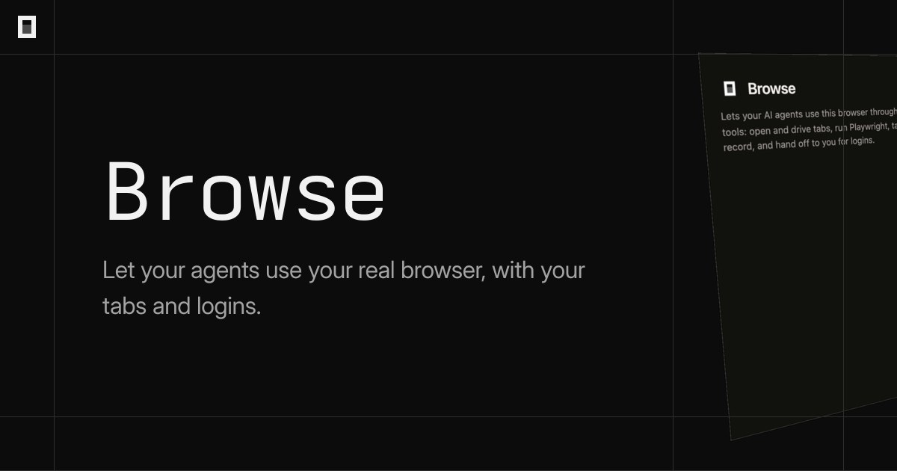
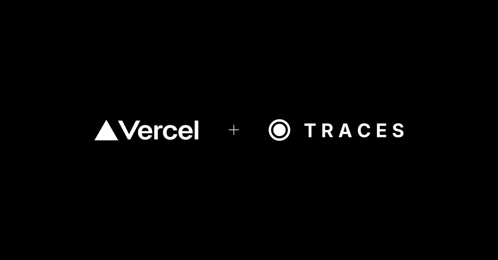
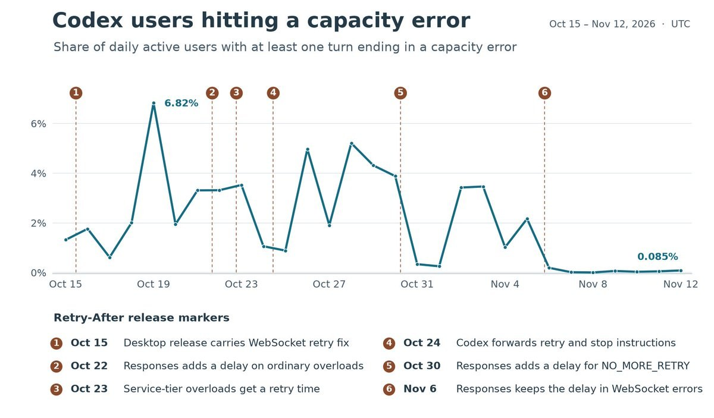
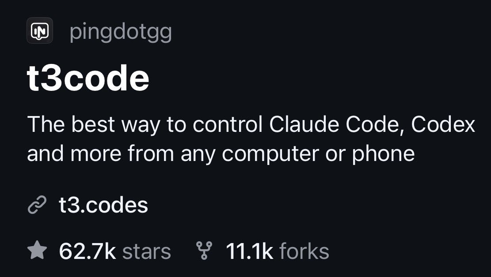
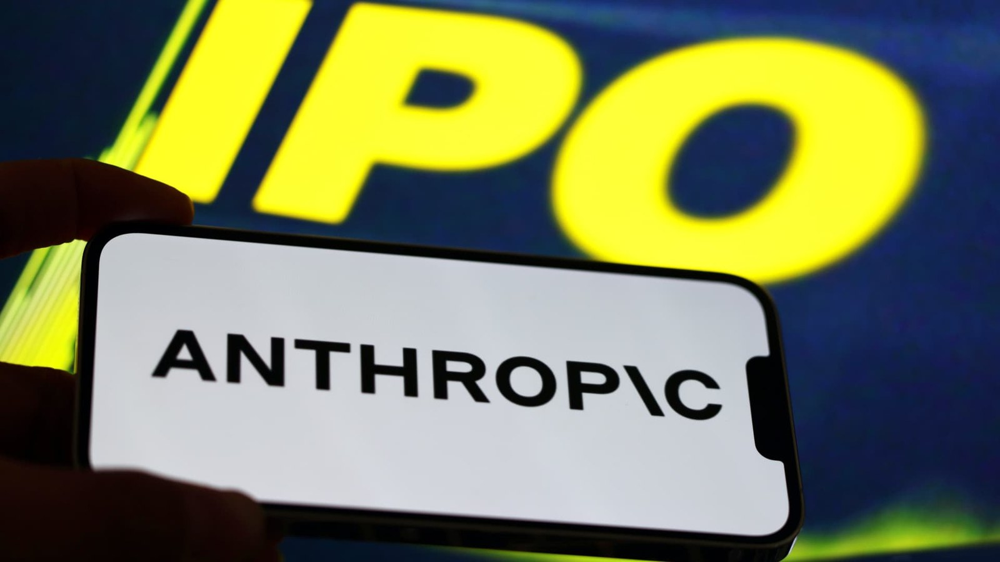
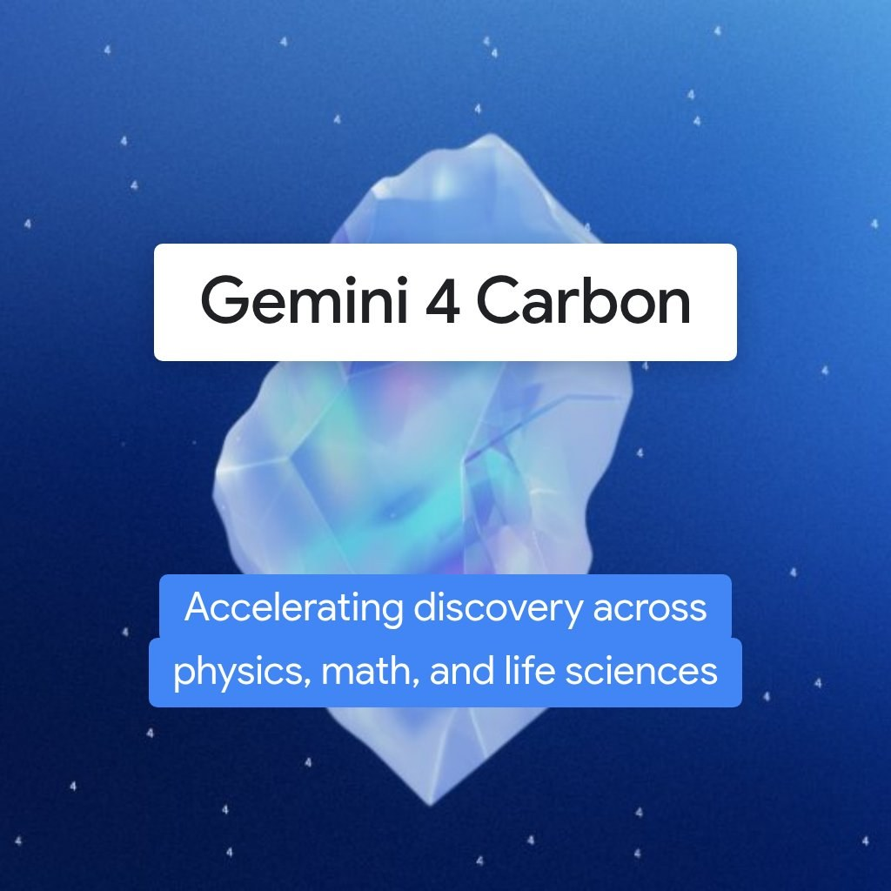
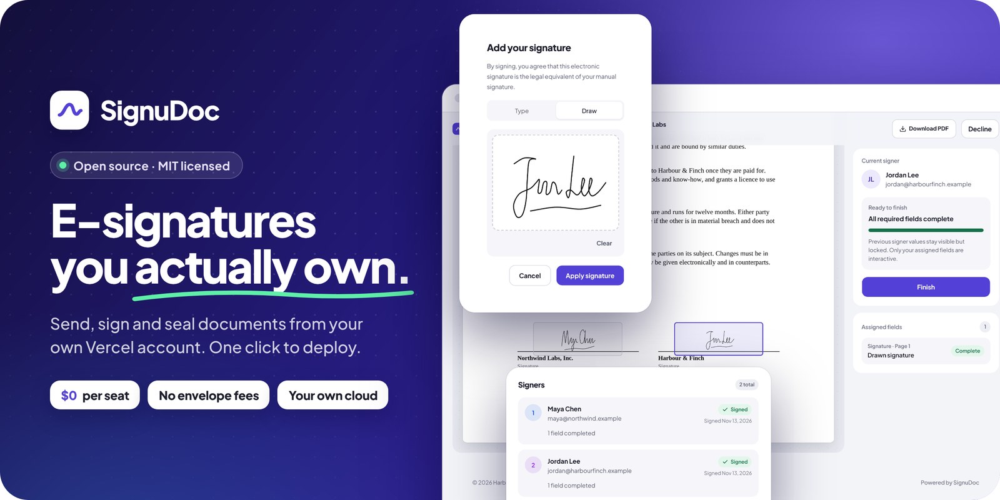

# AI Twitter/X 热点 Digest · 2026-11-17（周二）

## 今日要点

1. **Qwen4-Max 正式发布**：通义官宣新架构正式版，总参数 2.4T、每 token 激活 71B，原生视觉、100 万 token 上下文。官方 Work360 评估中，单任务平均成本从 $4.43 降到 $1.67。Qoder 提供 Day-0 支持，并把选择器里的 Qwen4-Max-Preview 升级为 Qwen4-Max；同日也登陆 OpenCode Go 等渠道。11-12 已报道过 Preview，今日是正式版与分发，不是首次亮相。
2. **Claude Code 桌面版公测 iPhone Duo 模拟器**：可在对话旁运行 App，并由 Claude 折叠或展开设备检查布局。团队随后发布 verification 博文，写明仓库约 90% 的代码由 Claude 编写并审查。Xcode 插件进入官方插件市场，但插件本身不是今天才首次出现。
3. **OpenCode Browse 0.1.0 以 Rust 重写发布**：官方称内存降为原来的 1/25、体积小 23 倍，并去掉 Playwright 依赖。同一窗口还宣布腾讯混元 Hy4 flash 未来两周近无限免费，OpenCode Go 也可使用且不计入 Go 用量。

---

## 1. Qwen4-Max 正式发布：2.4T MoE、原生视觉与 1M 上下文，Qoder 与 OpenCode 当日可用

**要点**：阿里巴巴通义团队官宣 Qwen4-Max 正式上线。阿里云新闻稿写明：这是新的 Qwen4 架构，总参数 2.4T，每 token 只激活 71B（官方称在同样 2.4T 规模下，激活参数比 Qwen3.8-Max 少 25%），并具备原生视觉和 100 万 token 上下文。通义主帖还称，相对 Qwen3.8-Max，token 用量最多可降约 50%；新闻稿则补充，在 Work360 的 High effort 推理模式下 token 用量少 35%，单任务平均成本约降 60%。通义后续帖给出更具体的数字：Work360 单任务平均成本从 **$4.43** 降到 **$1.67**。官方还称其在 Code Arena 的 WebDev 榜升至第 6、比 3.8-Max 高 74 分，Agent Arena 净胜 +7.5%，实验室总排名第 5。Qoder 宣布与通义共同打磨并提供 Day-0 支持，随后说明选择器中的 Qwen4-Max-Preview 已升级为 Qwen4-Max。同日，通义还宣布模型已在 OpenRouter 和 OpenCode Go 上线；新闻稿则写明可在 QwenCloud 的 Token Plan 与 API，以及 QwenWork、QwenStudio 使用，并称 Qwen4 系列更小规模的开源权重模型即将发布。社区实测并不一致：有体素对比称成本约为 Opus 5.5 的 1/11，也有中文用户认为正式版前端不如 Preview。

**为何值得看**：这是本窗口最大的模型发布。11-12 已经报道过 Qwen4-Max-Preview，今天应写成 Preview 升级为正式 Max 并开始更广的分发，不要写成首次亮相。正式版和 Preview 的观感争议值得并列，不要只抄官方榜单。

- Alibaba_Qwen：官宣 Qwen4-Max 正式发布，原生视觉与 100 万 token 上下文：https://x.com/Alibaba_Qwen/status/2122148127520289151
- Alibaba_Qwen：Work360 单任务平均成本从 $4.43 降到 $1.67：https://x.com/Alibaba_Qwen/status/2122148131982946642
- Alibaba_Qwen：称 Code Arena WebDev 升至第 6，比 Qwen3.8-Max 高 74 分：https://x.com/Alibaba_Qwen/status/2122156070781300934
- Alibaba_Qwen：称 Agent Arena 净胜 +7.5%，实验室总排名第 5：https://x.com/Alibaba_Qwen/status/2122161519110844686
- Alibaba_Qwen：宣布已在 OpenRouter 上线：https://x.com/Alibaba_Qwen/status/2122171875573068153
- Alibaba_Qwen：宣布已在 OpenCode Go 上线：https://x.com/Alibaba_Qwen/status/2122172575648514276
- qoder_ai_ide：宣布 Qoder 提供 Day-0 支持：https://x.com/qoder_ai_ide/status/2122208676874436673
- NFT_Chen：体素实测称成本约为 Opus 5.5 的 1/11：https://x.com/NFT_Chen/status/2122197098812862715
- leo114119：对比正式版与 Preview 前端，认为正式版不如 Preview：https://x.com/leo114119/status/2122180724883410997

---

## 2. Claude Code 桌面版公测 iPhone Duo 模拟器，团队博文称约 90% 代码由 Claude 编写并审查

**要点**：@ClaudeDevs 宣布，Claude Code 桌面版（macOS，需 Xcode 27.1 或更高版本）已在 iOS 模拟器中支持 iPhone Duo（公测）。可以在对话旁运行 App，并让 Claude 折叠或展开设备来检查布局。同线程还说可以安装苹果的 App Resizability skill；终端用户现在可在官方插件市场安装 Xcode 插件（`/plugin install xcode@claude-plugins-official`）。约一小时后，团队发布由 Addy Osmani 撰写的博文 *How the Claude Code team thinks about verification*（日期为 2026 年 11 月 16 日），写明 Claude 在能够验证工作时代码更好，并明确团队仓库约 **90%** 的代码由 Claude 编写并审查；在结构化文件生成的内部测试中，独立 grader 最多可提升 10 个成功点。

**为何值得看**：这是窗口内最完整的 Claude Code 官方更新。Xcode 插件在 11-08 已经报道过 PR 合并，今天应写成进入官方插件市场，不要写成首次发布。90% 这个数字出自团队博文，不是第三方审计。

- ClaudeDevs：宣布桌面版在 iOS 模拟器中公测支持 iPhone Duo：https://x.com/ClaudeDevs/status/2122439098740674839
- ClaudeDevs：说明可让 Claude 为 iPhone Duo 做好适配，并可安装 App Resizability skill：https://x.com/ClaudeDevs/status/2122439100854939907
- ClaudeDevs：说明今日可在 macOS 桌面版使用，需 Xcode 27.1 或更高版本：https://x.com/ClaudeDevs/status/2122439102981390562
- ClaudeDevs：宣布 Xcode 插件已进入官方插件市场：https://x.com/ClaudeDevs/status/2122439104419790958
- ClaudeDevs：发布团队 verification 博文，强调 Claude 在能验证工作时代码更好：https://x.com/ClaudeDevs/status/2122457608963395586

---

## 3. OpenCode Browse 0.1.0 换 Rust：内存降 25 倍；同时限免腾讯混元 Hy4 flash 两周

**要点**：@opencode 宣布 OpenCode Browse **0.1.0** 发布：用 Rust 重写，官方称内存降 25 倍、体积小 23 倍，并去掉 Playwright 依赖，浏览器操作直接暴露给 agent。产品页是 https://opencode.ai/product/browse 。稍早，官方还宣布 Hy4 flash（腾讯混元 HY4 Flash）未来两周近无限免费：1M 上下文、多模态、ZDR；随后称 OpenCode Go 也可使用，且不计入 Go 用量。

**为何值得看**：11-15 已经报道过 Browse 重写花费约 60 美元，今天的增量是正式版本号和性能数字。Hy4 flash 是腾讯混元，不要和 Gemini Hydrogen 搞混；窗口内能确认的是 OpenCode 限免，不必写成模型今天才首次发布。

- opencode：宣布 Browse 0.1.0 发布，Rust 重写后内存降 25 倍、体积小 23 倍：https://x.com/opencode/status/2122377687968678258
- opencode：附上 Browse 产品页：https://x.com/opencode/status/2122377719048519773
- opencode：宣布 Hy4 flash 未来两周近无限免费：https://x.com/opencode/status/2122231173720224224
- opencode：称 OpenCode Go 也可使用 Hy4 flash，且不计入 Go 用量：https://x.com/opencode/status/2122258314809741673

---

## 4. Traces 加入 Vercel；AI Gateway 上线 Private Inference；主打 agent evals

**要点**：Traces 创始人 @tarunsachdeva 宣布 Traces is joining Vercel。官方博客写明，团队全部加入 Vercel，继续做 agent 软件开发。现有用户第一天不受影响，可以继续分享 session、使用 CLI，也可以继续向已有 organization 添加成员；作为过渡，新建 organization 已暂停。产品自称始于 2026 年 2 月，已有 16 种 coding agent 适配，并称已分享近 50 万 session。@rauchg 称 traces 是比 git diff 更上游的新原语。同一天，@vercel 宣布 Private Inference 已登上 AI Gateway，调用路径为 `private/<slug>`；并发布博文 *Agents are users, so your software needs evals*。rauchg 把它概括成：旧方式做用户访谈，新方式把 agent 当用户跑 evals。

**为何值得看**：窗口里同时出现的是 traces 被收编、私有推理对 AI Gateway 开放，以及把 evals 定义成面向 agent 用户的方法论。这不是三条互不相关的发版说明。

- tarunsachdeva：宣布 Traces 加入 Vercel：https://x.com/tarunsachdeva/status/2122376451546910742
- rauchg：称 traces 是软件开发和 agent 演进的新原语：https://x.com/rauchg/status/2122391135129858507
- vercel：发布面向 agent 用户的 evals 博文：https://x.com/vercel/status/2122397118426181962
- rauchg：概括旧方式做用户访谈，新方式把 agent 当用户跑 evals：https://x.com/rauchg/status/2122415506451841215
- vercel：宣布 Private Inference 已登上 AI Gateway：https://x.com/vercel/status/2122457875364864347

---

## 5. Codex 团队称「model at capacity」报错可能已被修好

**要点**：OpenAI Codex 相关账号 @thsottiaux（Tibo）发帖说：“Codex team might have actually fixed the ‘model at capacity’ errors that have been pestering you.” 配图是一张题为 *Codex users hitting a capacity error* 的折线图，统计区间为 2026 年 10 月 15 日至 11 月 12 日（UTC），指标是「当天至少有一轮以容量报错结束的日活用户占比」。图上峰值约在 10 月 19 日的 **6.82%**，到 11 月 12 日已降到 **0.085%**，并标出了 10 月 15 日至 11 月 6 日期间若干与 Retry-After 相关的发布节点。

**为何值得看**：容量报错是近期 Codex 使用中的高频痛点，这是窗口内该产品最强的讨论信号。正文必须保留 “might have actually fixed” 的不确定语气，不要写成官方变更日志已经确认彻底修好；图的统计也只到 11 月 12 日。

- thsottiaux：称 Codex 团队可能已经修好 “model at capacity” 报错，并附上错误率下降图：https://x.com/thsottiaux/status/2122206990101536852

---

## 6. T3 Code 破 6 万 GitHub star，Theo 对标 Claude Desktop 的 iOS 能力并批评 kanban UI

**要点**：@theo 说自己度假期间，T3 Code 仓库破了 6 万 GitHub star，并且持续每天超过 1 千。他附上的截图写着约 **62.7k** stars。另有帖子称，自己试过很多方案后才做 T3 Code，是为了降低压力，不是为了爆红。引用 Claude Code 的 iPhone Duo 公告时，他用「泄露的内部 prompt」开玩笑，称 T3 Code 在 iOS 和移动开发上更强。白天还有一条互动很高的帖，批评「假进度 kanban」浪费屏幕，并提到自己曾投资并参与 Vibe Kanban，但对方最终关停。他还请大家展示用应用内改 UI 做出的东西，不过这项能力本身是 11-14 宣布、11-15 已报道的旧增量。

**为何值得看**：今日增量是 star 里程碑、对 Claude Desktop iOS 能力的对标，以及对 agent UI 形态的争论。不要再把应用内热改 UI 写成今天的新功能。

- theo：称度假期间仓库破了 6 万 star，并持续每天超过 1 千：https://x.com/theo/status/2122458476345717169
- theo：称自己试过很多方案后才做 T3 Code：https://x.com/theo/status/2122461831902138489
- theo：用玩笑对标 Claude Desktop，称 T3 Code 在 iOS 和移动开发上更强：https://x.com/theo/status/2122473901116805374
- theo：批评「假进度 kanban」不适合真实工作：https://x.com/theo/status/2122201652493230343
- theo：称自己曾投资并参与 Vibe Kanban，但对方最终关停：https://x.com/theo/status/2122201981167251877

---

## 7. Theo 称 Fable 5.2 会稳定忽略不重要反馈；Perplexity Teammate 用它写出自研 WebGL 开放世界 demo

**要点**：@theo 写道，Fable 5.2 是第一个会持续忽略不重要反馈的模型；他多次用 Opus 把线程跑进死循环后切到 Fable，对方会直接判断「这就够了，发吧」。同一窗口，Perplexity CEO @AravSrinivas 展示 Teammate 在 Fable 5.2 上做出的霓虹 1986 迈阿密开放世界驾车游戏（https://heat.pplx.app）：他声称没有使用游戏引擎、Three.js 或外部素材，Teammate 自己写了 WebGL2 渲染器。

**为何值得看**：这是窗口内关于 Fable 的最大新增量：一个明确的行为观察，加上一个可打开的 agent 作品。Fable 5.2 已在 11-10 前后发布，不要写成今天才首发。

- theo：称 Fable 5.2 是第一个会持续忽略不重要反馈的模型：https://x.com/theo/status/2122429147289206976
- AravSrinivas：展示 Teammate 用 Fable 5.2 做出的霓虹 1986 迈阿密开放世界 demo：https://x.com/AravSrinivas/status/2122338465648103676

---

## 8. 媒体称 Anthropic IPO 计划 11 月 18 日定价、19 日以 ANT 登陆纳斯达克，估值约 1.405 万亿美元

**要点**：窗口内 Bloomberg、Reuters、FT 等继续把 Anthropic 本周上市当作科技市场的试金石。CNBC 在 11 月 16 日更新的 IPO 指南写得更具体：预计 11 月 18 日晚定价，11 月 19 日在纳斯达克以代码 **ANT** 开售；发行 8.25 亿股 A 类股，定价区间 $70–$78；按该区间计算，筹资额将超过 **640 亿美元**，估值约 **1.405 万亿美元**；零售认购最多约占 20%。$70–$78 的价格区间此前已有报道，今天窗口里更清楚的是定价日、开售日和按该区间算出的筹资额与估值。这是媒体报道，窗口内没有抓到 @AnthropicAI 的官方确认帖。

**为何值得看**：具体日程让这场上市从「即将发生」变成了本周即可核对的事件。640 亿美元是按价格区间计算的筹资额，1.405 万亿美元是对应估值，两者不要和「希望募资 904 亿美元」之类的另一组传闻数字混写成同一宣布。这也不是产品发布。

- business：称 Anthropic 本周 IPO 将是 OpenAI 等竞争对手的风向标：https://x.com/business/status/2122459719403028886
- business：称这场 IPO 是对 AI 的试金石：https://x.com/business/status/2122292355608760371
- FT：称今年华尔街最大的 10 场 IPO 表现回落，引发对这场重磅上市的担忧：https://x.com/FT/status/2122221508210692111
- Reuters：在英伟达财报之外，把 Anthropic IPO 写成对投资者风险偏好的考验：https://x.com/Reuters/status/2122297416149787091

---

## 9. DeepMind 把 Antigravity 科学家项目扩至免费 Gemini 4 Carbon；Mohan 称本周会改速度

**要点**：@GoogleDeepMind 展示用 Gemini 4 Carbon 在 Antigravity 里做多步科学问题，并提到实验室用例。同线程宣布：面向 1 万名科学家的 Google Antigravity 项目，将扩至免费使用 Gemini 4 Carbon。@_mohansolo 在窗口内回复称正在做速度优化，希望本周有改进；并澄清基于 Antigravity 使用的处置不会影响 Google 账号，只限于 Antigravity。中文区 @tualatrix 继续吐槽 harness 会卡住，例如任务显示已运行很久，但日志早就结束了。官方账号还转发过上下文窗口翻倍的声明，但那是转发，不是今天的新发布。

**为何值得看**：今日可写的增量是科学家项目扩至免费 Carbon、速度改进预告，以及社区对 harness 的持续批评。不要把上下文翻倍再写成今天的新闻。

- GoogleDeepMind：展示在 Antigravity 中使用 Gemini 4 Carbon 做科学工作：https://x.com/GoogleDeepMind/status/2122366992376107167
- GoogleDeepMind：宣布面向 1 万名科学家的项目将扩至免费使用 Carbon：https://x.com/GoogleDeepMind/status/2122366997501780327
- _mohansolo：称正在做速度优化，希望本周有改进：https://x.com/_mohansolo/status/2122450999147442642
- _mohansolo：澄清基于 Antigravity 使用的处置只限于该产品，不影响 Google 账号：https://x.com/_mohansolo/status/2122421560212611393
- tualatrix：吐槽 Antigravity harness 会卡住，任务显示仍在运行但日志已结束：https://x.com/tualatrix/status/2122154613604499668

---

## 10. Kevin Rose 的开源 SignuDoc 刷屏，Rauch 称为「新软件时代」；仓库其实早在 3 月就已创建

**要点**：@kevinrose 发帖说，DocuSign 向 15 人团队要价每年 $8,100，只为签署 PDF，于是他做了开源的 SignuDoc：可一键部署到自己的 Vercel 账号，按座位 $0，并强调白标、审计追踪、防篡改印章，以及文件不离开自己的云。@rauchg 引用称：「个性化、完全自有、开源，而且比它所取代的东西质量更高。」仓库 `NYLLON-SOFTWARE/SignuDoc` 的创建时间是 **2026-03-26**，采用 MIT 许可。这是旧仓库在今天被大规模转发，不是今天才开源。

**为何值得看**：这是窗口内互动很高的软件讨论，也被接到 agent 和「自己拥有软件」的叙事上。必须写清楚：不是「今日刚开源」，也不是 Vercel 或 DocuSign 的官方新产品。

- kevinrose：介绍开源 SignuDoc，称可一键部署到自己的 Vercel 账号、按座位 $0：https://x.com/kevinrose/status/2122394902168473975
- rauchg：称个性化、完全自有、开源的软件时代已经到来：https://x.com/rauchg/status/2122396034186014919

