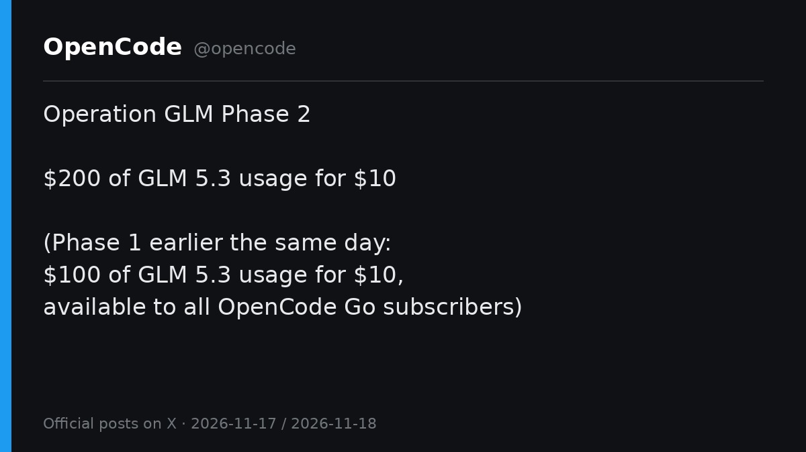
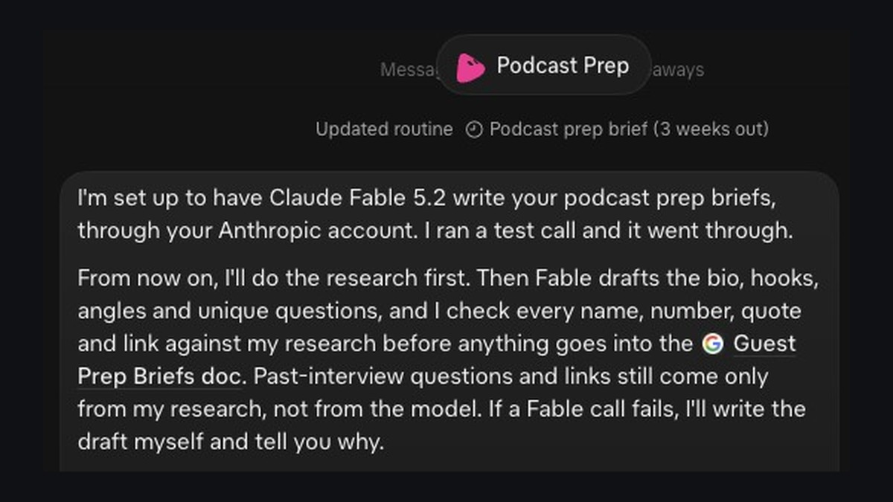
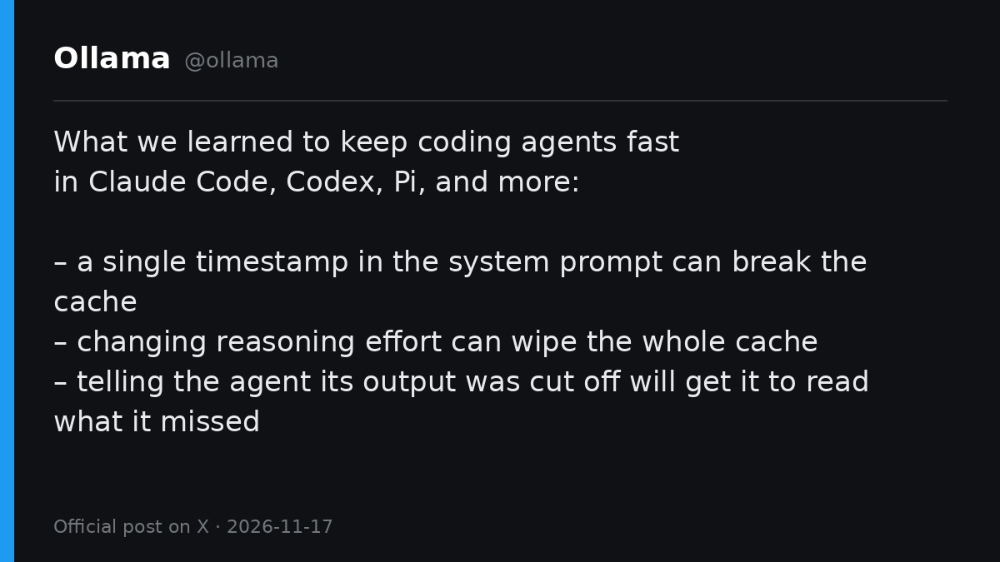
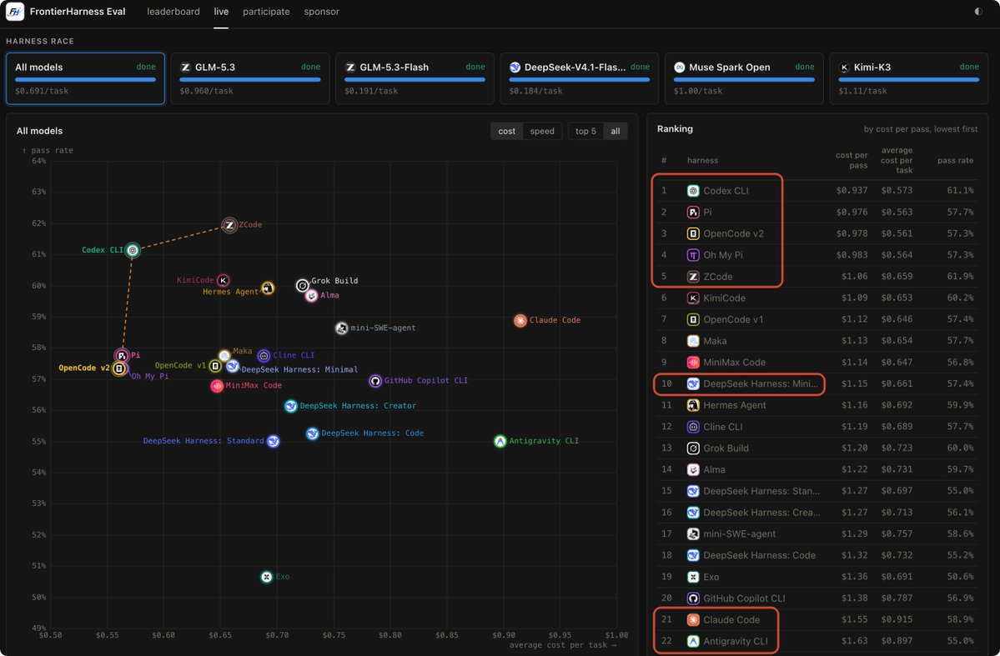
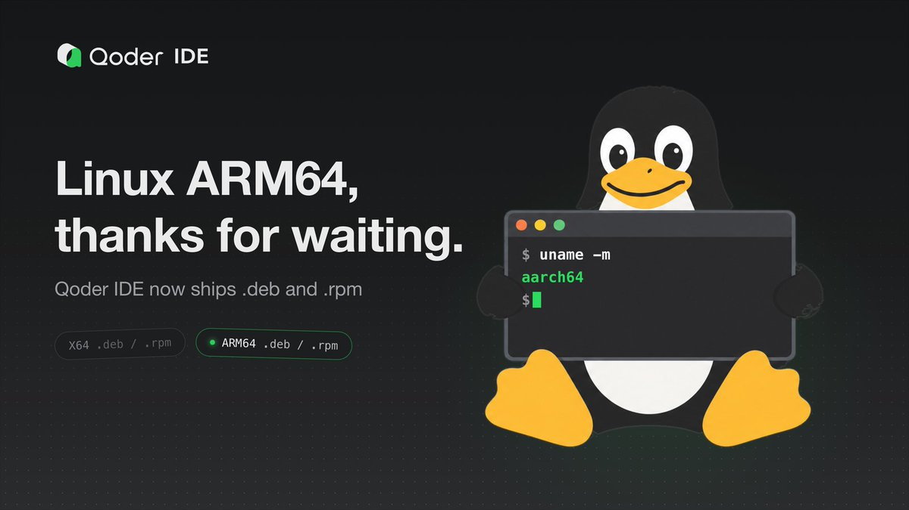

# AI Twitter/X Hots Digest · 2026-11-18 (Wednesday)

## Today's highlights

1. **GPT-6.2 Astra and Sol are generally available**: they are in ChatGPT Work and Codex, and in the API as `gpt-6.2-astra` and `gpt-6.2-sol`. Pro 500 subscribers can use Ultrafast with either model; Ultrafast reaches Pro 200 for the first time, starting with Sol. OpenAI says Astra sets new highs on professional-work and scientific-research evals, at less than a third of GPT-6 Astra's cost per task. Tibo and Sam Altman highlighted Sol Ultrafast; Theo published *Why I hate GPT-6.2 Astra* and called it the worst model OpenAI has ever released.
2. **Cognition launched Devin Bots**: persistent engineering agents that can lead a team of Devins to own an outcome. Officially, beta testers merged **4.5×** more PRs per message on average, and some engineers went from about 50 PRs a week to nearly 2,000. Those figures are official / beta-test claims, not an independent eval.
3. **OpenCode ran two rounds of Operation GLM in one day**: Go subscribers were first offered $100 of GLM 5.3 usage for $10, then about 11 hours later the official account raised it to $200. OpenCode's Dax said this is possible because it runs on their own GPUs and inference team. This is not a GLM 5.5 launch.

---

## 1. GPT-6.2 Astra and Sol are live in ChatGPT Work, Codex, and the API; Ultrafast expands to Pro 200, and reaction to Astra is split

**The point**: OpenAI announced that GPT-6.2 Astra and Sol are now available. The official blog positions Astra as a frontier model for the hardest projects, and Sol as an efficient, versatile model for everyday work and multistep agent workflows; it also says many OpenAI employees use Sol as their default. In the product, ChatGPT Work and Codex are open to Plus, Pro, Enterprise, and Edu users. Pro 500 subscribers can use Ultrafast with either model; Ultrafast reaches Pro 200 for the first time, starting with GPT-6.2 Sol. Developers can use `gpt-6.2-astra` and `gpt-6.2-sol` in the API, with Ultrafast available. The blog says that on Agents’ Last Exam, Astra scores 5.2 points higher than GPT-6 Astra at less than a third of the cost, and 5.5 points ahead of Claude Fable 5.2 at about 5% of the cost; on Terminal-Bench-Science 0.1 it is 9 percentage points above GPT-6 Astra, again at less than one-third the cost. API prices for Astra are 20% lower than GPT-6 Astra on input and output, with a further 60% discount on cached input, at $8 / $0.40 / $40 per million tokens; Sol keeps GPT-6.1 Sol's $2 / $0.10 / $10 rates. OpenAI also called Astra its most capable model yet for cyber, saying it jumps 22 points over GPT-6 Astra on ExploitBench Internal Port, while tightening safeguards for higher-risk cybersecurity assistance, and said it is working to bring the 6.2 models to Daybreak for approved defenders. Vercel AI Gateway listed both models the same day. Community reaction is split: Codex's Tibo (@thsottiaux) said Sol Ultrafast is his go-to for most day-to-day work, and Sam Altman also singled out 6.2 Sol Ultrafast. Theo first called 6.2 Astra the worst model OpenAI has ever released, then published the X article *Why I hate GPT-6.2 Astra*, and later said that in early testing he and a colleague both used Astra to make a new game level and both got water levels named Bellwether. Early tester @skirano argued the reaction was unfair, and that most of the issues in his testing were in the harness.

**Why it matters**: this is the largest model and Codex-distribution event in the window. Official posts stress efficiency and cost; the criticism of Astra is just as loud. Tibo and Sam's push for Sol Ultrafast belongs in the same item as Theo's review, not in a separate one.

- OpenAI: announces that GPT-6.2 Astra and Sol are now available: https://x.com/OpenAI/status/2122750124543926515
- OpenAI: says Astra sets new highs on professional-work and scientific-research evals at less than a third of GPT-6 Astra's cost per task: https://x.com/OpenAI/status/2122750126297161811
- OpenAI: spells out availability in ChatGPT Work and Codex, and Ultrafast expanding to Pro 200 starting with Sol: https://x.com/OpenAI/status/2122750135608528984
- OpenAI: calls Astra its most capable model yet for cyber, cites a 22-point jump on ExploitBench Internal Port, and tightens safeguards: https://x.com/OpenAI/status/2122750133133791592
- thsottiaux: says Sol and Astra are finally here, and that Sol Ultrafast is his go-to for day-to-day work: https://x.com/thsottiaux/status/2122753991000133943
- sama: says the models can do amazing things and are very token-efficient, and highlights 6.2 Sol Ultrafast: https://x.com/sama/status/2122798039899263456
- theo: calls 6.2 Astra the worst model OpenAI has ever released: https://x.com/theo/status/2122757647170703550
- theo: publishes the article *Why I hate GPT-6.2 Astra*: https://x.com/theo/status/2122760447103484410
- theo: says early tests of new game levels both converged on a water level named Bellwether: https://x.com/theo/status/2122762384704258122
- skirano: argues Astra is getting an unfair response, and that the issues in his testing were mostly in the harness: https://x.com/skirano/status/2122770640604111133

---

## 2. Cognition launches Devin Bots: persistent agents that can lead a team, with an official claim of 4.5× more PRs per message in beta

**The point**: Cognition announced Devin Bots, with a product page at https://devin.ai/bots . Officially, a Devin Bot leads a team of agents to get the job done, from writing firmware to merging thousands of PRs a week. The posts emphasize persistence and professional software engineering: a cloud computer, planning, code review, and automated testing, with the decisions that need a person collected in one place. An official follow-up said that, on average, beta testers are merging **4.5×** more PRs per message, and that individual engineers have gone from about 50 PRs a week to nearly 2,000. The company blog fills in internal examples: an Android Bot merged 1,134 PRs in 44 days, and Jenny's game studio went from about 50 PRs a week to 1,900. CEO Jeff Wang called it the company's biggest launch of 2026, placing it after Codeium autocomplete, Windsurf's local agents, and Devin's cloud agents, as persistent agents. Walden Yan also shared examples of “bots building bots.” The throughput numbers are official or beta-test claims, not a third-party reproduction.

**Why it matters**: this is one of the clearest new product launches in the window, moving coding agents from completing a task to owning an outcome over time. The 4.5× figure and the “nearly 2,000 PRs” claim need to be attributed to Cognition, not treated as an independent benchmark.

- cognition: introduces Devin Bots, saying a bot can lead a team of agents to get the job done: https://x.com/cognition/status/2122737511684587551
- cognition: says beta testers are merging 4.5× more PRs per message, and some engineers went from about 50 PRs a week to nearly 2,000: https://x.com/cognition/status/2122737513567826007
- jeffwang: calls it the biggest launch of 2026 and frames it as persistent agents: https://x.com/jeffwang/status/2122741216261628181
- walden_yan: shares examples of extreme automation and bots building bots: https://x.com/walden_yan/status/2122740852091216274

---

## 3. OpenCode runs two rounds of Operation GLM in one day: $10 first buys $100 of GLM 5.3 usage, then $200

**The point**: OpenCode first announced Operation GLM Phase 1: all OpenCode Go subscribers could get $100 of GLM 5.3 usage for $10. About 11 hours later it announced Phase 2 and raised the allowance to $200 for $10. The official Go pricing page now lists a monthly GLM-5.3 cap of $200 on Go ($400 on Go Plus). Official docs also say paid models on Go share one allowance, and that the figure is how much usage the plan covers if you use only that model for the month—not extra credit deposited into the account. OpenCode's Dax (@thdxr) quoted the first phase and said this is possible because it is hosted on their own GPUs by their inference team, “and this is just phase 1.” This is a staged promotion, not a GLM 5.5 launch; rumors of a 5.5 release in the same window were not confirmed by Zhipu, and should not be written up as a new model. Yesterday's digest already covered OpenCode Browse 0.1.0 and the Hy4 flash free window, so those are not treated as new today.

**Why it matters**: aside from the model launches, this was one of the highest-engagement product stories of the day, and the offer was raised within hours. For Go subscribers it is an actionable usage change, but “$200 of usage” is not the same as account credit.

- opencode: announces Operation GLM Phase 1, $100 of GLM 5.3 usage for $10: https://x.com/opencode/status/2122600875562537329
- opencode: announces Phase 2 and raises the allowance to $200 for $10: https://x.com/opencode/status/2122763721923559595
- thdxr: says this is possible because it runs on their own GPUs and inference team: https://x.com/thdxr/status/2122691122967224569
- thdxr: quotes the official Phase 2 post after the allowance was raised: https://x.com/thdxr/status/2122764850418057229

---

## 4. Antigravity turns one: a new multi-agent UI, a quota reset across all models, and 1.5× faster Carbon TTFT

**The point**: The official Antigravity account posted a video breaking down a redesigned UI “rebuilt from the ground up as a surface made for orchestrating multiple agents in parallel,” with an emphasis on visibility and control. Lead Varun Mohan (@_mohansolo) said the past week had brought step-change improvements to the design. He later announced that, in honor of Antigravity turning one, quota would be reset for everyone across all models, and earlier said Carbon's time to first token is now 1.5× faster on Antigravity, with Argon to follow. Public records show Antigravity launched on 2025-11-18 alongside Gemini 3, so the first-anniversary claim matches the public launch date. DeepMind also showed Gemini 4 Hydrogen plus a new Antigravity robotics plugin that can connect a supported arm, practice in MuJoCo, and run tasks on a real robot in plain language, plus a demo of Hydrogen and Antigravity turning Google Sheets into pixel-art animation. The official account also highlighted a fully offline language-learning app built by the Google AI Edge Gallery team with Antigravity, combining ASR, Gemma 4, and TTS, and using Figma MCP to turn designs into code. These are official demos, not a claim that every user now has the same robotics or on-device setup. Yesterday's scientists demo is not repeated here.

**Why it matters**: the UI, the quota reset, the speed work, and the robotics / on-device demos landed on the same day, and the quota reset is the most immediately useful change for current users. The “turning one” claim lines up with the 2025-11-18 public launch, rather than being an unverified slogan.

- antigravity: breaks down the redesigned UI for orchestrating multiple agents in parallel: https://x.com/antigravity/status/2122514607726043205
- _mohansolo: says the past week brought step-change improvements to Antigravity's design: https://x.com/_mohansolo/status/2122516734972420305
- _mohansolo: says Carbon TTFT is now 1.5× faster on Antigravity, with Argon to follow: https://x.com/_mohansolo/status/2122821676249625014
- _mohansolo: announces a quota reset for everyone across all models in honor of Antigravity turning one: https://x.com/_mohansolo/status/2122836883877347836
- GoogleDeepMind: introduces Gemini 4 Hydrogen and a new Antigravity robotics plugin: https://x.com/GoogleDeepMind/status/2122767521925230896
- antigravity: highlights a fully offline language-learning app built by the Edge Gallery team with Antigravity: https://x.com/antigravity/status/2122848700233925006

---

## 5. Grok Bot keeps circulating: Elon quotes a 90-minute phone-support story, the team talks connectors, and it can call Anthropic models

**The point**: There is no new Grok Bot version number in this window, but the product discussion was busy. Elon Musk quoted an earlier user thread with only “Grok @Bot”—the user said Grok Bot had spent 90 minutes on a complex call with AT&T, and that a human agent only realized it was a bot after the call hit its time limit. @teslaownersSV also said Grok Bot read their wife's medical records, researched treatments and trials, found a Stanford specialist, and drafted emails, after which they got an intake call; Elon reposted that account. These are user anecdotes, not verified claims. Grok team member Lauren (@poteto) said the more context you give the bot through connectors, the more it can act as a teammate or assistant; she suggested dictating workflows by voice, asking the bot to restate them, and saving skills. Lenny Rachitsky showed that you can ask @Bot to do its work with Anthropic models via your own API.

**Why it matters**: this is a usage and capability discussion, not a release. The phone-support and medical-records stories spread widely, but both should be labeled as user accounts, not as official evaluations or verified medical outcomes.

- elonmusk: quotes a user account of Grok Bot spending 90 minutes on a call with AT&T: https://x.com/elonmusk/status/2122560774073901341
- teslaownersSV: says Grok Bot read medical records, researched treatments, drafted emails, and a Stanford intake call followed: https://x.com/teslaownersSV/status/2122512355062161744
- poteto: describes giving Grok Bot more context through connectors, dictating workflows, and saving skills: https://x.com/poteto/status/2122774297840398639
- lennysan: shows that you can ask Grok Bot to use Anthropic models: https://x.com/lennysan/status/2122493120738988401

---

## 6. Ollama shares lessons for keeping prefix caches intact in Claude Code, Codex, Pi, and other coding agents

**The point**: Ollama wrote up what it has learned to keep coding agents fast in Claude Code, Codex, Pi, and similar tools: a single timestamp in the system prompt can break the cache; changing reasoning effort can wipe the whole cache; and telling the agent its output was cut off will get it to read what it missed. The post quoted a Together discussion that coding agents resend the whole conversation on every turn, and that prefix caching only stays effective if both the harness and the inference engine do their part. These are Ollama's operational lessons, not a benchmark.

**Why it matters**: it is not a product launch, but it is directly useful for Claude Code, Codex, and Pi users who care about latency and cost. The things that break the cache are easy to miss: a timestamp, or a change in reasoning effort.

- ollama: shares three lessons for keeping prefix caches intact in Claude Code, Codex, and Pi: https://x.com/ollama/status/2122531964154712541

---

## 7. Gemini 4 Hydrogen is live in Google Search globally; Google calls it Search’s biggest model upgrade yet

**The point**: Google announced that Gemini 4 Hydrogen is live in Google Search globally, calling it the biggest model upgrade to Search yet, and citing better intent understanding, smarter query fan-out and linking, more visual and adaptive responses, and richer multilingual capabilities. Hydrogen itself has already appeared in earlier digests; today is the global Search rollout, not a first model launch, and it is not a change to Antigravity's or an IDE's default model. In the same window, DeepMind used Hydrogen in the Antigravity robotics plugin and other demos, covered in item 4.

**Why it matters**: this is a distribution story, and the home product is Search. For people who write software, the signal is that the same Hydrogen model is being wired into more Google products, not that an IDE shipped a new release.

- Google: announces that Gemini 4 Hydrogen is live in Google Search globally: https://x.com/Google/status/2122820914777845813

---

## 8. FrontierHarness Eval: with a fixed set of open models, Codex CLI, Pi, and OpenCode V2 rank near the top

**The point**: Chinese-language user @CyanCloud77 published a FrontierHarness Eval comparison of coding harnesses, holding the models fixed at GLM-5.3, DeepSeek-V4.1, Muse Spark, and Open Kimi-K3. The overall ranking listed Codex CLI, Pi, OpenCode V2, Oh My Pi, and ZCode in the top five, and said DeepSeek Harness Minimal placed 10th, Claude Code 21st, and Antigravity CLI last. These results come from the eval post, not an official leaderboard, and the model list does not include closed-source flagship models, so the ranking should not be read as a head-to-head of official Claude or GPT models.

**Why it matters**: direct harness comparisons were scarce in the window. The result is narrow: it has to be read together with the fixed model list, and the placement should not be treated as a general ranking across all models and tasks.

- CyanCloud77: publishes the FrontierHarness Eval overall ranking, with Codex CLI, Pi, and OpenCode V2 near the top: https://x.com/CyanCloud77/status/2122587062348239056

---

## 9. Qoder IDE ships Linux ARM64 .deb and .rpm builds

**The point**: The official Qoder account announced that the IDE now ships .deb and .rpm builds for Linux ARM64, with x64 builds still available, and that ARM64 can be selected on the download page. Engagement was modest, but it is a concrete product update. In the same window, Qwen also said Qwen4-Max was live on you.com and LebrelAI; that is follow-on distribution after yesterday's GA, not a new model launch.

**Why it matters**: Linux ARM64 packages are a practical update for people on ARM machines, but the news value is clearly weaker than the launches and promotions above.

- qoder_ai_ide: announces Linux ARM64 .deb and .rpm builds for Qoder IDE: https://x.com/qoder_ai_ide/status/2122701237422563392

