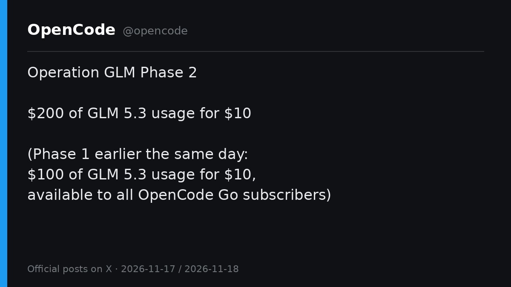
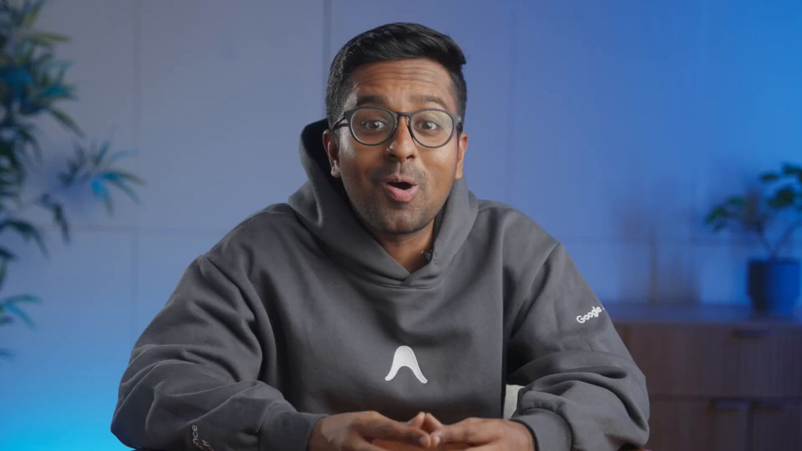
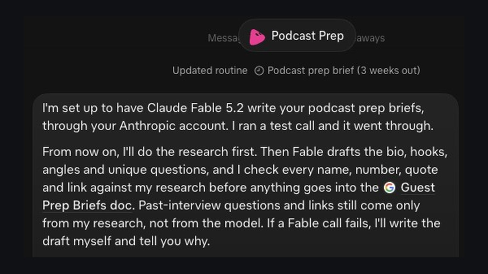
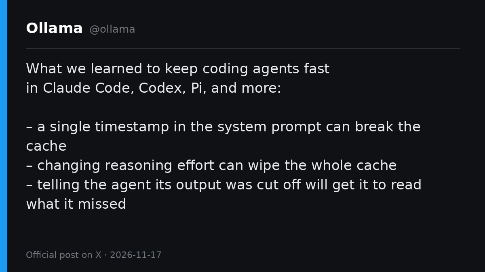
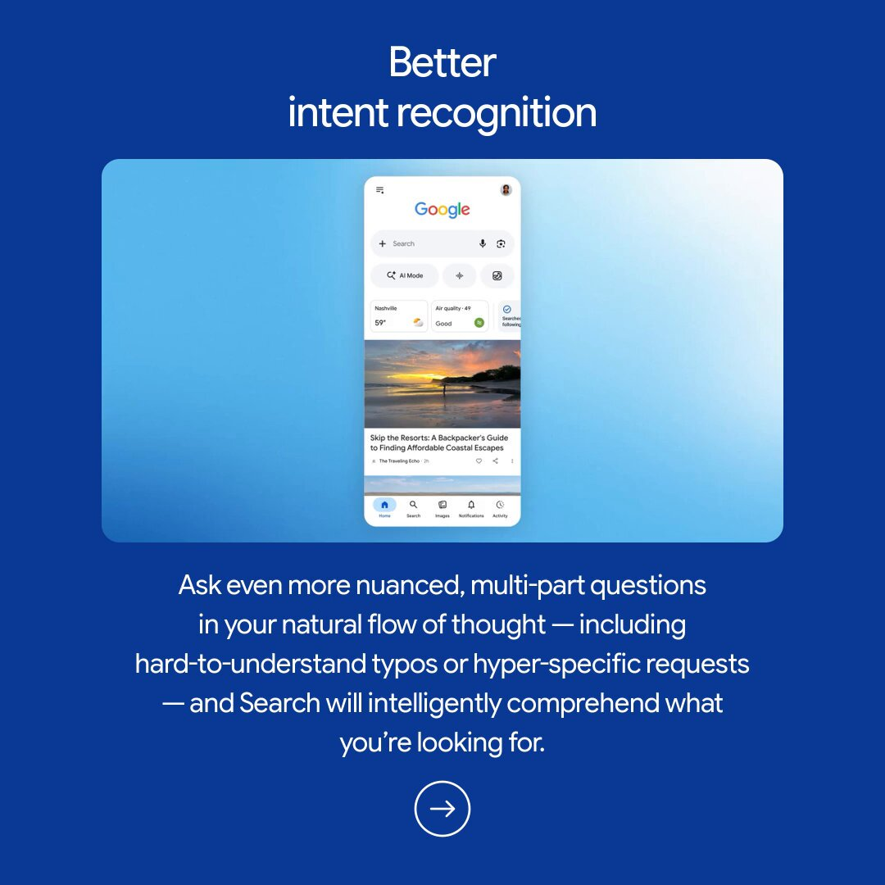
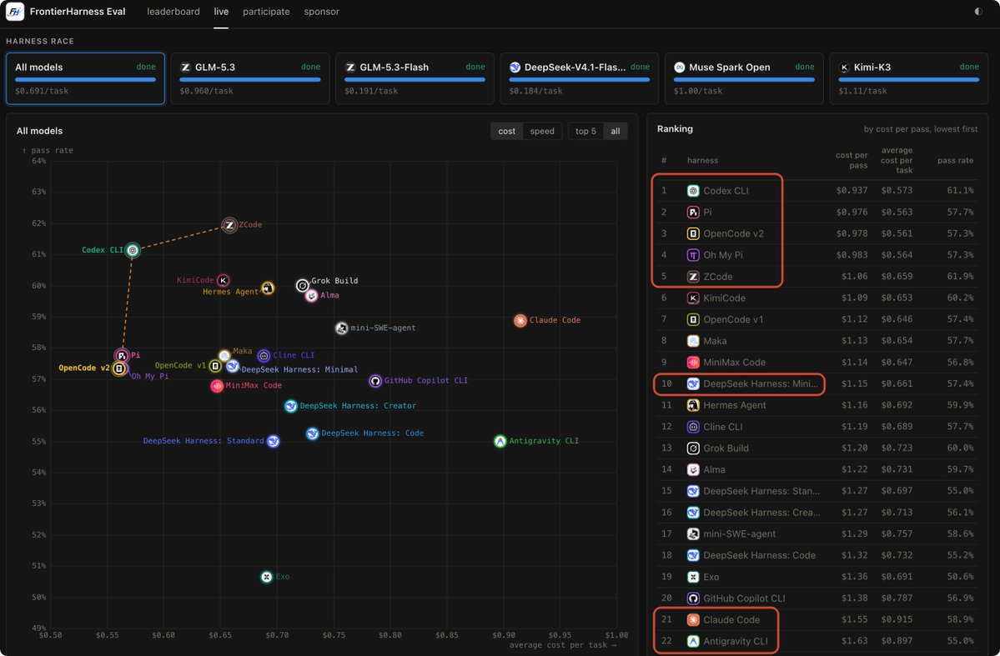
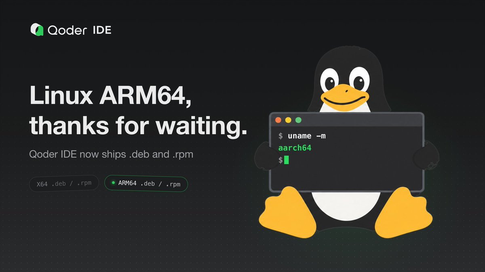

# AI Twitter/X 热点 Digest · 2026-11-18（周三）

## 今日要点

1. **GPT-6.2 Astra 与 Sol 正式上线**：进入 ChatGPT Work、Codex，并提供 API（`gpt-6.2-astra`、`gpt-6.2-sol`）。Pro 500 可用两种模型的 Ultrafast；Ultrafast 首次对 Pro 200 开放，先从 Sol 开始。官方称 Astra 在专业工作与科学研究评估上创新高，单任务成本不到 GPT-6 Astra 的三分之一。Tibo 与 Sam Altman 力推 Sol Ultrafast；Theo 则发文《Why I hate GPT-6.2 Astra》，称这是 OpenAI 发过最差的模型。
2. **Cognition 发布 Devin Bots**：定位为常驻、可带领一组 Devin 完成结果的工程代理。官方称内测用户平均每条消息合入的 PR 为原来的 4.5 倍，并写到有工程师从每周约 50 个 PR 到接近 2000 个。这是官方/内测口径，不是独立评测。
3. **OpenCode 一天两轮 Operation GLM**：先宣布 Go 订阅以 $10 换 $100 的 GLM 5.3 用量，约 11 小时后加码到 $200。OpenCode 的 Dax 称这跑在他们自建的 GPU 与推理团队上。这不是 GLM 5.5 发布。

---

## 1. GPT-6.2 Astra 与 Sol 上线：进入 ChatGPT Work、Codex 与 API，Ultrafast 扩到 Pro 200，社区评价两极

**要点**：OpenAI 宣布 GPT-6.2 Astra 与 Sol 现已可用。官方博客把 Astra 定位为面向最难项目的前沿模型，Sol 面向日常与多步 agent 工作流，并称许多 OpenAI 员工把 Sol 当主力。产品上，ChatGPT Work 与 Codex 向 Plus、Pro、Enterprise、Edu 开放；Pro 500 可用两种模型的 Ultrafast；首次把 Ultrafast 给到 Pro 200，先从 GPT-6.2 Sol 开始。开发者可在 API 使用 `gpt-6.2-astra` 与 `gpt-6.2-sol`，并提供 Ultrafast。官方博客写明：在 Agents’ Last Exam 上，Astra 比 GPT-6 Astra 高 5.2 分，单任务成本不到其三分之一，并比 Claude Fable 5.2 高 5.5 分、成本约为其 5%；在 Terminal-Bench-Science 0.1 上比 GPT-6 Astra 高 9 个百分点，成本同样不到三分之一。API 定价方面，Astra 输入/输出比 GPT-6 Astra 低 20%，缓存输入再打 60% 折扣，标准价为每百万 token 输入 $8、缓存输入 $0.40、输出 $40；Sol 沿用 GPT-6.1 Sol 的 $2 / $0.10 / $10。官方还称 Astra 是迄今最强的网络安全能力模型，在 ExploitBench Internal Port 上比 GPT-6 Astra 高 22 分，同时收紧高风险网络安全协助的防护，并计划把 6.2 系列放进 Daybreak 给获批防御方。Vercel AI Gateway 同步上线这两个模型。社区评价两极：Codex 的 Tibo（@thsottiaux）称 Sol Ultrafast 是自己日常主力，Sam Altman 也点名 6.2 Sol Ultrafast；Theo 先说这是 OpenAI 发过最差的模型，随后发表 X 文章《Why I hate GPT-6.2 Astra》，并补充早期测试里他和同事用 Astra 给游戏做新关卡，结果都收敛到名为 Bellwether 的水关。早期测试者 @skirano 则认为反应不公，自己遇到的问题主要出在 harness。

**为何值得看**：这是窗口内最大的模型与 Codex 分发事件。官方强调效率与成本，社区对 Astra 的争议同样刺耳，不宜只复述官方向；Tibo、Sam 对 Sol Ultrafast 的推荐，和 Theo 的批评应放在同一条里。

- OpenAI：宣布 GPT-6.2 Astra 与 Sol 现已可用：https://x.com/OpenAI/status/2122750124543926515
- OpenAI：称 Astra 在专业工作与科学研究评估上创新高，单任务成本不到 GPT-6 Astra 的三分之一：https://x.com/OpenAI/status/2122750126297161811
- OpenAI：说明 ChatGPT Work、Codex 的开放范围，以及 Ultrafast 扩到 Pro 200（先从 Sol 开始）：https://x.com/OpenAI/status/2122750135608528984
- OpenAI：称 Astra 是迄今最强网络安全能力模型，ExploitBench Internal Port 高 22 分，并收紧防护：https://x.com/OpenAI/status/2122750133133791592
- thsottiaux：称 Sol 与 Astra 终于上线，并把 Sol Ultrafast 当作日常主力：https://x.com/thsottiaux/status/2122753991000133943
- sama：称这些模型很能打且 token 效率高，并点名 6.2 Sol Ultrafast：https://x.com/sama/status/2122798039899263456
- theo：称 6.2 Astra 是 OpenAI 发过最差的模型：https://x.com/theo/status/2122757647170703550
- theo：发表文章《Why I hate GPT-6.2 Astra》：https://x.com/theo/status/2122760447103484410
- theo：讲述早期测试里两个游戏关卡都收敛到名为 Bellwether 的水关：https://x.com/theo/status/2122762384704258122
- skirano：认为 Astra 受到不公正评价，自己测试中的问题主要出在 harness：https://x.com/skirano/status/2122770640604111133

---

## 2. Cognition 发布 Devin Bots：常驻、可带队的工程代理，官方称内测人均单条消息合入 PR 为 4.5 倍

**要点**：Cognition 宣布 Devin Bots，产品页为 https://devin.ai/bots 。官方定位是：从写固件到一周合并数千个 PR，一个 Devin Bot 带领一组 agent 把活干完；强调常驻、面向职业软件工程，自带云电脑，覆盖规划、代码审查与自动测试，需要人拍板的决策集中在一处。官方帖写明，内测用户平均每条消息合入的 PR 是原来的 **4.5 倍**，并称见过个别工程师从每周约 50 个 PR 到接近 2000 个。官方博文用内部案例展开：Android Bot 在 44 天里合并 1,134 个 PR；Jenny 的游戏工作室从每周约 50 个 PR 到 1,900 个。CEO Jeff Wang 称之为「2026 年最大的发布」，把它放在 Codeium 补全、Windsurf 本地 agent、Devin 云端 agent 之后的 Persistent Agents。Walden Yan 也分享了「Bot 再做 Bot」的使用例子。这些吞吐数字都是官方或内测口径，不是第三方复现。

**为何值得看**：这是窗口内最明确的新产品发布之一，把 coding agent 从「完成一个任务」推到「长期拥有一个结果」。需要把 4.5 倍和近 2000 个 PR 写清来源，避免当成独立评测。

- cognition：介绍 Devin Bots，称一个 Bot 可带领一组 agent 完成工作：https://x.com/cognition/status/2122737511684587551
- cognition：称内测用户平均每条消息合入的 PR 为原来的 4.5 倍，个别工程师从每周约 50 个到接近 2000 个：https://x.com/cognition/status/2122737513567826007
- jeffwang：称之为 2026 年最大的发布，并把它放在 Persistent Agents 这一阶段：https://x.com/jeffwang/status/2122741216261628181
- walden_yan：分享 Devin Bots 带来的高度自动化，以及「Bot 再做 Bot」的例子：https://x.com/walden_yan/status/2122740852091216274

---

## 3. OpenCode 一天两轮 Operation GLM：$10 先换 $100 的 GLM 5.3 用量，晚间再加到 $200

**要点**：OpenCode 先宣布 Operation GLM Phase 1：所有 OpenCode Go 订阅用户可用 $10 换 $100 的 GLM 5.3 用量。约 11 小时后再宣布 Phase 2，把额度加到 $10 换 $200。官方 Go 定价页随后把 GLM-5.3 在 Go 套餐下的月度上限列为 $200（Go Plus 为 $400）；按官方文档，Go 里的付费模型共享同一份额度，这一数字是「整月只用该模型时套餐覆盖的上限」，不是额外打入账户的余额。OpenCode 的 Dax（@thdxr）引用第一阶段称，这能做到是因为跑在他们自己的 GPU 和推理团队上，「这还只是第一阶段」。这是分阶段促销，不是 GLM 5.5 发布；窗口里出现的 5.5 传闻没有智谱官方确认，不应写成新模型上线。昨日已报道的 OpenCode Browse 0.1.0 与 Hy4 flash 限免，不再当今天的新事件。

**为何值得看**：这是今天除大模型发布外互动最高的产品新闻之一，而且一天内加码。对 Go 订阅用户是可执行的用量变化，但要把「$200 用量上限」和「账户余额」区分开。

- opencode：宣布 Operation GLM Phase 1，$10 换 $100 的 GLM 5.3 用量：https://x.com/opencode/status/2122600875562537329
- opencode：宣布进入 Phase 2，额度加到 $10 换 $200：https://x.com/opencode/status/2122763721923559595
- thdxr：称这能做到是因为跑在自建 GPU 和推理团队上：https://x.com/thdxr/status/2122691122967224569
- thdxr：在 Phase 2 加码后再次引用官方帖：https://x.com/thdxr/status/2122764850418057229

---

## 4. Antigravity 满一周岁：官方拆解多智能体新 UI，全模型配额重置，Carbon TTFT 加快 1.5 倍

**要点**：Google Antigravity 官方发视频，拆解「为并行编排多个 agent 重建」的新界面，强调可见性与控制；负责人 Varun Mohan（@_mohansolo）称过去一周设计有阶跃改进。随后 Mohan 宣布：「为庆祝 Antigravity 满一岁，重置所有人、所有模型的配额」；稍早还说 Carbon 的 TTFT 已加快 1.5 倍，Argon 也会跟上。公开记录里，Antigravity 于 2025-11-18 随 Gemini 3 一起推出，今天确实是一周年。DeepMind 同时展示：用 Gemini 4 Hydrogen 加上新的 Antigravity 机器人插件，可以把支持的机械臂接到 MuJoCo 仿真，并用自然语言在真机上跑任务；另有 Hydrogen + Antigravity 把 Google 表格做成像素画动画的演示。官方还介绍 Google AI Edge Gallery 团队用 Antigravity 做了一个完全离线的语言学习应用，结合 ASR、Gemma 4 与 TTS，并用 Figma MCP 把设计落到代码。这些是官方演示，不等于所有用户都已具备同样的机器人或端侧能力。昨日已写过的 scientists 演示不再重复。

**为何值得看**：UI、配额、速度和机器人/端侧演示叠在同一天，配额重置对现有用户最直接。满一岁的说法与 2025-11-18 的公开推出日相符，不是口头编造。

- antigravity：拆解为并行编排多个 agent 重建的新界面：https://x.com/antigravity/status/2122514607726043205
- _mohansolo：称过去一周 Antigravity 的设计有阶跃改进：https://x.com/_mohansolo/status/2122516734972420305
- _mohansolo：称 Carbon 的 TTFT 加快 1.5 倍，Argon 也将跟上：https://x.com/_mohansolo/status/2122821676249625014
- _mohansolo：宣布庆祝满一岁，重置所有人、所有模型的配额：https://x.com/_mohansolo/status/2122836883877347836
- GoogleDeepMind：介绍 Gemini 4 Hydrogen 与新的 Antigravity 机器人插件：https://x.com/GoogleDeepMind/status/2122767521925230896
- antigravity：介绍 Edge Gallery 团队用 Antigravity 做的完全离线语言学习应用：https://x.com/antigravity/status/2122848700233925006

---

## 5. Grok Bot 继续发酵：Elon 转发 90 分钟电话客服案例，团队介绍连接器，并可调用 Anthropic 模型

**要点**：本窗口没有新的 Grok Bot 版本号发布，但产品讨论很热。Elon Musk 引用一条稍早的用户长帖，只回「Grok @Bot」——该用户称 Grok Bot 与 AT&T 打了 90 分钟复杂电话，达到通话时限后，真人客服才发现对方是 bot。另有 @teslaownersSV 称，Grok Bot 阅读其妻子病历、检索治疗与试验、找到斯坦福专家并起草邮件，随后接到入院评估电话；Elon 转发了这条。这是用户自述，未经验证。Grok 团队的 Lauren（@poteto）介绍：通过连接器给的上下文越多，bot 越能当同事或助理；建议用语音口述工作流、先让 bot 复述确认，并可保存 skills。Lenny Rachitsky 则演示，可以要求 @Bot 通过自己的 Anthropic API 使用 Claude 模型。

**为何值得看**：这是使用案例和能力讨论，不是发版。电话客服和病历故事传播很广，但都应标明是用户讲述，而不是官方评测或已核实的医疗结果。

- elonmusk：引用用户所述 Grok Bot 与 AT&T 通话 90 分钟的案例：https://x.com/elonmusk/status/2122560774073901341
- teslaownersSV：称 Grok Bot 阅读病历、检索治疗方案并起草邮件，随后接到斯坦福来电：https://x.com/teslaownersSV/status/2122512355062161744
- poteto：介绍用连接器给 Grok Bot 更多上下文，并用语音口述工作流、保存 skills：https://x.com/poteto/status/2122774297840398639
- lennysan：演示可以要求 Grok Bot 使用 Anthropic 模型：https://x.com/lennysan/status/2122493120738988401

---

## 6. Ollama 分享让 Claude Code、Codex、Pi 等 coding agent 保持前缀缓存的教训

**要点**：Ollama 总结了如何让 Claude Code、Codex、Pi 等 coding agent 保持速度快：系统提示里一个时间戳就能打断缓存；改推理强度会清空整段缓存；若告诉 agent 输出被截断，它会去补读错过的部分。帖文引用了 Together 方面关于「coding agents 每轮重发整个对话，前缀缓存只有 harness 与推理引擎都做好才有效」的讨论。这是 Ollama 的经验总结，不是基准测试。

**为何值得看**：不是发版，但直接关系到 Claude Code、Codex 和 Pi 用户的延迟与成本。把缓存打掉的往往是一条时间戳或一次推理强度切换，这类细节很容易被忽略。

- ollama：总结让 Claude Code、Codex、Pi 等保持前缀缓存的三条教训：https://x.com/ollama/status/2122531964154712541

---

## 7. Gemini 4 Hydrogen 全球登陆 Google Search，官方称为搜索侧迄今最大的模型升级

**要点**：Google 宣布 Gemini 4 Hydrogen 已在全球 Google Search 上线，称这是搜索迄今最大的模型升级，并列举更好的意图理解、更聪明的 query fan-out 与链接、更视觉化/自适应的回答，以及更强的多语言能力。Hydrogen 本身已在更早的日报里出现过，今天是进入全球 Search，不是模型首发，也不等于 Antigravity 或 IDE 的默认模型发生了变更。同窗口 DeepMind 把 Hydrogen 用在 Antigravity 机器人插件等演示上，见第 4 条。

**为何值得看**：这是模型分发新闻，主场是 Search。对写代码的人来说，价值在于同一套 Hydrogen 正在被接到更多 Google 产品里，而不是又一次 IDE 发版。

- Google：宣布 Gemini 4 Hydrogen 全球登陆 Google Search：https://x.com/Google/status/2122820914777845813

---

## 8. FrontierHarness Eval：在同一组开源模型下，Codex CLI、Pi、OpenCode V2 排名靠前

**要点**：中文用户 @CyanCloud77 公布 FrontierHarness Eval 的 harness 对比，固定使用的模型是 GLM-5.3、DeepSeek-V4.1、Muse Spark 与 Open Kimi-K3。综合排名称 Codex CLI、Pi、OpenCode V2、Oh My Pi、ZCode 为前五，并称 DeepSeek Harness Minimal 第 10、Claude Code 第 21、Antigravity CLI 最后。这是评测帖给出的结果，不是官方排行榜；模型名单也不包含闭源旗舰，不能外推成 Claude 或 GPT 官方模型之间的对打。

**为何值得看**：窗口里少见直接比较 coding harness 的讨论。结论的适用范围很窄，必须连同固定模型名单一起读，不能把名次当成所有模型、所有任务上的通排。

- CyanCloud77：公布 FrontierHarness Eval 综合排名，Codex CLI、Pi、OpenCode V2 靠前：https://x.com/CyanCloud77/status/2122587062348239056

---

## 9. Qoder IDE 推出 Linux ARM64 的 .deb / .rpm 包

**要点**：Qoder 官方宣布 IDE 提供 Linux ARM64 的 .deb 与 .rpm 构建，x64 构建仍保留，下载页可选 ARM64。热度一般，但是明确的产品更新。同窗口通义还宣布 Qwen4-Max 登陆 you.com 与 LebrelAI，那是昨日正式发布后的渠道续报，不应当成新模型发布。

**为何值得看**：国内 IDE 里少见的 Linux ARM64 打包更新，对用 ARM 设备的人有用，但新闻性明显弱于前面的发布与促销。

- qoder_ai_ide：宣布 Qoder IDE 提供 Linux ARM64 的 .deb 与 .rpm 包：https://x.com/qoder_ai_ide/status/2122701237422563392

