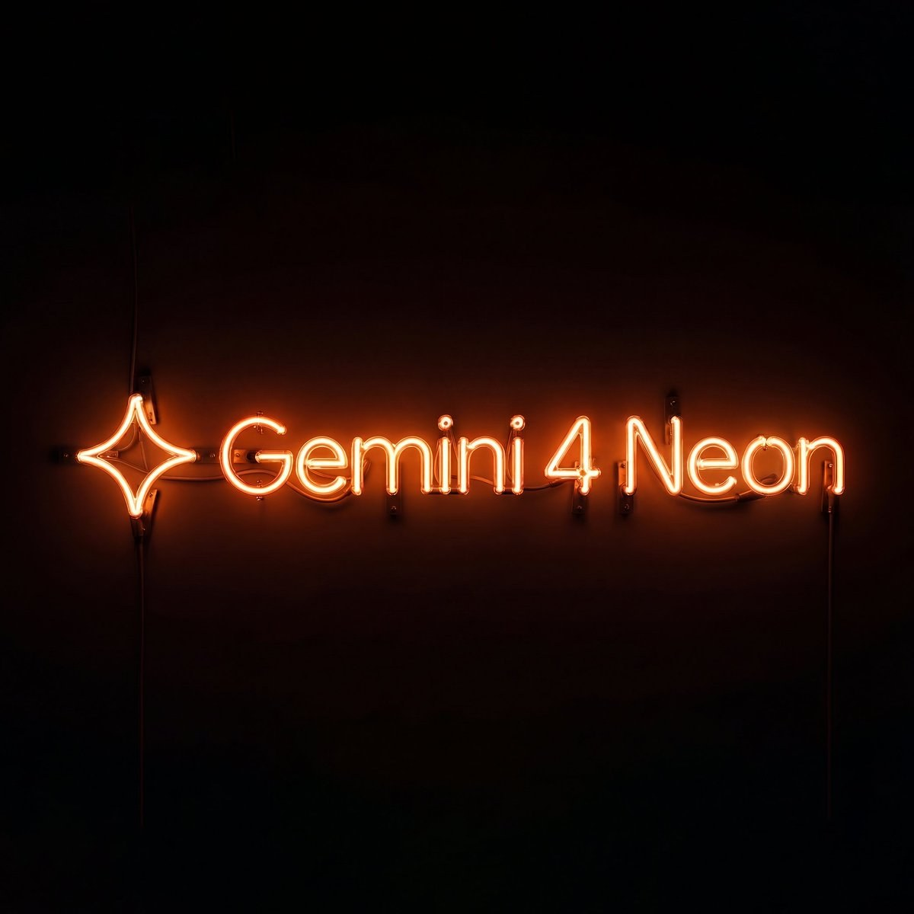
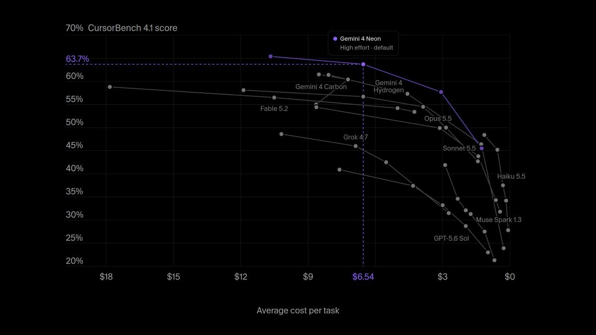
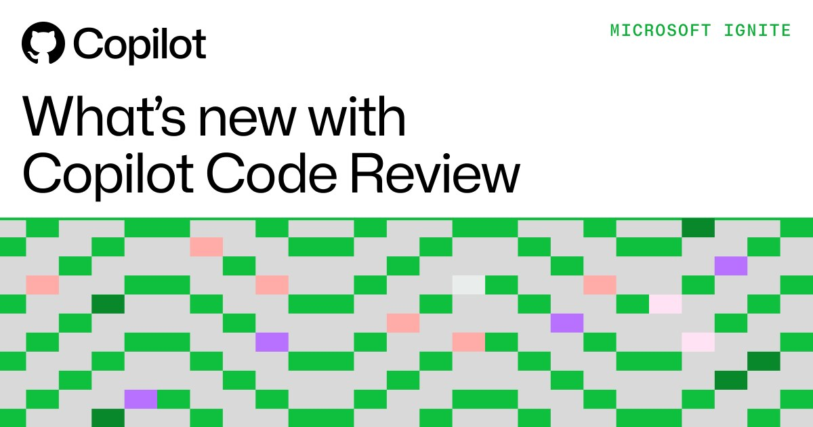
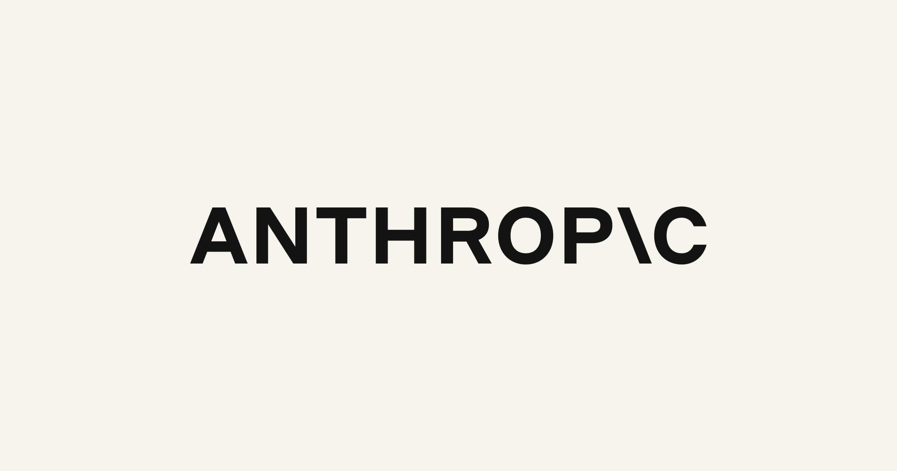
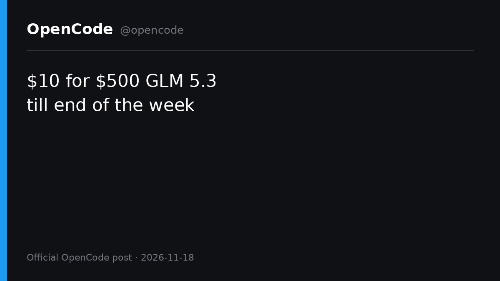
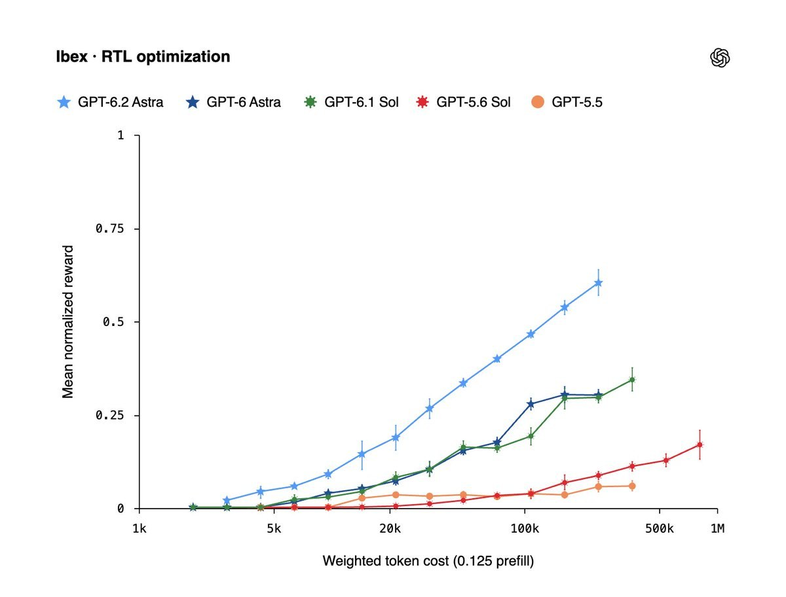
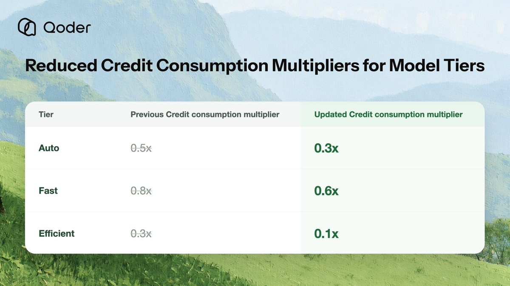

# AI Twitter/X Hots Digest · 2026-11-19 (Thursday)

## Today's highlights

1. **Gemini 4 Neon is generally available**: Google places it between Carbon and Hydrogen, for complex coding, knowledge work, and science workflows. Officially, it scores **61** and ranks #3 overall on the Artificial Analysis Intelligence Index at xhigh; API pricing is $3 per million input tokens and $15 per million output tokens, with cached input at $0.15. It is rolling out in the Gemini API, AI Studio, the Gemini app for Pro / Ultra, and Antigravity. Cursor, GitHub Copilot, and Vercel AI Gateway also added it in the same window.
2. **Anthropic priced its IPO**: the company officially set the price at **$83** per share and is offering 980 million Class A shares. Trading is expected to begin on the Nasdaq on November 19, New York time, under the ticker **ANT**. At the official share count and price, the offering is about $81.34 billion. Valuation figures in the press are not stated in the official news post.
3. **OpenCode raised the GLM 5.3 offer again**: officially, Go subscribers can get **$500** of usage for $10 through the end of the week. That follows the previous day's $100 and then $200 promotions; it is not a new model launch. In the same window, the official account also said a large share of the day's tokens ran on their own GPUs.

---

## 1. Gemini 4 Neon launches between Carbon and Hydrogen, scoring 61 at xhigh on the AA Intelligence Index

**The point**: The official Google account announced Gemini 4 Neon as a model that brings frontier-level intelligence with faster end-to-end task completion, aimed at complex coding, knowledge work, and science workflows. The official blog, dated 2026-11-18 and signed by Google DeepMind's Koray Kavukcuoglu, says Neon scores **61** and ranks #3 overall on the Artificial Analysis Intelligence Index at its xhigh thinking level, ahead of comparable models, and ranks #2 on the Vals Index. API pricing is $3 per million input tokens ($0.15 per million cached input tokens, officially a 95% discount) and $15 per million output tokens, with a 1 million-token context window and four thinking levels. It is rolling out in the Gemini API (paid Google AI Studio), Gemini for business, the Gemini app for Pro / Ultra subscribers, and Antigravity. Artificial Analysis called this Google's fourth model in seven weeks, and said Neon (xhigh) shows a small Intelligence gain over Carbon at about 17% lower cost per task. Google itself says that at the default high thinking level, cost per task is 32% lower than Carbon. Vercel said `google/gemini-4-neon` is live on AI Gateway.

**Why it matters**: this is the most complete model launch in the window, and it fills the middle tier of the Gemini 4 family. The eval numbers come from the official blog and from Artificial Analysis, and the framings are not identical (xhigh vs default high, 17% vs 32%). Read them separately, and do not treat "close to Carbon, cheaper" as a claim that Neon beats Carbon overall.

- Google: announces Gemini 4 Neon, #3 on the AA Intelligence Index at xhigh and #2 on the Vals Index: https://x.com/Google/status/2123172282574987698
- Google: adds steerability, multi-step instruction following, and the lowest fabrication rate yet in internal Antigravity tests: https://x.com/Google/status/2123172285188014398
- googledevs: introduces Neon for developers: https://x.com/googledevs/status/2123176874818084938
- GoogleCloudTech: the cloud-side announcement, including default-high cost performance: https://x.com/GoogleCloudTech/status/2123171852344270875
- Artificial Analysis: fourth model in seven weeks, a small gain over Carbon at about 17% lower cost per task: https://x.com/ArtificialAnlys/status/2123170645777526962
- vercel_dev: Gemini 4 Neon is live on AI Gateway: https://x.com/vercel_dev/status/2123178093473038673

---

## 2. Antigravity ships Neon, and Orchestrator can pair Neon planning with Hydrogen execution in one session

**The point**: The Antigravity team blog says Gemini 4 Neon is rolling out today to paid Google AI Pro / Ultra users in the desktop app, CLI, and IDE extensions. Officially, it sits between Carbon (the hardest, longest-horizon work) and Hydrogen (fast everyday execution). The new piece is that Orchestrator can now use Neon in the same session for planning, architecture, and harder reasoning, while handing routine edits, dependency updates, and test runs to Hydrogen, and handing back to Neon if Hydrogen gets stuck. Sundar Pichai posted a demo of a photorealistic lab scene built in Antigravity via Blender MCP; the official blog also describes Neon driving Blender MCP and using `/swarm` on complex scenes. Artificial Analysis reports that on Antigravity CLI, Neon (xhigh) scores 59 on the Coding Agent Index, 3 points ahead of Carbon (high, 55), and in line with Claude Code + Fable 5.2 (xhigh, 58) and Claude Opus 5.5 (max, 58), at a lower cost per task. The official blog says Neon ranks #1 overall on that index, at 58.6.

**Why it matters**: for people already in Antigravity, this is a new default mid-tier they can switch to, and the first time Orchestrator ties Neon and Hydrogen together. The coding-index figures come from two sources; 59 and 58.6 are close, but not the same number.

- Sundar Pichai: shows Neon modeling in Antigravity through Blender MCP: https://x.com/sundarpichai/status/2123184309137965524
- Artificial Analysis: Coding Agent Index comparison on Antigravity CLI: https://x.com/ArtificialAnlys/status/2123170648772288540

---

## 3. Cursor adds Gemini 4 Neon and says it scores 63.7% on CursorBench 4.1 at default effort

**The point**: The official Cursor account said Gemini 4 Neon is now available in Cursor. Officially, at default effort it scores **63.7%** on CursorBench 4.1, up from 57.3% for Gemini 4 Hydrogen, which Cursor calls a new cost-performance frontier. Pricing matches the Google API: $3 per million input tokens and $15 per million output tokens. Those figures are Cursor's own eval, not a third-party league table.

**Why it matters**: besides the model launch itself, this is the clearest IDE-side hookup and number in the window. Treat 63.7% as Cursor's official comparison with Hydrogen, not a general ranking across all models.

- cursor_ai: announces Neon in Cursor, 63.7% on CursorBench 4.1 at default effort: https://x.com/cursor_ai/status/2123198346802450926
- cursor_ai: a follow-up "learn more" post: https://x.com/cursor_ai/status/2123198359309853169

---

## 4. GitHub Copilot: Gemini 4 Neon is generally available, code review gets Ignite upgrades, and MCP connectors enter public preview

**The point**: GitHub officially said Gemini 4 Neon is generally available in GitHub Copilot, aimed at agentic coding, multi-step tool use, and knowledge work, and it repeated Google's line that quality is close to Carbon at a lower token cost per task and with faster responses. In the same window, GitHub also announced Copilot code review upgrades at Ignite: Adaptive review depth (Lite vs Max depending on the pull request), cross-repository context for public repos, secret detection in reviews, and tracking of review outcomes in repository Insights, which GitHub says is now generally available. Near the end of the window, GitHub announced that GitHub-verified MCP servers, or connectors, are rolling out in public preview: pick a service, sign in, and use it in the Copilot app, Copilot CLI, VS Code, and more. The MCP post landed late and did not attract much discussion yet, but it is an official product update.

**Why it matters**: Copilot added a new model, strengthened review, and started lowering the setup cost of MCP in a single day. All three come from the official GitHub account and should be read as separate updates, not one combined launch.

- github: Gemini 4 Neon is generally available in Copilot: https://x.com/github/status/2123181574116233646
- github: Copilot code review upgrades announced at Ignite: https://x.com/github/status/2123093114676265290
- github: GitHub-verified MCP connectors enter public preview: https://x.com/github/status/2123217310752342095

---

## 5. Anthropic prices its IPO at $83 a share, with ANT expected to start trading on November 19

**The point**: Anthropic's official account and newsroom post said the IPO of its Class A common stock is priced at **$83.00** per share. The offering consists of 980 million shares, of which 956,351,354 are being sold by Anthropic and 23,648,646 by selling stockholders; Anthropic will not receive proceeds from the selling stockholders' shares. The shares are expected to begin trading on the Nasdaq Global Select Market on November 19, 2026 under the symbol **ANT**, and the offering is expected to close on November 20. Underwriters also have a 30-day option to buy up to an additional 147 million shares. At the official share count and price, the offering is about $81.34 billion. Reuters and other outlets called it one of the largest IPOs on record and reported a fully diluted valuation of about $1.5 trillion; that valuation is not stated in the official news post. Earlier days already had filing and valuation talk; what landed today is the official price.

**Why it matters**: for anyone following Claude and Anthropic, this is the shift from "preparing to list" to a set price and ticker. Do not treat press market-cap figures as official. As of this digest (the morning of November 19, Shanghai time), U.S. markets have not opened yet, so this should not be written as if trading has already started.

- AnthropicAI: announces the $83 IPO price, with Nasdaq trading expected on November 19: https://x.com/AnthropicAI/status/2123196808675405860

---

## 6. OpenCode: $500 of GLM 5.3 for $10 through the end of the week, with a sizable share of tokens on its own GPUs

**The point**: The official OpenCode account said Go subscribers can get **$500** of GLM 5.3 usage for $10 through the end of the week. That is another increase after the $100 and later $200 offers already recorded in the November 18 digest, not a GLM 5.5 or new-model launch. Co-founder thdxr also wrote that their inference stack did 41T tokens the previous day, and that they will be the first to run a quadrillion tokens a month of open-weight models. Near the end of the window, the official account posted two own-GPU updates minutes apart; the later one said 44% of the day's tokens, 16T in total, ran on their own GPUs, with 10× the hardware coming online in the next few months. The same afternoon, OpenCode also said Hy4 flash had become an unexpected hit and would stay exclusively free on OpenCode for the next 10 days — a continuation of an existing promotion, not a new model.

**Why it matters**: for people already running GLM through OpenCode, the $500 allowance is the most direct promotional change in the window; the own-GPU figures help explain why they are willing to push the offer this far. The 41T, 16T, and 44% figures are official or founder claims, and the GPU share was revised once in a short span, so the later post should be treated as the current official number.

- opencode: $500 of GLM 5.3 for $10 through the end of the week: https://x.com/opencode/status/2122969474571583885
- thdxr: says yesterday's inference volume was 41T tokens: https://x.com/thdxr/status/2123059328299188353
- opencode: the later own-GPU update, 44% / 16T: https://x.com/opencode/status/2123214984389771684
- opencode: Hy4 flash stays free for 10 more days: https://x.com/opencode/status/2123106127030210786

---

## 7. poteto publishes a long guide to automating with Grok Bot, while the official account adds flight, hotel, and car-rental booking

**The point**: xAI / Grok Bot's @poteto published a long article, *Automate Anything with Grok Bot*, on how to break a goal into a repeatable process and have Grok Bot run it. It was one of the most bookmarked posts in the window. He then announced a new Dr Eggbot v2 bot template, with new skills for automating work and life, and noted that it is different from the old template, so people should reinstall it and ask the old bot to transfer anything they want to keep. In the same window, the official Grok Bot account @bot said the bot can now book flights, hotels, and rental cars, and look for a good deal. That is an official product update, separate from poteto's methodology piece, but both were high-signal Grok Bot discussions in the window.

**Why it matters**: the article is one of the more complete public write-ups of how to automate with Grok Bot, and the booking announcement is a concrete official capability. Do not treat poteto's personal methods as an official feature list; flights, hotels, and rental cars should be attributed to the @bot announcement.

- poteto: the long article *Automate Anything with Grok Bot*: https://x.com/poteto/status/2123159537016533493
- poteto: announces the Dr Eggbot v2 template: https://x.com/poteto/status/2123159763626430464
- bot: announces booking for flights, hotels, and rental cars: https://x.com/bot/status/2123121401762918718

---

## 8. OpenAI: models helped find up to 14% PPA on flagship AMD GPU IP, and were also used on its Jalapeño inference chip

**The point**: OpenAI officially said that, working with AMD, its models identified up to 14% PPA (performance / power / area) improvement on flagship GPU IP in less than five months, building on designs AMD's engineers had already spent years optimizing. The same approach, it said, also helped improve Jalapeño, OpenAI's first custom inference chip, with the gains verified. This is an official research and engineering update, not a coding-tool release, and not an independent eval.

**Why it matters**: model companies rarely post chip-design gains this directly in the window. The 14% figure is OpenAI's official claim, and it applies to the AMD flagship GPU IP in that collaboration and to Jalapeño, not to EDA work in general.

- OpenAI: announces the AMD collaboration and Jalapeño progress: https://x.com/OpenAI/status/2123100386638877054

---

## 9. Qoder cuts Credit multipliers: officially, credits per task fall about 41%, and time per turn about 27%

**The point**: The official Qoder account said Credit multipliers just dropped for Auto, Fast, and Efficient, attributing it to smarter routing, better cache reuse, and leaner agent runs, with the same output quality, live now across the Qoder product family. The official numbers are: credits per task fell from 4.43 to 2.6, down about 41.3%, so the same credits now cover about 1.7× as many tasks; time per task turn fell from 118 seconds to 86 seconds, down about 27.1%. Qoder also said the correction rate stays low, and that lower credit use only counts if tasks keep moving. In the same window, Qwen also said Qwen4-Max landed on more channels; that is follow-on distribution after the November 17 GA, not a new model launch.

**Why it matters**: official efficiency numbers with a clear before-and-after are uncommon among China-built IDEs. These figures are Qoder's own comparison, not a third-party eval.

- qoder_ai_ide: announces lower Credit multipliers, so the same credits cover more tasks: https://x.com/qoder_ai_ide/status/2122899533877346720
- qoder_ai_ide: credits per task fell from 4.43 to 2.6: https://x.com/qoder_ai_ide/status/2122899538105282716
- qoder_ai_ide: time per turn fell from 118 seconds to 86 seconds: https://x.com/qoder_ai_ide/status/2122899544488952071

