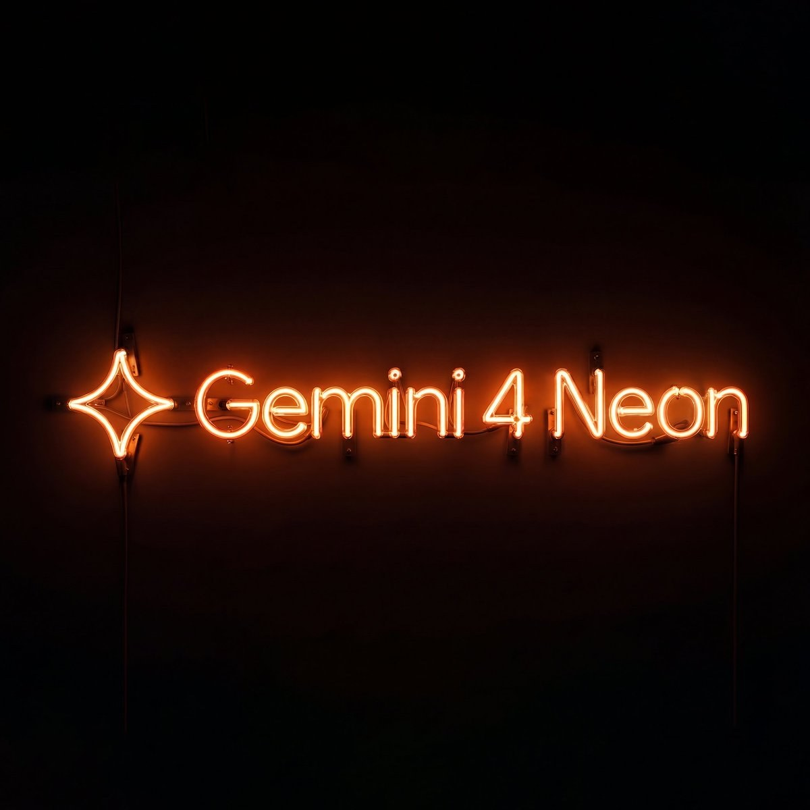
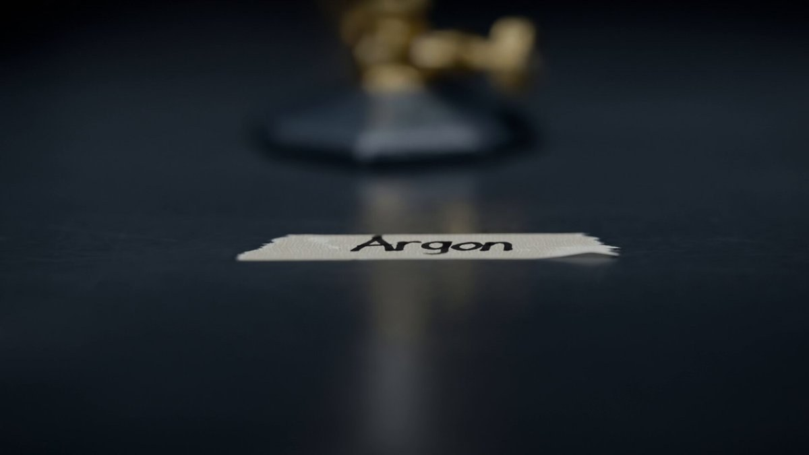
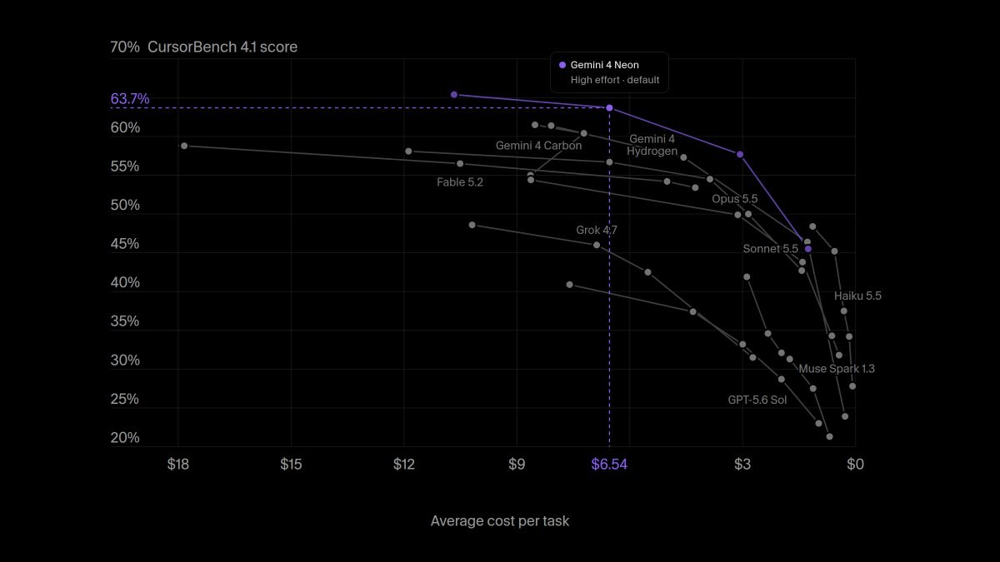
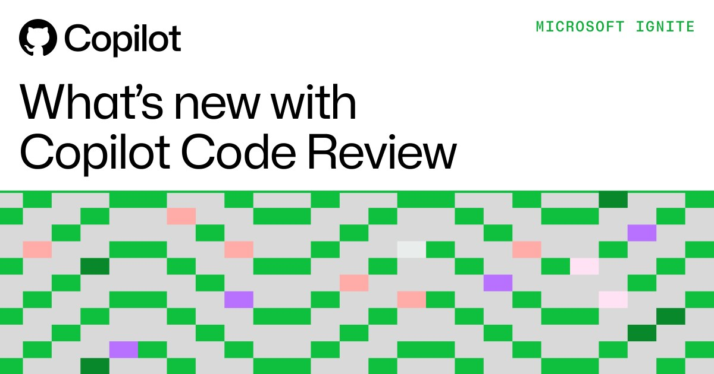
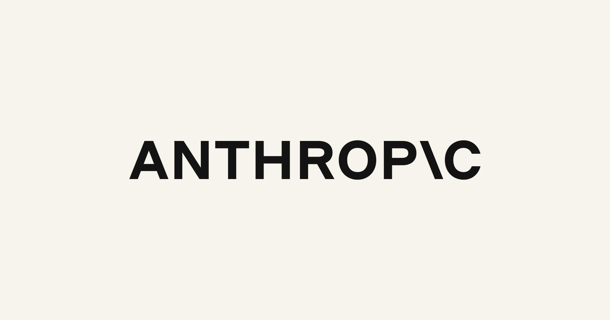
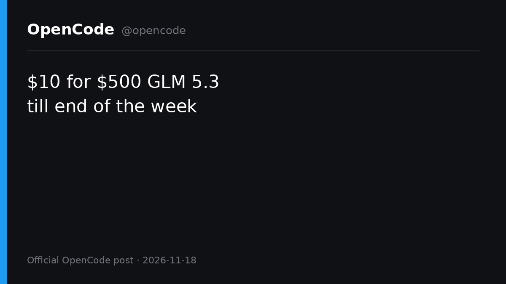
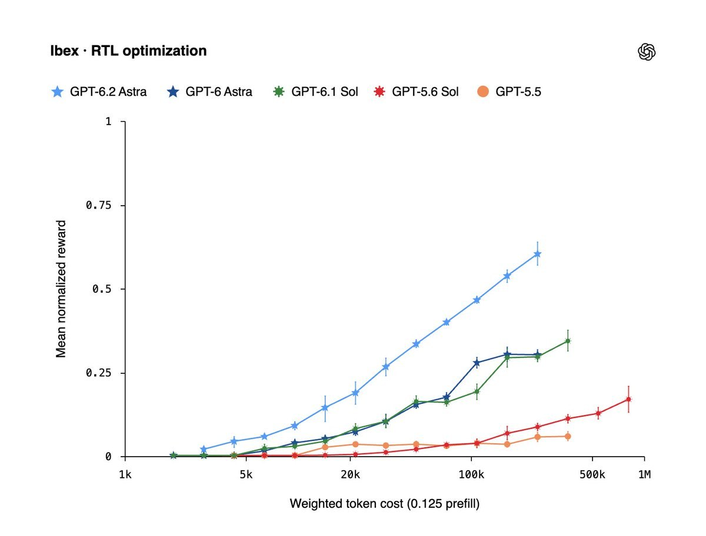
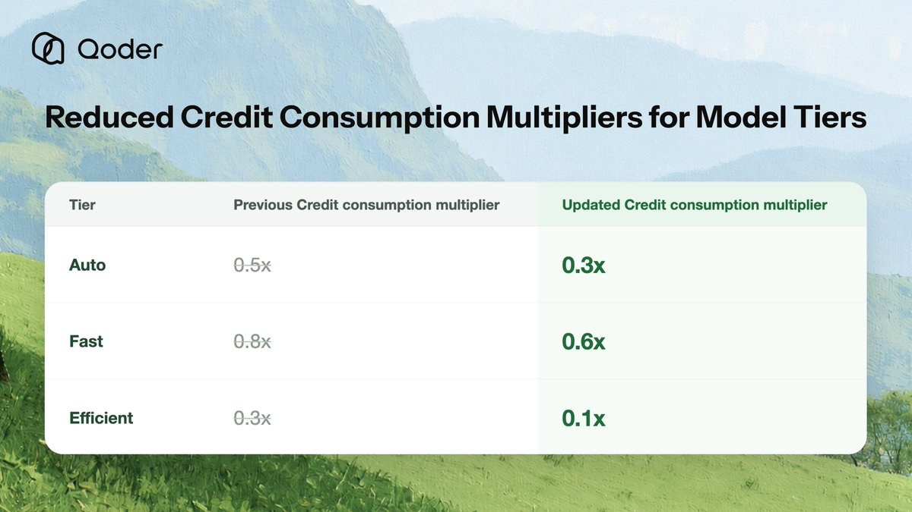

# AI Twitter/X 热点 Digest · 2026-11-19（周四）

## 今日要点

1. **Gemini 4 Neon 正式发布**：Google 把它放在 Carbon 与 Hydrogen 中间，面向复杂编程、知识工作与科学流程。官方称在 Artificial Analysis Intelligence Index 的 xhigh 档得到 61 分、总榜第 3；API 定价为输入 $3 / 百万 token、输出 $15 / 百万 token，缓存输入 $0.15；已进入 Gemini API、AI Studio、Gemini 应用（Pro / Ultra）和 Antigravity。Cursor、GitHub Copilot 与 Vercel AI Gateway 也在同一窗口接入。
2. **Anthropic 给 IPO 定价**：官方宣布每股 83 美元，发行 9.80 亿股 A 类普通股，预计 11 月 19 日（纽约时间）以代码 ANT 在纳斯达克开始交易。按官方股数与定价，发行规模约 813.4 亿美元。估值口径以媒体报道为主，官网新闻稿未写市值。
3. **OpenCode 再加码 GLM 5.3**：官方宣布本周末前 Go 订阅可以用 10 美元换 500 美元用量。这是对前一日 100 美元、后来加到 200 美元活动的又一轮加码，不是新模型发布。同一窗口官方还谈到自建 GPU 已承担当天很大一部分 token。

---

## 1. Gemini 4 Neon 发布：定位在 Carbon 与 Hydrogen 之间，AA 指数 xhigh 拿下 61 分

**要点**：Google 官方账号宣布 Gemini 4 Neon，定位为「前沿级能力、更快完成端到端任务」，覆盖复杂编程、知识工作与科学流程。官方博客由 Google DeepMind 的 Koray Kavukcuoglu 署名，日期为 2026-11-18。官方称：在 Artificial Analysis Intelligence Index 的 xhigh 思考档，Neon 得到 61 分、总榜第 3，并排在可比模型前面；Vals Index 第 2。API 定价为每百万 token 输入 3 美元（缓存输入 0.15 美元，官方称 95% 折扣）、输出 15 美元，上下文 100 万 token，提供四档 thinking。入口包括 Gemini API（Google AI Studio 付费档）、Gemini for business、面向 Pro / Ultra 订阅者的 Gemini 应用，以及 Antigravity。Artificial Analysis 说这是 Google 七周内的第四个模型，Neon（xhigh）相对 Carbon 有小幅 Intelligence 提升，同时 Cost per Task 约低 17%。官方则写，在默认 high 思考档，每任务成本比 Carbon 低 32%。Vercel 宣布 AI Gateway 已提供 `google/gemini-4-neon`。

**为何值得看**：这是窗口里最完整的一次模型发布，也把 Gemini 4 家族的中间档补齐了。评估数字分别来自官方博客和 Artificial Analysis，口径不完全相同（xhigh 与默认 high，17% 与 32%），需要分开读，不能把「接近 Carbon、更便宜」理解成全面超过 Carbon。

- Google：宣布 Gemini 4 Neon，AA Intelligence Index xhigh 第 3、Vals Index 第 2：https://x.com/Google/status/2123172282574987698
- Google：补充可操控性、多步指令跟随，以及 Antigravity 内部测试中最低的虚构率：https://x.com/Google/status/2123172285188014398
- googledevs：面向开发者介绍 Neon：https://x.com/googledevs/status/2123176874818084938
- GoogleCloudTech：云侧介绍，并提到默认 high 档的成本表现：https://x.com/GoogleCloudTech/status/2123171852344270875
- Artificial Analysis：七周内第四个模型，相对 Carbon 小幅提升、Cost per Task 约低 17%：https://x.com/ArtificialAnlys/status/2123170645777526962
- vercel_dev：Gemini 4 Neon 登陆 AI Gateway：https://x.com/vercel_dev/status/2123178093473038673

---

## 2. Antigravity 上线 Neon，Orchestrator 可把 Neon 规划与 Hydrogen 执行配在同一会话

**要点**：Antigravity 团队博客写明，当天起向付费的 Google AI Pro / Ultra 用户，在桌面应用、CLI 和 IDE 扩展中推出 Gemini 4 Neon。官方强调它处在 Carbon（最长周期、最难任务）和 Hydrogen（日常快速执行）之间。新的一点是 Orchestrator 现在支持在同一会话里用 Neon 做规划、架构和复杂推理，把常规改代码、依赖更新和跑测试交给 Hydrogen；Hydrogen 卡住时再交回 Neon。Sundar Pichai 发了一段在 Antigravity 里通过 Blender MCP 做实验室三维场景的演示，官方博客也写了 Neon 驱动 Blender MCP、用 `/swarm` 做复杂场景的例子。Artificial Analysis 给出：在 Antigravity CLI 上，Neon（xhigh）的 Coding Agent Index 为 59，比 Carbon（high，55）高 3 分，与 Claude Code + Fable 5.2（xhigh，58）以及 Claude Opus 5.5（max，58）接近，但 Cost per Task 更低。官方博客则写 Neon 在该指数上总榜第 1（58.6）。

**为何值得看**：对已经在用 Antigravity 的人，这是可直接切换的新默认档，也是 Orchestrator 第一次把 Neon 和 Hydrogen 绑在一起。编码榜数字来自官方与 Artificial Analysis 两个口径，59 与 58.6 接近但不完全相同。

- Sundar Pichai：展示 Neon 在 Antigravity 中通过 Blender MCP 建模：https://x.com/sundarpichai/status/2123184309137965524
- Artificial Analysis：Antigravity CLI 上的 Coding Agent Index 对比：https://x.com/ArtificialAnlys/status/2123170648772288540

---

## 3. Cursor 上线 Gemini 4 Neon，官方称 CursorBench 4.1 默认档达到 63.7%

**要点**：Cursor 官方宣布 Gemini 4 Neon 已在 Cursor 中可用。官方称，在默认 effort 下，它在 CursorBench 4.1 上得到 63.7%，高于 Gemini 4 Hydrogen 的 57.3%，并称之为新的 cost-performance frontier。定价与 Google API 一致：输入 $3 / 百万 token，输出 $15 / 百万 token。这是 Cursor 的官方评测口径，不是第三方通排。

**为何值得看**：窗口里除了模型本身，IDE 侧最明确的接入与数字来自 Cursor。把 63.7% 理解成「比 Hydrogen 更划算的官方内部榜」，不要外推成对所有模型的通排。

- cursor_ai：宣布 Neon 上线，CursorBench 4.1 默认档 63.7%：https://x.com/cursor_ai/status/2123198346802450926
- cursor_ai：了解更多：https://x.com/cursor_ai/status/2123198359309853169

---

## 4. GitHub Copilot：Gemini 4 Neon 正式可用，代码审查升级，MCP connectors 进入公开预览

**要点**：GitHub 官方宣布 Gemini 4 Neon 已在 GitHub Copilot 正式可用，面向 agentic coding、多步工具调用和知识工作，并转述 Google「质量接近 Carbon、单任务 token 成本更低、响应更快」的说法。同一窗口，GitHub 还在 Ignite 上宣布 Copilot code review 的一组升级：Adaptive 审查深度（按 PR 风险在 Lite 与 Max 之间选择）、公开仓库的跨仓库上下文、审查中的 secret 检测，以及仓库 Insights 里对审查结果的跟踪，并称 Repo Insights 已正式可用。临近窗口结束时，GitHub 又宣布 GitHub-verified MCP servers（connectors）进入公开预览：选好服务并登录后，可在 Copilot 应用、Copilot CLI 和 VS Code 等处使用。MCP 这条帖发出较晚，讨论还不多，但是官方产品更新。

**为何值得看**：Copilot 在同一天同时接入新模型、加强审查，并开始用官方 connectors 降低 MCP 接入成本。三件事都来自 GitHub 官方账号，应分开理解，不要把 Ignite 审查升级和深夜的 MCP 预览当成同一项发布。

- github：Gemini 4 Neon 在 Copilot 正式可用：https://x.com/github/status/2123181574116233646
- github：Copilot code review 在 Ignite 上的升级：https://x.com/github/status/2123093114676265290
- github：GitHub-verified MCP connectors 进入公开预览：https://x.com/github/status/2123217310752342095

---

## 5. Anthropic 给 IPO 定价每股 83 美元，预计 11 月 19 日以代码 ANT 开盘

**要点**：Anthropic 官方账号与官网新闻稿宣布，A 类普通股 IPO 定价为每股 83.00 美元。发行规模为 9.80 亿股，其中 9.56351354 亿股由公司出售，2364.8646 万股由部分股东出售；公司不会获得股东出售部分的所得。股票预计于 2026 年 11 月 19 日在纳斯达克全球精选市场以代码 ANT 开始交易，交割日预计为 11 月 20 日。另授予承销商 30 天内最多再购 1.47 亿股的选择权。按官方股数与定价计算，发行规模约 813.4 亿美元。路透社等媒体称这是有记录以来最大的 IPO 之一，并报道完全稀释估值约 1.5 万亿美元；后一项不是官网新闻稿里的数字。此前几天已有招股与估值传闻，今天落地的是正式定价。

**为何值得看**：对关注 Claude 与 Anthropic 的人，这是从「准备上市」变成「价格和代码都已确定」。媒体市值口径不要直接写成官方数字。截至这篇摘要发布时（上海时间 11 月 19 日上午），纽约市场尚未开盘，不能写成已经开始交易。

- AnthropicAI：宣布 IPO 定价 83 美元，预计 11 月 19 日在纳斯达克开盘：https://x.com/AnthropicAI/status/2123196808675405860

---

## 6. OpenCode：本周末前 10 美元换 500 美元 GLM 5.3，自建 GPU 已承担可观流量

**要点**：OpenCode 官方宣布，本周末前 Go 订阅可以用 10 美元换 500 美元的 GLM 5.3 用量。这是对 11 月 18 日摘要里已记录的 100 美元、后来加到 200 美元活动的又一次加码，不是 GLM 5.5 或新模型发布。联合创始人 thdxr 还写道，他们的推理层前一天跑了 41T token，并称会成为第一个每月跑到 1000 万亿（a quadrillion）开源权重模型 token 的团队。临近窗口结束，官方账号几分钟内连发两条自建 GPU 进展：较新的一条称当天 44% 的 token（共 16T）跑在自建 GPU 上，并说未来几个月还会有 10 倍硬件上线。同一天下午，官方还说 Hy4 flash「成了意外的热门」，并继续在 OpenCode 上免费 10 天——这是既有免费活动的延续，不是新模型。

**为何值得看**：对正在用 OpenCode 跑 GLM 的人，500 美元额度是窗口里最直接的促销变化；自建 GPU 的数字则解释了他们为什么敢把活动加到这个量级。41T、16T、44% 都是官方或创始人口径，而且 GPU 占比在短时间内改过一次，应以较新那条为准。

- opencode：本周末前 10 美元换 500 美元 GLM 5.3：https://x.com/opencode/status/2122969474571583885
- thdxr：称前一天推理量为 41T token：https://x.com/thdxr/status/2123059328299188353
- opencode：较新的自建 GPU 更新，44% / 16T：https://x.com/opencode/status/2123214984389771684
- opencode：Hy4 flash 继续免费 10 天：https://x.com/opencode/status/2123106127030210786

---

## 7. poteto 写长文讲怎么用 Grok Bot 做自动化，官方同时宣布可订机票、酒店和租车

**要点**：xAI / Grok Bot 的 @poteto 发表长文 *Automate Anything with Grok Bot*，讨论如何把目标拆成可重复的流程，并用 Grok Bot 去做。这是窗口里收藏很高的一篇方法论文。他随后宣布新的 Dr Eggbot v2 模板，带有新的工作与生活自动化 skill，并提醒与旧模板不同，需要重新安装，再请旧 bot 迁移要保留的内容。同一窗口，Grok Bot 官方账号 @bot 宣布现在可以代订机票、酒店和租车，并帮忙找价格。这是官方产品能力更新，和 poteto 的方法论长文不是同一件事，但都属于 Grok Bot 在窗口里的高信号讨论。

**为何值得看**：长文是目前较完整的一份 Grok Bot 自动化思路，官方订票能力则是可验证的产品更新。不要把 poteto 的个人方法写成官方功能清单；订票、酒店和租车以 @bot 公告为准。

- poteto：长文 *Automate Anything with Grok Bot*：https://x.com/poteto/status/2123159537016533493
- poteto：发布 Dr Eggbot v2 模板：https://x.com/poteto/status/2123159763626430464
- bot：宣布可预订机票、酒店和租车：https://x.com/bot/status/2123121401762918718

---

## 8. OpenAI：模型协助 AMD 旗舰 GPU IP 最高提升 14% PPA，并用于改进自研推理芯片 Jalapeño

**要点**：OpenAI 官方发文称，与 AMD 合作，其模型在不到五个月里为旗舰 GPU IP 找到最高 14% 的 PPA（性能 / 功耗 / 面积）改进，而且是在 AMD 工程师已经多年优化过的设计之上。同一方法也被用于改进 OpenAI 的第一款自研推理芯片 Jalapeño，并称收益已得到验证。这是官方研究与工程进展，不是编程工具发版，也不是独立评测。

**为何值得看**：窗口里少见模型公司直接谈芯片设计收益。14% 是 OpenAI 官方口径，适用范围是与 AMD 合作的旗舰 GPU IP，以及他们自己的 Jalapeño，不能外推成通用 EDA 成绩。

- OpenAI：宣布与 AMD 合作及 Jalapeño 的进展：https://x.com/OpenAI/status/2123100386638877054

---

## 9. Qoder 下调 Credit 倍率：官方称每任务 Credit 降约 41%，单轮耗时降约 27%

**要点**：Qoder 官方宣布，Auto、Fast 和 Efficient 的 Credit 倍率下调，并称来自更聪明的路由、更好的缓存复用和更瘦的 Agent 运行，输出质量不变，已在 Qoder 产品家族上线。官方给出的数字是：每任务 Credit 从 4.43 降到 2.6，约降 41.3%，同样的 Credit 大约能覆盖 1.7 倍任务；单轮耗时从 118 秒降到 86 秒，约降 27.1%。官方同时说纠错率仍然低，并强调只有任务仍在推进时，更低的 Credit 消耗才算数。同窗口通义还提到 Qwen4-Max 登陆更多渠道，那是 11 月 17 日正式发布后的分发续报，不应当成新模型发布。

**为何值得看**：这是国内 IDE 里少见的、带着明确 Credit 与耗时数字的官方效率更新。数字是 Qoder 自己的前后对比，不是第三方评测。

- qoder_ai_ide：宣布 Credit 倍率下调，同样 Credit 可做更多任务：https://x.com/qoder_ai_ide/status/2122899533877346720
- qoder_ai_ide：每任务 Credit 从 4.43 降到 2.6：https://x.com/qoder_ai_ide/status/2122899538105282716
- qoder_ai_ide：单轮耗时从 118 秒降到 86 秒：https://x.com/qoder_ai_ide/status/2122899544488952071

