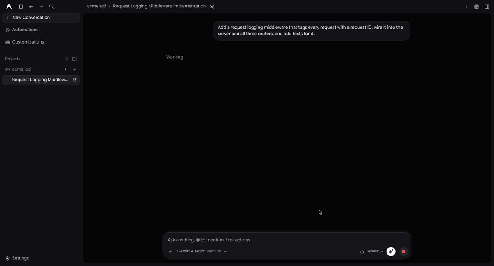
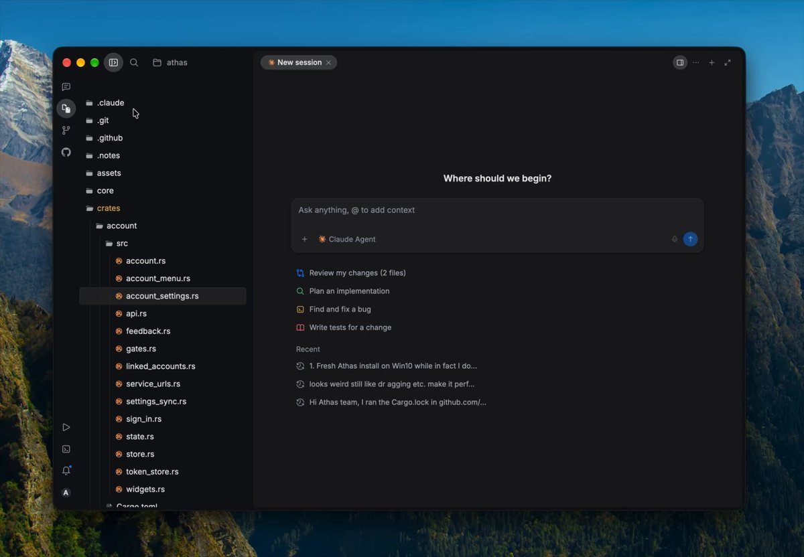

Several of today’s changes sit outside the model. How do you explore a side question while the main task keeps running? What happens when a huge tool result slows the next turn? Why can the same model feel different in another agent? This issue starts there.

## Today’s highlights

- **Antigravity**: The new `/btw` lets a side question become a thread, then lets you promote it if it proves useful.

- **Codex**: The WebSocket request limit rises from 16 MB to 128 MB, reducing HTTP fallback on large turns.

- **Gemini 4 Neon**: Antigravity says it is expanding its cache pool to improve the amount of work customers can do within quota.

## 1. Antigravity makes /btw a branch you can promote

Antigravity showed a new version of `/btw`. Previously it was a way to ask a quick question while the main agent worked. Now a side thread can keep going, and a useful branch can be promoted without losing the original task.

**Why it matters**: The useful test is a migration with an uncertain alternative. Keep the main work running, try the alternative on a branch, then promote it only if it helps. Check what context the branch inherits, what promotion carries over, and whether the two threads can be canceled independently.

**Sources**: [Antigravity](https://x.com/antigravity/status/2123921833883840650)

## 2. Codex raises its WebSocket request ceiling from 16 MB to 128 MB

Charlie Marsh said Codex sends model requests incrementally over a WebSocket and raised the size limit from 16 MB to 128 MB. Fewer large turns should fall back to HTTP; he reported roughly a fivefold speedup on the path that still exceeds the limit. This is a transport ceiling and an overflow-path figure, not a model context limit or a fivefold gain on normal turns.

**Why it matters**: For an agent team, two useful metrics are the WebSocket fallback rate on large turns and P95 time from upload start to model generation. Tool-heavy turns may be slow because of transport and retries, even when model speed has not changed.

**Sources**: [Charlie Marsh](https://x.com/charliermarsh/status/2123849871480463669)

## 3. Neon’s quota story goes beyond the model

Neon had already launched. The fresh detail is how much work fits in a quota. Antigravity’s Varun Mohan said a larger cache pool was expected to raise Neon cache hit rate by around 4% and allow at least 20% more work within quota. He said a reset would follow. Those are rollout estimates, not independent measurements or proof that the reset has happened. Theo was enthusiastic about the model itself, which is a different signal from quota behavior.

**Why it matters**: Long sessions and repeated prefixes can dominate real usage. Hold the repo, task, and effort level fixed, then measure completion, latency, and quota use separately on cold and warm sessions. Google’s benchmark cost per task and the subscription meter are not the same number.

**Sources**: [Varun Mohan](https://x.com/_mohansolo/status/2123848516581892181) · [Theo](https://x.com/theo/status/2123880652428988683) · [News from Google](https://x.com/NewsFromGoogle/status/2123959779894632746) · [Google Antigravity](https://antigravity.google/blog/gemini-4-neon-in-google-antigravity)

## 4. Linear brings issue context into Antigravity

Linear announced that Antigravity can bring in issues, projects, and their context for Gemini 4 Neon. The announcement confirms context access; it does not establish which actions the agent can perform on the issue tracker.

**Why it matters**: Try it on a bug whose acceptance criteria are scattered across comments. Does the agent find the right code and tests? Saving a copy-and-paste is useful; matching the eventual fix to each condition is more valuable.

**Sources**: [Linear](https://x.com/linear/status/2123828680527114634)

## 5. VS Code puts delegation and taking the keyboard in the same workflow

An Ignite demo announcement from VS Code described a Copilot workflow in which developers hand work to an agent, then review, edit, and debug in the same project context. It describes what the team planned to demonstrate, not a release announcement across every client.

**Why it matters**: To measure how well the handoff works, pick a task with a deliberately failing test. Count the steps from opening the session to finding the diff and resuming at the failure. Include that time in end-to-end agent latency rather than timing generation alone.

**Sources**: [Visual Studio Code](https://x.com/code/status/2123824915216293973)

## 6. OpenAI publishes adversarial-distillation research, with safeguards measured separately

OpenAI published research on detecting and disrupting coordinated adversarial distillation attempts and evaluating protection for private reasoning. The central distinction is that capability transfer does not guarantee safeguard transfer. Results refer to OpenAI’s own tests and threat models, not universal success rates.

**Why it matters**: When a team swaps a base model, distilled variant, or inference gateway, passing the same task benchmark is not a substitute for rerunning its safety checks. Measure capability, refusal behavior, and actual tool permissions separately so regressions can be localized.

**Sources**: [OpenAI on X](https://x.com/OpenAI/status/2123862344422088794) · [OpenAI report](https://openai.com/index/combatting-adversarial-distillation/)

## 7. In a large repo, one change need not start with understanding the entire system

Randy Lu shared Sean Goedecke’s discussion and recalled an internal guide for navigating the very large OneDrive repository. Sean’s original essay makes the point that partial understanding is often the practical limit in a large, changing system. The essay resurfaced today; it was not first published today.

**Why it matters**: For a coding agent, start by finding the change boundary and gathering evidence from neighboring interfaces, callers, and regression tests. Showing that a change preserves a local contract is more useful than loading the entire repo into context. Widen the search when the behavior crosses modules.

**Sources**: [Randy Lu](https://x.com/randyloop/status/2123970862185677264) · [Sean Goedecke](https://www.seangoedecke.com/in-defense-of-not-understanding-your-codebase/)

## 8. Athas moves to native Rust and GPUI, giving editor startup a comparison point

Athas said it rewrote its editor as a native Rust and GPUI application without a WebView or JavaScript runtime. The team reported 2.4× faster project opening and at least halving memory use versus its old implementation. The post does not specify the benchmark environment or compare extension ecosystems.

**Why it matters**: Use those figures to design a benchmark, not to choose a framework by themselves. Time window open, project tree visible, editor interactive, and agent index ready separately on cold and warm starts. That shows which wait actually disappeared.

**Sources**: [Athas](https://x.com/athasdev/status/2123882405320958289)

## 9. The same subscribed model can feel different in another harness

In a post about subscription spending, Fan Kai described a personal observation: GPT felt different in Pi Agent or Hermes than in Codex. Lee Robinson made a related product argument that products need to catch up with model capability. These are observations and opinions, not controlled comparisons.

**Why it matters**: A useful comparison would pin the repo, model, and effort level and use the same tests for acceptance. Then compare tool turns, repeated file reads, and cost per successful task. That makes it possible to distinguish model effects from scheduling, context, and tooling.

**Sources**: [范凯说 AI](https://x.com/fankaishuoai/status/2123976039147971048) · [Lee Robinson](https://x.com/leerob/status/2123845449413239273)

---

If you try one thing, pick a real task with a large tool result and a deliberate handoff. Time transport, model generation, tests, and human takeover separately. The total can stay flat while the bottleneck moves.
