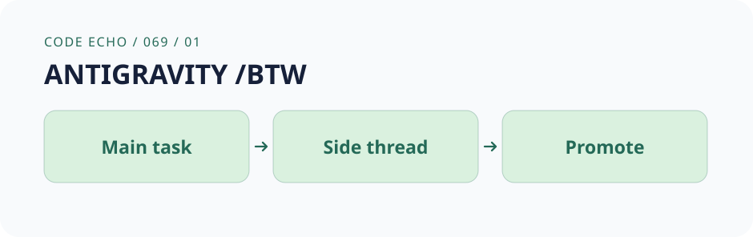
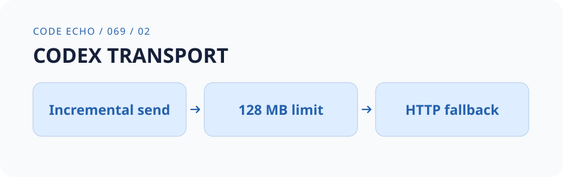
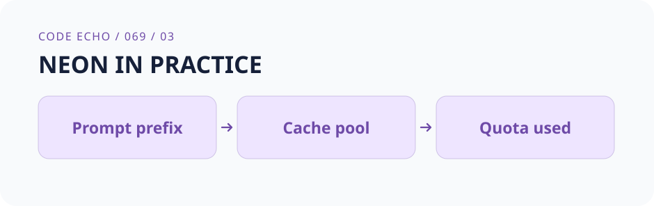
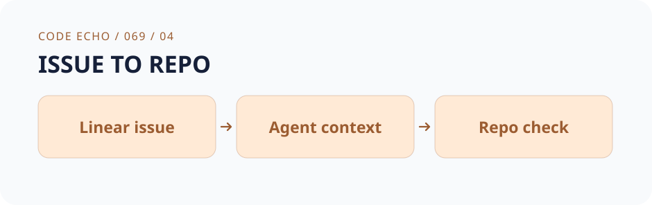
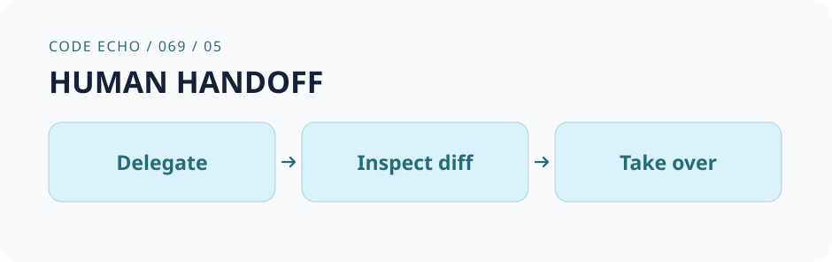
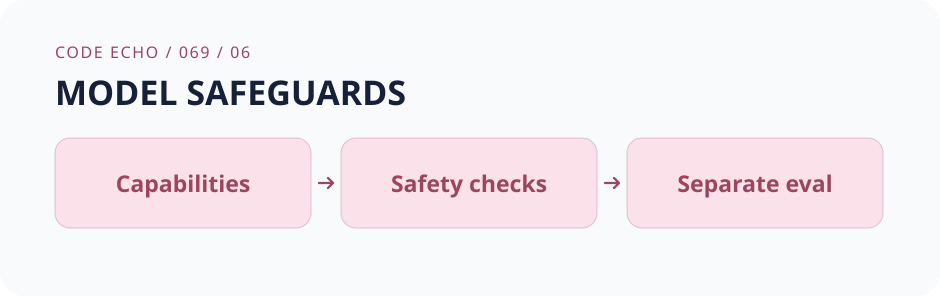
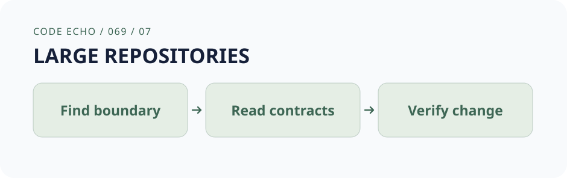
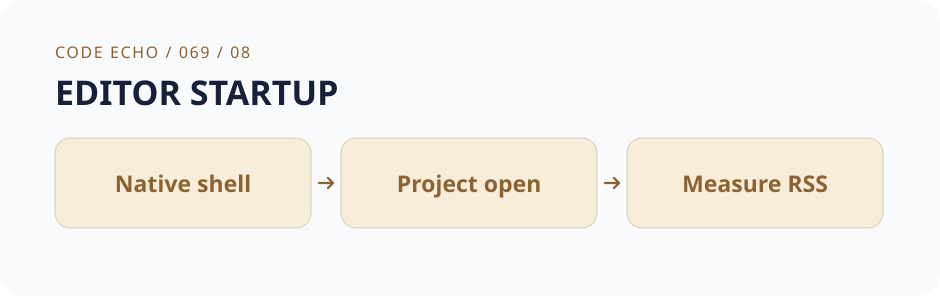
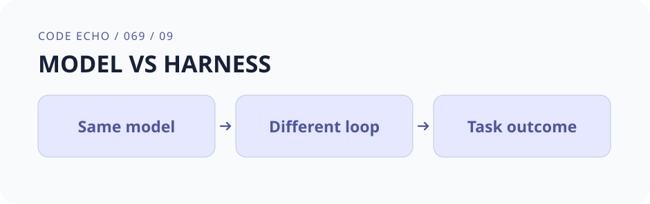

今天的几个变化都发生在模型外面：主任务跑着时，怎么展开一个旁支？长工具输出怎么不拖慢下一轮？同一个模型，换个 Agent 又为什么感觉不同？这期从这些具体问题讲起。

## 今日推荐

- **Antigravity**：新版 `/btw` 可以把临时的旁支问题继续做下去，并把有用的支线提升出来。

- **Codex**：WebSocket 请求上限从 16 MB 提至 128 MB，减少大轮次退回 HTTP。

- **Gemini 4 Neon**：Antigravity 团队说正在扩大缓存池，以改善同一额度下的实际工作量。

## 1. Antigravity 把 /btw 做成可提升的支线

Antigravity 官方演示了新版 `/btw`。旧用法是在主 Agent 忙时插问一句；新用法可以从当前任务分出一条支线，沿着支线继续探索，值得保留的方向再提升出来。主线继续留在原位，试错过程不用挤进正在执行的会话。

**为什么值得看**：这是比多开一个聊天窗更具体的设计：在处理迁移时，主线继续跑，支线去查一种替代方案，最后只在用户决定时合流。值得实测的是分支继承了哪些上下文，提升后带走哪些结论，以及两条线能否各自取消。

**原帖与资料**：[Antigravity](https://x.com/antigravity/status/2123921833883840650)

## 2. Codex 把 WebSocket 请求上限从 16 MB 提到 128 MB

Charlie Marsh 披露，Codex 用 WebSocket 增量发送模型请求，大小上限从 16 MB 提到 128 MB。大轮次不容易因为单次请求过大而退回 HTTP；即便仍超过上限，他称这一分支也快了约五倍。这里说的是传输大小和超限路径，不是 128 MB 的模型上下文，更不是每轮都能快五倍。

**为什么值得看**：对 Agent 团队，值得加一个指标：大轮次的 WebSocket 回退率，以及从开始上传到模型开始生成之间的 P95。大工具输出拖慢的可能是传输和重试，优化模型未必对症。

**原帖与资料**：[Charlie Marsh](https://x.com/charliermarsh/status/2123849871480463669)

## 3. Neon 的额度体验，问题出在模型之外

Neon 前几天已经发布，今天有新信息的是实际用量。Antigravity 的 Varun Mohan 说，团队在扩大缓存池，预期 Neon 的缓存命中率提高约 4%，同一额度下能做的工作至少多 20%，并说完成后会重置额度。这是他给出的预期，不是独立测量，也没有确认重置已经发生。另一边，Theo 对模型表现很积极，但主观体验和用量是两回事。

**为什么值得看**：同一模型的真实账单，常常被重复前缀和长会话拖着走。做对比时可以固定仓库、任务、思考档位，再分别记录冷启动和热缓存下的完成率、耗时、额度消耗。Google 公布的每任务成本基准和账号内的订阅额度，不适合合并成一个数。

**原帖与资料**：[Varun Mohan](https://x.com/_mohansolo/status/2123848516581892181) · [Theo](https://x.com/theo/status/2123880652428988683) · [News from Google](https://x.com/NewsFromGoogle/status/2123959779894632746) · [Google Antigravity](https://antigravity.google/blog/gemini-4-neon-in-google-antigravity)

## 4. Linear 进入 Antigravity，工单上下文离代码更近了

Linear 官方宣布可以在 Antigravity 里带入工单、项目和相关上下文，让 Gemini 4 Neon 从现有工作记录出发。公告确认的是上下文接入；它没有说明 Agent 能进行哪些写操作，不能据此认定它已经能替你关闭工单。

**为什么值得看**：试这个集成时，可以挑一张验收条件散在多条讨论里的 bug 单，检查 Agent 是否找对了对应代码和测试。对专业团队来说，少复制一遍工单是起点；真正省时间的是修复结果能逐条对上验收条件。

**原帖与资料**：[Linear](https://x.com/linear/status/2123828680527114634)

## 5. VS Code 把「交给 Agent」和「自己接手」放在同一条工作流

VS Code 团队在 Ignite 的演示预告里，把 Copilot 的交接讲得很清楚：分给 Agent 一部分工作，开发者可以在同一个项目上下文里回来审阅、编辑和调试。它是一场演示的描述，不必把它读成所有端都同步上线的新功能。

**为什么值得看**：接手是否顺滑，可以用一个故意留失败测试的任务量出来：回来后隔几步能看到 Agent 改了什么、失败在哪里，能不能直接在那个断点继续。把这段时间也加到 Agent 的端到端耗时里，比只测生成速度更接近实际。

**原帖与资料**：[Visual Studio Code](https://x.com/code/status/2123824915216293973)

## 6. OpenAI 公开对抗性蒸馏研究，重点是单独测防护

OpenAI 发布了一份对抗性蒸馏研究，介绍它如何识别和干预有组织的尝试，以及评估对受保护推理信息的防护。报告的核心区分是，能力迁移不代表原有防护也一并迁移。文中数字对应 OpenAI 自己的测试和威胁模型，不等同于通用成功率。

**为什么值得看**：如果一个团队换了底模、蒸馏版本或者推理网关，即使业务基准不掉分，原来的安全验收也应该重跑。把能力、拒绝边界和实际工具权限拆开测，能更快判断是模型变了，还是应用少做了一层控制。

**原帖与资料**：[OpenAI on X](https://x.com/OpenAI/status/2123862344422088794) · [OpenAI report](https://openai.com/index/combatting-adversarial-distillation/)

## 7. 大仓库里，读懂整个系统不是改一行代码的前置条件

Randy Lu 在转发 Sean Goedecke 的讨论时回忆，OneDrive 的大仓库让功能开发很难从全局理解开始，团队甚至需要专门的电子书来介绍系统。Sean 的原文更直接：在持续变动的大型系统里，局部理解经常是开发者能实际建立的理解。旧文章今天被转回讨论，不是今天首发。

**为什么值得看**：给 coding agent 的启发是，先找到改动的边界，让它拿出相邻接口、调用方和回归测试的证据。能证明局部改动不破坏契约，比一次把整个仓库装进上下文更有用。遇到跨模块行为时，再主动扩大阅读范围。

**原帖与资料**：[Randy Lu](https://x.com/randyloop/status/2123970862185677264) · [Sean Goedecke](https://www.seangoedecke.com/in-defense-of-not-understanding-your-codebase/)

## 8. Athas 改用原生 Rust + GPUI，给编辑器启动成本一个对照

Athas 官方账号称，它把编辑器重写成 Rust + GPUI 原生应用，去掉 WebView 和 JavaScript 运行时。团队报告项目打开快 2.4 倍、内存至少减半。这是项目方相对旧实现的对比，基准环境和扩展生态没有在这条帖子里展开。

**为什么值得看**：这组数字适合用来设计自己的基准，不适合直接据此选框架。可以把打开窗口、看到项目树、编辑器可交互、Agent 索引可用分开打点，分别跑冷启动和热启动，看看消失的是哪一段等待。

**原帖与资料**：[Athas](https://x.com/athasdev/status/2123882405320958289)

## 9. 订阅花在模型上，体验却会被 Agent 外壳改写

范凯在一条订阅账单帖里讲了主观体验：同样用 GPT，换成 Pi Agent 或 Hermes 后体验与 Codex 不同。Lee Robinson 则从产品角度说，模型能力提升后，产品还得跟上。两条都是使用感受或判断，不是同模型、同参数下的可复现对照。

**为什么值得看**：一个能落地的对照：固定仓库、模型和思考档位，用同样的测试判定修复是否成功，再对比两套 Agent 的工具轮次、重复读文件次数和单个成功任务的成本。这样才能知道差异究竟出在模型还是调度、上下文与工具。

**原帖与资料**：[范凯说 AI](https://x.com/fankaishuoai/status/2123976039147971048) · [Lee Robinson](https://x.com/leerob/status/2123845449413239273)

---

如果只试一件事：挑一个有长工具输出、又需要人工接手的真实任务。把等待时间拆成传输、模型生成、测试和接手四段。总用时可能差不多，但拆开看就知道下一步该优化哪一段。
