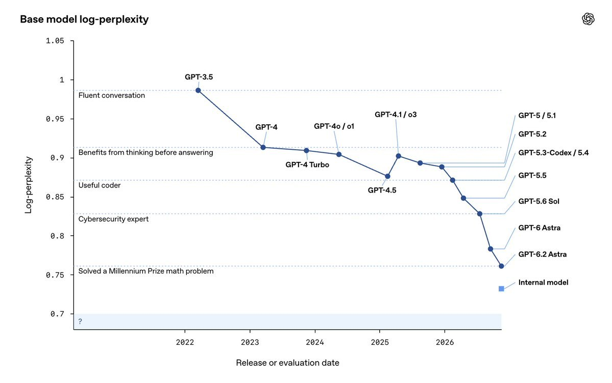
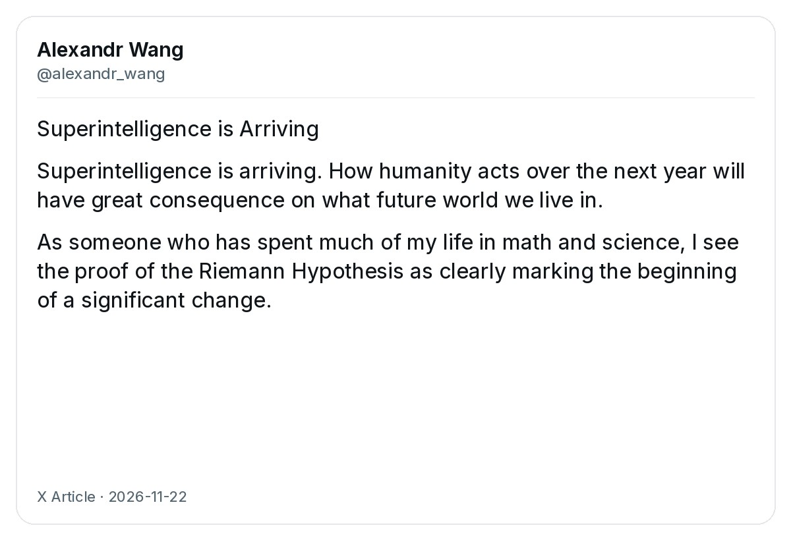
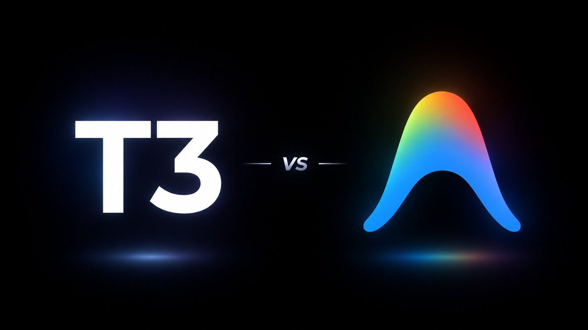
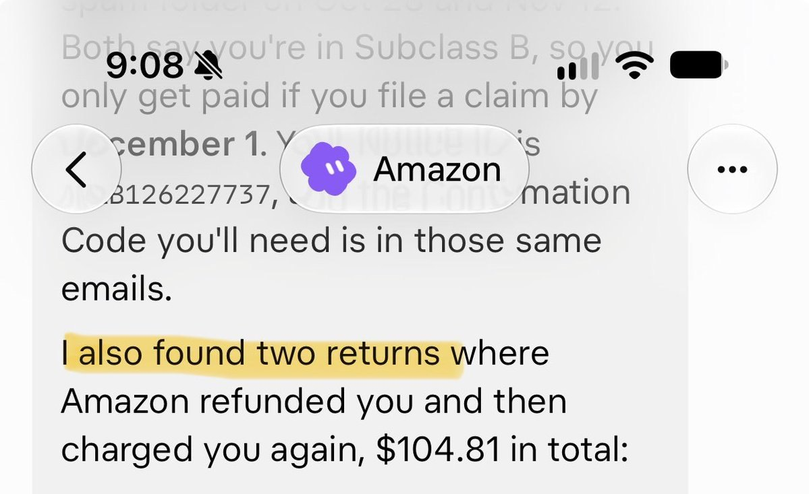
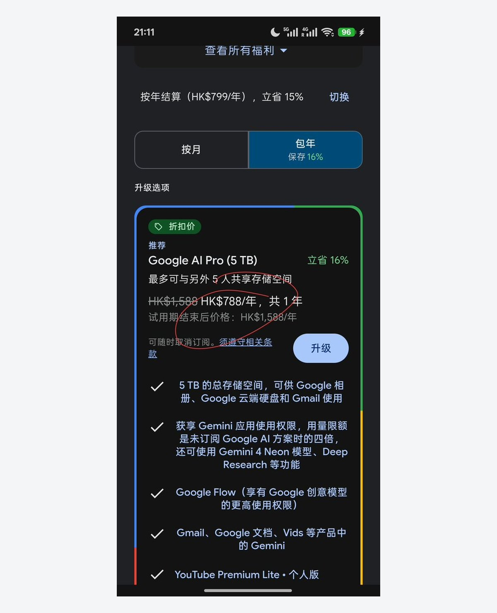
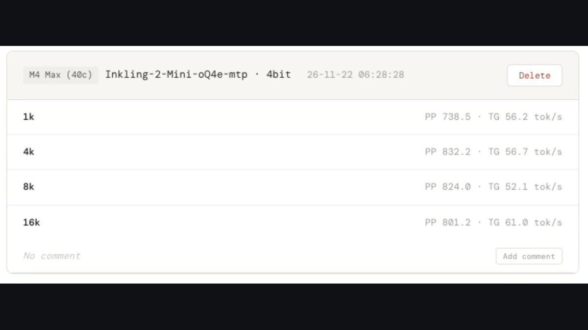
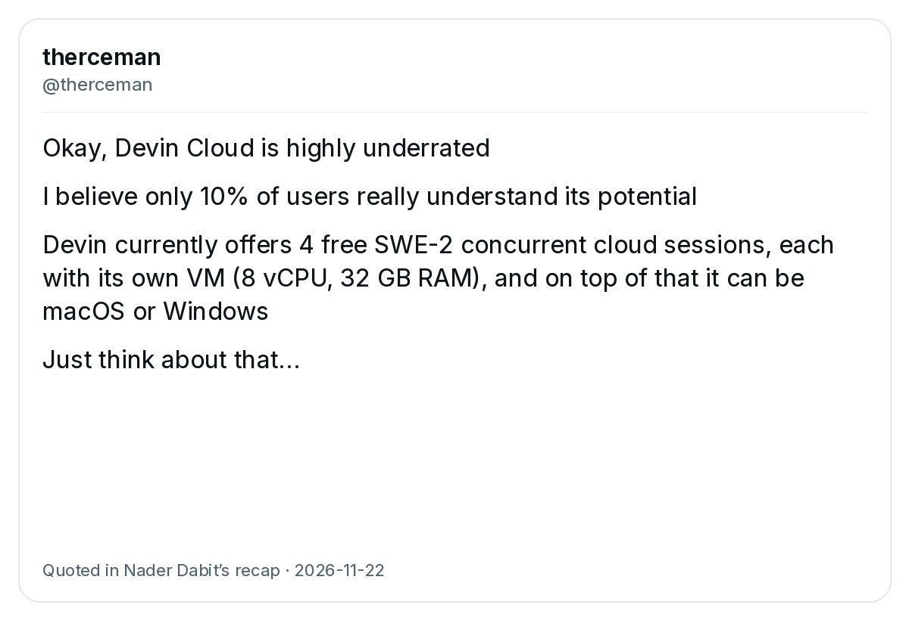
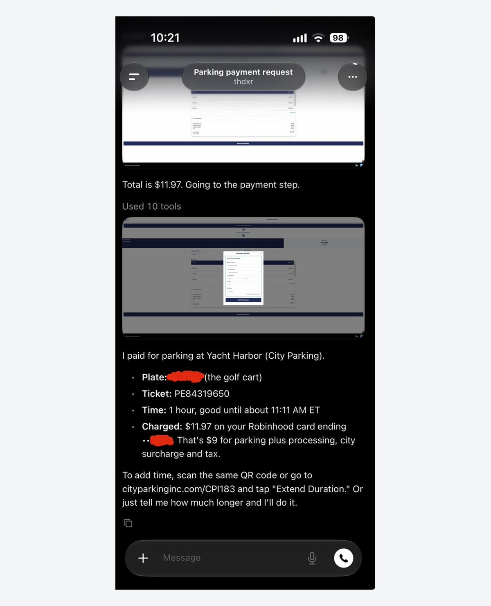

Today’s discussion ran on two tracks: labs putting their measuring sticks on the table, and people asking which tools can legally share a subscription. OpenAI published internal pretraining perplexity. The Lean community issued a verification statement on a formal proof of the Riemann Hypothesis. At the same time, the timeline filled with questions about where a Gemini subscription may be used, a Black Friday offer, and hands-on reports on a small local model.

## Today’s highlights

- **OpenAI**: Chief Scientist Jakub Pachocki published *Perplexity and Intelligence*, sharing internal perplexity figures and proposing common industry limits tied to that metric.

- **Riemann Hypothesis**: On November 20, Alpöge released a Lean library of about 17 million lines; on November 21 the Lean and Mathlib communities said they had verified it. Clay still lists the problem as unsolved.

- **T3 Code**: Theo said a Gemini subscription can only be used inside Antigravity; T3 Code uses the official binary, while a fake Antigravity shim in Pi is not allowed.

## 1. OpenAI publishes internal perplexity and proposes it as a shared limit

OpenAI Chief Scientist Jakub Pachocki published *Perplexity and Intelligence* on November 22. He treats pretraining as training a compressor, and argues that perplexity (equivalently, cross-entropy loss) can serve as a comparable progress metric across labs and as the basis for shared safety limits. As a first step, he published log-perplexity on OpenAI’s main internal evaluation set. Those numbers come from a fixed snapshot of an internal codebase, not a public benchmark. The post gives waypoints including about 0.99 for GPT-3.5 and about 0.91 for GPT-4. Once loss fell below 0.8, he said transformative capabilities appeared in cybersecurity and mathematics; after a move to about 0.76, the model began producing groundbreaking results on open math problems. He extrapolates that entering a window of about 0.68–0.7 could bring new capabilities that are not even being tested today.

He proposes that labs jointly set limits: they would not cross a threshold measured by perplexity and other metrics until their ability to understand and monitor model behavior reached a concrete milestone, such as a successor to chain-of-thought monitors. The post does not name a first numeric limit, and it does not say that other labs have agreed. He also lists the difficulties: evaluation sets differ across labs, perplexity does not map directly onto downstream tasks, chain-of-thought does not reduce perplexity, and the theoretical floor of the loss is unknown. Sam Altman called it the most important thing OpenAI has published in a while; Greg Brockman and Will Depue took the same side.

**Why it matters**: This is a lab publishing the pretraining ruler it actually uses, not another downstream leaderboard. Cross-lab comparison still depends on whether datasets can be aligned. Reading 0.76 or 0.68–0.7 as an already binding industry red line is not what the text says.

**Posts and sources**: [Jakub Pachocki](https://x.com/merettm/status/2124549218995949967) · [Sam Altman](https://x.com/sama/status/2124551594691932405) · [Greg Brockman](https://x.com/gdb/status/2124582684840399311) · [Will Depue](https://x.com/willdepue/status/2124558039663669638) · [OpenAI post](https://openai.com/index/perplexity-and-intelligence)

## 2. The Lean community certifies a formal RH proof; Clay still lists it unsolved

The announcement itself came on November 20: Anthropic’s Levent Alpöge released a Lean library of about 17 million lines, claiming a proof of the Riemann Hypothesis. On November 21, the Lean and Mathlib communities issued a joint statement, endorsed by the Lean FRO and the Mathlib Initiative, saying they have full confidence in the proof’s correctness. Their rationale: the statement is Mathlib’s already-vetted `RiemannHypothesis`; independent builds reproduced the same export; two comparison tools confirmed that the theorem proved is exactly Mathlib’s statement; and several checkers, including Lean’s official kernel and independent checkers with a formal relative-to-set-theory argument, accepted an inert export of the proof. The statement also looks forward to the mathematical community explaining the new ideas.

The Clay Mathematics Institute’s Millennium Prize page still lists the Riemann Hypothesis as unsolved. Claiming the million-dollar prize ordinarily requires formal publication and at least two years of general acceptance afterward. A formal verification is not the same as a completed prize process, and it is not the same as a human-readable paper. Today, Scale’s Alexandr Wang published a long essay, *Superintelligence is Arriving*, treating the event as a turning point in intellectual history and extrapolating to programming and other fields. Guillermo Rauch cautioned that a proof should still come with a paper, a walkthrough, and new concepts, not only machine-checkable code.

**Why it matters**: This was one of the day’s largest scientific conversations, but three things need to stay separate: the Lean community’s verification of a formal proof, Clay’s still-unsolved status, and the capability claims people are inferring from it. The last two are not settled facts.

**Posts and sources**: [Alexandr Wang](https://x.com/alexandr_wang/status/2124636606959345776) · [Guillermo Rauch](https://x.com/rauchg/status/2124654108124848350) · [Lean community statement](https://leanprover-community.github.io/blog/posts/riemann-hypothesis/) · [Clay Millennium Prize page](https://www.claymath.org/millennium/riemann-hypothesis/)

## 3. Neon’s reception is still unfolding, and the focus has shifted to the harness

Gemini 4 Neon launched on November 18. What is new today is first-hand use, not another launch. signüll wrote that, product frustrations aside, Neon’s tone, responses, and idea-generation felt fresh—almost unlike the “Gemini” he was used to. 图拉鼎 relayed evals from agentzh’s company: Neon’s scores were close to Opus 5.5, while taking about one-third the time. That is one company’s internal evaluation, not a public benchmark. 范凯 used the same talk to have Neon, Claude Opus 5.5, GPT-6.2 Sol, and DeepSeek V4.1 Flash generate a PPTX file. He found Neon the most visually polished and Opus 5.5 the most structurally solid, and he shipped the Opus version. He also said a Paseo ACP call once hung, and that the Antigravity CLI prompted him for authorization many times.

**Why it matters**: The same model can feel very different across agents and tasks. A fair comparison should hold the task and harness fixed, then look at quality, latency, and auth friction, rather than treating one slide deck or one internal eval as a league table.

**Posts and sources**: [signüll](https://x.com/signulll/status/2124338865888457117) · [图拉鼎](https://x.com/tualatrix/status/2124321279318868152) · [范凯说AI](https://x.com/fankaishuoai/status/2124532226016874920)

## 4. Gemini subscriptions stay on Antigravity; T3 Code is on the allowed path

T3 Code was not launched today—it is an existing open-source control plane—but discussion of it ran hot. The live question is whether a Gemini subscription can be attached to other agents. Theo was explicit: a Gemini subscription can only be used inside Antigravity; T3 Code uses Antigravity, so it is allowed; other harnesses (he named Pi) are not allowed if they use a “fake Antigravity shim.” He wrote the paths as: T3 Code → Antigravity binary → Google API, allowed; Pi → fake shim → Google API, not allowed. He compared this to how Claude subscriptions work. A Google developer forum thread also discusses whether T3 Code is permitted when it uses the official, unmodified antigravity-acp binary. 范凯 added that, according to the docs, opening Antigravity via ACP in Paseo is a compliant path, though context is assembled on the Paseo side and the experience is less native.

**Why it matters**: Which layer a subscription may be used in now shapes daily workflow as much as the model itself. The terms and the account page are authoritative. Stretching “T3 is allowed” into “any tool wrapped in an Antigravity shell is allowed” is not the line Theo drew.

**Posts and sources**: [Theo](https://x.com/theo/status/2124665075638411641) · [hqmank’s comparison question](https://x.com/hqmank/status/2124377326842687662) · [范凯说AI](https://x.com/fankaishuoai/status/2124417895350604078) · [Google developer forum thread](https://discuss.ai.google.dev/t/tos-clarification-is-t3-code-official-antigravity-acp-agent-permitted-under-the-antigravity-terms-of-service/192027)

## 5. After the ChatGPT / Codex desktop update, the official question is what’s still missing

On November 20, ChatGPT desktop’s Anthony Ambrosino announced an update: Space for Plus, a simpler visual design across the app, performance improvements, rebuilt threads, a redesigned Space home, faster Pages and Slides, page editing on mobile, and more reliable Codex Remote. Today, Codex-adjacent Tibo (@thsottiaux) quoted that update, asked what still needs work after the upgrade, and said the team is already preparing another large update. The thread is about remaining gaps, not another changelog.

**Why it matters**: An official follow-up that asks “what’s still not there” is more useful than a second feature list. The items worth checking in real workflows are the ones he named: Codex Remote, thread performance, and mobile page editing.

**Posts and sources**: [Tibo](https://x.com/thsottiaux/status/2124322968499282388) · [Anthony Ambrosino (November 20 update)](https://x.com/ajambrosino/status/2123840812534452296)

## 6. Grok Bot recovered an Amazon overcharge for Lee Robinson

Lee Robinson wrote that he dropped a post into Grok Bot, and the bot searched his email, filled out a form, and submitted it, recovering $100 that Amazon had charged incorrectly. That is one concrete personal case. Other posts on the same timeline tied Grok Bot to canceling auto-renewals and recovering subscription fees in general; those are broader claims, and this one report does not prove them.

**Why it matters**: An agent often creates value when it can read a mailbox and orders and finish a bad form. That is a different job from writing code, but it is a clear sample of whether an agent can actually get something done. A single refund should not be generalized into a legal conclusion.

**Posts and sources**: [Lee Robinson](https://x.com/leerob/status/2124522043274351096)

## 7. The Google AI Pro Black Friday price is still being discussed, and eligibility varies

On November 20, Google said Black Friday deals would open early for current AI or storage subscribers: through November 26, Google AI Plus and annual Pro plans would be up to 50% off, so people could try the latest models, including Neon. Offers for new subscribers were said to start on November 27, with details not fully published at the time. Today, people on the timeline continued to share Pro checkout pages at about $99.99 a year. 范凯 converted that price to about $8 a month, and described using Paseo via ACP to call Antigravity for Neon, plus AI Studio credit and Colab hours he saw on his own account. The actual discount depends on the current plan—some people see it, some do not—and whether the renewal price returns to full rate should be checked on the checkout page.

**Why it matters**: This is a window for packing Neon usage and other Google compute into one subscription, but it is not a single price for every account. Before paying, open the Google AI plan page and check eligibility and renewal terms.

**Posts and sources**: [范凯说AI](https://x.com/fankaishuoai/status/2124344657727635737) · [卫斯理](https://x.com/imwsl90/status/2124491832805794250) · [Google AI plans](https://one.google.com/ai)

## 8. Two days after Inkling 2 Mini shipped, someone made it their default local model

Thinking Machines released Inkling 2 Mini on November 20: an open-weights looped MoE with 26.4 billion total parameters, 3.4 billion active, about 5.4 billion weight activations per token after looping, a memory footprint of about 20GB, and up to 1M context. The lab positions it as a local model that can run on a laptop, and showed it building a flight simulator offline on a MacBook Pro in airplane mode. Today, 范凯 switched the default local model on his Mac Studio to it. He said it used under 20GB, felt faster than Qwen3.8-27B on his machine, was more stable on a browser-agent task, and he reported prefetch and decode speeds from that setup. Those speeds are his measurements, not official benchmarks.

**Why it matters**: For a small open model to hold up in agent and privacy work, stability and speed matter more than the parameter count alone. Comparisons should record the machine and quantization, rather than treating one Mac Studio run as a general result. The release date is November 20; what is new today is usage-side feedback.

**Posts and sources**: [范凯说AI](https://x.com/fankaishuoai/status/2124399843087200588) · [Thinking Machines announcement](https://thinkingmachines.ai/news/inkling-2-mini/)

## 9. A recap of what a Devin subscription already includes

Nader Dabit listed what he says is already in a Devin subscription: SWE included for the long term (currently SWE-2); frontier models including Claude’s Opus and Fable, Gemini’s Neon and Carbon, ChatGPT’s Astra and Sol, and Grok; Devin Bots, Review, Security, and Oncall; cloud VMs on macOS, Linux, or Windows; open models such as GLM, Kimi, and DeepSeek; and a Fusion router said to cut frontier-model cost by about 40%. He also mentioned desktop, CLI, and web clients, an early iOS and Android preview, and the option to bring a ChatGPT subscription. He wrote it because he had been talking to new users who did not realize they were already paying for all of this. @therceman added that Devin Cloud currently offers four free concurrent SWE-2 cloud sessions, each with its own VM (8 vCPUs, 32GB of RAM), on macOS or Windows. This is a user-side recap, not a new pricing announcement today.

**Why it matters**: Cloud agents often differ in VM size and concurrency, not only in model names. The figures come from users; the quota in a Devin account is the number to check.

**Posts and sources**: [Nader Dabit](https://x.com/dabit3/status/2124502393589002724) · [therceman](https://x.com/therceman/status/2124477413786878223)

## 10. OpenCode Browse was used to finish a real parking-payment form

OpenCode Browse launched on November 6. It lets an agent drive the browser you are already using, including tabs, logins, and extensions. Today, dax (@thdxr) showed a concrete use: he sent OpenCode a photo of a parking sign and let it handle the rest of the form, saying that with OpenCode Browse installed you no longer have to deal with a bad web form yourself. This is not a new launch. It is an example of “can use the browser” landing on a real form.

**Why it matters**: A browser agent is only as useful as its ability to finish a small task in a real logged-in session. A demo can show the path; turning one parking payment into “you will never fill a form again” still depends on failure rates and permission boundaries.

**Posts and sources**: [dax](https://x.com/thdxr/status/2124524412196278730) · [OpenCode Browse](https://opencode.ai/product/browse)

