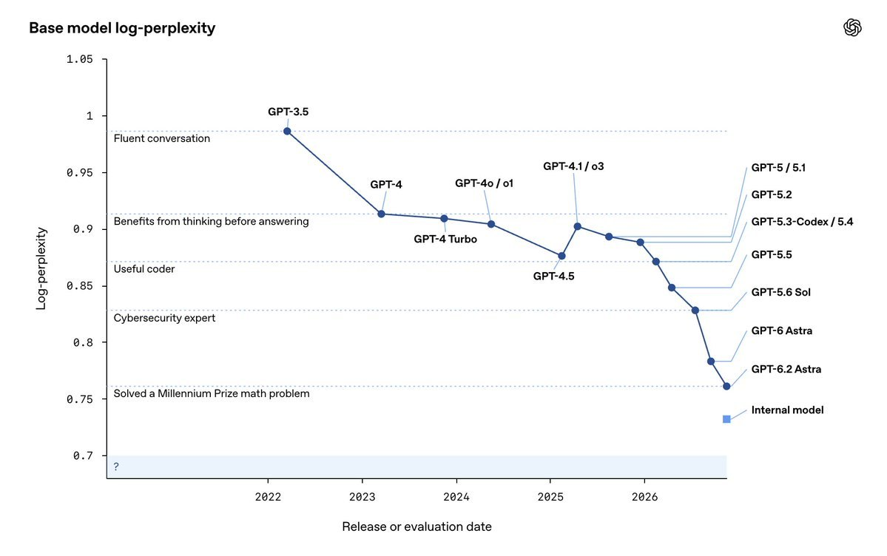
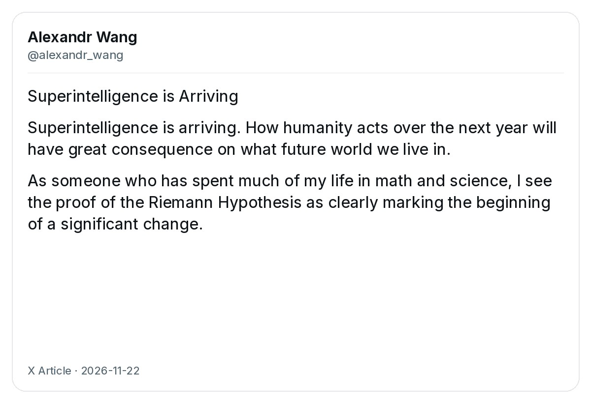
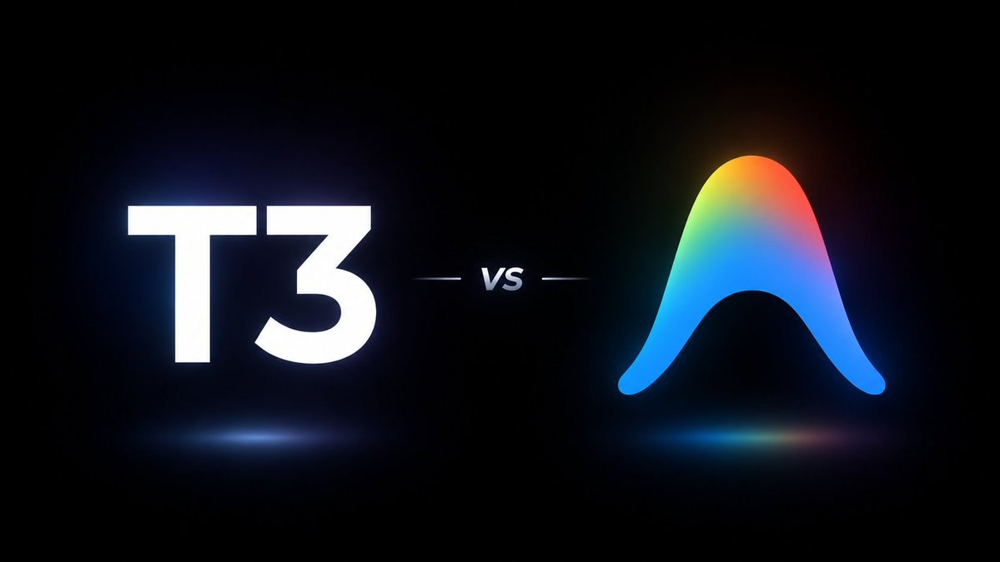
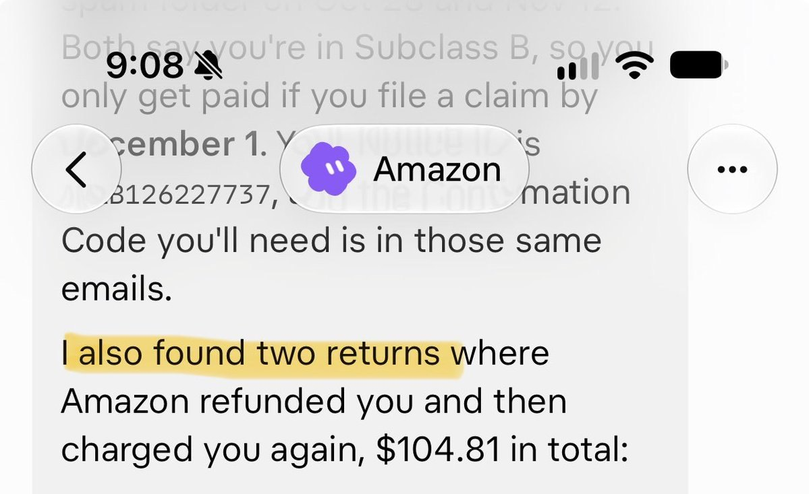
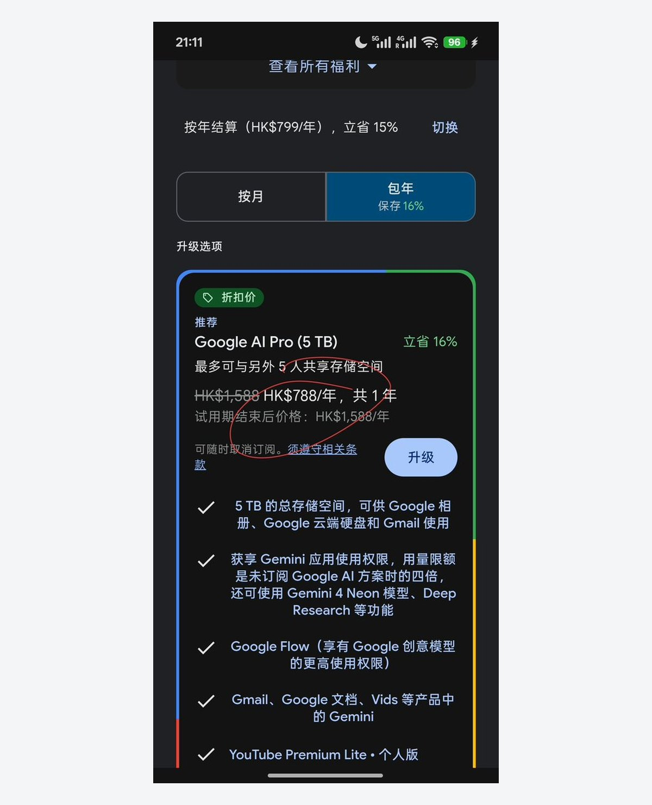
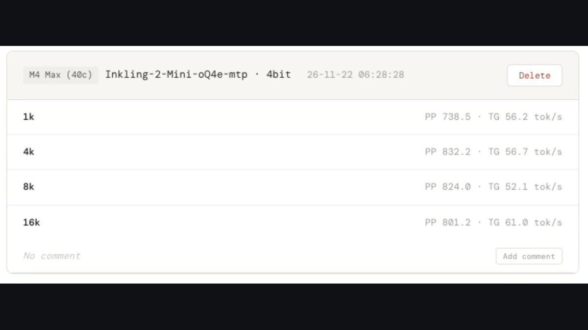
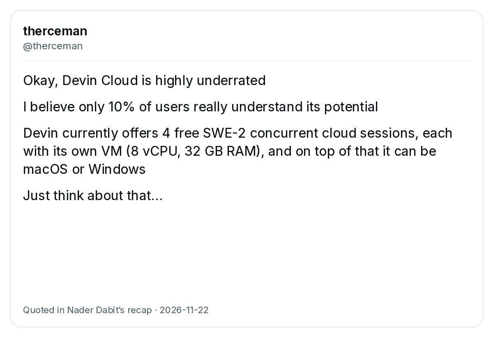
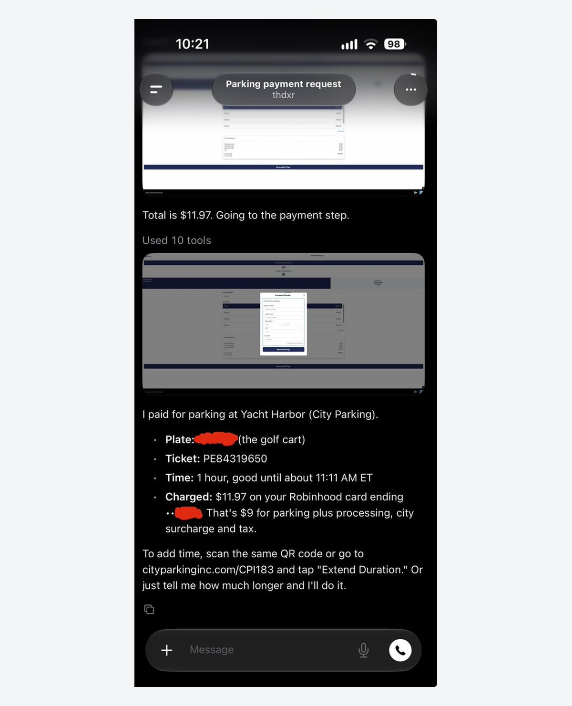

今天的讨论一边是实验室把尺子摊开，一边是订阅和工具能不能合规地接到一起。OpenAI 公开了内部预训练困惑度；Lean 社区则对一份黎曼假设的形式化证明给出了核验声明。与此同时，Gemini 订阅该走哪条路径、黑五优惠，以及本地小模型的实测，也在时间线上铺开。

## 今日推荐

- **OpenAI**：首席科学家 Jakub Pachocki 发表《Perplexity and Intelligence》，公开内部困惑度，并提议用困惑度等指标设定行业共同上限。

- **黎曼假设**：11 月 20 日 Alpöge 释出约 1700 万行 Lean 库；11 月 21 日 Lean/Mathlib 社区声明核验通过。Clay 研究所仍列为未解题。

- **T3 Code**：Theo 说明 Gemini 订阅只能在 Antigravity 中使用；T3 Code 走官方二进制，Pi 的仿制 shim 不被允许。

## 1. OpenAI 公开内部困惑度，并提议用它设定共同上限

OpenAI 首席科学家 Jakub Pachocki 在 11 月 22 日发表《Perplexity and Intelligence》。他把预训练看成训练一个压缩器，主张用困惑度（等价于交叉熵损失）作为实验室之间可比较的进度指标，并据此讨论共同的安全上限。作为第一步，他公开了 OpenAI 内部主评估集上的对数困惑度。这套数据来自内部代码库的固定快照，不是公开基准。文中给出的节点包括 GPT-3.5 约 0.99、GPT-4 约 0.91；当损失降到 0.8 以下时，他称在网络安全和数学上看到了变革性能力；升到约 0.76 后，模型开始对开放数学问题给出突破性结果。他据此外推，进入约 0.68–0.7 的窗口时，还可能出现今天未必在测的新能力。

他提议实验室共同设定上限：在理解和监控模型行为达到某个具体里程碑（例如 Chain-of-Thought 监控的后继方案）之前，不要越过以困惑度等指标衡量的界限。文章没有给出第一个上限的数值，也没有说其他实验室已经同意。他自己也列出了难点：各家评估集不同、困惑度不直接对应下游任务、思维链不会降低困惑度，以及损失的理论上限未知。Sam Altman 称这是 OpenAI 一段时间以来最重要的一篇公开文章，Greg Brockman 和 Will Depue 也表达了同一立场。

**为什么值得看**：这是实验室主动公开内部预训练尺子，而不是又一份下游榜单。要比较各家，还得先解决数据集能否对齐；把 0.76 或 0.68–0.7 读成已经生效的行业红线，并不符合原文。

**原帖与资料**：[Jakub Pachocki](https://x.com/merettm/status/2124549218995949967) · [Sam Altman](https://x.com/sama/status/2124551594691932405) · [Greg Brockman](https://x.com/gdb/status/2124582684840399311) · [Will Depue](https://x.com/willdepue/status/2124558039663669638) · [OpenAI 原文](https://openai.com/index/perplexity-and-intelligence)

## 2. Lean 社区核验黎曼假设形式化证明，Clay 仍列为未解

这件事的宣布本身在 11 月 20 日：Anthropic 的 Levent Alpöge 释出一份约 1700 万行的 Lean 库，声称证明黎曼假设。11 月 21 日，Lean 与 Mathlib 社区发表联合声明（由 Lean FRO 与 Mathlib Initiative 背书），表示对证明正确性有充分信心：命题是 Mathlib 中已审定的 `RiemannHypothesis`；多组独立编译得到同一导出文件；两个比较工具确认所证定理与 Mathlib 陈述一致；包括 Lean 官方内核和带有相对集合论正确性证明的独立检查器在内的多枚检查器，都接受了这份惰性导出。声明同时期待数学界继续解释其中的新想法。

Clay Mathematics Institute 的千禧年问题页仍把黎曼假设列为未解。要申领百万美元奖金，通常还需要正式发表，并在此后至少两年获得普遍接受。形式化核验不等于奖金流程已经走完，也不等于证明已经被写成人类可读的论文。今天，Scale 的 Alexandr Wang 为此写了长文《Superintelligence is Arriving》，把这件事看成智力史上的转折，并外推到编程和其他领域；Guillermo Rauch 则提醒，证明还应附带论文、思路讲解和新概念，而不能只留下机器可检查的代码。

**为什么值得看**：这是过去一天里讨论量很大的科学事件，但需要把三件事分开：Lean 社区对形式化证明的核验声明、Clay 的未解状态，以及由此引出的能力外推。后两者不是已经发生的结论。

**原帖与资料**：[Alexandr Wang](https://x.com/alexandr_wang/status/2124636606959345776) · [Guillermo Rauch](https://x.com/rauchg/status/2124654108124848350) · [Lean 社区声明](https://leanprover-community.github.io/blog/posts/riemann-hypothesis/) · [Clay 千禧年问题页](https://www.claymath.org/millennium/riemann-hypothesis/)

## 3. Neon 的使用感受还在发酵，重点已从发布转到脚手架

Gemini 4 Neon 是 11 月 18 日发布的，今天继续有第一手使用感受，而不是新的发布会。signüll 写到，抛开产品上的别扭，Neon 的说话语气、反应方式和出点子的方式都让他觉得新鲜，甚至不太像他印象里的 “Gemini”。图拉鼎转述 agentzh 用自家公司 Evals 的结果：Neon 的分数接近 Opus 5.5，同时耗时大约只有三分之一。这是一家公司的内部评测，不是公开基准。范凯用同一份演讲稿分别让 Neon、Claude Opus 5.5、GPT-6.2 Sol 和 DeepSeek V4.1 Flash 做 PPTX，认为 Neon 最好看，Opus 5.5 的结构更稳，最后采用了 Opus 的版本；他也抱怨经由 Paseo ACP 调用时曾无响应，Antigravity CLI 则多次弹出授权。

**为什么值得看**：同一模型在不同 Agent 和不同任务上的观感差很大。做对比时最好固定任务和脚手架，再分别看质量、耗时和授权摩擦，而不是把一次 PPT 或一次内部 Evals 直接写成总榜。

**原帖与资料**：[signüll](https://x.com/signulll/status/2124338865888457117) · [图拉鼎](https://x.com/tualatrix/status/2124321279318868152) · [范凯说AI](https://x.com/fankaishuoai/status/2124532226016874920)

## 4. Gemini 订阅只能走 Antigravity，T3 Code 被划在合规一侧

围绕 T3 Code 的讨论今天很热，但 T3 Code 本身并不是今天才发布的开源控制面。争论的焦点是：Gemini 订阅能不能接到其他 Agent 上。Theo 写得很明确：Gemini 订阅只能在 Antigravity 里用；T3 Code 使用 Antigravity，因此可以；其他 harness（他举例 Pi）如果走的是 “假的 Antigravity shim”，则不被允许。路径被他写成：T3 Code → Antigravity 二进制 → Google API 可以；Pi → 仿制 shim → Google API 不行。他把它类比成 Claude 订阅的用法。Google 开发者论坛上亦有关于 T3 Code 使用官方、未修改的 antigravity-acp 二进制是否符合条款的讨论。范凯则提到，按文档通过 ACP 在 Paseo 里打开 Antigravity 是合规路径，但上下文由 Paseo 组装，体验不够原生。

**为什么值得看**：订阅能用在哪一层，已经和模型本身一样影响日常工作流。具体以官方条款和账号页为准；把 “T3 可以用” 推广成 “任何套了 Antigravity 壳的工具都可以”，并不符合 Theo 自己划的那条线。

**原帖与资料**：[Theo](https://x.com/theo/status/2124665075638411641) · [hqmank 的对比提问](https://x.com/hqmank/status/2124377326842687662) · [范凯说AI](https://x.com/fankaishuoai/status/2124417895350604078) · [Google 开发者论坛讨论](https://discuss.ai.google.dev/t/tos-clarification-is-t3-code-official-antigravity-acp-agent-permitted-under-the-antigravity-terms-of-service/192027)

## 5. ChatGPT / Codex 桌面应用更新之后，官方在收口还差什么

11 月 20 日，ChatGPT 桌面应用的 Anthony Ambrosino 宣布了一轮更新：Plus 也可以用 Space、全应用更简单的视觉设计、性能改进、重做的线程、重新设计的 Space 首页、更快的 Pages 和 Slides、移动端可编辑 Pages，以及更可靠的 Codex Remote。今天，Codex 相关的 Tibo（@thsottiaux）引用这条更新，问大家升级之后还有哪些地方需要继续修，并说团队已经在准备下一轮大更新。这条征求意见的帖讨论的是体验缺口，而不是又一次发版说明。

**为什么值得看**：官方在发版后主动收口 “还差什么”，比再列一遍功能清单更有用。值得对照的是远程 Codex、线程性能和移动端编辑这些被点名的点，在实际工作流里是否已经稳住。

**原帖与资料**：[Tibo](https://x.com/thsottiaux/status/2124322968499282388) · [Anthony Ambrosino（11 月 20 日更新）](https://x.com/ajambrosino/status/2123840812534452296)

## 6. Grok Bot 帮 Lee Robinson 追回一笔 Amazon 错扣

Lee Robinson 写到，他把一条推文丢给 Grok Bot 后，Bot 翻了他的邮件、填好表格并提交，帮他追回 Amazon 错扣的 100 美元。这是一个具体的个人案例。同一时间线上还有人把 Grok Bot 和自动续订、找回订阅费用联系在一起，那是更一般的设想，不是这条记录能够证明的事。

**为什么值得看**：Agent 真正创造价值的时刻，往往是它能读到你的邮箱和订单，并走完一张烂表格。这和写代码不是同一类任务，但对 “Agent 能不能替你办事” 是一个清楚的样本。不要把单个退款案例推广成普遍的法律结论。

**原帖与资料**：[Lee Robinson](https://x.com/leerob/status/2124522043274351096)

## 7. Google AI Pro 黑五年费继续被讨论，资格因账号而异

11 月 20 日，Google 已宣布黑色星期五优惠提前给现有 AI 或存储订阅用户：至 11 月 26 日，Google AI Plus 与年缴 Pro 最高 5 折，以便试用包括 Neon 在内的新模型。新用户的优惠官方说会在 11 月 27 日推出，内容当时未完全公布。今天时间线上继续有人晒出年费约 99.99 美元的 Pro 页面。范凯按这个价格把月费折成约 8 美元，并列举了用 Paseo 经 ACP 调 Antigravity 跑 Neon，以及他账号里看到的 AI Studio 额度和 Colab 时数等用法。实际折扣依当前方案而定，有人看得见、有人看不见；续费价是否恢复原价，也要以结账页为准。

**为什么值得看**：这是把 Neon 用量和其他 Google 计算资源凑在一个订阅里的窗口，但不是对所有账号都成立的统一价。下单前应当打开 Google AI 方案页，看自己的资格和续费条款。

**原帖与资料**：[范凯说AI](https://x.com/fankaishuoai/status/2124344657727635737) · [卫斯理](https://x.com/imwsl90/status/2124491832805794250) · [Google AI 方案页](https://one.google.com/ai)

## 8. Inkling 2 Mini 发布两天后，有人把它换成了本地默认模型

Thinking Machines 在 11 月 20 日发布 Inkling 2 Mini：开源权重的 looped MoE，总参数 264 亿、激活 34 亿，循环后约 54 亿次权重激活，显存约 20GB，上下文最长 1M。官方把它定位为可在笔记本上跑的本地模型，并展示了在飞行模式的 MacBook Pro 上离线写出飞行模拟器的演示。今天，范凯把 Mac Studio 上的默认本地模型换成了它，称占用不到 20GB，在他的机器上比 Qwen3.8-27B 更快、跑浏览器 Agent 更稳，并给出了他自己测到的预填充和输出速度。这些速度是他的环境数字，不是官方基准。

**为什么值得看**：开源小模型要在 Agent 和隐私场景里站稳，比的是稳定性和速度，而不只是参数量。对比时需要写明机型和量化，避免把一次 Mac Studio 实测写成普遍结论。发布日期是 11 月 20 日，今天补上的是使用侧的反馈。

**原帖与资料**：[范凯说AI](https://x.com/fankaishuoai/status/2124399843087200588) · [Thinking Machines 公告](https://thinkingmachines.ai/news/inkling-2-mini/)

## 9. 有人把 Devin 订阅里已经包含的能力摊开了

Nader Dabit 梳理了 Devin 订阅里已经包含的能力：长期免费的 SWE（当前是 SWE-2）、各家前沿模型（包括 Claude 的 Opus 与 Fable、Gemini 的 Neon 与 Carbon、ChatGPT 的 Astra 与 Sol，以及 Grok）、Devin Bots / Review / Security / Oncall、可选 macOS、Linux、Windows 云虚拟机、开源模型如 GLM、Kimi、DeepSeek，以及号称可把前沿模型成本降低约 40% 的 Fusion 路由；桌面、CLI、Web，以及 iOS/Android 早期预览，还可以自带 ChatGPT 订阅。他明确说，写这些是因为遇到不少新用户并不知道自己已经付过这些。@therceman 则补充，Devin Cloud 目前提供 4 个免费的 SWE-2 并发云会话，每个有独立虚拟机（8 vCPU、32GB 内存），并且可选 macOS 或 Windows。这些是使用侧的梳理，不是今天的新定价公告。

**为什么值得看**：云端 Agent 的差异常常在虚拟机规格和并发，而不只是模型名字。数字来自用户转述，核对时应以 Devin 账号里的实际配额为准。

**原帖与资料**：[Nader Dabit](https://x.com/dabit3/status/2124502393589002724) · [therceman](https://x.com/therceman/status/2124477413786878223)

## 10. OpenCode Browse 被用来处理一张真实的停车缴费表

OpenCode Browse 是 11 月 6 日推出的能力：让 Agent 操作你正在用的浏览器，包括标签、登录态和扩展。今天 dax（@thdxr）展示了一个很具体的用法：他把停车标志的照片发给 OpenCode，其余表格都交给它处理，并说装了 OpenCode Browse 之后就不用再自己填那些糟糕的网页表单。这不是新功能发布，而是一个把 “能开浏览器” 落到一张真实表格上的例子。

**为什么值得看**：Browser Agent 的价值取决于它能不能在真实登录态里做完一件小事。演示能说明路径，但把一次停车缴费推广成 “再也不用填表”，还需要看失败率和权限边界。

**原帖与资料**：[dax](https://x.com/thdxr/status/2124524412196278730) · [OpenCode Browse](https://opencode.ai/product/browse)

