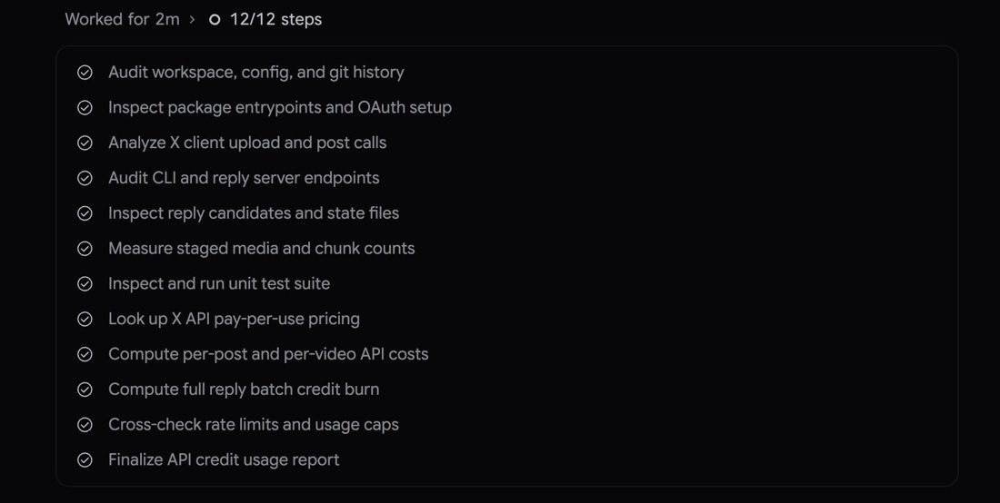
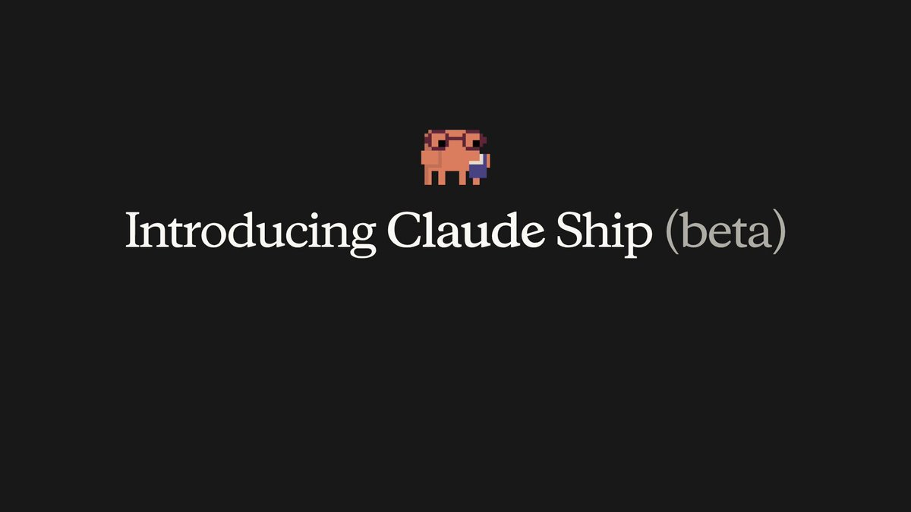
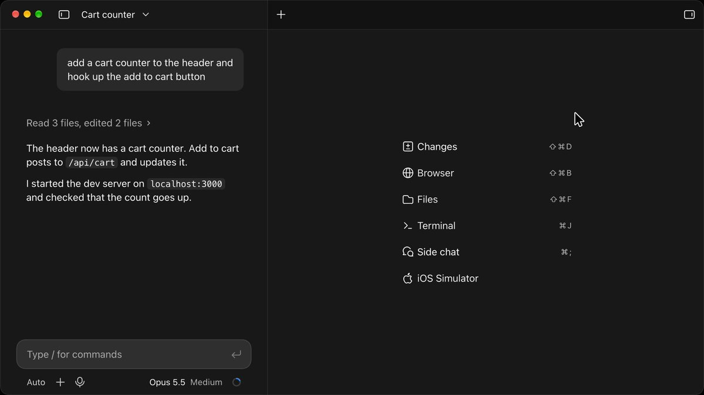
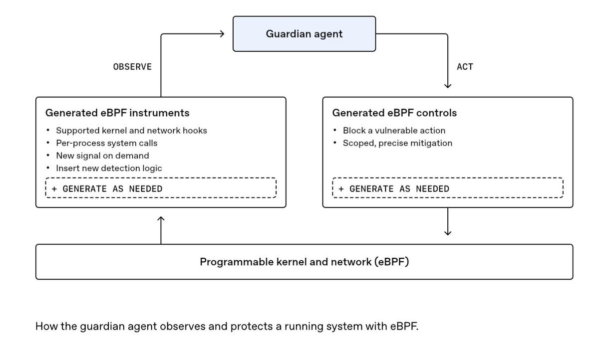
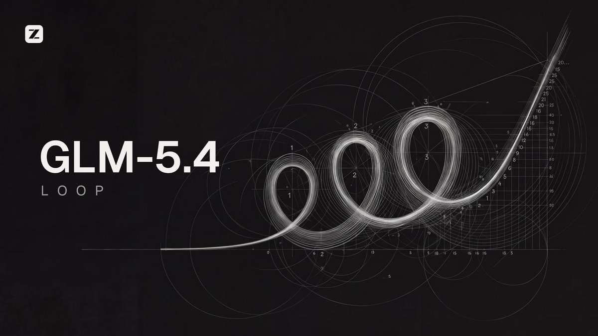
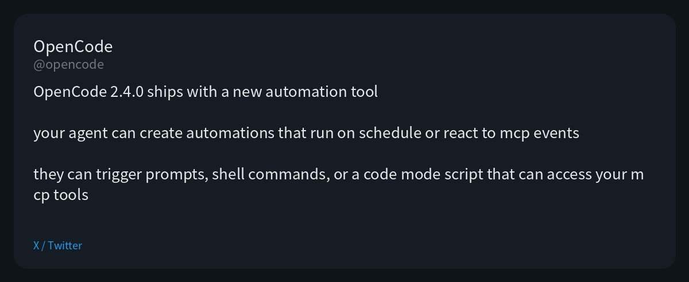
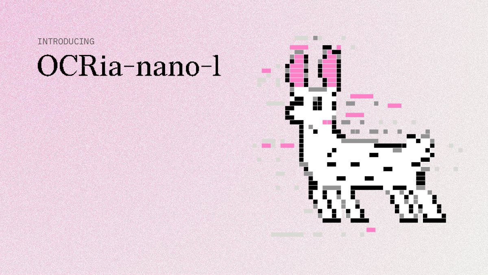

Today's discussion ran on two tracks: tools reopening quotas and model tiers, and agents being asked to finish the work after the code is written. Antigravity reset Gemini quotas and opened more model combinations. Anthropic launched Claude Ship and folded connectors and skills into a single plugins entry. Zhipu's GLM-5.4, Qoder's mystery model HungerG, and OpenCode 2.4.0 automations also landed on the timeline the same day.

## Today's highlights

- **Antigravity**: Gemini quotas were reset for everyone as models are upgraded across tiers; paid Pro users get Carbon, Hydrogen is available to all, the separate Argon bucket is folded into the shared pool, and progress checklists are live.

- **Claude Ship**: It can review pull requests, work on fixes, and approve changes a repository policy allows. Developers can run /ship; admins enable it per repository.

- **GLM-5.4**: Zhipu introduced its first Loop Transformer flagship, now available to GLM Coding Plan users. The API waits on a security review, and the weights are not out yet.

## 1. Antigravity resets Gemini quotas, opens Carbon, and ships progress checklists

Varun Mohan (@_mohansolo) said Gemini quotas on Antigravity were being reset for everyone because models were being upgraded across tiers. Paid Pro users would get access to Carbon, and Hydrogen would be available to all users as previously promised. He also said the separate Argon bucket for paid Pro users was going away, with that capacity moving into the general Gemini bucket, so people could also spend more on Argon, Carbon, and, in his words, most importantly Neon. The same day, Orchestrator gained an explicit way to set the pair of models and effort levels; his own setting was Neon High with Hydrogen High. The official account then said progress checklists were live, so you can track every step mid-run and expand the full breakdown. Varun called this one of the most requested features for long-running tasks, especially when you do not want to open a side chat.

On the discussion side, DHH said Gemini 4 Neon cut Omarchy's boot time in half and also improved the install path. He described it as a quiet model: it works with very little output, then returns a complete result. He later said he had it running across six Intel, AMD, and NVIDIA machines the same day and never exhausted the session window. Guillermo Rauch asked Fable to study his coding sessions and choose between Opus and Gemini Neon as a "personal eval"; it picked Neon. Perplexity's Aravind Srinivas posted product figures: from November 19 to 22, on a 22-hour-matched basis, Neon compounded at 10.6% per day in Ask (fast search) queries and 15.0% per day in Computer (agentic tasks). He later clarified that Perplexity had not started routing traffic to Neon by default; the shift was users moving over from Opus 5.5 and Sol 6.2.

**Why it matters**: This is a bundled change to quotas, model access, and the product itself, not a verdict on Neon. DHH and Rauch are describing their own use. The Perplexity growth rates come from that product, and they are not yet a default-routing change.

**Posts and sources**: [Varun Mohan on the reset](https://x.com/_mohansolo/status/2124960419429458207) · [Argon bucket](https://x.com/_mohansolo/status/2124971131312734707) · [Orchestrator model pairs](https://x.com/_mohansolo/status/2124917777630961911) · [Official checklists](https://x.com/antigravity/status/2125032843550028030) · [DHH on Omarchy](https://x.com/dhh/status/2124860839572488538) · [DHH on six machines](https://x.com/dhh/status/2124949501534171477) · [Guillermo Rauch](https://x.com/rauchg/status/2124880074168242369) · [Aravind Srinivas](https://x.com/AravSrinivas/status/2124765417378099414) · [The clarification](https://x.com/AravSrinivas/status/2124951952035578100)

## 2. Claude Ship starts reviewing, fixing, and approving pull requests under policy

Anthropic launched Claude Ship in beta. The official write-up says it combines Code Review, which is already generally available, with two agents still in beta: PR Steward, which works to keep a pull request mergeable after failing checks, conflicts, and review comments, and is designed not to approve or merge; and Claude Approvals, which reads a policy file in the repository and can approve routine changes when the policy allows, or require deeper human sign-off. Boris Cherny said anyone can use /ship; on a Team or Enterprise plan, an admin can turn on Claude Ship per GitHub repository. He would start with one repo and run Approvals in observe mode until the team trusts it. The official article also says eligible Claude Enterprise organizations can claim at least $10,000 in Claude Ship credits to use within 30 days of claiming, with a claim deadline of January 15, 2027, subject to terms.

**Why it matters**: The product is aimed at a real bottleneck: models write code faster than teams can land it. Approval still depends on repository policy and branch protection, and observe mode is a reminder that this is not, by default, an auto-merge switch.

**Posts and sources**: [ClaudeDevs](https://x.com/ClaudeDevs/status/2124959436640858475) · [Boris Cherny](https://x.com/bcherny/status/2124961485801836573) · [How to turn it on](https://x.com/bcherny/status/2124961488691740941) · [Addy Osmani](https://x.com/addyosmani/status/2124960211287101656) · [The announcement](https://claude.com/resources/articles/introducing-claude-ship)

## 3. Claude folds connectors and skills into a single plugins entry

Claude's official account said there is now one way to connect tools or teach Claude a new skill: connectors and skills come together as plugins. The entry is live on Free, Pro, Max, and Ultra, with Team and Enterprise coming later. The help center is more specific: the change starts rolling out to Team plans on November 30, 2026, and reaches Enterprise in the following weeks. Users can browse a directory that Claude says contains more than 10,000 plugins, at [claude.ai/plugins](https://claude.ai/plugins).

**Why it matters**: This collapses two extension paths into one place and puts it on personal plans first. The 10,000-plus figure is the official browseable count, not a claim that every item works the same way on every plan.

**Posts and sources**: [Claude](https://x.com/claudeai/status/2124970294523945328) · [Plugin directory](https://claude.ai/plugins) · [Help Center](https://support.claude.com/en/articles/17740565-manage-plugins-skills-and-connectors-from-one-plugins-page)

## 4. Claude Code on desktop rebuilds the side panel: files, changes, and the terminal become tabs

ClaudeDevs said the side panel in Claude Code on desktop has been redesigned. Files, Changes, Terminal, and other tools now open as tabs beside the session. You can still place tabs side by side, or pop one out into its own window. The rollout starts on Mac, with Windows and Linux coming later. Quoting the update, Theo joked that at the rate features were being copied, Antigravity support might arrive in a few days.

**Why it matters**: The change is about watching what the agent is editing, not just a visual refresh. It is also still a Mac-first rollout, so it should not be read as already shipping on every desktop platform.

**Posts and sources**: [ClaudeDevs](https://x.com/ClaudeDevs/status/2124978802006851961) · [Theo](https://x.com/theo/status/2124987957803446311)

## 5. OpenAI and Cisco introduce Shirudo, an open-source runtime that adds eBPF shields without downtime

On November 23, OpenAI and Cisco introduced Shirudo, an open-source project whose name means "shield" in Japanese. It is a Linux runtime meant to help teams block vulnerable paths with a temporary shield while a lasting patch is still rolling out, without restarting the service, and without blocking legitimate requests if the team can make that distinction. The official write-up says it uses eBPF; shields are signed and verified before they load, and a TPM can leave a verifiable record. Security teams still decide what actually gets deployed. The post also describes a controlled test in which a Codex-generated shield blocked a Java4Shell exploit attempt against a running Elasticsearch service without a restart. The GitHub repository [shirudo-dev/shirudo](https://github.com/shirudo-dev/shirudo) was created on October 13. The project calls itself pre-release, and production targets need the matching kernel patches plus TPM 2.0.

**Why it matters**: This is an attempt to connect "we found the bug" with "the system still has to stay up," and it keeps deployment in the operator's hands. A controlled demo shows the path; it is not the same as dropping the runtime onto an unpatched production kernel.

**Posts and sources**: [OpenAI](https://x.com/OpenAI/status/2124980590717911527) · [Greg Brockman](https://x.com/gdb/status/2124985602722676794) · [The announcement](https://openai.com/index/introducing-shirudo) · [GitHub](https://github.com/shirudo-dev/shirudo)

## 6. Zhipu introduces GLM-5.4, its first Loop Transformer flagship; Coding Plan is first, weights are not out

Zhipu introduced GLM-5.4, calling it its first flagship model built on a Loop Transformer. The technical write-up says it runs 28 layers from the GLM-5 base model for two iterations, aiming for deeper reasoning without adding parameters. The adaptation is described at a 750B scale, with a 1M context window and up to 128K output tokens. Zhipu frames this as the start of "generalized coding," with examples that include writing code to generate and edit video, building a complete game, and handling 3D and mechanical design. It also lists a limitation: the model can get stuck in overly long "marathon thinking," even though that extra reflection and self-correction continues to improve accuracy. The claim that it reaches intelligence comparable to 2T–3T-parameter models is the vendor's own wording, not an independent benchmark result.

On availability, the docs say GLM-5.4 is now open to all GLM Coding Plan users, and that weekly-quota users get 1.5 times the GLM-5.3 quota when they use it. The API will open after a security assessment, and the weights are planned for a "responsible" open-source release; they are not out yet. The Chinese announcement also says the model is appearing on coding products including ZCode, Trae, Qoder, and OpenCode.

**Why it matters**: This is a flagship productization of looped depth, and it is being delivered first through a coding subscription rather than as open weights or a public API. The quota multiplier and the 2T–3T comparison both come from official materials; how the long-thinking habit feels in actual use is still an open question.

**Posts and sources**: [Z.ai](https://x.com/Zai_org/status/2124811995912286352) · [Technical blog](https://z.ai/blog/glm-5.4) · [Product docs](https://docs.z.ai/guides/llm/glm-5.4) · [dax on the missing weights](https://x.com/thdxr/status/2124893825021903010)

## 7. Qoder launches a mystery model, HungerG, free for individual users through November 30

Qoder announced a stealth model whose identity is classified, under the codename HungerG, and invited people to try it on real work and guess who built it. Official docs set the window as 24:00 on November 23, 2026 through 24:00 on November 30, 2026, Singapore time (UTC+8). It is for individual Qoder International users, including Free and the personal Lite, Pro, Pro+, and Ultra plans; Team and Enterprise accounts do not see the model. During the promotion, HungerG calls consume no Credits and have no daily cap, including at Max thinking intensity, which is billed at 0.0×. The offer applies to Qoder and Qoder IDE, and official docs exclude the JetBrains plugin, the CLI, Cloud Agents, the web app, and mobile. Requests may queue at peak times, with paid users getting higher priority. On identity, the official line is only that it has not been disclosed; guesses on the timeline have included DeepSeek, Qwen, and StepFun, and none of those have been confirmed.

**Why it matters**: A time-limited, zero-credit exclusive trial is not a model launch. Until Qoder names the builder, those guesses should stay guesses, and team or enterprise seats are out of scope by the official rules.

**Posts and sources**: [Qoder's announcement](https://x.com/qoder_ai_ide/status/2124899980632822148) · [How to try it](https://x.com/qoder_ai_ide/status/2124899982675480849) · [Promotion details](https://docs.qoder.com/events/hungerg-free)

## 8. OpenCode 2.4.0 lets the agent create automations, and can import a desktop browser profile

OpenCode's official account highlighted a new automation tool in 2.4.0: the agent can create automations that run on a schedule or react to MCP events, then trigger prompts, shell commands, or a Code Mode script that can use MCP tools. In the changelog, the title feature of this release is actually a built-in desktop browser. It can import sign-ins and browsing history from Chrome, Edge, Firefox, or Safari into a persistent desktop profile; chat links open already signed in, tabs survive restarts, and the agent can read and drive the same pages. That is a different path from letting the agent use the browser you already have open. dax then posted a concrete case: he was stuck in an odd domain-purchase flow, and the agent used an MCP connection he already had to create an automation that watched his email. About an hour later the instructions arrived, the agent handled them, bought the domain, and set up Cloudflare.

**Why it matters**: Automations turn "the agent finished one task" into "the agent can keep going while you are not watching." The built-in browser imports a login state into its own profile, so the permission and mistake boundaries still need a hard look; shell actions also ask for approval when they are created.

**Posts and sources**: [OpenCode](https://x.com/opencode/status/2124886266835505473) · [dax's domain example](https://x.com/thdxr/status/2124888129102360921) · [2.4.0 changelog](https://opencode.ai/changelog/v2.4.0)

## 9. Claude's zero-data-retention Enterprise Frontier Safeguards enter public beta

Claude's official account said zero data retention (ZDR) with Enterprise Frontier Safeguards (EFS) is now in public beta for eligible businesses. The core claim is that EFS looks for misuse across many requests while remaining compatible with ZDR: neither Anthropic nor cloud providers retain the enterprise's data. The article says EFS was announced in September and has since been developed with more than 100 customers, including a quarter of the Fortune 100 and companies in industries with strict rules on data visibility, such as healthcare, financial services, and law. Firms such as Bridgewater, Salesforce, and Stripe had been evaluating it in private beta. A public beta is not the same as those companies running it in full production.

**Why it matters**: This is a direct response to enterprises that want frontier models without leaving logs with the model provider. It is still a public beta for eligible businesses; who can turn it on, and where logs actually live, still depends on the official terms.

**Posts and sources**: [Claude](https://x.com/claudeai/status/2124929944530587712) · [The announcement](https://claude.com/resources/articles/zero-data-retention-with-enterprise-frontier-safeguards)

## 10. LlamaIndex releases OCRia-nano-1, an 8.1-million-parameter open-weight OCR model

Jerry Liu announced OCRia-nano-1, a lightweight open-weight OCR model with 8.1 million parameters. The official figure is about 426 milliseconds per page on CPU, with no GPU required. LlamaIndex's write-up is more precise: those timings include the full LiteParse pipeline, not recognition alone. On ParseBench-2, Nano scores 59.2 overall and 59.5 on tables. The average is 426 milliseconds per page on a single core, and 90% of measured pages finished within 862 milliseconds. It is positioned as a first-pass parser for large document collections, recognizing text when a usable text layer is missing and recovering table and layout structure.

**Why it matters**: This is a small model aimed at running a first pass on CPU, not another general-purpose giant. The 426-millisecond figure is an official average under the full pipeline; document quality and scan condition will still move the result.

**Posts and sources**: [Jerry Liu](https://x.com/jerryjliu0/status/2124909031999553926) · [The announcement](https://www.llamaindex.ai/blog/introducing-ocria-nano-1)

