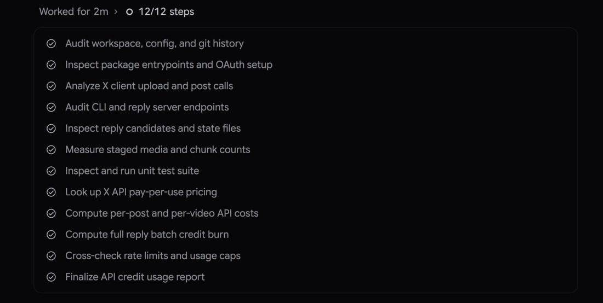
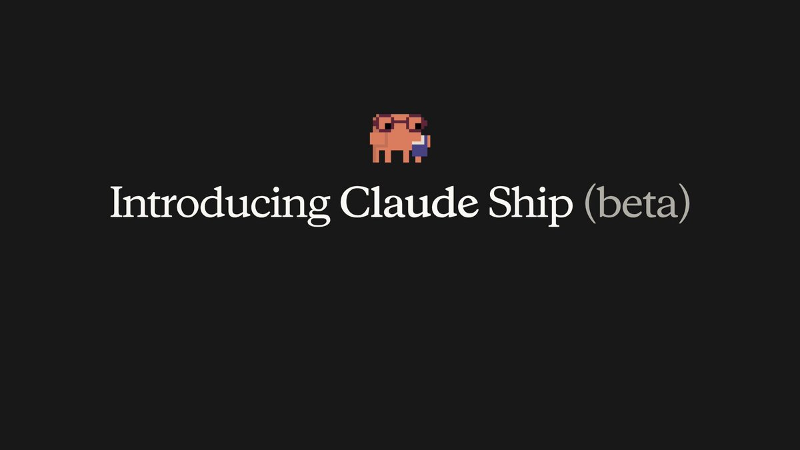
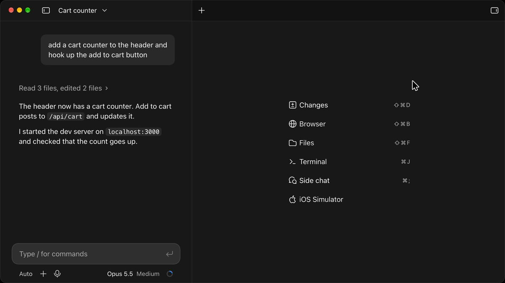
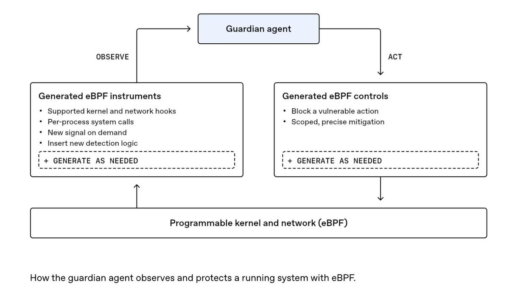
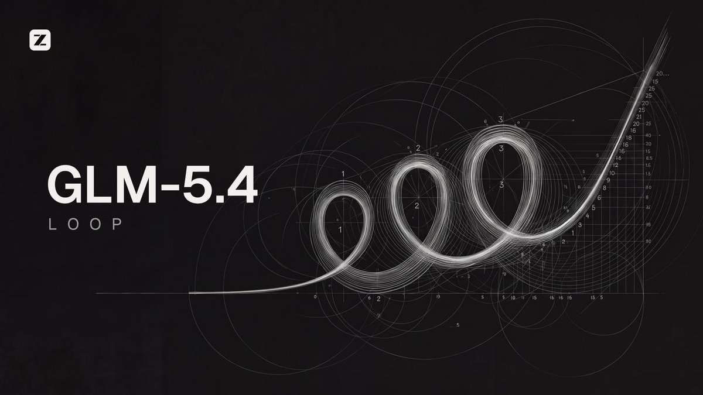
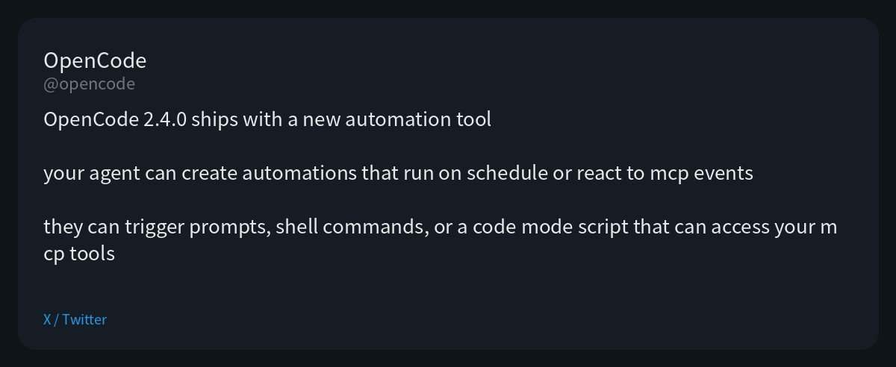
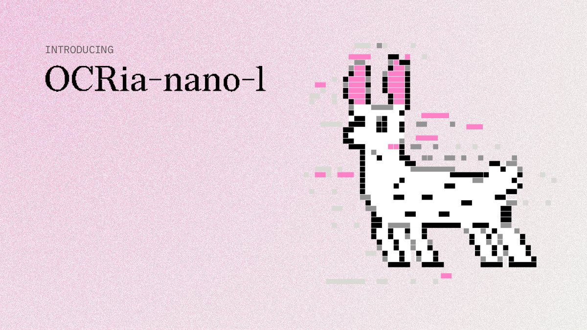

今天的讨论一边是把额度和模型档位重新铺开，一边是把“写完代码之后怎么合并”交给代理。Antigravity 重置了 Gemini 额度，并开放更多模型组合；Anthropic 则推出 Claude Ship，还把连接器和技能收进统一的插件入口。智谱的 GLM-5.4、Qoder 的神秘模型 HungerG，以及 OpenCode 2.4.0 的自动化，也在同一天挤进时间线。

## 今日推荐

- **Antigravity**：因各档模型升级，Gemini 额度对所有用户重置；付费 Pro 可用 Carbon，Hydrogen 面向所有用户；独立 Argon 桶并入通用额度，并上线任务进度清单。

- **Claude Ship**：可审 PR、处理修复与检查失败，并按仓库策略批准；开发者可用 /ship，管理员按仓库开启。

- **GLM-5.4**：智谱推出首个 Loop Transformer 旗舰模型，对 Coding Plan 用户开放；API 待安全评估，权重尚未放出。

## 1. Antigravity 重置 Gemini 额度，开放 Carbon 与进度清单

Varun Mohan（@_mohansolo）宣布，因为要在各档升级模型，Antigravity 上的 Gemini 额度会对所有人重置。付费 Pro 用户将可以使用 Carbon；Hydrogen 按此前承诺面向所有用户开放。他还说，付费 Pro 原先单独的 Argon 额度桶会被取消，容量并入通用的 Gemini 桶，因此也可以把更多额度用在 Argon、Carbon，以及他称为“最重要”的 Neon 上。同一天，Orchestrator 可以显式指定要搭配的模型与努力程度；他自己的设置是 Neon High 配 Hydrogen High。官方账号随后宣布进度清单上线，可在任务进行中跟踪每一步并展开完整分解。Varun 说，这是长任务里最常被要求的功能之一，尤其适合不想另开 side chat 的场合。

讨论侧，DHH 说 Gemini 4 Neon 把 Omarchy 的启动时间砍掉一半，安装流程也有明显优化；模型工作时输出很少，结束后一次给出完整结果。他后来又说，当天在 6 台 Intel、AMD 和 NVIDIA 机器上跑优化，一次都没有把 session 窗口用尽。Guillermo Rauch 让 Fable 回顾自己的编程会话，在 Opus 和 Gemini Neon 之间做“个人评测”，结果选了 Neon。Perplexity 的 Aravind Srinivas 给出一组产品数据：Neon 在 11 月 19 日至 22 日（按 22 小时对齐）里，Ask 查询日均复合增长 10.6%，Computer（代理任务）为 15.0%。他随后澄清，这还不是默认路由切换，而是用户从 Opus 5.5 和 Sol 6.2 主动迁过来的自然需求。

**为什么值得看**：这是一次把额度、模型档位和产品体验绑在一起的调整，并不等于 Neon 的能力评测已经定论。DHH 和 Rauch 的反馈是个人经历；Perplexity 的增长率来自自家产品，也还没有变成默认路由。

**原帖与资料**：[Varun Mohan：重置额度](https://x.com/_mohansolo/status/2124960419429458207) · [取消独立 Argon 桶](https://x.com/_mohansolo/status/2124971131312734707) · [Orchestrator 模型组合](https://x.com/_mohansolo/status/2124917777630961911) · [官方进度清单](https://x.com/antigravity/status/2125032843550028030) · [DHH：Omarchy](https://x.com/dhh/status/2124860839572488538) · [DHH：六台机器](https://x.com/dhh/status/2124949501534171477) · [Guillermo Rauch](https://x.com/rauchg/status/2124880074168242369) · [Aravind Srinivas](https://x.com/AravSrinivas/status/2124765417378099414) · [增长澄清](https://x.com/AravSrinivas/status/2124951952035578100)

## 2. Claude Ship 开始代审、代修，并按策略批准 PR

Anthropic 推出 Claude Ship（beta）。官方说明它由已经正式可用的 Code Review，以及两个仍处于 beta 的代理组成：PR Steward 负责在检查失败、合并冲突和评审意见之后把 PR 维持在可合并状态，但被设计为不批准、不合并；Claude Approvals 则读取仓库里的策略文件，在策略允许时批准常规变更，或要求更深入的人工确认。Boris Cherny 说，开发者都可以用 /ship；若在 Team 或 Enterprise 计划上，管理员可以按 GitHub 仓库打开 Claude Ship。他建议先从一个仓库开始，并把 Approvals 放在观察模式，直到团队信任它。官方文章还提到，符合条件的 Claude Enterprise 组织可以领取至少 1 万美元的 Claude Ship 额度，需在领取后 30 天内用完，领取截止 2027 年 1 月 15 日，具体以条款为准。

**为什么值得看**：它针对的是“模型写代码越来越快，合并流程跟不上”的瓶颈。批准权仍然取决于仓库策略和分支保护；先观察再生效，也说明这套批准默认不是直接合入。

**原帖与资料**：[ClaudeDevs](https://x.com/ClaudeDevs/status/2124959436640858475) · [Boris Cherny](https://x.com/bcherny/status/2124961485801836573) · [如何开启](https://x.com/bcherny/status/2124961488691740941) · [Addy Osmani](https://x.com/addyosmani/status/2124960211287101656) · [介绍文章](https://claude.com/resources/articles/introducing-claude-ship)

## 3. Claude 把连接器和技能收进统一的插件入口

Claude 官方账号宣布，连接工具和教授新技能现在走同一条路径：连接器与技能被收进插件。该入口已在 Free、Pro、Max 和 Ultra 计划上线，Team 和 Enterprise 将随后推出。官方帮助中心写得更具体：Team 计划从 2026 年 11 月 30 日开始滚动，Enterprise 在随后数周跟进。用户可以在插件目录里浏览宣称超过 10,000 项的插件，地址是 [claude.ai/plugins](https://claude.ai/plugins)。

**为什么值得看**：这把原来分散的扩展方式收成一个入口，并提前放到个人档套餐里。目录规模是官方宣称的可浏览数量，并不等于每一项都已经在所有计划里同样可用。

**原帖与资料**：[Claude](https://x.com/claudeai/status/2124970294523945328) · [插件目录](https://claude.ai/plugins) · [帮助中心说明](https://support.claude.com/en/articles/17740565-manage-plugins-skills-and-connectors-from-one-plugins-page)

## 4. Claude Code 桌面版重做侧栏：文件、改动和终端改成标签页

ClaudeDevs 宣布，Claude Code 桌面版重做了侧栏：Files、Changes、Terminal 以及其他工具会作为标签页开在会话旁边。标签页仍可并排，也可以弹出成独立窗口。目前先在 Mac 上滚动发布，Windows 和 Linux 稍后跟进。Theo 引用这条更新时开玩笑说，按对方抄功能的速度，过几天大概也要加上 Antigravity 支持。

**为什么值得看**：侧栏改的是“看代理正在改什么”的工作流，而不只是视觉装修。目前范围仍是 Mac 先发，还不能把它读成所有桌面平台已经同步到位。

**原帖与资料**：[ClaudeDevs](https://x.com/ClaudeDevs/status/2124978802006851961) · [Theo](https://x.com/theo/status/2124987957803446311)

## 5. OpenAI 与 Cisco 推出开源运行时 Shirudo，用 eBPF 在不停机时加防护

OpenAI 与 Cisco 在 11 月 23 日联合介绍了开源项目 Shirudo（日语“盾”的意思）。它是一个面向 Linux 的运行时，让团队在正式补丁还没铺开时，用临时的 shield 挡住易受攻击的路径，同时尽量放行正当请求，而不必重启服务。官方说明它基于 eBPF：防护在加载前要经过签名和校验，并可用 TPM 留下可验证记录。安全团队仍决定什么会被真正部署。文章还提到一个受控实验：用 Codex 生成的 shield，在无需重启的情况下挡住了针对运行中 Elasticsearch 的 Java4Shell 利用尝试。GitHub 仓库 [shirudo-dev/shirudo](https://github.com/shirudo-dev/shirudo) 的创建时间是 10 月 13 日，项目自称尚处预发布阶段，需要带有相应内核补丁和 TPM 2.0 的生产环境。

**为什么值得看**：这是把“发现漏洞”和“系统还得继续跑”接到一起的基础设施尝试，而且明确把部署权留在运营者手里。受控实验能说明路径，还不等于已经可以在未打补丁的内核上直接当生产方案用。

**原帖与资料**：[OpenAI](https://x.com/OpenAI/status/2124980590717911527) · [Greg Brockman](https://x.com/gdb/status/2124985602722676794) · [介绍文章](https://openai.com/index/introducing-shirudo) · [GitHub](https://github.com/shirudo-dev/shirudo)

## 6. 智谱推出 GLM-5.4：首个 Loop Transformer 旗舰，Coding Plan 可用、权重未放

智谱官方介绍了 GLM-5.4，称这是其首个采用 Loop Transformer 架构的旗舰模型。按官方技术说明，它把 GLM-5 基座中的 28 层循环执行两轮，希望在不增加参数量的前提下加深推理；模型按 750B 规模改造，上下文长度为 1M，最大输出 128K。官方把这称为“泛 Coding”的开始，并举例可用代码生成和编辑视频、做完整游戏，以及处理 3D 与机械设计。他们也承认一个限制：模型容易进入过长的“马拉松思考”，尽管这种反复自我修正会继续提高正确率。官方宣称其智能水平可与 2T 至 3T 参数量级的模型相比，这是卖方自己的表述，而不是独立评测结论。

可用性上，文档写明 GLM-5.4 已向所有 GLM Coding Plan 用户开放；周额度用户使用该模型的额度，相对 GLM-5.3 提升至 1.5 倍。API 要等安全评估完成后才会开放，权重“计划以负责任的方式开源”，目前尚未放出。中文介绍还提到会同步出现在 ZCode、Trae、Qoder、OpenCode 等编码产品中。

**为什么值得看**：这是把循环深度当成旗舰卖点的一次正式产品化，而且先走订阅编码套餐，而不是先放权重或开放 API。额度倍数和“对标 2T–3T”都来自官方口径，实际体验还得看长思考会不会把交互拖慢。

**原帖与资料**：[Z.ai](https://x.com/Zai_org/status/2124811995912286352) · [技术博客](https://z.ai/blog/glm-5.4) · [产品文档](https://docs.z.ai/guides/llm/glm-5.4) · [dax：权重尚未放出](https://x.com/thdxr/status/2124893825021903010)

## 7. Qoder 上线神秘模型 HungerG，个人用户免费试用至 11 月 30 日

Qoder 宣布上线一个身份保密的 stealth 模型，代号 HungerG，并邀请用户用真实任务去猜它是谁做的。官方文档写明：活动时间为 2026 年 11 月 23 日 24:00 至 11 月 30 日 24:00（新加坡时间，UTC+8），面向 Qoder International 的个人用户，包括 Free 以及 Lite、Pro、Pro+、Ultra 等个人档；Team 和 Enterprise 看不到这个模型。活动期间调用 HungerG 不消耗 Credits，也没有每日用量上限，思考强度开到 Max 也是 0.0 倍计费。适用产品是 Qoder 和 Qoder IDE，官方明确不包括 JetBrains 插件、CLI、Cloud Agents、网页版和移动端。高峰期可能排队，付费用户有更高优先级。身份方面，官方只说“尚未披露”；时间线上出现过 DeepSeek、Qwen、StepFun 等猜测，都没有得到证实。

**为什么值得看**：这是一次限时、不扣额度的独家试用不等于一次模型发布会。在官方点名之前，不宜把任何猜测写成结论；Team 与企业帐户也按文档被排除在外。

**原帖与资料**：[Qoder 宣布](https://x.com/qoder_ai_ide/status/2124899980632822148) · [试用方法](https://x.com/qoder_ai_ide/status/2124899982675480849) · [活动说明](https://docs.qoder.com/events/hungerg-free)

## 8. OpenCode 2.4.0 让代理自己建自动化，并可导入桌面浏览器登录态

OpenCode 官方账号为 2.4.0 突出了新的 automation 工具：代理可以创建按日程运行、或对 MCP 事件作出反应的自动化，进而触发提示词、shell 命令，或能调用 MCP 工具的 Code Mode 脚本。更新说明里，这一版的标题功能其实是内置桌面浏览器——可从 Chrome、Edge、Firefox 或 Safari 导入登录态和浏览历史，保存在持久的桌面配置里，聊天里的链接会以已登录状态打开，标签页在重启后仍在，代理也可以读写并操作同一批页面。这和此前“让代理使用你正在用的浏览器”不是同一条路径。dax 随后给了一个很具体的例子：他当时卡在一个奇特的域名购买流程里，代理利用已经接好的 MCP，建了一条监控邮件的自动化；大约一小时后邮件指示到来，它处理完，买下域名并配置了 Cloudflare。

**为什么值得看**：自动化把“代理做完一件事”变成“代理可以在你不盯着的时候接着做”。内置浏览器导入的是独立配置里的登录态，权限和误操作边界仍然要先想清楚；shell 类动作在创建时需要一次批准。

**原帖与资料**：[OpenCode](https://x.com/opencode/status/2124886266835505473) · [dax 的域名例子](https://x.com/thdxr/status/2124888129102360921) · [2.4.0 更新说明](https://opencode.ai/changelog/v2.4.0)

## 9. Claude 企业零数据保留与 Frontier Safeguards 进入公开测试

Claude 官方宣布，面向符合条件企业的零数据保留（ZDR）与 Enterprise Frontier Safeguards（EFS）进入公开测试。官方的核心表述是：EFS 会在多次请求之间查找滥用，同时与 ZDR 兼容——Anthropic 和云厂商都不留存企业数据。文章说，EFS 已在 9 月公布，此后与 100 多家客户继续打磨，包括四分之一的 Fortune 100，以及医疗、金融、法律等对数据可见性要求更严的行业；Bridgewater、Salesforce、Stripe 等企业曾在私有测试中评估。公开测试不等于这些公司已经全量上线。

**为什么值得看**：这回应的是企业想用前沿模型、又不愿把日志留给模型厂商的矛盾。它目前仍是符合条件企业的公开测试，具体能开给谁、日志如何存放，还得以官方说明和合同条款为准。

**原帖与资料**：[Claude](https://x.com/claudeai/status/2124929944530587712) · [介绍文章](https://claude.com/resources/articles/zero-data-retention-with-enterprise-frontier-safeguards)

## 10. LlamaIndex 放出 810 万参数的开源权重 OCR 模型 OCRia-nano-1

Jerry Liu 宣布推出 OCRia-nano-1：一个 810 万参数、开源权重的轻量 OCR 模型，官方数字是在 CPU 上每页约 426 毫秒，不需要 GPU。LlamaIndex 的介绍写得更完整：这些耗时包含 LiteParse 的完整流水线，而不只是单独识别；在 ParseBench-2 上整体得分 59.2，表格为 59.5；单核平均 426 毫秒/页，90% 的测量页面在 862 毫秒内完成。它被定位成组织内部海量页面的第一轮解析，可在已有文本层不可用时做识别，并恢复表格与版面结构。

**为什么值得看**：这是一个明确瞄准“能在 CPU 上先跑一遍”的小模型，而不是再堆一个通用大模型。426 毫秒是官方在完整流水线下的平均数字，具体文档和扫描件质量仍会影响结果。

**原帖与资料**：[Jerry Liu](https://x.com/jerryjliu0/status/2124909031999553926) · [介绍文章](https://www.llamaindex.ai/blog/introducing-ocria-nano-1)

