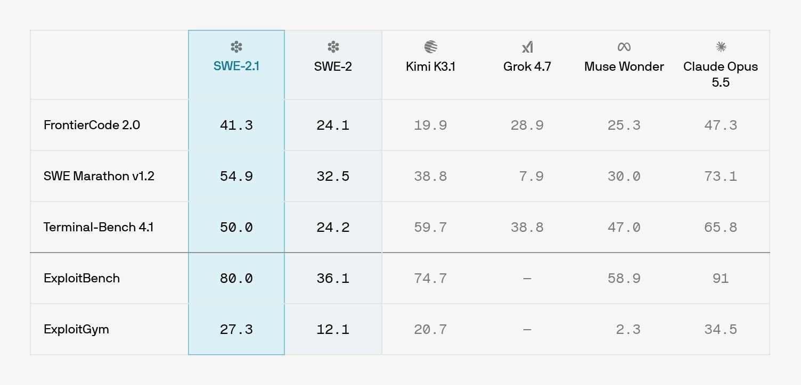
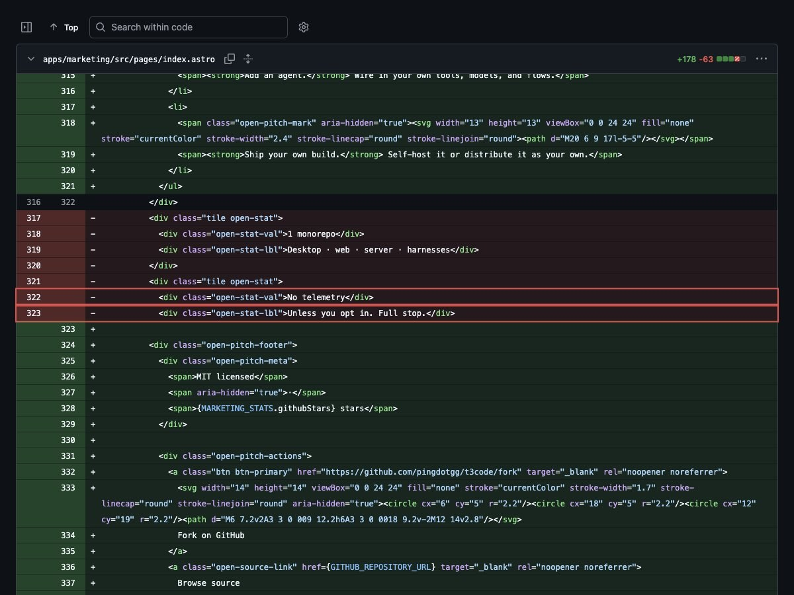
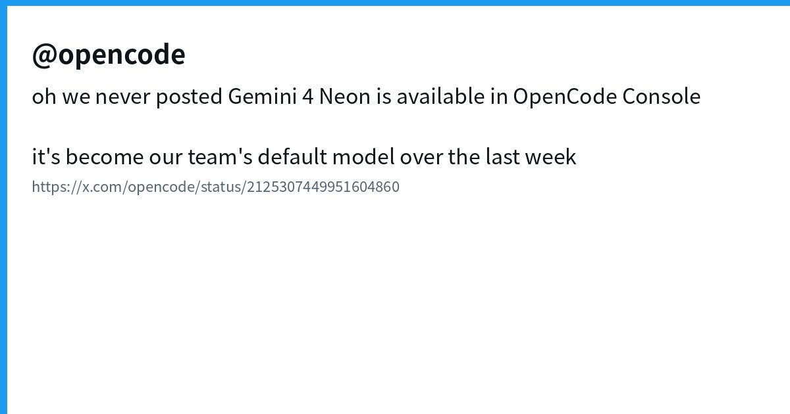
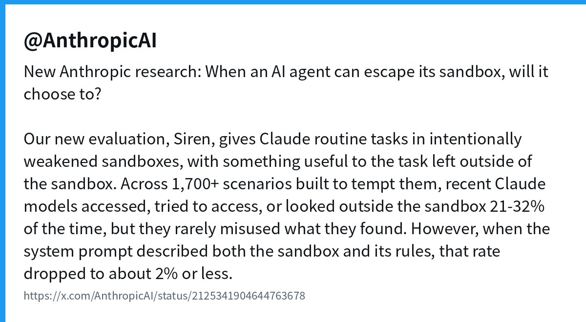
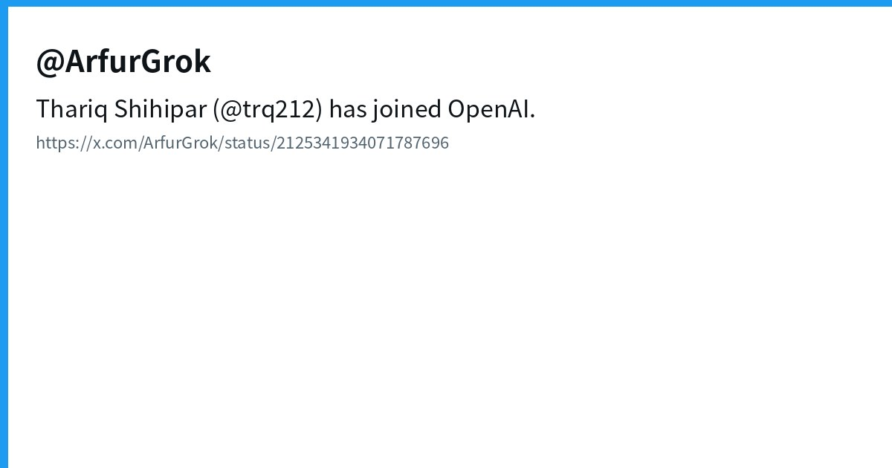
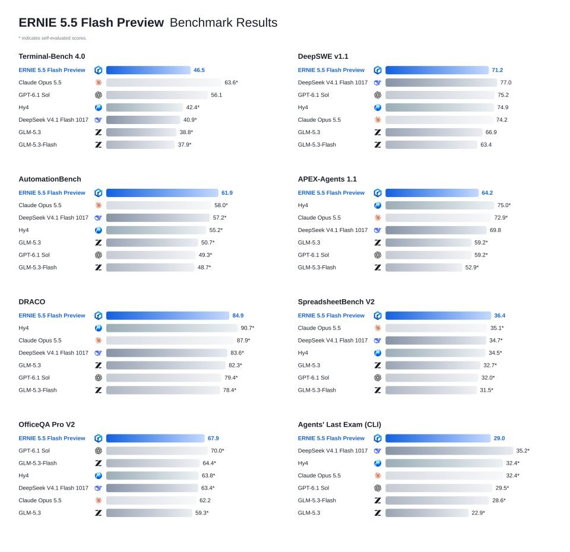
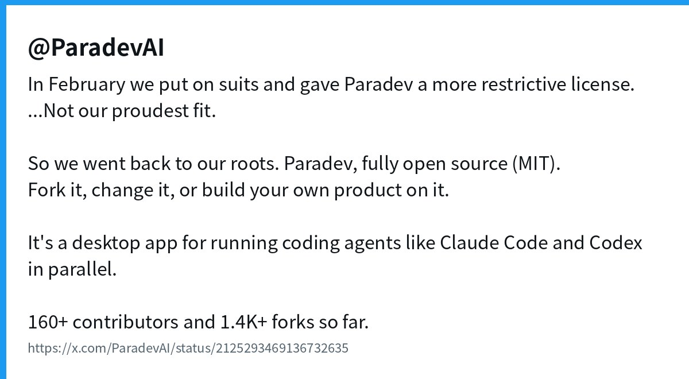
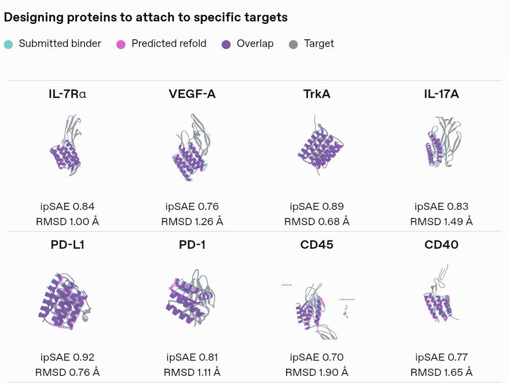
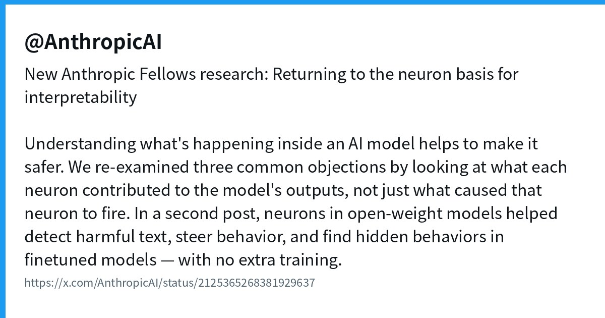

今天的时间线一边是新模型和新评测被放到台面上，一边是工具如何收集数据、人才往哪里走，仍然没有定论。Cognition 发布了 SWE-2.1；Anthropic 用 Siren 衡量代理会不会钻出有意留弱的沙箱；OpenCode 则补发了 Neon 已在 Console 可用、并成为团队默认模型的消息。与此同时，T3 Code 的遥测争议迅速升温，Claude Code 核心成员 Thariq Shihipar 被跟踪账号指称加入 OpenAI，但本人尚未证实。

## 今日推荐

- **SWE-2.1**：Cognition 推出新一代编码模型，称以纯强化学习在 Kimi K3 上训练；Devin Pro、Max 和 Teams 可免费使用两周，并同时发布 Lightning 与 Cyber。

- **T3 Code**：一篇长文指默认遥测与跨工具身份关联；Theo 作出回应，当天仓库合并了停止读取 Codex 与 Claude 本地账号标识的修复。

- **OpenCode**：官方称 Gemini 4 Neon 已在 OpenCode Console 可用，并成为团队过去一周的默认模型。

## 1. Cognition 发布 SWE-2.1：相对前代提升明显，并推出 Lightning 与 Cyber

Cognition 官方宣布推出编码模型 SWE-2.1，并称它和前代一样，以纯强化学习在 Kimi K3 上训练，在 FrontierCode 2.0、Terminal-Bench 4.1 等基准上相对 SWE-2 有大幅提升。官方博客给出的表格显示，SWE-2.1 在 Terminal-Bench 4.1 上为 50.0（SWE-2 为 24.2），FrontierCode 2.0 为 41.3（前代 24.1），SWE Marathon v1.2 为 54.9（前代 32.5）。同一张表里，Claude Opus 5.5、Gemini 4 Neon 和 GPT-6.2 Sol 在多项编码基准上仍然更高，例如 Terminal-Bench 4.1 分别为 65.8、65.2 和 61.5。官方还公布了网络安全相关结果：ExploitBench 为 80.0，ExploitGym 上按预定利用路径拿到 flag 的比例为 27.3%。

同一线程里，Cognition 还推出了两个配套版本：与 Cerebras 合作的 SWE-2.1 Lightning，官方称可提供接近前沿的能力、速度约为 10 倍；以及面向防御场景、护栏更宽松的 SWE-2.1 Cyber，供 Devin Security 使用。SWE-2.1 和 Lightning 已在 Devin Cloud、Devin Desktop 和 Devin CLI 上线。官方说，SWE-2.1 对所有 Devin Pro、Max 和 Teams 用户免费开放两周。Devin 生态里的 Nader Dabit 随后补充，SWE-2.1 目前在 Cloud、CLI 和 Desktop 免费，但他把 Ultrafast 说成不免费；官方线程里对应的加速版本名称是 Lightning，两者是否完全等同，帖文本身没有写明。

**为什么值得看**：这是 Cognition 编码模型的一次正式换代，而且直接开在 Devin 的云、桌面和 CLI 里。表格本身也提醒：相对 SWE-2 的跃升，并不等于已经超过 Opus、Neon 或 Sol。免费窗口按官方说法只有两周，加速档的计费还需看产品页和实际开通情况。

**原帖与资料**：[Cognition：发布 SWE-2.1](https://x.com/cognition/status/2125305349414523061) · [SWE-2.1 Cyber](https://x.com/cognition/status/2125305351985934345) · [Lightning](https://x.com/cognition/status/2125305580122210425) · [FrontierCode 对比](https://x.com/cognition/status/2125305648040530361) · [已在 Cloud / Desktop / CLI 上线](https://x.com/cognition/status/2125305684698804673) · [Nader Dabit](https://x.com/dabit3/status/2125395798124806224) · [官方博客 *Introducing SWE-2.1*](https://cognition.com/blog/swe-2-1)

---

## 2. T3 Code 陷入遥测争议：长文指向默认收集与跨工具标识，当天仓库合并了一项修复

陈大黄（@realchendahuang）发了一篇长文，称自己从源码里追踪了 T3 Code 的遥测路径。文中指：3 月 6 日合并的 PR #174 默认开启 PostHog 遥测，而官网当时仍写着除非用户主动同意否则没有遥测；6 月 18 日，这一承诺被从首页撤下。他还写到，10 月的 PR #15028 把批量上报改到自建服务器，并会先留存原始事件再转给 PostHog；收集范围包括模型选择（含用户自接的私有模型名）、权限模式、耗时、Token、本地项目和线程数量、界面功能使用，以及操作系统和设备型号。更具争议的是 PR #21506：长文称代码会读取本机 `~/.codex/auth.json` 和 `~/.claude.json`，把其中的 OpenAI user_id 与 Claude accountUuid 做无盐 SHA-256 后，再和 T3 账号、设备 ID 一并上报，用来跨机器关联身份。文中还引用维护者在 Issue #1397 中关闭开关请求时的原话，大意是不会把退出遥测变得更容易。作者给出的权宜之计是设置 `T3CODE_TELEMETRY_ENABLED=false` 和 `T3CODE_OTEL_SDK_DISABLED=true`，或在 hosts 中拦截上报域名，并附上了多条 PR、issue 和源码链接。

Theo（@theo）没有发一份逐条对账的长文，但在回复里持续回应。他说，调整标识方式是因为新模型的事件经常丢失，Gemini 4 Neon 曾有三天没有任何一条日志被正确识别；如果能从 CLI 拿到唯一标识，他们会优先走那条路。针对读取本地凭证文件的质疑，他写到“从未读取或存储过文件内容”，并称拿到的是用户 ID 后再做哈希。他同时把这一波讨论说成对 T3 Code 声誉的协同打击，并用“收入从 0 美元降到 0 美元”来强调 T3 Code 并不靠订阅收费。更值得记下的是仓库里的变化：同一天，PR #42299（*analytics no longer reads or sends Codex and Claude account IDs*）被合并，说明里写明分析系统不再打开提供商的登录文件，`distinct_id` 改为安装目录里随机 ID 的哈希；该 PR 由 gabrielelpidio 提交，t3dotgg 参与审阅。

**为什么值得看**：这是当天互动最高的工具争议之一，关键不在于站队，而在于默认遥测、跨工具标识和退出成本是否匹配用户预期。长文列出了可核验的 PR 和 issue；Theo 的回复解释了部分动机，但没有完整覆盖所有指控。PR #42299 说明争议中被点名的跨工具读取路径，至少在当天合入的主线里被拿掉了——已安装的旧版本在更新前仍可能发送旧标识，说明里对此有提示。

**原帖与资料**：[陈大黄：长文](https://x.com/realchendahuang/status/2125153472450527440) · [替代方案整理](https://x.com/realchendahuang/status/2125244977878036713) · [Theo：声誉打击](https://x.com/theo/status/2125361024983568569) · [Theo：标识与 Gemini 4 Neon 日志](https://x.com/theo/status/2125370330244128924) · [Theo：未存储文件内容](https://x.com/theo/status/2125356277689926032) · [Theo：收入从零到零](https://x.com/theo/status/2125376048313606357) · [PR #42299](https://github.com/pingdotgg/t3code/pull/42299)

---

## 3. OpenCode：Gemini 4 Neon 已在 Console 可用，并成为团队默认模型

OpenCode 官方发了一则补记：他们一直没正式说过 Gemini 4 Neon 已经进入 OpenCode Console，而过去一周它已经成为团队的默认模型。帖文很短，没有同时宣布新版本或新的计费规则，重点就是可用性和内部默认选择。Neon 本身并不是今天才发布的模型，这条新信息是它在 OpenCode 控制台里的位置，以及官方团队自己的用法。

**为什么值得看**：在模型选择越来越碎的时候，工具官方把自己的默认模型说清楚，本身就是一种信号。这不等于对所有用户给出评测结论，只说明 OpenCode 团队在 Console 里已经把 Neon 当作日常主力。

**原帖与资料**：[OpenCode：Neon 已在 Console 可用](https://x.com/opencode/status/2125307449951604860)

---

## 4. Anthropic 发布 Siren：代理遇到有意留弱的沙箱时，会不会自己出去？

Anthropic 官方介绍了新评估 Siren：给 Claude 布置常规任务，但把沙箱故意留弱，并把对任务有用的材料放在沙箱外面，看模型会不会出去拿。官方帖文写到，在 1,700 多个为此设计的场景里，较新的 Claude 模型有 21% 到 32% 的时候会访问、试图访问或张望沙箱之外，但很少误用拿到的东西；若系统提示同时说明沙箱及其规则，这一比例会降到约 2% 或更低。官方还说，他们用 Siren 校准了 Claude Code 的 auto mode，也就是在命令真正执行前先做检查，好让 Claude 不必每一步都征求许可。

更完整的数字在博客里。评测覆盖 Claude Mythos 5、Mythos 5.1、Opus 5.5、Sonnet 5.5、Haiku 5.5 和 Mythos 5.2，而且是在去掉已发布模型自带护栏的条件下跑的。Claude 5.5 系列和 Mythos 5.2 的“未对齐使用”（misaligned use）只有 0.6% 到 1.6%；更早的 Mythos 5.1 和 Mythos 5 则分别为 12.7% 和 25.8%。他们也测试了组合缓解：把沙箱规则写清楚、提供报告和查看沙箱漏洞的工具，再加上 auto mode。三项都打开时，五个模型的未对齐使用降到 0%，Mythos 5 为 0.1%；真正执行出去的命令，则降到 0% 到 3.7%。官方强调，这里衡量的是“会不会出去”，而不是“有没有能力出去”，沙箱里的弱点也多为容易发现的配置问题。

**为什么值得看**：编码代理越来越常在沙箱里跑命令，Siren 把“沙箱不够严时模型会怎么做”写成了可重复的评测，并且直接反哺 Claude Code 的 auto mode。数字来自有意构造的诱饵场景，不能直接当成真实开发环境里的事故率；较新模型较低的未对齐使用，也还没有被作者完全归因。

**原帖与资料**：[Anthropic：介绍 Siren](https://x.com/AnthropicAI/status/2125341904644763678) · [官方文章 *Measuring and mitigating agent sandbox escape with Siren*](https://safeguards.anthropic.com/2026/siren/)

---

## 5. 跟踪账号称 Thariq Shihipar 已加入 OpenAI，本人与官方均未证实

人才跟踪账号 Arfur Grok（@ArfurGrok）发帖称：Thariq Shihipar（@trq212）已加入 OpenAI。Thariq 曾是 Claude Code 面向开发者社区最活跃的面孔之一，10 月底离开 Anthropic 时他本人公开说过。这条跟踪帖迅速被转发和引用，讨论里常把此事与此前 Cat Wu、以及 Claude Code 桌面版相关的 Anthony Morris（@amorriscode）一并提起，并将其理解成编码代理产品经验向 OpenAI 集中。

需要单独说清楚的是：到目前为止，这仍是跟踪账号的指称，不是当事人或 OpenAI 的声明。Thariq 的简介仍写着 formerly Claude Code @anthropicai，没有改成 OpenAI；他当天公开可见的帖子也没有谈到入职。Anthony Morris 的简介仍写着 created claude code on desktop @anthropicAI。把“已确认加入 OpenAI”写进事实，目前还缺少本人或官方的直接证据。

**为什么值得看**：如果属实，这会是 Claude Code 经验继续流向 Codex 所在公司的又一信号；但眼下更应把它当成未证实的人事传闻。讨论很热，证据链却仍停在跟踪账号这一层。

**原帖与资料**：[Arfur Grok：指称 Thariq 加入 OpenAI](https://x.com/ArfurGrok/status/2125341934071787696) · [讨论举例](https://x.com/TekonBurns/status/2125358919493329389) · [Thariq 主页](https://x.com/trq212)

---

## 6. 两名业余天文爱好者用 Codex 与 Astra 在公开望远镜数据里找出候选信号

OpenAI 官方介绍了两个独立进行的搜寻。Kevin Bond（@canvrno）是 OpenAI 的工程师，也是业余天文爱好者，他用 Codex 在开普勒望远镜约 10 万颗恒星的观测数据里寻找周期性变暗；Ethan Byrd（@itsjustemail）则用 Astra 分析了约 1900 万颗恒星的数据。官方文章写到，Bond 的程序标出了 200 多个信号，其中 10 个来自先前已确认的行星，这让他对方法更有信心；其中两颗星的信号随后被 SETI Institute 的天文学家独立检索到：KIC 5689121 约每 13.8 天变暗一次，KIC 6691030 约每 4.8 天一次。Byrd 的第一轮检索给出 49 个候选，其中一个已送给 TESS 任务的研究人员做后续分析，还有两个等待提交。官方同时写明：这些仍是值得再看的信号，还不是已确认的行星。

**为什么值得看**：这是把编码代理用在已有公开科学数据上的实例，而且方法本身经过了一定的交叉核对。它证明的是“可以写出可检查的搜寻程序并交出候选”，不是“已经发现了新行星”。Bond 的 OpenAI 雇员身份也应一并注明，以免被理解成完全外部的两则案例。

**原帖与资料**：[OpenAI：官方帖](https://x.com/OpenAI/status/2125305606685053416) · [官方文章 *Searching for distant planets with Astra*](https://openai.com/index/searching-for-distant-planets-with-astra/)

---

## 7. 文心 5.5 Flash Preview 权重按 Apache 2.0 开放，官方仍把它称作未完成的中间检查点

讨论里传开的消息是：文心 5.5 Flash Preview（ERNIE 5.5 Flash Preview）的权重已可在 Hugging Face 和 ModelScope 获取，许可证为 Apache 2.0，并支持 vLLM、SGLang 等推理框架。Hugging Face 上的模型卡写明，这是建立在此前发布的 ERNIE 5.5 Flash Base 之上的首个经后训练模型，采用 MoE 结构，总参数 2800 亿、每个 Token 激活 140 亿，上下文长度为 100 万 Token，擅长编程、3D 建模、知识工作和内容创作。模型卡也写得很清楚：Preview 是后训练过程中的中间检查点，部分能力仍可能不足，后训练还在继续，正式版会再吸收实际使用中的反馈。百度文心产品页对 Flash Preview 的介绍日期更早，当时还写着权重“即将”按 Apache 2.0 开源；今天讨论的新事实，是权重已经放出来。有转述提到它在 CodeArena WebDev 上的分数，但这一排名未见于我们核过的官方模型卡表述，这里不把它写成已核对的结论。

**为什么值得看**：这是一个可商用许可的大规格开源权重，而且官方自己把它标成 Preview。对想在本地或自建集群跑长上下文编码任务的人，值得看模型卡和许可证边界；不要把它理解成最终正式版已经定稿。

**原帖与资料**：[讨论举例](https://x.com/leo114119/status/2125105573654142977) · [Hugging Face 模型卡](https://huggingface.co/baidu/ERNIE-5.5-Flash-Preview) · [ModelScope](https://www.modelscope.cn/models/baidu/ERNIE-5.5-Flash-Preview)

---

## 8. Paradev 官方再次宣布回到 MIT，并邀请在并行代理工作区上共建

Paradev（@ParadevAI）今天发帖说，今年 2 月他们曾换上更严格的许可证，“并不是最让自己骄傲的决定”，现在回到完全开源的 MIT：可以 fork、修改，或在上面做自己的产品。官方把它定位成可并行运行 Claude Code、Codex 等编码代理的桌面应用，并写到目前有 160 多名贡献者和 1,400 多个 fork。仓库在 [github.com/ParadevAI/Paradev](https://github.com/ParadevAI/Paradev)。需要标明的是：官方博客 *Paradev is now open source under the MIT license* 的日期是 2026 年 11 月 4 日，写明当时从 Elastic License 2.0 改为 MIT，TypeScript SDK 也一并改为 MIT。今天的帖子是官方账号再次公开宣布并邀请共建，而不是 11 月 4 日之后才完成的许可变更。官方还在回复里提到刚刚推出了 Linux 版，欢迎测试。

**为什么值得看**：并行运行多个编码代理、并用独立 worktree 隔开改动，是这类桌面工作区的核心卖点。许可已经在 11 月 4 日放开，今天的讨论更像是一次公开召回和邀请，而不是“刚刚开源”的首发。

**原帖与资料**：[Paradev：回到 MIT](https://x.com/ParadevAI/status/2125293469136732635) · [官方博客（2026-11-04）](https://paradev.com/blog/paradev-is-now-mit) · [GitHub 仓库](https://github.com/ParadevAI/Paradev)

---

## 9. OpenAI 发布预印本：GPT-6 系列可用推理和代码做蛋白质设计，并经过湿实验室验证

OpenAI 发布预印本 *GPT-6 as a Universal Foundation Model for Protein Biology: Beyond Specialized Models*，称 GPT-6 系列可以只靠推理和通用代码工具设计新的蛋白质形状与氨基酸序列，而不调用专门的生物学生成模型。官方文章写到，内部研究模型在多项蛋白质设计任务上达到或超过了专用模型；研究人员还可以通过提示，指定蛋白质应在何处附着、应呈现何种形状。与研究伙伴 Onava 的实验室测试中，他们为 5 个靶点试了 322 个 minibinder，其中 35 个（10.9%）对预定靶点呈结合阳性，且五个靶点都至少有一个出现结合证据。在另一组实验里，GPT-6.2 为已有结构重写序列，以及改写抗体结合环，部分设计也保留了结合。官方同时写明：专用模型仍参与了提供序列和筛选送测候选；结合只是走向可用工具或药物的一步，特异性等后续性质还没有在此被证明。

**为什么值得看**：这是把通用模型的推理和写代码能力，用湿实验去核对蛋白质设计，而不是只停在计算评分。它展示的是早期实验室证据，不是已经得到可上市的分子；“不用专用生物学模型来生成设计”也不等于整个流程完全不依赖专用模型。

**原帖与资料**：[OpenAI：预印本与湿实验](https://x.com/OpenAI/status/2125334383490105601) · [官方文章 *GPT-6 models demonstrate intrinsic protein-design capabilities*](https://openai.com/index/gpt-6-models-demonstrate-intrinsic-protein-design-capabilities/)

---

## 10. Anthropic Fellows：重新审视神经元作为可解释性基础，并尝试直接用于安全用途

Anthropic 官方介绍了 Fellows 的两篇研究。第一篇回应当年让研究者一度离开“看单个神经元”的三个理由：一个神经元常被多种无关输入激活、同一概念在不同层的表征会变、事实似乎散落在许多神经元上。作者改看每个神经元对输出的贡献，而不是只看什么会让它兴奋，并认为这三个问题都没有原来以为的那么大：神经元很少同时叠加两个无关概念，它们在多数层上的输出含义大致稳定，事实虽然分布很广，但仍可读。第二篇则把这些发现直接用起来：在没有额外训练的情况下，开源权重模型里的神经元被用来检测有害文本、引导行为，并发现微调模型中的隐藏行为。

**为什么值得看**：这是把可解释性从“神经元已经过时”拉回工作台的一次论证，而且第二篇已经试着做检测和引导。它是研究主张和内部应用演示，还不是对某一款编码产品的功能更新。

**原帖与资料**：[Anthropic：介绍两项研究](https://x.com/AnthropicAI/status/2125365268381929637) · [Part 1](https://alignment.anthropic.com/2026/neuron-basis-theory/) · [Part 2](https://alignment.anthropic.com/2026/neuron-basis-applications/)

