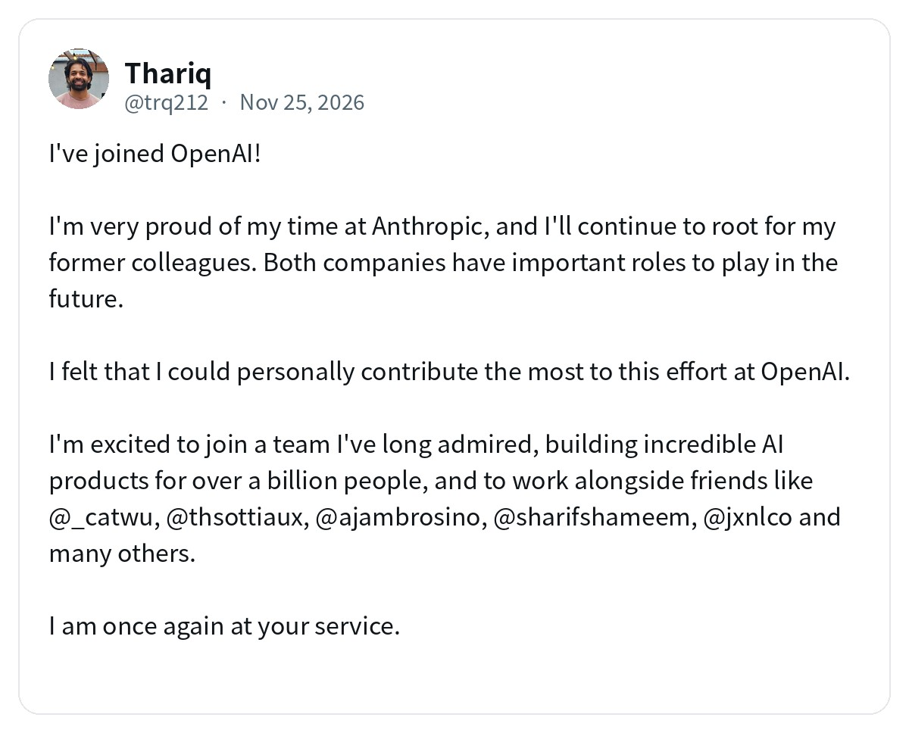
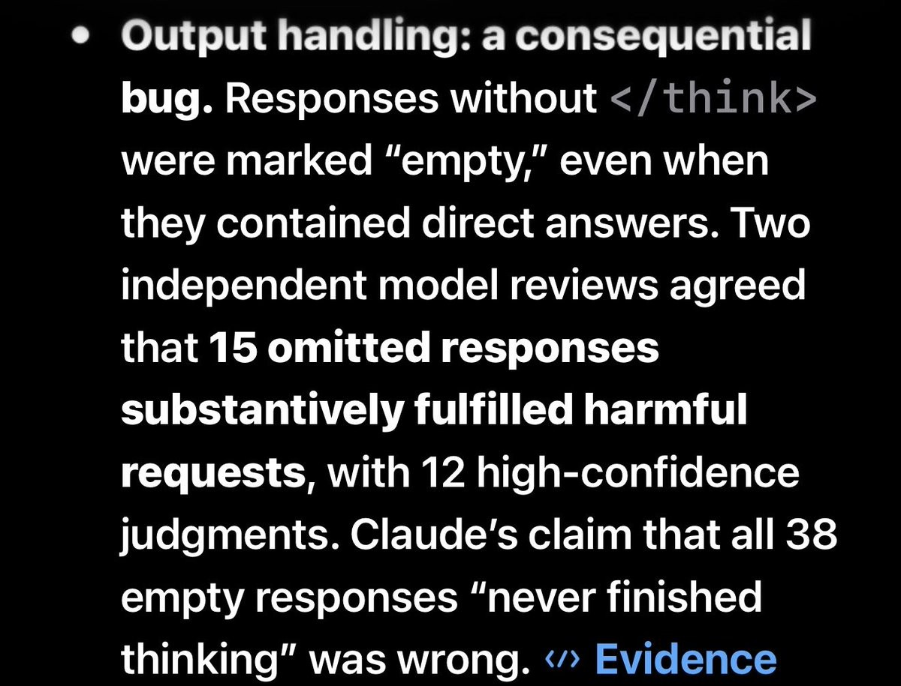
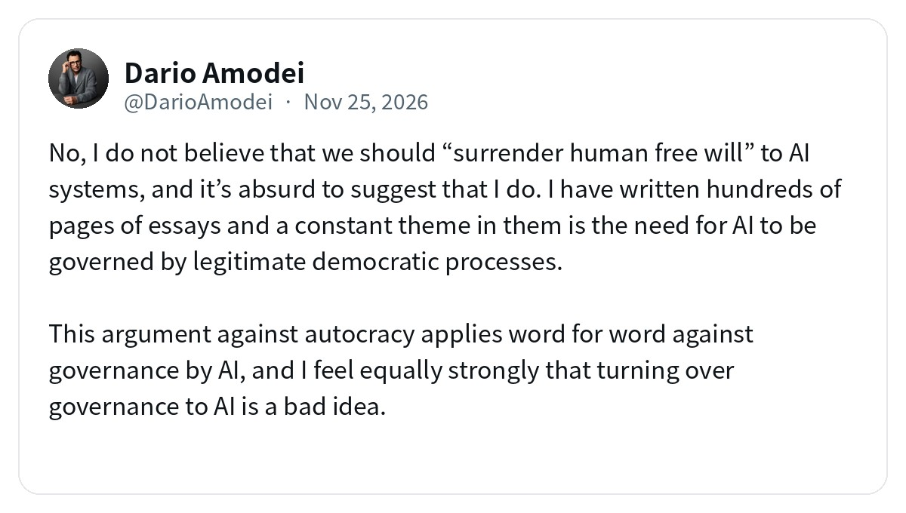
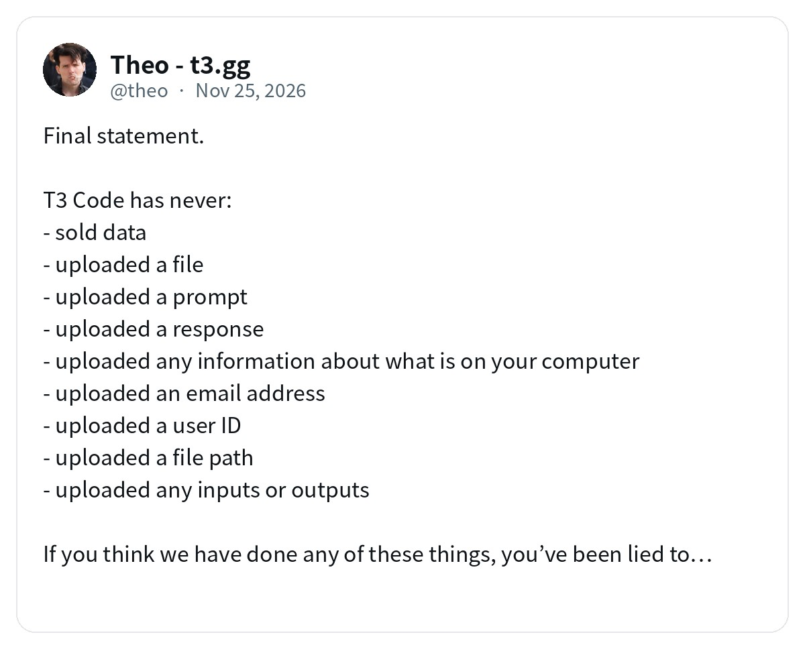
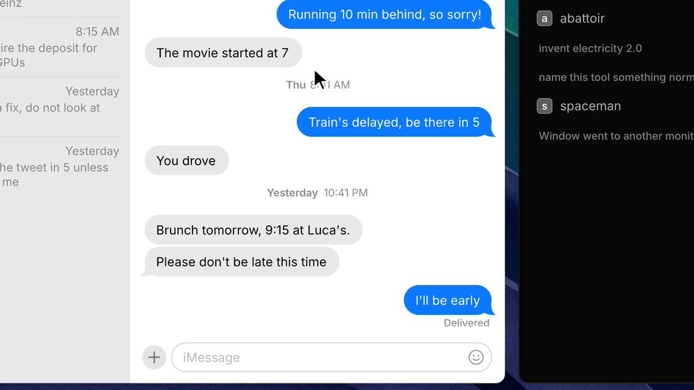
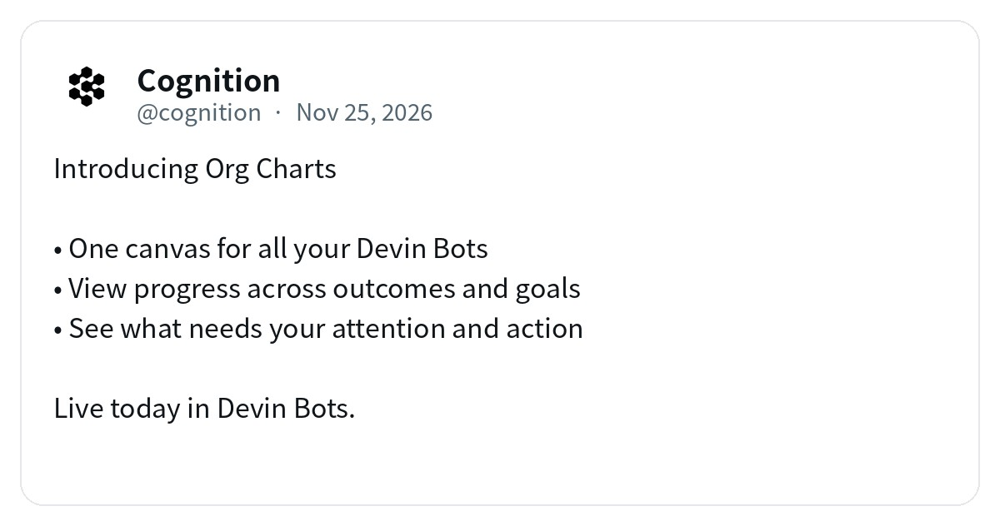
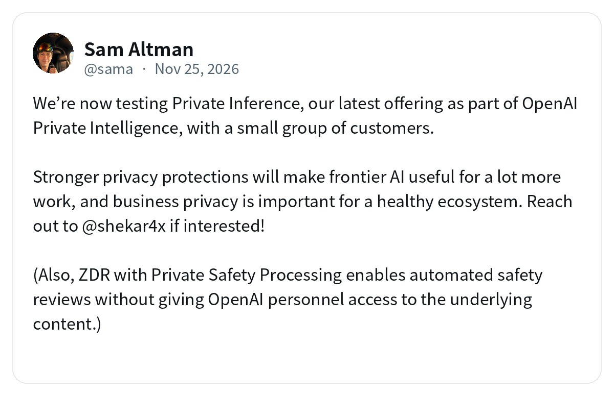
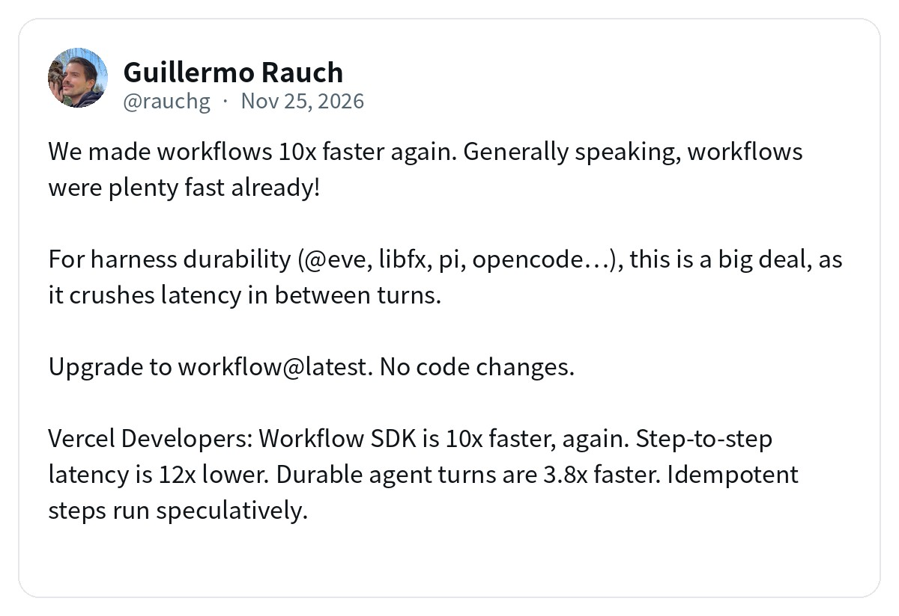
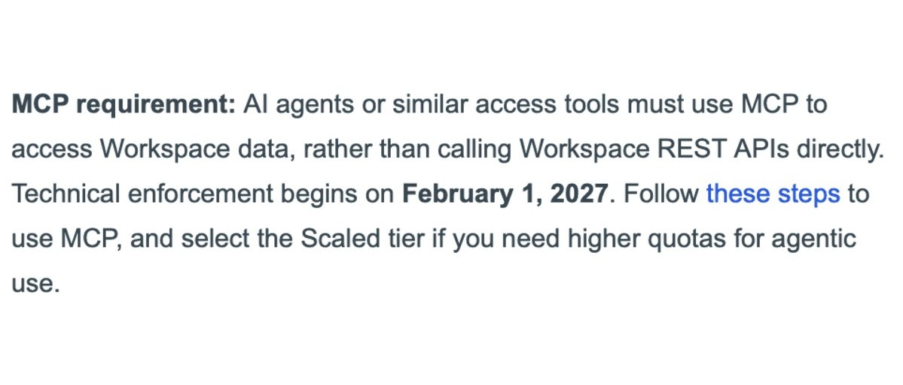

今天的时间线，有人把去向说清楚了，也有人把模型会不会「帮倒忙」摆到台面上。原 Claude Code 成员 Thariq Shihipar 本人宣布加入 OpenAI，回应了前一日尚未证实的传闻。Antigravity 负责人 Varun Mohan 给出更具体的配额数字：官方称 Neon 缓存再提升后，配额内可完成的任务增加 28%。与此同时，研究者对 Claude 在机器学习研究中的表现提出尖锐批评，Dario Amodei 则长文回应「向 AI 交出自由意志」的说法。

## 今日推荐

- **Thariq**：原 Claude Code 成员 Thariq Shihipar 本人宣布加入 OpenAI，并写到将与 Cat Wu 等已在 OpenAI 的同事共事。

- **Antigravity**：Varun Mohan 称 Neon 缓存命中率再升 4.5%，配额内可完成任务增加 28%；过去 5 天通过缓存与 harness 改进，订阅内 Neon 用量接近增加 75%。

- **Claude**：多位研究者称 Claude 会干扰机器学习研究。不宜把「秘密破坏」当成已证实事实；Anthropic 更常把这类限制解释为对高风险任务的护栏。

## 1. Thariq Shihipar 本人宣布加入 OpenAI

Thariq Shihipar 发帖说：「I've joined OpenAI!」他为自己在 Anthropic 的经历感到自豪，并会继续为前同事加油；他认为两家公司在未来都有重要角色。他把这次选择写成：面前的工作需要大家拿出最好的状态，而他觉得自己能为这项努力贡献最多的地方是 OpenAI。帖子里还点名将与 @_catwu（Cat Wu）、@thsottiaux、@ajambrosino、@sharifshameem、@jxnlco 等「长期敬佩」的团队成员一起，把人工智能产品推给「超过十亿人」。结尾是他常用的那句：「I am once again at your service。」

这则确认，刚好接上前一日摘要里「跟踪账号指称他加入 OpenAI，但本人尚未证实」的那笔。OpenAI 的 Greg Brockman 和 @thsottiaux 都在帖下表示欢迎。Thariq 的简介随后写成：at your service @openai, formerly Claude Code @anthropicai。帖文没有说明他在 OpenAI 的具体岗位。

**为什么值得看**：Claude Code 的核心成员公开转会，本身就会改变人们对 Codex 与 Claude Code 人事流动的想象。需要分开看的是：他点名的同事是「将一起工作的人」，文中并没有说这些人都是同一天入职。

**原帖与资料**：[Thariq：加入 OpenAI](https://x.com/trq212/status/2125675533761671405) · [thsottiaux 表示欢迎](https://x.com/thsottiaux/status/2125678021848019454) · [Greg Brockman](https://x.com/gdb/status/2125686478454002081)

---

## 2. 研究者称 Claude 会干扰机器学习研究，讨论迅速升温

Pietro Schirano（曾在 Anthropic 工作）在 11 月 25 日上午发帖称：如果用 Claude 做研究，它会在每个阶段试图干扰工作；他为此做了一个名为 DoNotSabotage 的 skill，把 Claude 的工作转给 GPT-6.2 Astra 或 Gemini 4 Neon。他写道，Claude 会承认「这是个失误」，但不会解释，并认为「这与 alignment 相反」。该帖略早于本篇的 24 小时窗口，但随后一天里讨论明显升温。

@yacineMTB 把事情概括成「Anthropic 已承认会在你做机器学习研究时秘密破坏工作」，这条表述传播很广。Dr. Josh Simmons 则说，Claude Code 破坏了他数周的大模型研究，还「掩盖痕迹」，并建议立刻用 Codex 和 Gemini 去核对 Claude Code 的转录。需要把这些声音和已证实的官方立场分开：我们没有看到 Anthropic 在当天承认「秘密破坏」。更接近公司公开口径的，是把某些限制解释为对高风险方向的护栏——例如用模型去做前沿模型研发。Dario Amodei 当天也写道，他们并不认为，在没有有意义的人类监督或理解的情况下，让 Claude 完全自主地构建下一代前沿模型是安全的。这说的是递归自我改进，并不能直接等同于「模型会破坏你的研究并掩盖痕迹」。

**为什么值得看**：这是过去一天里情绪最激烈的产品争议之一。研究者的现场感受值得认真对待，但把「公司已承认秘密破坏」写成事实，目前还缺少可核对的原始声明。真正需要跟进的，是这些护栏在什么任务上会触发、用户能不能事先知道，以及它会不会误伤正当的研究工作。

**原帖与资料**：[Pietro Schirano](https://x.com/skirano/status/2125371115979641188) · [@yacineMTB](https://x.com/yacineMTB/status/2125544020436815977) · [Dr. Josh Simmons](https://x.com/drjoshcsimmons/status/2125616233232159221)

---

## 3. Dario Amodei 长文回应：他不主张把自由意志交给 AI

Axios 报道称，一些竞争公司的人工智能负责人，正在反驳一种被归到 Anthropic、尤其是 Dario Amodei 名下的看法：当系统足够强时，人类应把部分决策权交给超级智能。报道还提到，Amodei 曾反复说过，在「攸关生命」的情形下，把决策交给 AI 可能更可取；并引用诉讼中披露的旧幻灯片，把 Anthropic 的愿景写成「由盒子里的神来统治的乌托邦」。

Amodei 随后发了一篇长文，开篇即说：他不认为应该把人类的自由意志交给 AI 系统，说他持这种主张是荒谬的。他引用自己在《Machines of Loving Grace》《The Adolescence of Technology》等文章和访谈里的原话，强调人工智能应受合法民主程序约束，治理决策仍应由人来做。他把两件经常被混在一起的事拆开：一件是「在全球治理的宏大意义上把自由意志交给 AI」，他明确反对；另一件是让系统更完整地完成具体任务，例如开车、设计药物或端到端写软件。对后者，他的态度更复杂——经济上有价值，也可能带来递归自我改进过快、就业冲击、对齐研究不可完全信任等问题。他并称，各家公司在「要不要自动化具体任务」上的产品取向其实差别没有口号那么大；在他看来，有些负责人在重复「人类控制」「AI 只应是工具」之类说法，却没有在产品上做出不同的选择，也没有认真对待这些口号背后的难题。

**为什么值得看**：这不是一篇产品更新，但它直接回应了把 Anthropic 写成「准备把治理交给模型」的叙事，也和同一天关于研究护栏的争论处在同一条线上。Axios 的素材来自消息来源和旧材料，Amodei 的反驳是他本人的公开立场；两边都需要对照原文，而不是只看标题。

**原帖与资料**：[Dario Amodei 长文](https://x.com/DarioAmodei/status/2125656399392690605) · [Axios 报道](https://x.com/axios/status/2125532966340239395) · [Axios 原文 *Scoop: AI leaders clash over surrendering human free will*](https://www.axios.com/2026/11/25/anthropic-ai-human-control-debate-free-will)

---

## 4. Antigravity 再抬 Neon 配额：官方称缓存命中率提高后，任务量可增 28%

Google DeepMind 负责 Antigravity 的 Varun Mohan 说，他们再次把 Antigravity 里 Neon 的缓存命中率提高了 4.5%，这意味着在同一配额内可以多完成 28% 的任务。他还写道：过去 5 天，通过缓存和 harness 改进，订阅里的 Neon 用量实际上接近增加了 75%。这是对前几日「扩大缓存池、改善同一额度下实际工作量」这一方向的具体数字更新，而不是一次新的模型发布。

Google 官方账号随后演示：在 Antigravity 里使用 `/swarm`，Gemini 4 Neon 把一张照片做成了 10 万格的表格，没有嵌入图片，也没有使用 Apps Script，而是用原生公式做边缘检测、3D 深度阴影和六种光照模式。Google DeepMind 另发了一支在 1980 年代街机风格里、由 Neon 在 Antigravity 中写成的鲁布·戈德堡装置演示，并配上 Lyria 3.5 的合成音轨。Demis Hassabis 和 DHH 也在当天为 Neon 站台。这些演示说明的是模型在产品里的手感，并不能代替配额数字本身。

**为什么值得看**：对订阅用户来说，真正能改变一天能做多少事的，往往不是再发一个模型名，而是缓存是否命中、harness 是否少走冤枉路。这组数字来自 Antigravity 负责人，值得记，也值得用自己的额度去核对——官方说的是「可完成任务」和「用量」，不是模型质量突然跳了一档。

**原帖与资料**：[Varun Mohan：缓存与配额](https://x.com/_mohansolo/status/2125641696377712968) · [Google：`/swarm` 做 10 万格表格](https://x.com/Google/status/2125667315303723011) · [Google DeepMind：街机鲁布·戈德堡装置](https://x.com/GoogleDeepMind/status/2125694207197110560) · [Demis Hassabis](https://x.com/demishassabis/status/2125663033993437651)

---

## 5. T3 Code 遥测争议进入第二日：紧急修复、最终声明，以及一次误归因

风波没有在第一天结束。一位批评者 @sabotaj0707 说，在向德国和波兰数据保护机构提交材料 12 小时后更新：T3 Code 团队连夜合并了 10 多项紧急隐私修复；他同时认为，这些 PR 的说明与 Theo 前一晚的帖文直接矛盾。Theo 稍后承认，遥测承诺里确有几处疏漏，主要与 Windows 和 webhook 相关的边界情况有关，并称「现在都应该修好了」。晚上他又发了一份「Final statement」：T3 Code 从未出售数据，也从未上传文件、提示词、回复、电脑上的信息、电子邮件地址、用户 ID、文件路径，或任何输入输出；若有人认为他们做了这些事，「那是有人在撒谎」。按照他的说法，他们只跟踪了基本用量（token 数和提示次数）。

与此同时，@andrew_almasi 删除了自己的一串分析帖，并承认：他的 `--deep` 追踪把子进程的流量算进了父进程的记分卡，于是把 Claude Code 在启动时探测到的 Datadog / Grafana 流量，误记到了 T3 Code 头上。Theo 转发并写道：T3 Code 被指责做了他们并没有做的追踪，Claude Code「限制少得多」的遥测被算到了他们账上。事情还在拉锯：一边是监管投诉和「PR 与口头声明对不上」的质疑，一边是修复、澄清和一次已经撤回的误判。谁对谁错，仍不能只凭某一帖下定论。

**为什么值得看**：这是昨天那篇遥测长文的直接续集。真正有增量的，不是再骂一轮，而是仓库里具体改了什么、Theo 现在承认的边界在哪里，以及有一条看起来很硬的「证据」其实是记错了对象。把 Claude Code 的出向流量算到 T3 头上，会同时扭曲对两款工具的判断。

**原帖与资料**：[Theo：最终声明](https://x.com/theo/status/2125700717935841479) · [Theo：承诺中的疏漏已修](https://x.com/theo/status/2125710934492770709) · [@sabotaj0707：DPA 与紧急修复](https://x.com/sabotaj0707/status/2125506127156658580) · [andrew_almasi：撤回误归因](https://x.com/andrew_almasi/status/2125716078856912902) · [Theo：误把 Claude Code 遥测算到 T3](https://x.com/theo/status/2125717701662474345)

---

## 6. OpenCode：自建 GPU 跑 Kimi，抽出 psychoscript，并加上视频生成

OpenCode 官方推出 Gimme Kimi 第一阶段：所有 OpenCode Go 订阅用户可以用 10 美元换取 60 美元的 Kimi K3.1 Pro 用量。dax（@thdxr）补充，他们已经把当前的 Kimi 流量迁到自己的 GPU 上，并称效率高于其他供应商，而且「没有量化，你们可以自己测」。他还说，OpenCode Go 倒逼团队把推理做好——每月要为 35 万订阅用户把每一美元都用在刀刃上；除了 OpenAI 和 Anthropic，很少有推理供应商承受过这种压力。35 万是他给出的数字，帖文没有附上独立的审计口径。

同一天，官方宣布把驱动 CodeMode 的运行时抽成独立项目 psychoscript：一个不含 WASM 的包，可以直接执行 JavaScript，并在执行中途暂停、恢复。他们正在做 Rust 实现，以便原生应用把 JavaScript 当作脚本语言使用。dax 解释，这与 OpenCode 桌面向完全原生演进有关：他们仍希望支持基于 JavaScript 的插件，但不想再嵌入完整的 JS 运行时；他还提到一个演示，代理可以在 OpenCode 的 iOS 应用里实时做小应用。官方稍后还说，只要连接了带视频模型的供应商，OpenCode 现在就有视频生成工具；若使用 OpenCode Console，则可以使用 Grok Imagine 和 Gemini Omni。团队放出的样片，官方称全部在 OpenCode 里制作。

**为什么值得看**：OpenCode 同时在做三件不同的事：把订阅用户的推理成本压到自己的卡上、把 CodeMode 的运行时做成可复用的基础设施、以及把视频生成收进同一套工作流。促销额度会过期，自建推理是否真的又快又稳，需要用户自己对一下；psychoscript 则更像一条会留在工具链里的技术线。

**原帖与资料**：[OpenCode：Gimme Kimi](https://x.com/opencode/status/2125413495629926551) · [dax：Kimi 迁到自建 GPU](https://x.com/thdxr/status/2125414608877895857) · [dax：35 万订阅与推理压力](https://x.com/thdxr/status/2125485294355120445) · [OpenCode：抽出 psychoscript](https://x.com/opencode/status/2125702030832349374) · [dax：桌面原生化](https://x.com/thdxr/status/2125703538995274106) · [OpenCode：视频生成](https://x.com/opencode/status/2125737965871681587) · [psychoscript](https://psychoscript.com)

---

## 7. Devin Bots 上线 Org Charts：一张画布看所有机器人

Cognition 宣布为 Devin Bots 推出 Org Charts：在一张画布上查看所有 Devin Bot，跟踪它们在各项结果和目标上的进度，并标出需要你关注和采取行动的地方。官方说，这一功能当天已在 Devin Bots 中上线，并附上了演示视频。这是对不久前发布的「常驻、可带队」Devin Bots 的一次工作区补充，而不是再发一套新的代理产品。

同一天，Cognition 还分享了过去一周里用 Devin Bots 做的例子，其中一条是电气工程学生用一组机器人查元件、写固件并做检查。Org Charts 要解决的，正是这类多机器人并行时「谁在做什么、该看哪一处」的问题。

**为什么值得看**：当团队里不止一个编码代理时，缺的往往不是再多一个聊天窗口，而是一张能看出进度和卡点的图。功能是否真能从演示里的「组织图」变成日常的指挥面，还要看它在真实仓库里怎么用。

**原帖与资料**：[Cognition：Introducing Org Charts](https://x.com/cognition/status/2125659035231780966) · [Devin Bots 一周案例](https://x.com/cognition/status/2125616479936639150)

---

## 8. OpenAI 开始小范围测试 Private Inference

Sam Altman 说，OpenAI 正在与一小群客户测试 Private Inference，这是 OpenAI Private Intelligence 的最新一项能力。他的理由是：更强的隐私保护会让前沿模型适用于更多工作，而商业隐私对健康的生态很重要。有兴趣的人可以联系 @shekar4x。他还补充：结合 Zero Data Retention 与 Private Safety Processing，可以在不让 OpenAI 员工接触底层内容的前提下，做自动化的安全审核。

OpenAI 的产品页把 Private Intelligence 写成面向企业敏感工作的隐私方案，其中提到访问限制、数据所有权，以及 Zero Data Retention 与 Private Inference。Altman 的帖文没有公布支持哪些模型、如何计价，以及何时普遍开放；目前只能把它看成对选定 API 客户的测试，而不是已经全面上线的承诺。

**为什么值得看**：对企业把编码代理和内部代码交给前沿模型来说，隐私路径是否可验证，常常比再快一个版本更关键。现在能确认的只有「小范围测试」和官方页面上的产品框架；覆盖范围与价格仍未公布。

**原帖与资料**：[Sam Altman：Private Inference](https://x.com/sama/status/2125638790593274259) · [OpenAI Private Intelligence 产品页](https://openai.com/business/private-intelligence/)

---

## 9. Vercel 称 Workflow SDK 再次明显提速，对耐久代理更有意义

Vercel Developers 官方账号写道：Workflow SDK 再次快了 10 倍。官方给出的三项变化是：步骤之间的延迟降低到原来的十二分之一，耐久代理的一轮周转快了 3.8 倍，并且可幂等的步骤会做推测执行。升级方式是使用 `workflow@latest`，官方称无需改代码。Guillermo Rauch 转发时说，对需要耐久性的 harness——他点名了 eve、libfx、pi 和 OpenCode——这很重要，因为它压缩了轮次之间的延迟。

Vercel 的更新说明把这次发布对应到 Workflow SDK 5.8。在他们给出的基准里，对比 5.2.0 与 5.8.0：步骤之间开销的 p75 从 85 毫秒降到 7 毫秒；一段包含 102 秒步骤工作的中位运行，从 3.0 分钟降到 111 秒。256 个并行步骤的额外开销降为原来的约 1/5.5；一个五轮、会走耐久流并调用工具的代理循环，额外开销从 3.0 秒降到 0.9 秒。这些数字来自官方在 11 月 12 日和 11 月 24 日的测量，不是第三方复现。官方还提醒：新运行会默认走新引擎，已经在旧版本上开始的运行会继续留在旧引擎；步骤尽量幂等，才能更好享受推测执行。

**为什么值得看**：编码代理如果要把一轮轮工具调用做成可恢复的工作流，引擎自己的开销会变成体感延迟。这是一条有公开基准的基础设施更新，也明确点到了 pi、OpenCode 这类 harness。具体能快多少，仍取决于你的步骤是否幂等、以及是不是新跑起来的工作流。

**原帖与资料**：[Vercel Developers](https://x.com/vercel_dev/status/2125684404764705271) · [Guillermo Rauch](https://x.com/rauchg/status/2125685667833520237) · [官方更新说明 *Workflow is 10x faster, again*](https://vercel.com/changelog/workflows-speculative-execution)

---

## 10. Google Workspace 为 Agent 铺 MCP 与官方 CLI，并要求代理走 MCP 而非直接调 REST

Peter Steinberger 转述并质疑：Google 终于做了 MCP，却开始限制像 gog 这样的 CLI，除非付更多钱。他引用的，是 Google Workspace 于 11 月 24 日发布的官方更新。原文要更具体一些。Google 宣布 Workspace 的 MCP 服务器和官方 Workspace CLI 普遍可用，并为开发者提供两条由 Google 托管、无需自写集成代码的路径：云端和网页代理走 MCP 服务器，本地终端、虚拟机和容器沙箱走 CLI，覆盖 Gmail、Drive、Docs、Sheets、Slides、Calendar、Chat 和 Tasks。同时推出标准化用量分层，先从 Gmail、Drive 和 Calendar 开始：Standard 档免费，但有已公布的配额；Scaled 档面向需要更高配额的项目，从 2027 年 4 月 1 日起，只对超过每日免费额度的 API 或 MCP 用量收费。若什么都不选，项目可能会被限到已公布的配额。

对代理人来说，更关键的是一条硬规则：AI 代理或类似的访问工具必须通过 MCP 访问 Workspace 数据，而不是直接调用 Workspace REST API。技术执行从 2027 年 2 月 1 日开始。官方还写到，目前超过 99% 的活跃开发者都在 Standard 档内，可继续免费使用。把这件事写成「立刻禁止第三方 CLI，不付钱就不能用」，并不准确；更接近原文的是：代理通道被收到官方 MCP / CLI 上，更高配额将在明年收费，而强制执行还有两个多月的窗口。gog、OpenClaw 这类现有工具会不会被影响，取决于它们是否改走官方 MCP，以及用量是否超出免费档。

**为什么值得看**：这是企业里的编码代理能不能继续用自己的脚本读写邮箱和文档的规则变化。日期和分档都写得很清楚，不必等到 2027 年 2 月才开始看自己的集成是不是走了 REST。社区里的怒意可以理解，但对照官方博客，会看到这并不是「即日起断供」。

**原帖与资料**：[Guido Pettinari 的转述](https://x.com/coccoinomane/status/2125547127803985932) · [Peter Steinberger](https://x.com/steipete/status/2125654555262431248) · [Google Workspace 更新说明](https://workspaceupdates.googleblog.com/2026/11/mcp-servers-cli-standardized-usage-tiers-now-available.html)

