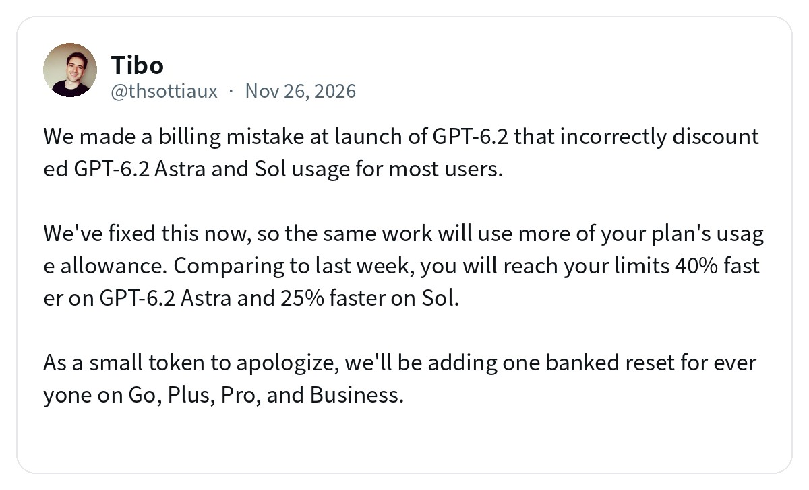
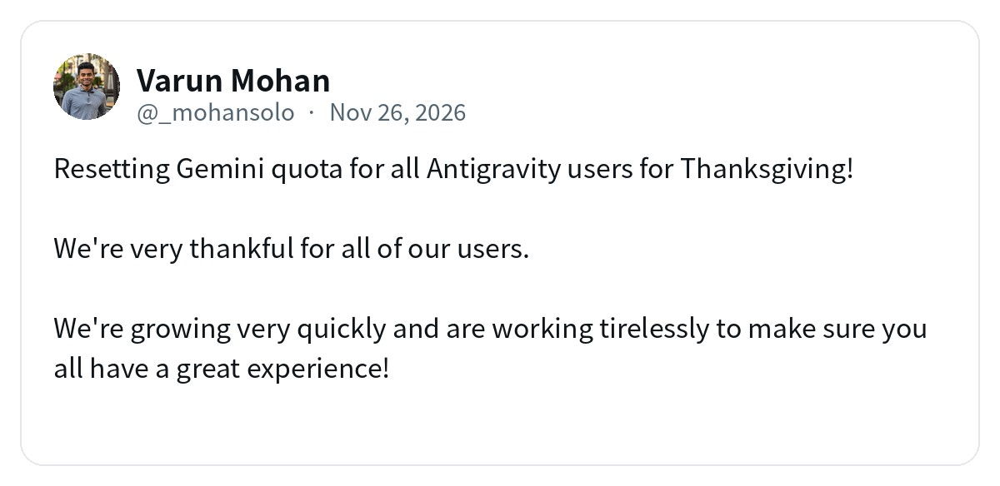
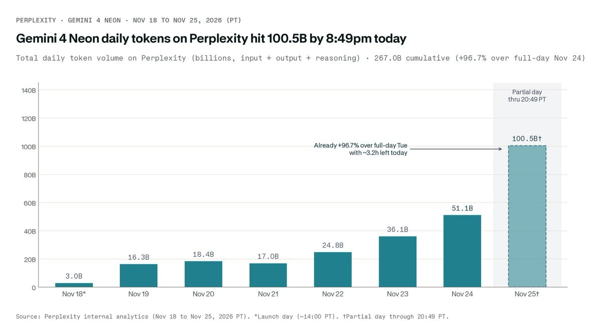
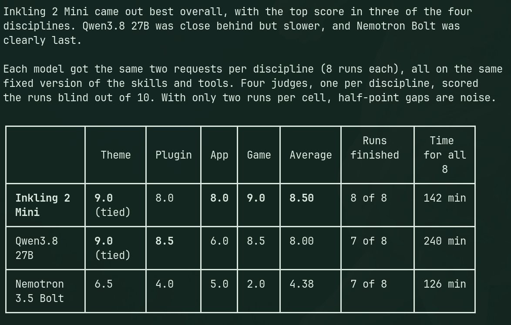
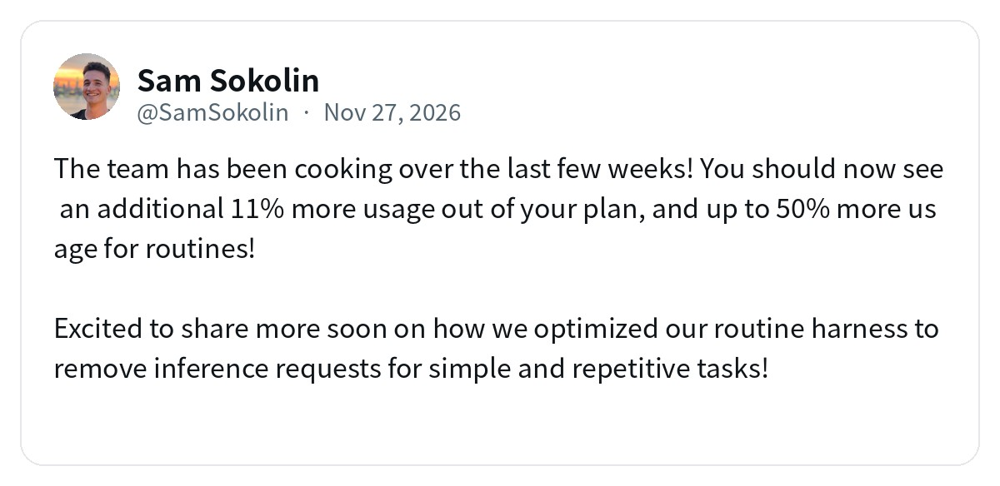
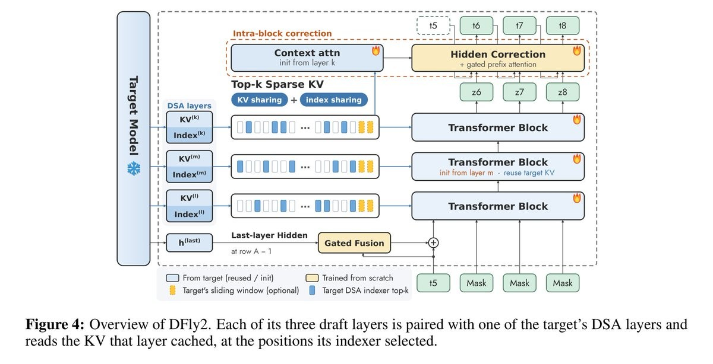
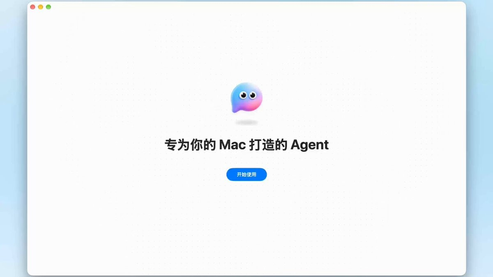
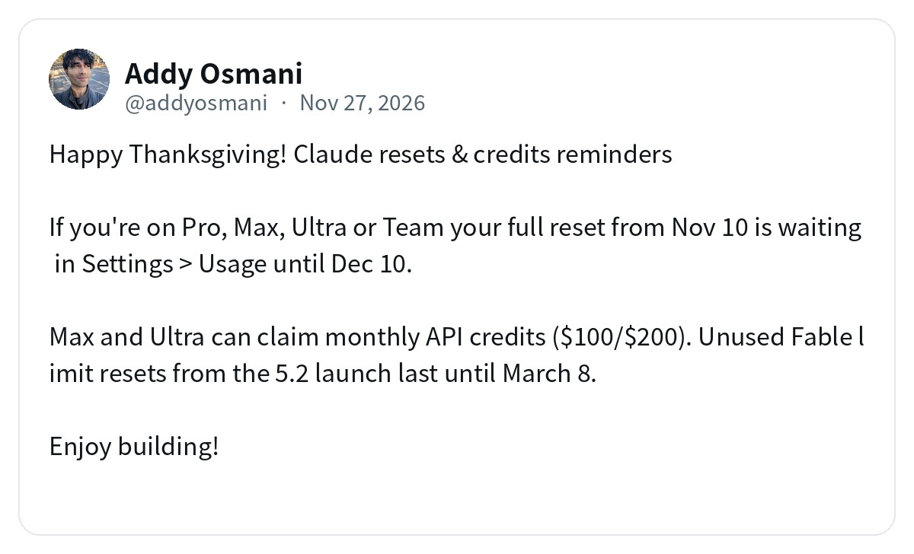
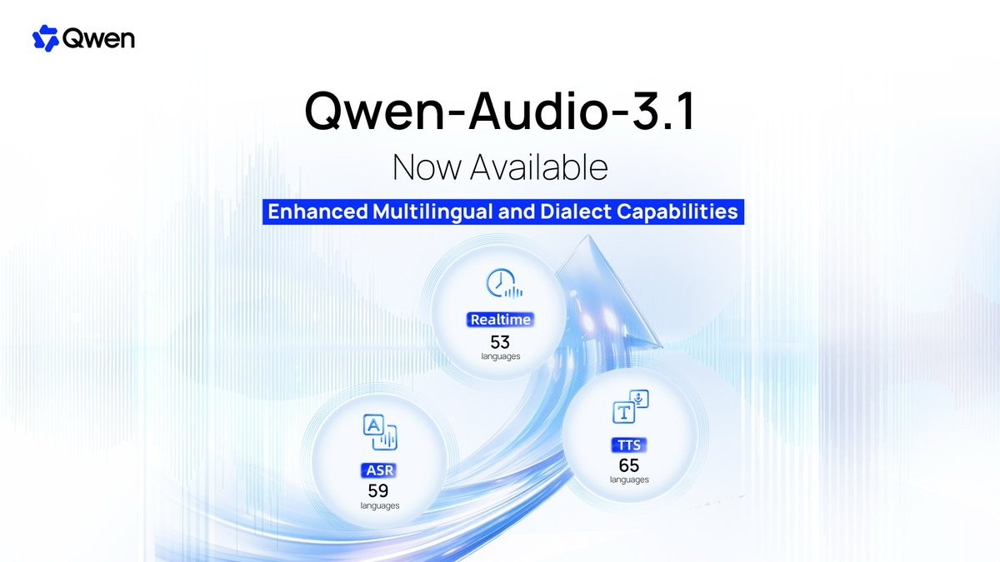

On Thanksgiving, the timeline was less about a new model launch than about tools people already use being laid open. Andrej Karpathy used the Claude Code desktop app and Opus 5.5 to spend about seven hours and 45,000 lines of code turning US public data into a Civilization-style map. OpenAI's Tibo said GPT-6.2 launched with a billing error, so the same work will now burn through a plan faster, with one banked reset added as an apology. Antigravity lead Varun Mohan said Gemini quota is being reset for all users for Thanksgiving.

## Today's picks

- **Karpathy**: Used the Claude Code desktop app and Opus 5.5 to turn US public data into a browsable Civilization-style map, now at karpathy.ai/usaciv.

- **GPT-6.2**: OpenAI said Astra and Sol were incorrectly discounted at launch; after the fix, the same work hits limits sooner, and Go, Plus, Pro, and Business plans get one banked reset.

- **Antigravity**: Varun Mohan said Gemini quota is being reset for all users for Thanksgiving, and the official account later showcased community projects built with Neon.

## 1. Karpathy uses Claude Code and Opus 5.5 to turn the United States into a Civilization-style map

Andrej Karpathy posted that he asked Claude to populate a Civilization-style game map with real data from the US. According to him, Opus 5.5 downloaded and parsed a large amount of public data, and after about seven hours and 45,000 lines of code, "it works." He listed 31 sources, including Census, BEA, BLS, EIA, NOAA, USGS, DoD, NPS, FAA, FEMA, and CDC. Elevation, land cover, GDP, jobs, power plants, mines, ports, airports, bases, parks, universities, freight flows, and disasters were reconciled onto a 25 km hex grid.

The data was translated into Civilization language: gold yield maps to GDP, and a city's districts reflect its real industry specializations — San Jose gets a Campus, Detroit is "Motor city." Citizens follow the real workforce: one in four San Jose workers are engineers, coders, or scientists, against one in 14 nationally. Wonders are chosen by published rules, such as national parks by visitor numbers and universities by R&D spending. The project has 19 lenses, a City View for 524 metros, nine advisors, and an Explorer that can turn any column for any of 3,100+ counties into a table and scatter plot, linked to the map. Claude also decided to skip a few states and territories. He built it with the Claude Code desktop app, using Opus 5.5 on medium with ultracode turned on.

It is deployed at [karpathy.ai/usaciv](https://karpathy.ai/usaciv/), and the "?" includes a source link as well. Karpathy said he was not exactly sure where he was going with it, only that it is fun to browse and might be expanded or built into a game. He also noted that he had only half of his weekly Claude quota left, so someone else would have to take over. Asked whether his work deserved a higher quota, he said it does for work, but this was a casual side project on his regular subscription. Elon Musk replied, "Very impressive."

**Why it matters**: This is not a shipping note. It is a public demonstration of how far a coding agent can run — open data, a long session, Claude Code on the desktop, and a weekly quota the author himself was about to exhaust. The map is compelling, but the skipped states and territories are a reminder that the result still needs a human check, and is not a finished game delivered automatically.

**Posts and references**: [Karpathy: the US Civ map](https://x.com/karpathy/status/2125779541952246039) · [Project site](https://karpathy.ai/usaciv/) · [Karpathy: a side project on his regular sub](https://x.com/karpathy/status/2125787014880702868) · [Elon Musk](https://x.com/elonmusk/status/2126036921734553740)

---

## 2. OpenAI fixes a GPT-6.2 billing error: Astra and Sol will hit limits sooner, with one banked reset

OpenAI's Tibo (@thsottiaux) said a billing mistake at the launch of GPT-6.2 had incorrectly discounted GPT-6.2 Astra and Sol usage for most users. The fix is in, so the same work will use more of a plan's usage allowance. Compared with last week, he said users will reach their limits 40% faster on GPT-6.2 Astra and 25% faster on Sol. He added that these models should still go further than 6 Astra and 6.1 Sol; other models were not affected, and OpenAI will not charge for the difference on past usage.

As an apology, the company will add one banked reset for everyone on Go, Plus, Pro, and Business. A few hours later Tibo followed up: "Banked reset is online." The posts do not say whether Team, Enterprise, or other tiers are included, and they do not confine the fix to a single client.

**Why it matters**: This is not a quiet price increase. It is an official admission that usage was under-counted at launch, and that the same work will now hit the cap sooner. For anyone who has made GPT-6.2 Astra or Sol their default, the practical step is to check remaining limits and the extra reset, not to argue first about whether the model "got worse."

**Posts and references**: [Tibo: the GPT-6.2 billing mistake](https://x.com/thsottiaux/status/2125784147889393806) · [Tibo: Banked reset is online](https://x.com/thsottiaux/status/2125853628250599730)

---

## 3. Antigravity resets Gemini quota for Thanksgiving, and showcases community projects

Antigravity lead Varun Mohan posted, "Resetting Gemini quota for all Antigravity users for Thanksgiving!" He thanked users and said the product is growing quickly, with the team working to keep the experience solid. The post does not say how large the reset is, whether every model tier is included, or when the allowance will run out again — those details have to be checked against the usage meter in the product.

Later in the day, the official @antigravity account posted a thread of community work: weekend game prototypes built with Gemini 4 Neon, parallel subagent runs, and pipelines that pair Antigravity with Colab and Blender for 3D and video. One reply specifically highlighted /swarm multi-agent workflows. Varun later added that new users from Japan had increased over the past week. Amp, meanwhile, said it had been rate-limited because of highly increased demand for Gemini 4 Neon, was working to get unblocked, and pointed to a status page.

**Why it matters**: A quota reset is the most immediate change for subscribers today, but the official post gives no number you can audit. It is more useful to read it alongside the demand side — more community projects, and Amp hitting a Neon rate limit. "Thanksgiving credits" should not be mistaken for evidence that supply is now loose.

**Posts and references**: [Varun Mohan: the quota reset](https://x.com/_mohansolo/status/2125851902009311306) · [Antigravity: community projects](https://x.com/antigravity/status/2126005564547252730) · [Varun: new users in Japan](https://x.com/_mohansolo/status/2126102493805555970) · [Amp: Neon rate limit](https://x.com/AmpCode/status/2125930211480875164) · [Amp status page](https://ampcodestatus.com/incidents/qdvzrecx)

---

## 4. Perplexity: Neon tops 100 billion tokens in a single day, doubling day over day

Perplexity CEO Aravind Srinivas said Neon usage on Perplexity had doubled day over day, with "no default model routing," and that the model did 100 billion+ tokens in a single day. He called that kind of exponential growth rare, and said the team had merged harness improvements to address earlier formatting issues. He also said he personally enjoys using it as his default model. The post quotes an earlier update of his on Tuesday's usage as context.

These figures are Perplexity's own account. The post does not include an independently auditable dashboard definition, and it does not specify which full calendar day "a single day" refers to. The numbers describe usage inside Perplexity, not quota changes inside an Antigravity subscription.

**Why it matters**: Read alongside Antigravity's quota reset and Amp's rate limit, this is more evidence that Neon is not short of demand right now. For practitioners, the more actionable detail is that formatting issues in the harness are being patched. Whether it is a good default still depends on your own tasks, not on a daily token total.

**Posts and references**: [Aravind Srinivas: Neon tops 100 billion tokens in a day](https://x.com/AravSrinivas/status/2125816545897312752)

---

## 5. Inkling 2 Mini: DHH's eval beats Qwen3.8 27B, and Ollama brings it to Windows and Linux

The launch of Inkling 2 Mini is not today's news. What is new are two concrete follow-ups. Ollama said Inkling 2 Mini is available on Windows and Linux with Ollama v0.40.18. The model has 26 billion parameters and, per Ollama, fits on devices with 32GB or more of unified memory or VRAM; on the Mac, custom kernels have significantly improved performance. The post positions it for agentic work, coding, and computer use, and the run command is `ollama run inkling-2-mini`.

DHH then wrote that Thinking Machines' Inkling2 Mini had just beaten Qwen3.8 27B in his overnight eval shoot-out for the best model for a 48–64GB RTX Spark on Omarchy malleability. He credited a recipe from @MiaAI_lab running on @tensorfold_dev. Later in the day he added that Omarchy's upcoming built-in local AI recipes are based heavily on Mia's work on the NVIDIA side. That is one author's eval and a product plan, not a cross-platform official leaderboard.

**Why it matters**: For people already watching this open-weight model, today's increment is broader install support, plus a closely followed developer putting it into his local shortlist. DHH's comparison is scoped to particular hardware and to "Omarchy malleability" tasks. It should not be generalized into a blanket claim that the model is ahead of Qwen3.8 27B everywhere.

**Posts and references**: [Ollama: Windows and Linux support](https://x.com/ollama/status/2125780317747466548) · [DHH: beats Qwen3.8 27B in his eval](https://x.com/dhh/status/2125845831051858053) · [DHH: Omarchy's local AI recipes](https://x.com/dhh/status/2126015731859124261)

---

## 6. Grok Bot: official posts say plan usage is up 11%, and Routines can gain up to 50%

Grok Bot's Sam Sokolin said the team had been shipping optimizations for weeks, and that users should now see an additional 11% more usage out of their plan, and up to 50% more usage for Routines. He teased a later write-up of how the routine harness was optimized to remove inference requests for simple and repetitive tasks. The post quotes an earlier update of his about the harness team focusing on getting more usage out of a plan.

The same day, Uncle Bob Martin wrote that he now uses nothing but Grok Bot; his bots sometimes use Grok Build on various machines, "but it's all grok." That is a personal usage note, not a product launch.

**Why it matters**: The 11% and 50% figures are official, and they are framed as harness optimizations rather than a larger plan allowance. Gains on Routines depend on whether the work is actually simple enough for inference to be skipped; everyday chat and harder agent jobs may not see the same lift. For people who already hand schedules and workflows to Grok Bot, this is a change worth checking on the usage panel.

**Posts and references**: [Sam Sokolin on the usage optimizations](https://x.com/SamSokolin/status/2126027973568466949) · [Uncle Bob: nothing but Grok Bot](https://x.com/unclebobmartin/status/2126005306694213813)

---

## 7. Tencent open-sources DFly2: official speedup claims for sparse models, but the repo itself is not new today

Tencent AI said it had open-sourced a speculative decoder that speeds up sparse models such as DeepSeek-V4.1-Flash, GLM-5.3-Flash, and its own Hy4 flash. The official numbers: at 64K context, DFly2 boosts DeepSeek-V4.1-Flash serving throughput by up to 81%; on Hy4 flash agentic tasks, it runs up to 4.2x faster, beating a same-recipe DSpark by about 30% and accepting 10.4% more draft tokens than open-source DSpark. Under the hood, each draft layer reads directly from the target model's KV cache and top-k token selection, with no prefill required, so it adds no extra KV memory and keeps drafting cost flat at any context length.

What should be separated out: the host repo, [Tencent/AngelSpec](https://github.com/Tencent/AngelSpec), was created on 23 July 2026. The repo's own latest notes date 26 November 2026 as the day DFly2 was open-sourced in full — weights, training code, and a technical report. The paper is at [arXiv:2611.34776](https://arxiv.org/abs/2611.34776), and the weights are listed under [AngelSlim on Hugging Face](https://huggingface.co/AngelSlim). The speedup figures are official claims; no independent third-party audit was published alongside them.

**Why it matters**: If the numbers hold, this could matter for the cost of long-context, sparse MoE decoding — the slow part of many coding-agent runs. Today's news is that DFly2's weights, code, and paper landed together, not that the AngelSpec repository was created today. That distinction should stay in any citation.

**Posts and references**: [Tencent AI: open-sourcing DFly2](https://x.com/TencentAI_News/status/2125968859450802415) · [AngelSpec repository](https://github.com/Tencent/AngelSpec) · [Hugging Face: AngelSlim](https://huggingface.co/AngelSlim) · [Paper arXiv:2611.34776](https://arxiv.org/abs/2611.34776)

---

## 8. Tualatrix ships PopAgent 1.0: a Mac-native agent that can drive Claude Code, Codex, and Antigravity

Developer Tualatrix (@tualatrix) said PopAgent, an agent product he had been building for 150 days, is now officially out. It is made for Apple platforms, with macOS shipping today and iOS to follow. He wrote that if ChatGPT feels bloated, you do not want to be locked to a single vendor, or you want one agent that can drive other agents, PopAgent is worth a look. He said the installer is about 25MB and runs smoothly on an 8GB MacBook Neo; the website lists on-disk size at about 70MB, including the execution host and workers. The site also says PopAgent can finish tasks on its own, or run Claude Code, Codex, and Antigravity, and that you can sign in with an existing ChatGPT, Grok, or Kimi plan, use Claude through Claude Code, or paste an API key.

He was clear that 1.0 is only a start, with plenty still missing, and mentioned a launch discount. The product site is [popagent.ai](https://popagent.ai). These capabilities come from the author and the official site; there is not yet a broad set of third-party reviews.

**Why it matters**: The desktop-agent field is already crowded. PopAgent's pitch is more specific: a small, Mac-only app that puts Claude Code, Codex, and Antigravity in the same layer so you can compare them. Whether it is worth switching depends on how reliably it drives those existing tools, not on how polished the launch demo looks.

**Posts and references**: [Tualatrix: PopAgent 1.0](https://x.com/tualatrix/status/2125836921549340977) · [PopAgent site](https://popagent.ai)

---

## 9. Addy Osmani reminds Claude users that the full reset lasts until December 10

Addy Osmani posted a practical Thanksgiving reminder: if you are on Pro, Max, Ultra, or Team, the full reset from November 10 is still waiting in Settings > Usage, until December 10. Max and Ultra can also claim monthly API credits ($100 and $200). He added that unused Fable limit resets from the 5.2 launch last until March 8.

He was quoting an announcement from Claude's official developer account, @ClaudeDevs, on November 10: Pro, Max, Ultra, and Team users received one free full reset, across all models and limits, to be used anytime before 2:00 p.m. PT on December 10. At the time, the official explanation was that a few issues had used more limits than intended, and that the Fable resets had not helped much for people who had already hit weekly limits for all models. Nothing new was issued today; this is a reminder that the deadline is approaching.

**Why it matters**: This is not a product update, but it is timely for anyone who has not yet used that reset. It expires after December 10. The API credits and the leftover Fable limits are separate benefits, and should not be folded into the same "full reset" balance.

**Posts and references**: [Addy Osmani's reminder](https://x.com/addyosmani/status/2126034792424919200) · [ClaudeDevs announcement, November 10](https://x.com/ClaudeDevs/status/2120275296637321476)

---

## 10. Qwen-Audio-3.1 adds broader multilingual support, with a focus on Chinese dialects

Alibaba's official Qwen account said the Qwen-Audio-3.1 series has received a multilingual upgrade, with a particular focus on Chinese dialects. The coverage they listed: ASR supports 59 languages and 8 Chinese dialects, TTS supports 65 languages and 6 Chinese dialects, and Realtime supports 53 languages and 6 Chinese dialects. The post highlights stronger dialect recognition and synthesis, plus broader language coverage across modalities, and points to three product pages for ASR, TTS, and Realtime.

This is an official capability update for a speech model, not a coding-tool release. The exact dialect list, quality comparisons, and recommended settings should be taken from the product pages.

**Why it matters**: For anyone building a voice interface in Chinese dialects or across languages, this is an official update you can try today. It is about listening and speaking, not writing code. Treating "a few more dialects" as a general agent-quality jump would overread the announcement.

**Posts and references**: [Qwen: Qwen-Audio-3.1 multilingual update](https://x.com/Alibaba_Qwen/status/2125798914490249411) · [ASR](https://www.qwencloud.com/models/qwen-audio-3.1-asr-flash) · [TTS](https://www.qwencloud.com/models/qwen-audio-3.1-tts-flash) · [Realtime](https://www.qwencloud.com/models/qwen-audio-3.1-realtime-flash)

