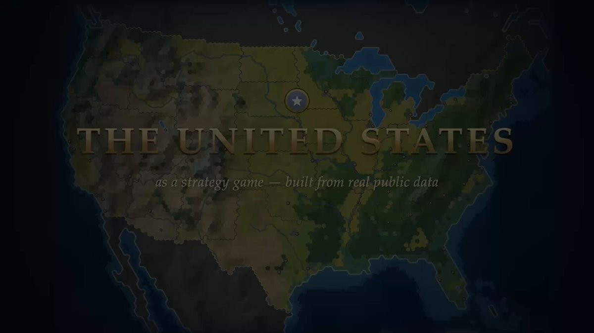
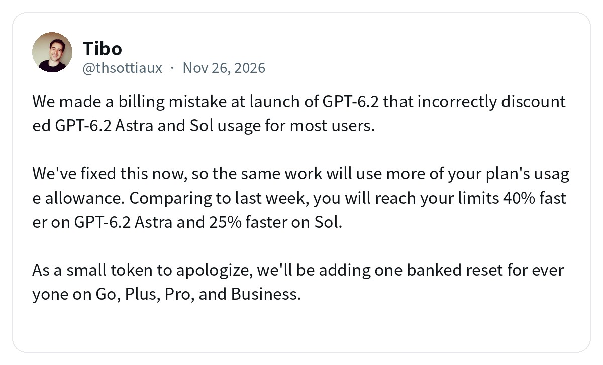
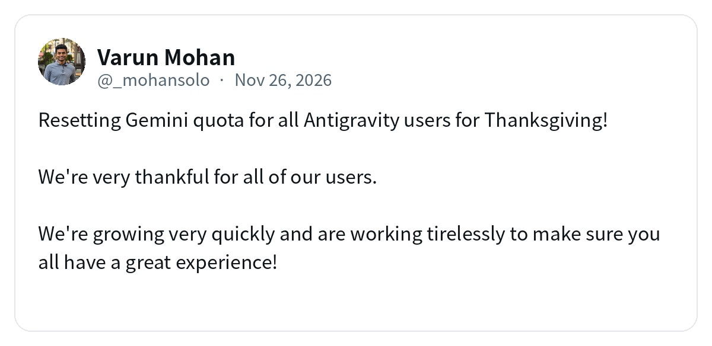
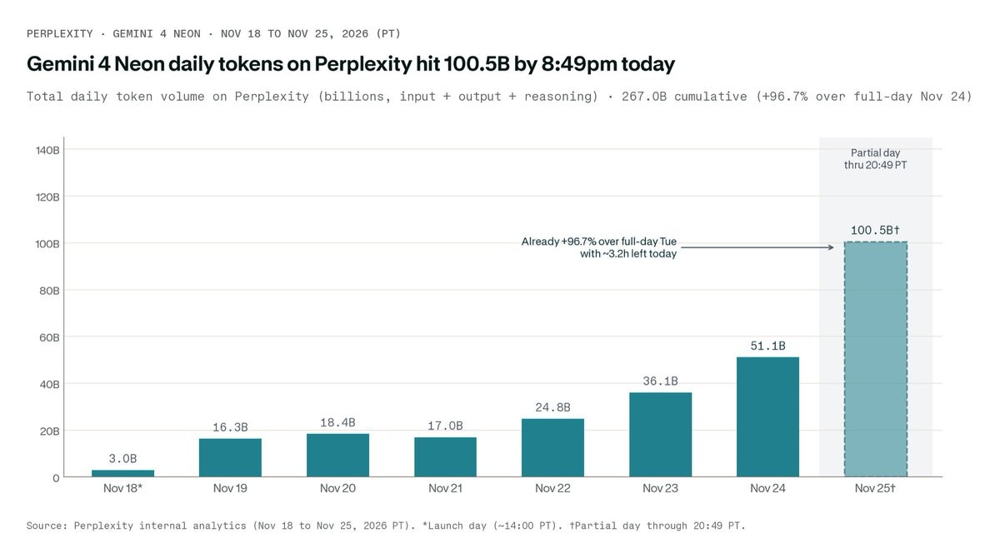
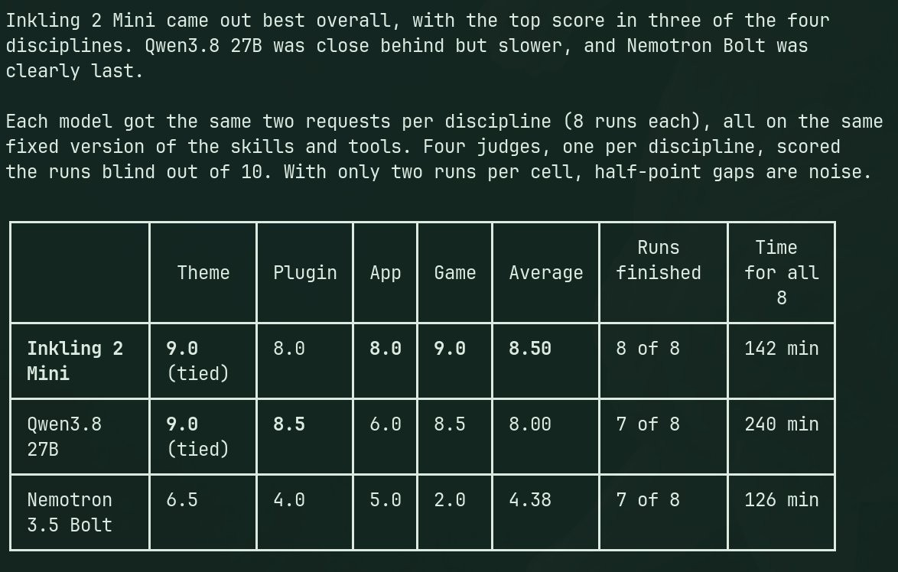
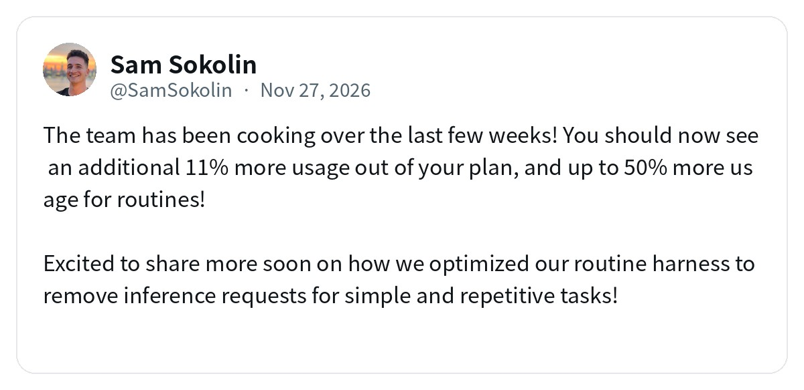
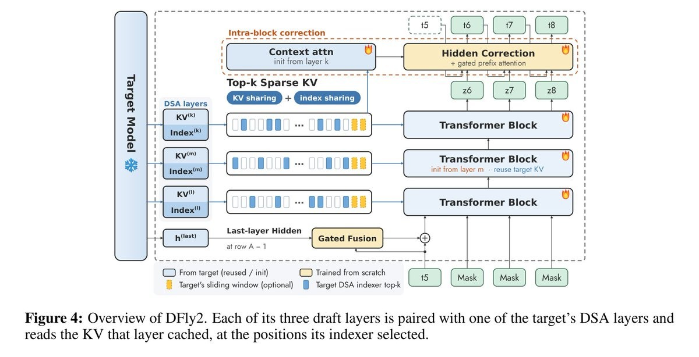
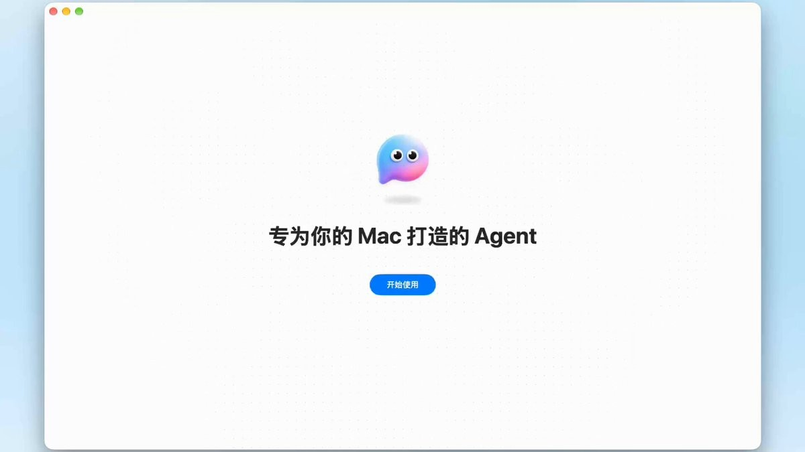
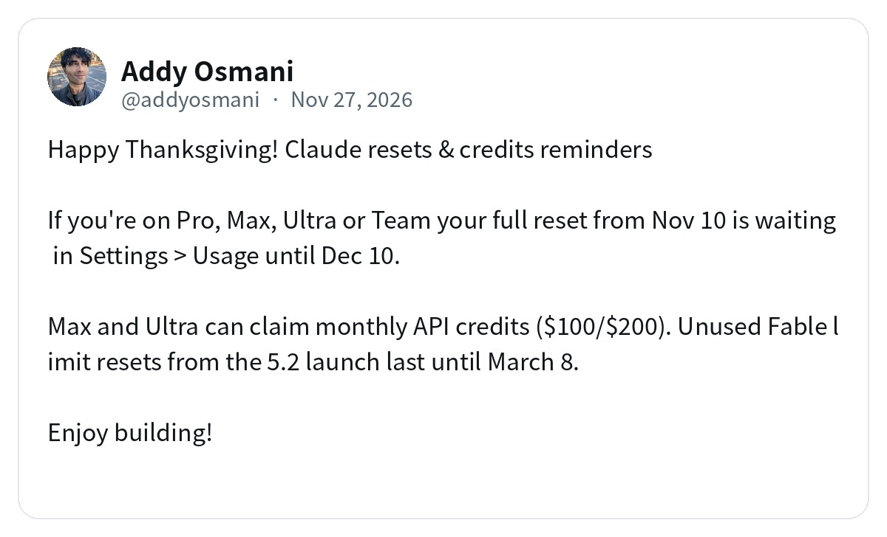
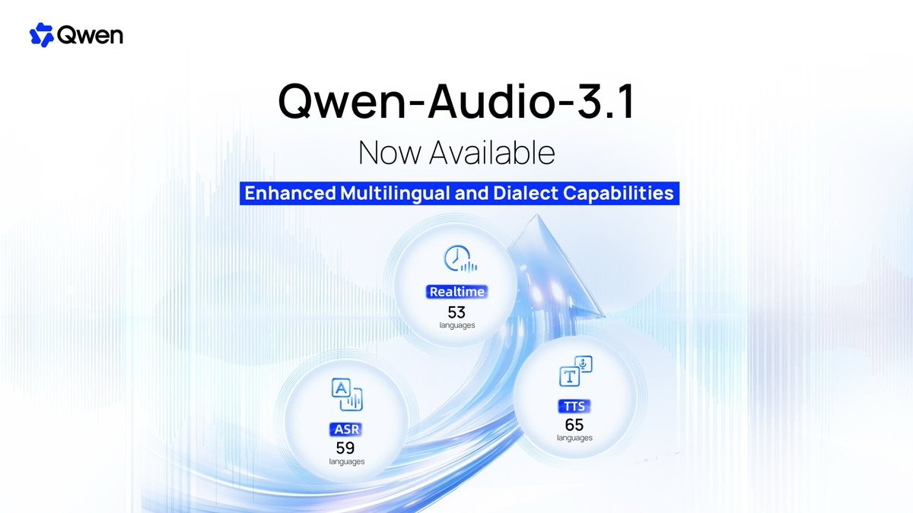

感恩节这一天，时间线上最显眼的不是新模型发布，而是几件已经在用的东西被摊开了。Andrej Karpathy 用 Claude Code 桌面版和 Opus 5.5，花约 7 小时写出约 4.5 万行代码，把美国公共数据铺成一张 Civilization 风格的地图。OpenAI 的 Tibo 承认 GPT-6.2 发布时计费有误，修复后同样的工作会更快用完额度，并补上一次 banked reset。Antigravity 负责人 Varun Mohan 则宣布，为所有用户重置感恩节的 Gemini 配额。

## 今日推荐

- **Karpathy**：用 Claude Code 桌面版和 Opus 5.5，把美国公共数据做成可浏览的 Civilization 风格地图，并部署到 karpathy.ai/usaciv。

- **GPT-6.2**：OpenAI 称发布时错误地给 Astra 和 Sol 打了折扣；修复后同样工作会更快触及限额，并为 Go、Plus、Pro、Business 补一次 banked reset。

- **Antigravity**：Varun Mohan 宣布为所有用户重置感恩节的 Gemini 配额；官方随后展示了社区用 Neon 做的项目。

## 1. Karpathy 用 Claude Code 和 Opus 5.5，把美国做成一张 Civilization 风格地图

Andrej Karpathy 发帖说，他让 Claude 用真实的美国数据填充一张 Civilization 风格的游戏地图。按他的描述，Opus 5.5 下载并解析了大量公开数据，大约 7 小时、4.5 万行代码之后，「它能跑了」。数据来源有 31 个，包括人口普查、BEA、BLS、EIA、NOAA、USGS、国防部、国家公园局、FAA、FEMA、CDC 等；海拔、土地覆盖、GDP、就业、电厂、矿区、港口、机场、基地、公园、大学、货运和灾害等，都被对齐到 25 公里的六边形网格上。

他写到，这些数据被转成了 Civilization 的语言：黄金产量对应 GDP，城市的区块对应真实的产业专长——圣何塞会得到 Campus，底特律则是 "Motor city"。人口也按真实劳动力来：圣何塞每 4 名劳动者里就有 1 名工程师、程序员或科学家，全国则是 14 人里才有 1 名。奇观按公开规则挑选，例如国家公园看访客量、大学看研发支出。地图上有 19 种透镜、524 个都市区的城市视图，以及 9 位顾问和一个 Explorer——可以把 3100 多个县的任一列数据做成表格和散点图，并和地图联动。Claude 还决定跳过了部分州和领地。项目是用 Claude Code 桌面版完成的，模型是 Opus 5.5，档位为 medium，并打开了 ultracode。

成品部署在 [karpathy.ai/usaciv](https://karpathy.ai/usaciv/)，问号里也有源码链接。Karpathy 说自己并不清楚接下来要把它做成什么，只是「很好玩，也许可以扩展，甚至做成一款游戏」；他还写到，自己每周的 Claude 额度只剩一半，后面要是有人接着做，可能得换人来。有人问这是不是该用更高配额的工作账号，他回答：工作上会，但这是一个随便做的 side project，用的是普通订阅。Elon Musk 在帖下写了一句：「Very impressive。」

**为什么值得看**：这不是一份发布说明，而是一次把编码代理的耐力摊在桌上的演示——公开数据、长时间运行、桌面端 Claude Code，以及作者自己也快用尽的周额度。地图很好看，但「跳过了部分州和领地」也说明，成果仍然依赖人工验收，而不是自动交付的成品游戏。

**原帖与资料**：[Karpathy：美国 Civ 地图](https://x.com/karpathy/status/2125779541952246039) · [项目站点](https://karpathy.ai/usaciv/) · [Karpathy：这是普通订阅做的 side project](https://x.com/karpathy/status/2125787014880702868) · [Elon Musk](https://x.com/elonmusk/status/2126036921734553740)

---

## 2. OpenAI 修复 GPT-6.2 计费错误：Astra 和 Sol 会更快用完额度，并补一次 banked reset

OpenAI 的 Tibo（@thsottiaux）发帖说，GPT-6.2 发布时出现了计费错误，导致大多数用户在使用 GPT-6.2 Astra 和 Sol 时被错误地打了折扣。现在已经修好，所以同样的工作会占用更多套餐用量。和他上周相比，GPT-6.2 Astra 会快 40% 触及限额，Sol 会快 25%。他同时写到，这两款模型的用量表现仍应好于 6 Astra 和 6.1 Sol；其他模型没有受到影响，过去已经发生的差额也不会补收。

作为歉意，OpenAI 将为所有 Go、Plus、Pro 和 Business 用户增加一次 banked reset。几个小时后，Tibo 又补了一句：「Banked reset is online。」帖文没有说明 Team、Enterprise 或其他档位是否包含在内，也没有把这次修复限定在某一个客户端里。

**为什么值得看**：这不是一次「悄悄变贵」，而是官方承认发布时把用量算少了，修复后同一份工作会更快撞上限额。对正在把 GPT-6.2 Astra 或 Sol 当作主力的人来说，先核对限额和那一次补发的 reset，比争论模型「是不是变差了」更要紧。

**原帖与资料**：[Tibo：GPT-6.2 计费错误](https://x.com/thsottiaux/status/2125784147889393806) · [Tibo：Banked reset is online](https://x.com/thsottiaux/status/2125853628250599730)

---

## 3. Antigravity 为感恩节重置 Gemini 配额，官方同时展示社区项目

Antigravity 负责人 Varun Mohan 发帖说：「Resetting Gemini quota for all Antigravity users for Thanksgiving!」他感谢用户，并写到产品增长很快，团队正在尽力保证体验。帖文没有说明重置的幅度、是否覆盖所有模型档位，以及额度会在何时再次用尽，这些需要以产品里实际显示的用量为准。

当天稍晚，官方账号 @antigravity 发了一组社区作品：有人用 Gemini 4 Neon 做周末游戏原型，有人跑并行子代理，还有人把 Antigravity 和 Colab、Blender 接在一起做三维与视频。其中一条专门提到 /swarm 多代理工作流。Varun 后来还写到，过去一周日本的新用户明显增加。与此同时，Amp 官方称，因为 Gemini 4 Neon 需求过高，他们已被限流，正在尽快申请解除，并给出了状态页。

**为什么值得看**：配额重置是订阅用户当天最直接的变化，但官方没有给出可核对的数字；更值得一起看的是需求侧——社区作品在增加，Amp 也因为同一模型被限流。把「感恩节送额度」理解成供给已经宽松，并不准确。

**原帖与资料**：[Varun Mohan：重置配额](https://x.com/_mohansolo/status/2125851902009311306) · [Antigravity：社区作品](https://x.com/antigravity/status/2126005564547252730) · [Varun：日本新用户](https://x.com/_mohansolo/status/2126102493805555970) · [Amp：Neon 限流](https://x.com/AmpCode/status/2125930211480875164) · [Amp 状态页](https://ampcodestatus.com/incidents/qdvzrecx)

---

## 4. Perplexity：Neon 单日超过 1000 亿 token，日环比翻倍

Perplexity CEO Aravind Srinivas 发帖说，Neon 在 Perplexity 上的用量日环比翻倍，而且「没有默认模型路由」，单日完成超过 1000 亿 token。他称这种指数式增长很少见，并写到团队已经合并了一些 harness 改进，以修复此前存在的格式问题。他自己则把 Neon 当作默认模型来用。帖中还引用了他更早前一条关于周二用量的更新，作为对照。

这些数字来自 Perplexity 单方陈述，帖里没有给出可独立核对的后台截图口径，也没有说明「单日」对应哪一个完整自然日。它描述的是 Perplexity 产品内的用量，并不直接等于 Antigravity 订阅里的额度变化。

**为什么值得看**：把这条和 Antigravity 的配额重置、Amp 的限流放在一起看，更能说明 Neon 这几天不缺需求。对使用者而言，更实际的信号是官方已经在修格式问题；「作为默认模型好不好用」，仍然要看自己的任务，而不是看单日 token 总量。

**原帖与资料**：[Aravind Srinivas：Neon 单日超 1000 亿 token](https://x.com/AravSrinivas/status/2125816545897312752)

---

## 5. Inkling 2 Mini：DHH 评测胜过 Qwen3.8 27B，Ollama 把它带到 Windows 和 Linux

Inkling 2 Mini 的发布本身并不是今天的新闻。今天新增的是两件具体的事。Ollama 宣布，Inkling 2 Mini 已随 Ollama v0.40.18 在 Windows 和 Linux 上可用；它有 260 亿参数，官方称适合 32GB 及以上统一内存或显存的设备，Mac 上则用自定义内核明显提升了性能。帖文把它定位为面向智能体、编程和 computer use 的模型，运行命令是 `ollama run inkling-2-mini`。

DHH 随后写到，在他为 48–64GB RTX Spark、针对 Omarchy「可塑性」做的夜间评测里，Thinking Machines 的 Inkling2 Mini 刚刚胜过 Qwen3.8 27B。他称赞 @MiaAI_lab 的配方，并注明运行在 @tensorfold_dev 上。当天晚些时候他又说，Omarchy 即将内置的本地 AI 配方，大量基于 Mia 在 NVIDIA 一侧的工作。这是作者自己的评测和产品计划，不是一份跨平台的官方榜单。

**为什么值得看**：对已经在关注这个开源权模型的人来说，今天的增量是可安装的平台变多了，以及一位高关注开发者把它放进了自己的本地默认候选。DHH 的对比限定在特定硬件和「Omarchy malleability」任务上，不宜直接外推成「全面超过 Qwen3.8 27B」。

**原帖与资料**：[Ollama：Windows 与 Linux 可用](https://x.com/ollama/status/2125780317747466548) · [DHH：评测胜过 Qwen3.8 27B](https://x.com/dhh/status/2125845831051858053) · [DHH：Omarchy 的本地 AI 配方](https://x.com/dhh/status/2126015731859124261)

---

## 6. Grok Bot：官方称套餐用量增加 11%，Routines 最多可增加 50%

Grok Bot 的 Sam Sokolin 发帖说，过去几周团队一直在做优化，现在套餐用量应当多出 11%，Routines 则最多可多出 50%。他预告稍后会更详细说明：他们优化了 routine harness，把简单、重复任务上的推理请求拿掉了。这条帖引用了他此前一条关于「harness 团队完全聚焦于让套餐用量更耐用」的更新。

同一天，Uncle Bob Martin 写到，自己现在只用 Grok Bot；他的 bots 有时会在不同机器上使用 Grok Build，「但全都是 Grok」。这是个人使用声明，不是产品发布。

**为什么值得看**：11% 和 50% 都来自官方口径，而且明确指向 harness 优化，而不是套餐涨配额。Routines 的收益取决于任务是否真的足够简单、可被去掉推理；日常对话和复杂代理工作未必能看到同一幅度。对已经把日程和工作流交给 Grok Bot 的人，这是一条可以立刻在用量面板里核对的变化。

**原帖与资料**：[Sam Sokolin：用量优化](https://x.com/SamSokolin/status/2126027973568466949) · [Uncle Bob：只用 Grok Bot](https://x.com/unclebobmartin/status/2126005306694213813)

---

## 7. 腾讯开源 DFly2：官方称可为稀疏模型加速，但仓库本身并非今天新建

腾讯 AI 官方账号发帖说，他们开源了一个投机解码器，用于加速 DeepSeek-V4.1-Flash、GLM-5.3-Flash 以及自家的 Hy4 flash 等稀疏模型。官方给出的数字是：在 64K 上下文下，DFly2 可将 DeepSeek-V4.1-Flash 的服务吞吐最高提升 81%；在 Hy4 flash 的智能体任务上，速度最高可达 4.2 倍，比同一配方的 DSpark 快约 30%，并比开源 DSpark 多接受 10.4% 的草稿 token。原理上，每个 draft 层直接读取目标模型的 KV cache 和 top-k token，无需 prefill，因此不额外占用 KV 内存，draft 成本也不随上下文变长而上升。

需要分开看的是：承载它的仓库 [Tencent/AngelSpec](https://github.com/Tencent/AngelSpec) 早在 2026 年 7 月 23 日就已经创建。仓库的最新说明把 2026 年 11 月 26 日写成「完整开源 DFly2」：权重、训练代码和技术报告。论文在 [arXiv:2611.34776](https://arxiv.org/abs/2611.34776)，权重大门在 [Hugging Face 的 AngelSlim](https://huggingface.co/AngelSlim)。上述加速数字均为官方陈述，未见同步公布的第三方复核。

**为什么值得看**：如果这些数字站得住，它对长上下文、稀疏 MoE 的推理成本会有实际影响，尤其是编码代理那种又长又慢的解码。但今天的新闻是 DFly2 的权重、代码和论文齐出，不是 AngelSpec 仓库「刚刚建立」。引用时应当写清这一点。

**原帖与资料**：[腾讯 AI：开源 DFly2](https://x.com/TencentAI_News/status/2125968859450802415) · [AngelSpec 仓库](https://github.com/Tencent/AngelSpec) · [Hugging Face：AngelSlim](https://huggingface.co/AngelSlim) · [论文 arXiv:2611.34776](https://arxiv.org/abs/2611.34776)

---

## 8. 图拉鼎发布 PopAgent 1.0：原生 Mac 上的 Agent，可以调度 Claude Code、Codex 和 Antigravity

开发者图拉鼎（@tualatrix）宣布，做了 150 天的 Agent 产品 PopAgent 正式发布。这是一款面向 Apple 平台的工具，今天先出 macOS 版，iOS 版稍后到来。他写到，如果你觉得 ChatGPT 太臃肿、不想被单一厂商锁定，或者想用一个 Agent 去调用其他 Agent，可以试试它。作者称安装包约 25MB，在 8GB 内存的 MacBook Neo 上也能流畅运行；官网则写明磁盘占用约 70MB，含执行主机和 worker。官网还写到，PopAgent 可以自己把任务做完，也可以运行 Claude Code、Codex 和 Antigravity，并支持用已有的 ChatGPT、Grok、Kimi 订阅，或通过 Claude Code 使用 Claude 方案，也可以自行填写 API key。

作者强调 1.0 只是开始，还有很多不足，当天有首发优惠。产品站点是 [popagent.ai](https://popagent.ai)。这些能力以官网和作者自述为准，尚未看到广泛的第三方评测。

**为什么值得看**：在桌面 Agent 已经不少的情况下，PopAgent 的卖点比较具体：体量小、只做 Mac、并且把 Claude Code、Codex、Antigravity 放到同一层里对比使用。值不值得换，要看它调度这些已有工具时是否稳定，而不是看发布当天的演示是否漂亮。

**原帖与资料**：[图拉鼎：PopAgent 1.0](https://x.com/tualatrix/status/2125836921549340977) · [PopAgent 官网](https://popagent.ai)

---

## 9. Addy Osmani 提醒：Claude 那次完整重置可以用到 12 月 10 日

Addy Osmani 在感恩节发了一条实用提醒：如果你在 Pro、Max、Ultra 或 Team 档，11 月 10 日那次完整重置仍在 Settings > Usage 里，可以用到 12 月 10 日。Max 和 Ultra 还可以领取每月 API 积分（分别为 100 美元和 200 美元）。他还写到，Fable 5.2 发布时未用完的限额重置，可以留到 3 月 8 日。

他引用的是 Claude 官方开发者账号 @ClaudeDevs 在 11 月 10 日的公告：Pro、Max、Ultra 和 Team 用户获得一次免费的完整重置，覆盖所有模型和限额，须在太平洋时间 12 月 10 日下午 2 点前使用。官方当时的解释是，近期修过一些会多耗限额的小问题，而且 Fable 的重置对那些已经打满所有模型周限额的用户帮助不大。今天并没有新的重置，只是临近截止日期的提醒。

**为什么值得看**：这条本身不是产品更新，但对还没点过那次重置的人很及时。12 月 10 日之后它就会过期；API 积分和 Fable 限额是另外两件事，不要和这一次「完整重置」混成同一笔额度。

**原帖与资料**：[Addy Osmani 的提醒](https://x.com/addyosmani/status/2126034792424919200) · [ClaudeDevs 11 月 10 日公告](https://x.com/ClaudeDevs/status/2120275296637321476)

---

## 10. Qwen-Audio-3.1 升级多语言能力，尤其补强了中文方言

阿里巴巴通义官方账号宣布，Qwen-Audio-3.1 系列迎来多语言增强，重点是中文方言。官方列出的覆盖范围是：ASR 支持 59 种语言和 8 种中文方言，TTS 支持 65 种语言和 6 种中文方言，Realtime 支持 53 种语言和 6 种中文方言。帖文强调了方言识别与合成的增强，以及各模态更广的语言覆盖，并给出了三个体验入口：ASR、TTS 和 Realtime。

这是模型官方自己的能力说明，不是一次编程工具发布。具体方言名单、质量对比和适用场景，需要以产品页为准。

**为什么值得看**：对要在中文方言或跨语言场景里做语音接口的人，这是一条可以立刻去试的官方更新。它解决的是听和说，而不是写代码；如果把「多了几种方言」理解成通用智能体能力升级，就不准确了。

**原帖与资料**：[Qwen：Qwen-Audio-3.1 多语言更新](https://x.com/Alibaba_Qwen/status/2125798914490249411) · [ASR](https://www.qwencloud.com/models/qwen-audio-3.1-asr-flash) · [TTS](https://www.qwencloud.com/models/qwen-audio-3.1-tts-flash) · [Realtime](https://www.qwencloud.com/models/qwen-audio-3.1-realtime-flash)

