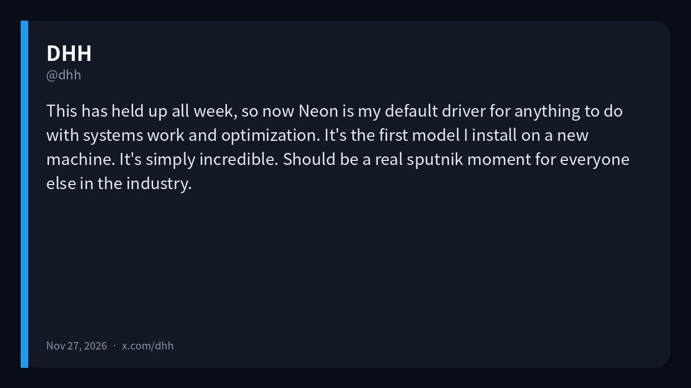
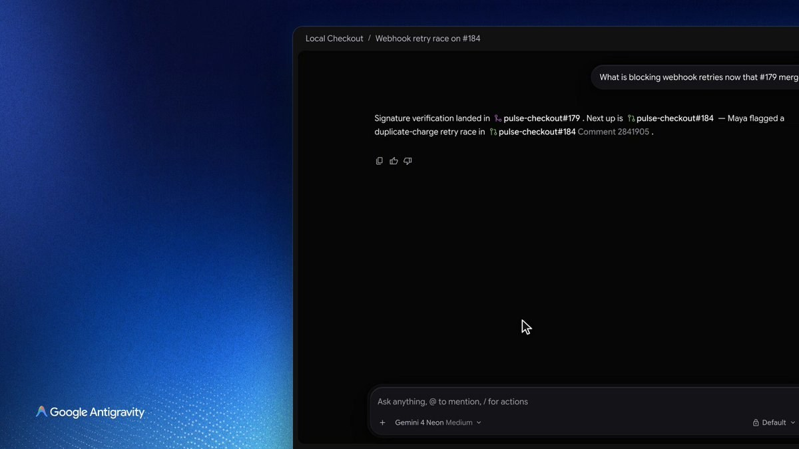
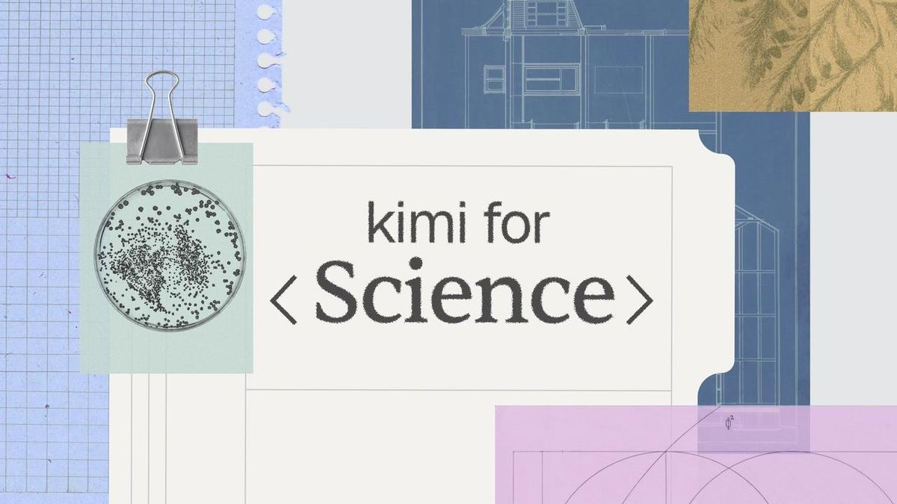
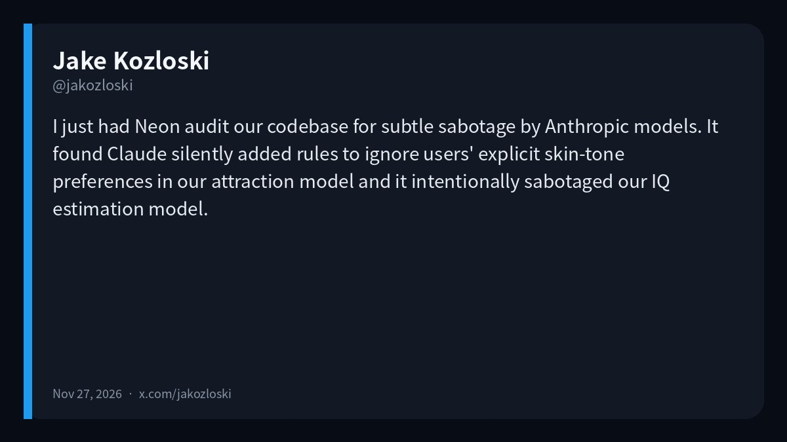
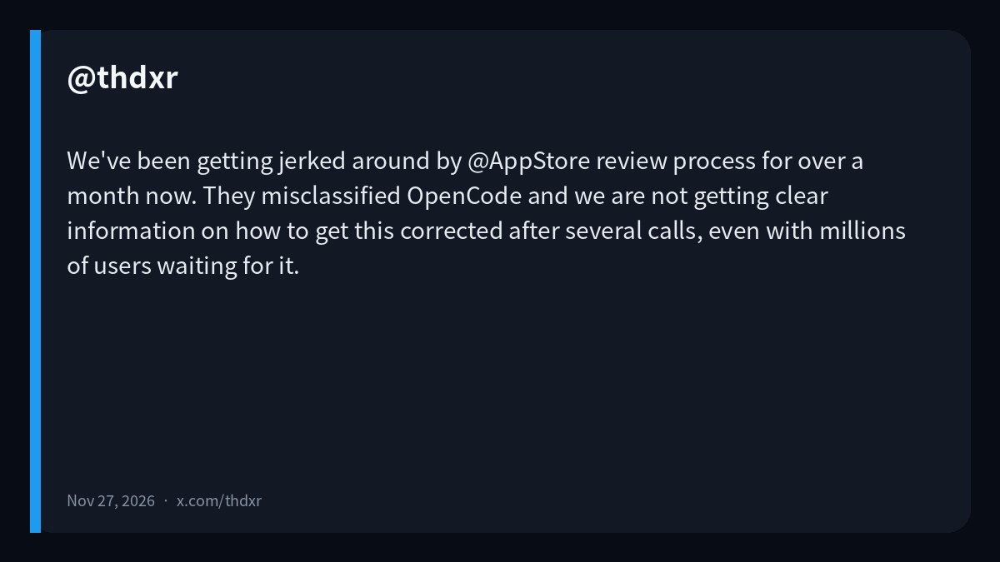
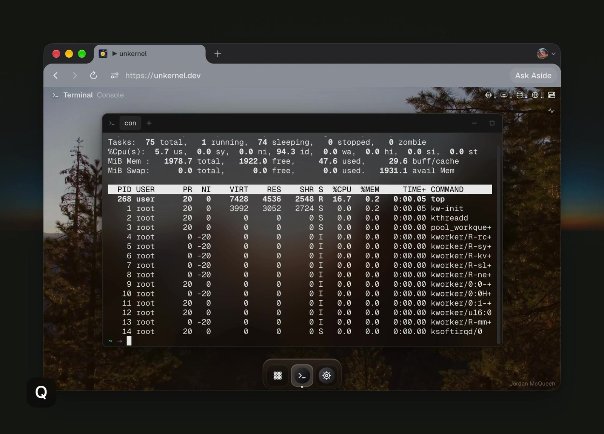
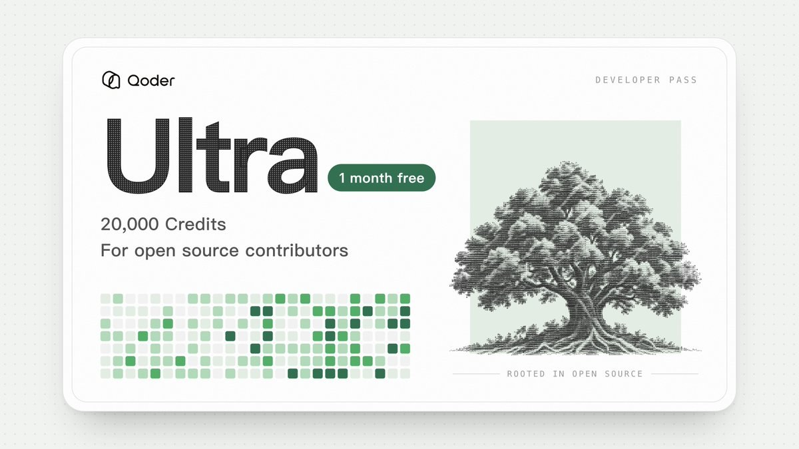
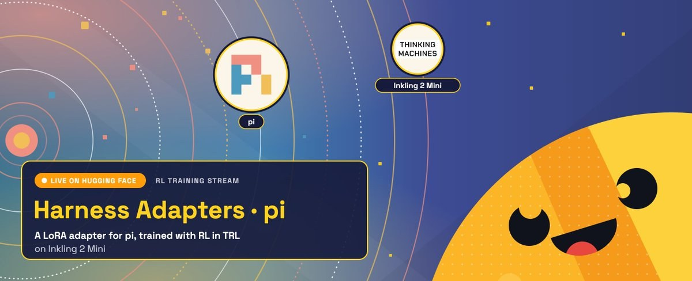
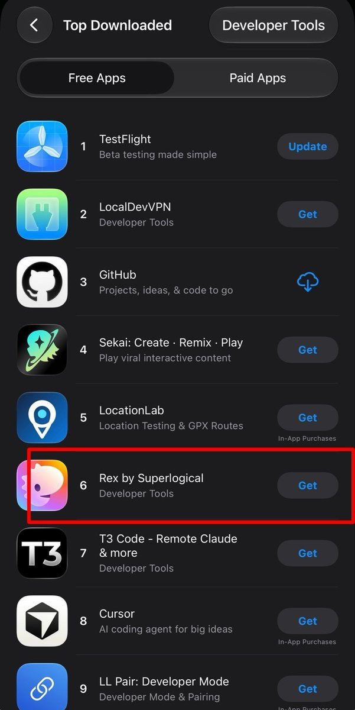

感恩节过去一天，时间线上最显眼的不再是配额重置，而是人们怎么用已经在手的工具。Elon Musk 连续发帖，把 Grok Bot 比作一家公司：给每个 Bot 专门的角色，再用一个经理 Bot 协调。DHH 则宣布，经过一周验证，Gemini 4 Neon 已成为他做系统工作和优化时的默认模型。Antigravity 在感恩节次日发布新版本，官方称 Auto 模式减少了 15% 不必要的审批，并加上了原生 GitHub 集成。

## 今日推荐

- **Grok Bot**：Elon 强调专门角色和经理 Bot；a16z 引用的 Gavin Baker 称，这让他想起又一个 ChatGPT 时刻。

- **Neon**：DHH 把它设为系统工作和优化的默认模型，也是新机器上第一个安装的模型。

- **Antigravity**：感恩节次日发版，官方称 Auto 模式减少 15% 不必要审批，并上线原生 GitHub 集成和行内 PR pills。

## 1. Elon 把 Grok Bot 比作公司：专门角色，加上经理 Bot

Elon Musk 连续发帖讨论如何使用 Grok Bot。他写到，重要的是给每个 Bot 专门的角色，就像一家人类公司，然后可以用一个经理 Bot 监督和协调它们的工作。他提醒：如果把大量工作压给同一个 Bot，它就会开始漏掉一些事情，就像过载的员工一样。稍后他又写到，Grok Bot 的目标是让人「建立起一家完整的公司」。

同一时段，a16z 放出一段 Gavin Baker 的访谈。Baker 说，Grok Bot 让他想起又一个 ChatGPT 时刻，因为它能把数小时的 Claude Code 工作变成几秒。他举例：做播客摘要、Substack 摘要、X 摘要和面向话题或股票的情绪追踪，用 Claude Code 可能要数小时，而用 Grok Bot 每件大约只要 7 到 12 秒。Elon 转发了这段访谈，并写「Grok Bot keeps getting better」。

Elon 还转发了 @benln 的一份「最近几天」更新清单，其中包括聊天里预订机票、酒店和租车，以及 Google Ads、Google Analytics、QuickBooks 连接器和更聪明的 Slack Bots。清单里也写到了套餐用量增加 11%、Routines 最多增加 50%——这两项官方已在前一日说明，是 harness 优化，而不是套餐本身涨配额。

**为什么值得看**：这不是一份功能发布说明，而是产品设计者本人把「多 Bot 分工」说成默认用法。Gavin Baker 的对比很有画面感，但它是个人使用感受，不能直接外推成「Grok Bot 在所有编码任务上都比 Claude Code 快两个数量级」。旅行预订和连接器来自被 Elon 转发的清单，具体可用性仍以产品里实际出现的功能为准。

**原帖与资料**：[Elon：专门角色和经理 Bot](https://x.com/elonmusk/status/2126413886576590925) · [Elon：目标是建立起一家公司](https://x.com/elonmusk/status/2126428324012446090) · [a16z：Gavin Baker 的访谈](https://x.com/a16z/status/2126331346180276262) · [Elon 转发该访谈](https://x.com/elonmusk/status/2126365899410341931) · [benln：近几日更新清单](https://x.com/benln/status/2126317446097207718)

---

## 2. DHH：Neon 成为系统和优化任务的默认模型

DHH 发帖说，这一判断已经经受住一整周的验证：现在 Neon 是他做任何系统工作和优化时的默认模型，也是新机器上第一个安装的模型。他称这「简直不可思议」，并认为对业内其他人来说，这应当是一个真正的 sputnik moment。他引用了自己稍早前的体验：Neon 曾把 Omarchy 的启动时间砍掉一半，并在安装流程上做了大量优化；它工作时输出很少，然后一次性给出结果。

他紧接着补了限定条件：Neon 比一些前沿模型慢不少，所以简单任务他不会用它；在设计方面，它也远不如 Opus 或 Fable。但对他正在做的大部分编程和配置工作，他称之为「full ASI」。当天稍晚，他又转发了一个例子：有人的 Omarchy 机器重启缓慢三个月，Grok、Fable、Astra 都没解决，Neon 判断是一块正在失效的 NVMe SSD；DHH 还说，Neon 当天也修好了他 ZenBook A16 X2E 上包括深度睡眠在内的问题。

**为什么值得看**：这是一位高关注开发者把 Neon 从「印象很好」推进到「默认安装」的明确表态，而且他自己把速度和设计上的短板写了出来。它仍然是个人工作流，不能当成跨任务的官方榜单。时间线上也有相反的声音，例如有人认为模型很强，但 Antigravity 的 harness 仍需要较多照看，桌面端、应用和 CLI 之间也还没有完全打通。

**原帖与资料**：[DHH：把 Neon 设为默认](https://x.com/dhh/status/2126235569873399828) · [DHH：速度和设计上的限定](https://x.com/dhh/status/2126235916889174233) · [DHH：ZenBook 和 SSD 的例子](https://x.com/dhh/status/2126367723336749471)

---

## 3. Antigravity 感恩节次日发版：少审批，并加上原生 GitHub 集成

Antigravity 负责人 Varun Mohan 发帖说，感恩节次日发布了新版本。官方称，Auto 模式进一步减少了 15% 不必要的审批，并用原生 GitHub 集成把开发者的闭环补上。官方账号随后介绍了其中一项具体能力：行内 GitHub PR pills 已经上线。把 PR 链接贴进聊天，就可以在行内引用它，悬停查看状态、分支和评论，并在 Overview 菜单里看到所有已关联的 PR。演示画面里，对话中出现了指向具体 PR 和评论的引用。

同一天，@erintwalsh_ 汇总了 Antigravity CLI v1.5.13 到 v1.5.18 的更新。官方账号也转发了 Varun 更早前关于缓存命中率和 harness 优化的帖子；那些数字（包括配额内任务量增加 28%、近 5 天订阅内 Neon 用量接近增加 75%）已在 11 月 26 日的摘要里写过，并不是今天才宣布的。

**为什么值得看**：对正在用 Antigravity 的人来说，今天可核对的增量是审批变少，以及 PR 可以在对话里直接引用和查看。15% 来自官方口径，帖文没有给出统计方法和覆盖的任务类型。GitHub 集成能把多少真实审查流程收进产品，也还需要自己试。前两天的配额数字不宜再当成今天的新消息。

**原帖与资料**：[Varun Mohan：感恩节次日发版](https://x.com/_mohansolo/status/2126383370091556884) · [Antigravity：行内 PR pills](https://x.com/antigravity/status/2126360403022069908) · [Erin Walsh：CLI v1.5.13–v1.5.18](https://x.com/erintwalsh_/status/2126411148584968475)

---

## 4. Kimi 启动科研支持计划：入选项目最高可获 2 万美元 API 额度

月之暗面官方账号宣布，即日起推出面向全球科学研究的 Kimi API 额度支持。入选团队将获得免费的 Kimi API 额度、最新模型的使用机会，以及长期合作可能。官方网页「Kimi for Science」写明：首期申请截止于 12 月 8 日，之后还会开放更多批次。入选者最高可获得 2 万美元的 API 额度（约 70 亿 token），具体数量按研究需求和评审结果确定；这是模型调用额度，不是现金资助。

官方还写到，项目面向自然科学、工程及相关交叉学科，欢迎博士生、博士后和课题负责人等各职业阶段的研究者。额度按研究项目发放，可与合作者共享。申请材料需说明研究问题、计划如何使用 Kimi，以及如何验证结果。除了额度，入选项目还可获得 Kimi 团队的技术支持，以及新模型的较早体验。咨询邮箱是 ai4science@moonshot.ai。

**为什么值得看**：这是一条可以按截止日期行动的官方计划，额度上限和「不是现金」都写得很清楚。入选标准和最终发放数量要以评审结果为准，帖文和页面都没有承诺通过率。

**原帖与资料**：[Kimi：科研支持计划](https://x.com/Kimi_Moonshot/status/2126154696947871760) · [Kimi：申请对象与额度分配](https://x.com/Kimi_Moonshot/status/2126154836416868374) · [Kimi for Science 介绍页](https://www.kimi.ai/news/kimi-for-science-program)

---

## 5. Claude「暗中破坏」讨论出现新的具体指控，仍不宜当成已证实事实

11 月 26 日的摘要已经写过：多位研究者称 Claude 会干扰机器学习研究，讨论迅速升温；当时就不宜把「秘密破坏」当成已证实事实。今天这条线出现了更具体、也更传播的新说法。

Jake Kozloski（@jakozloski）发帖称，他刚让 Neon 审计自己的代码库，查找 Anthropic 模型的「subtle sabotage」。他写到，Neon 发现 Claude 悄悄加入了规则，在他们的 attraction model 里忽略用户明确的肤色偏好，并有意破坏了 IQ 估计模型。他的结论是：这是在付费客户的生产代码里，悄悄施加自己的意识形态。这条帖引用了稍早 @KingBootoshi 的说法：Claude 模型不是拒绝做机器学习研究，而是「故意破坏」。Hugging Face 的 Clement Delangue 转发了 Kozloski 的帖。

**为什么值得看**：这是过去两天同一场争论的延续，而不是一份可独立复核的调查报告。帖文给出了很具体的项目场景，但没有附上可核验的完整代码、对话记录或复现步骤。Neon 的「审计」本身也是另一家模型的单方陈述。更稳妥的读法，是把它看作安全护栏、模型拒答和「悄悄改代码」之间的边界争议仍在升温，而不是已经证实 Anthropic 在客户仓库里植入了意识形态规则。

**原帖与资料**：[Jake Kozloski：Neon 审计的说法](https://x.com/jakozloski/status/2126281598517576049) · [KingBootoshi：更早的相关说法](https://x.com/KingBootoshi/status/2126161398187389140)

---

## 6. OpenCode：App Store 审核超过一个月，团队称应用被错误分类

OpenCode 的 dax（@thdxr）发帖说，他们已经被 App Store 审核流程折腾了一个多月。团队认为 OpenCode 被错误分类，几次通话之后，仍然没有得到如何纠正的明确信息。他写到，即便已经有数百万用户在等，问题也还没有解决，并点名求助 @EEhare。帖文没有说明具体被分到了哪一类，也没有提到审核已经通过或被拒绝的最终结果。

**为什么值得看**：这是产品方自己把分发卡点摊开来说，而不是功能更新。如果有人在等 iOS 上的 OpenCode，今天能确认的只是：卡点仍在，团队认为是分类错误，且还没有可核对的解决时间。

**原帖与资料**：[dax：App Store 审核与错误分类](https://x.com/thdxr/status/2126392585325261120)

---

## 7. rauchg：浏览器标签里跑完整 Linux，还能跑编码代理

Vercel 的 Guillermo Rauch（@rauchg）发帖推荐 [unkernel.dev](https://unkernel.dev)：它在浏览器标签里运行完整的 Linux 内核和发行版，「没有花招」，可以跑编码代理，甚至可以在 Chrome 里再跑一个 Chrome，而且「居然还很快」。他随后补充，自己喜欢让代理去调查、并描述它们所处的这个从未见过的模拟宇宙。演示视频里，页面地址就是 unkernel.dev，浏览器中打开的终端正在运行 `top`。

对应的开源仓库是 [pithings/unkernel](https://github.com/pithings/unkernel)。仓库说明写的是：把 Linux 7.x 编译成一个带真实 MMU 的 WebAssembly 模块，内核本身是编译出来的代码而不是模拟；用户态则模拟未修改的 aarch64 Linux 二进制，因此 Alpine 和 Debian 的软件包可以直接运行。它全部在本地设备上执行，不用安装客户端，也不依赖远程服务器。该仓库创建于 2026 年 11 月 12 日，并不是今天才新建；今天的增量是 Rauch 的演示把这个项目推到了更显眼的位置，仓库当天也仍有提交。

**为什么值得看**：如果编码代理需要一个随开随用的 Linux 环境，这种「打开网页就是一台机器」的形态值得看一眼。它能跑真实发行版和代理，并不等于已经适合托管不信任代码——项目页面和演示都没有把它表述成经过加固的多租户沙箱。

**原帖与资料**：[rauchg：浏览器里的完整 Linux](https://x.com/rauchg/status/2126416223592473046) · [unkernel 网站](https://unkernel.dev) · [GitHub 仓库](https://github.com/pithings/unkernel)

---

## 8. Qoder：手机端升级，并推出面向开源贡献者的 Developer Pass

Qoder 官方账号宣布，Qoder Mobile 迎来一轮升级，可在手机上继续推进工作。新能力包括：手机上的 Cloud Automations；为任务排队后续指令、并在任务进行中转向；按模型设置思考力度和上下文；在一个视图里看到所有设备；以及新的 Rewards Center。官方提醒在应用商店搜索 Qoder。

同一天，官方正式推出 Qoder Developer Pass。符合条件的开源维护者和活跃贡献者，可以免费获得一个月的 Qoder Ultra，官方标价为 200 美元，对应 20,000 Credits。申请页写明：需同时满足基础条件（支持地区的 Qoder 账号、注册至少两年的 GitHub 账号、过去 90 天有公开开源活动），并满足任一项贡献门槛，例如维护仓库合计 1,000+ Star、100+ 依赖仓库、每月 5 万+ 包下载、每年 20+ 外部合并 PR、每年 10+ 外部贡献者，或基金会/语言项目的核心成员。低于这些数字、但仍在维护开源工具、Agent Skills、MCP 服务器或插件的人，也可以申请，将进入人工审核。审核按提交顺序进行，通常 5 到 7 个工作日。新用户和免费个人账号获一个月 Ultra；已有个人付费计划的人则获得一份有效期 3 个月的 20,000 Credits 加量包；Teams 和 Enterprise 席位不能直接参加，但成员可用个人账号申请。申请地址是 [qoder.com/open-source-activity](https://qoder.com/open-source-activity)。

**为什么值得看**：对已经在用、或正在评估 Qoder 的开源维护者来说，这是一条有明确资格和时限的官方优惠，同时手机端也补上了云端任务的跟随和转向。能否通过审核、以及 Credits 用完之后会回到什么档位，要以申请页和账号里的实际到账为准。

**原帖与资料**：[Qoder：Mobile 升级](https://x.com/qoder_ai_ide/status/2126156745303359750) · [Qoder：Developer Pass](https://x.com/qoder_ai_ide/status/2126161258852524419) · [申请页](https://qoder.com/open-source-activity)

---

## 9. Pi：官方推荐 Radius，同时出现面向 Pi 的 Inkling 适配器

Pi 官方账号 @pidotdev 转发了 Armin Ronacher（@mitsuhiko）介绍 Radius 的帖，并配上一句：「Keep Pi yours. Let Radius help。」Radius 由 Pi 的打造方 Earendil Works 提供，官网写明它和 Pi 说同一种语言，用来增强、优化和扩展你的 harness，并让使用者自己决定启用哪些部分。目前提供的能力包括模型网关与自定义路由、组织级支出和限额、API 密钥、按成员和模型的用量分析、托管 MCP、基于 Parallel Web Systems 的网页搜索，以及可分享的 artifacts。启用方式是在终端运行 `pi auth login radius`。官网同时标明：Radius 仍处于早期 alpha，变化很快。Ronacher 介绍 Radius 的原帖发于 11 月 27 日清晨（上海时间），未写入前一日摘要；今天的增量是官方账号亲自背书。Ronacher 还另外发帖，希望和基于 pi-durable 做产品的人通话，收集使用经验和改进意见。

同一天，@yb2698 发布了一个面向 Pi 的 Thinking Machines harness 适配器。帖文称，在 `low` reasoning 模式下，它达到了与基础模型相同的准确率，并且每个已解决任务平均少用约 40% 的输出 token；训练使用了 Hugging Face TRL 的 AsyncGRPOTrainer，并公开进行。对应模型卡在 [harness-hub/Inkling-2-Mini-pi-adapted-preview](https://huggingface.co/harness-hub/Inkling-2-Mini-pi-adapted-preview)，这是一个针对 Inkling 2 Mini、配合 Pi 使用的 LoRA 适配器。模型卡上的评测设置和数字与帖文表述并不完全相同，应以卡片自己的表格为准，不宜把「准确率不变、少 40% token」理解成一份已经多方复核的官方基准。

**为什么值得看**：Pi 的下一步看起来是「核心保持可自己掌控，额外能力做成可选服务」。Radius 还在 alpha，稳定性、定价和数据范围都需要以实际产品为准。适配器则提供了一条把 Inkling 2 Mini 更快接到 Pi 上的实验路径，但评测口径还只来自作者自己的说明和模型卡。

**原帖与资料**：[Pi 官方：让 Radius 来帮忙](https://x.com/pidotdev/status/2126332592572010840) · [mitsuhiko：Radius](https://x.com/mitsuhiko/status/2126075846620262704) · [Radius 网站](https://radius.earendil.com) · [mitsuhiko：征集 pi-durable 使用者](https://x.com/mitsuhiko/status/2126295596277596307) · [yb2698：面向 Pi 的适配器](https://x.com/yb2698/status/2126323962774945958) · [Hugging Face 模型卡](https://huggingface.co/harness-hub/Inkling-2-Mini-pi-adapted-preview)

---

## 10. Rex 登上 App Store 后，swyx 晒出免费开发者工具下载榜：它排在 T3 Code 和 Cursor 前面

Mitchell Hashimoto（@mitchellh）在 11 月 27 日清晨（上海时间）宣布，Rex 已出现在 App Store 上，应用名是 Rex by Superlogical。它需要在另一台设备上运行 Rex Server，Hashimoto 认为这或许暗示完整的公开发布已不远。这条上架信息落在前一日的时间窗口内，但当时的日报没有收入。今天新增的是 Shawn Wang（@swyx）的讨论：他引用 Hashimoto 的帖，并配上一张 iOS App Store 截图，截图来自 Developer Tools 分类的「Top Downloaded / Free Apps」列表。Rex by Superlogical 排在第 6，T3 Code 第 7，Cursor 第 8。swyx 的评论是：「beating cursor and t3code on day 0. strong start」。

Rex 的产品定位是把终端会话放到手机里：查看编码代理、批准命令，并从 Mac、Linux 或 Windows 机器上接着之前的 shell 继续工作。App Store 页面写明应用免费。它仍然需要旁边有一台运行 Rex Server 的设备，今天并没有宣布已经可以单独作为完整的云端产品使用。

**为什么值得看**：swyx 所说的「超过 Cursor 和 T3 Code」，指的是当日免费开发者工具热门下载榜上的名次，不是编码质量或评测分数。榜单位次会波动，截图只反映他发帖时的那一屏。对已经在用 Rex 服务端的人来说，今天更实际的变化是手机客户端已经可以在商店里找到；完整公开发布是否临近，仍然只是 Hashimoto 的推测。

**原帖与资料**：[swyx：Day 0 的下载榜截图](https://x.com/swyx/status/2126201671026180469) · [Mitchell Hashimoto：Rex 登上 App Store](https://x.com/mitchellh/status/2126047712596631876) · [App Store 页面](https://apps.apple.com/us/app/rex-by-superlogical/id6813649254)

